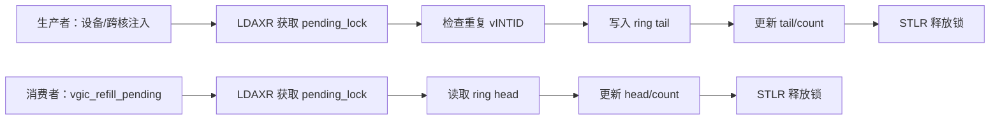
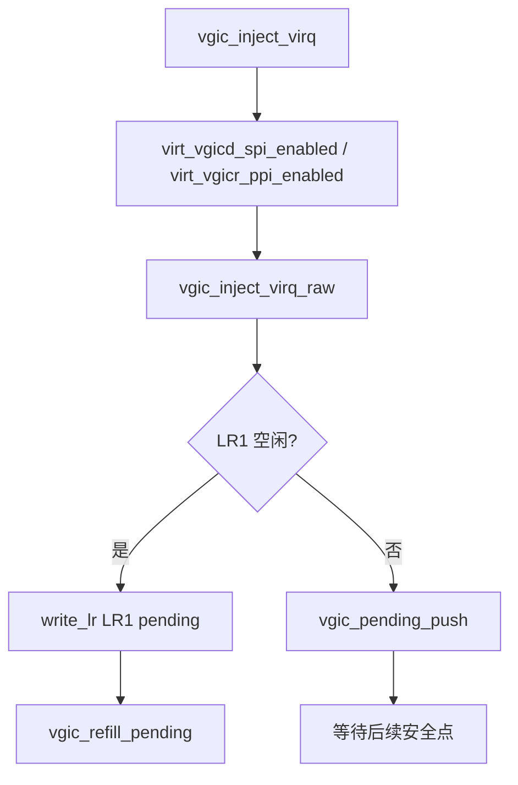
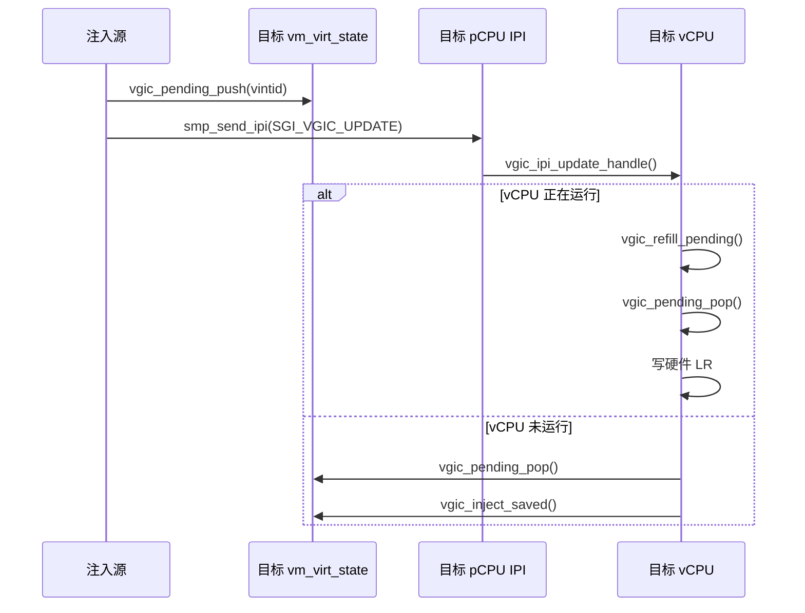
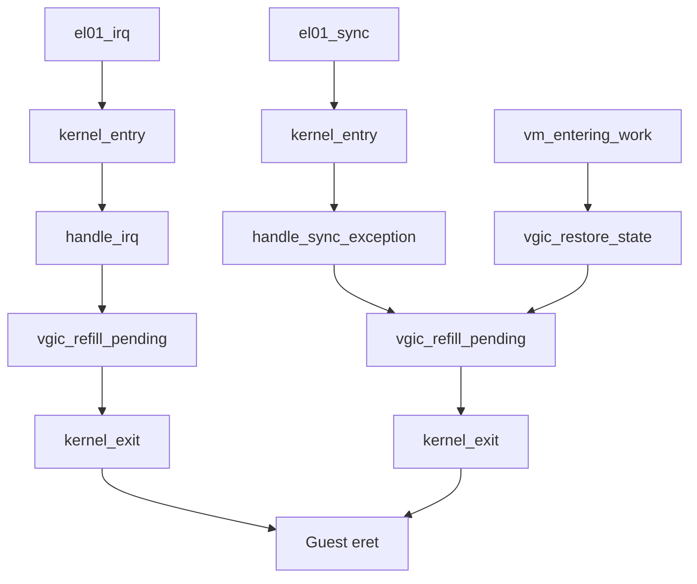

# aVisor Hypervisor Phase 103 详细设计文档：vGIC LR 溢出队列与延迟重填

> 版本：Phase 103
> 平台：QEMU virt（ARMv8-A、EL2、GICv3）
> 前置阶段：Phase 102 timer 负载采样与自动均衡请求
> 主题：vGIC 软件注入中断的 LR 溢出排队、跨核投递与安全点重填

## 1. 项目概述

### 1.1 背景

当前 vGIC 软件注入路径使用硬件 List Register（LR）承载虚拟中断。LR 数量有限，而 virtio、ivshmem、vITS、vSGI 和 GIC 测试可能在同一时间产生多个 pending vIRQ。若所有 LR 都被占用，直接返回失败会丢失本应保留的虚拟中断。

Phase 103 在每个 vCPU 的虚拟化状态中增加软件 pending ring。无法立即装入 LR 的 vIRQ 进入 ring，并在当前 vCPU 的安全执行点重新填入空闲 LR。该设计不在物理 IRQ handler 中直接执行 Guest 上下文切换，也不依赖当前 QEMU 版本未验证的 vGIC maintenance PPI 编号。

### 1.2 设计目标

- 为每个 vCPU 提供容量为 32 的 pending vIRQ ring；
- 对同一 vINTID 的重复 pending 请求进行合并；
- LR 全忙时保留中断，不直接丢弃；
- 支持当前 vCPU、同核非当前 vCPU 和跨 pCPU vCPU 三种注入路径；
- 使用 acquire/release 自旋锁保护跨核 ring；
- 在 IRQ 返回、同步异常返回、vCPU restore 和跨核 IPI 路径补填空闲 LR；
- 保持 LR0/LR2 的既有 vTimer、PCI INTx HW+EOI 用途，只使用软件 LR 范围；
- 通过 Guest 突发注入 4 个不同 SPI 验证 LR 溢出后仍全部送达。

### 1.3 非目标

- 不修改 GICD/GICR 的完整优先级仲裁模型；
- 不新增物理设备 IRQ affinity；
- 不在 maintenance IRQ handler 中直接进行世界切换；
- 不把不存在或未在 QEMU 回归中确认的 maintenance PPI 行为写成已验证功能；
- 不改变 Phase 101 的 vCPU 迁移协议和 Phase 102 的负载均衡协议。

## 2. 架构设计

### 2.1 分层结构

```mermaid
flowchart TD
    A[设备或 Guest 产生 vIRQ] --> B{目标 vCPU 状态}
    B -->|当前运行| C[vgic_inject_virq_raw]
    B -->|同核但未运行| D[vgic_inject_saved]
    B -->|跨 pCPU| E[vgic_pending_push + SGI_VGIC_UPDATE]
    C --> F{软件 LR 是否空闲}
    F -->|是| G[写入 LR1]
    F -->|否| H[写入 pending ring]
    D --> I{saved LR1 是否空闲}
    I -->|是| J[写入 saved gic_lr[1]]
    I -->|否| H
    E --> H
    H --> K[vgic_refill_pending 安全点]
    K --> L{软件 LR 空闲}
    L -->|是| M[vgic_pending_pop]
    M --> N[写入 LR]
    L -->|否| O[等待下一安全点]
```

### 2.2 pending ring 数据结构

`struct vm_virt_state` 增加：

```c
volatile unsigned int vgic_pending_lock;
unsigned int vgic_pending_head;
unsigned int vgic_pending_tail;
unsigned int vgic_pending_count;
unsigned int vgic_pending[32];
```

ring 使用固定容量和 head/tail/count 三元组：

- `head` 指向下一个待取出的 vINTID；
- `tail` 指向下一个写入位置；
- `count` 表示当前 pending 数量；
- `lock` 保护整个 ring 的一致性；
- 插入时扫描现有元素，重复 vINTID 不重复入队；
- 满队列返回 `-1`，由调用方报告注入失败。

### 2.3 LR 分配边界

当前平台的 LR 约定如下：

| LR | 用途 |
|---|---|
| LR0 | vTimer 硬件映射 |
| LR1 | 软件注入 vIRQ |
| LR2 | PCI INTx HW+EOI |

因此 `vgic_refill_pending()` 只扫描 `1 <= i < NR_VGIC_LRS - 1` 的软件 LR 范围，避免覆盖 LR0 和 LR2 的硬件语义。

### 2.4 安全点重填

本阶段重填点为：

1. 软件注入函数返回前；
2. 跨核 `SGI_VGIC_UPDATE` 处理期间；
3. vCPU 进入 Guest 前的 `vgic_restore_state()` 后；
4. Guest IRQ 异常处理完成后的 EL2 返回路径；
5. Guest 同步异常/HVC 处理完成后的 EL2 返回路径。

这种方式利用 Guest 已经完成一次异常返回或调度切换的时刻，避免在任意物理 IRQ 中间直接修改 Guest 上下文。

## 3. 并发与内存序

### 3.1 ring 锁

`vgic_pending_lock()` 使用 AArch64 `LDAXR/STXR` 获取锁，`vgic_pending_unlock()` 使用 `STLR` 释放锁：



生产者写入 ring 后，再通过 `dmb ish` 和 `SGI_VGIC_UPDATE` 通知目标 pCPU。目标核读取到 ring 内容后，才执行 saved LR 或硬件 LR 更新。

### 3.2 重复中断合并

同一 vINTID 已经存在于 LR pending 状态，或已经存在于 ring 时，新的边沿请求不再追加副本。这与本项目当前软件注入语义一致，避免 ring 被同一事件快速填满。

## 4. 函数调用关系

### 4.1 当前 vCPU 注入与溢出路径



### 4.2 跨 vCPU / 跨 pCPU 路径



### 4.3 异常返回重填路径



## 5. 代码实现映射

| 文件 | 实现内容 |
|---|---|
| [include/common/sched.h](../include/common/sched.h) | `vm_virt_state` pending ring 字段及迁移快照字段 |
| [hypervisor/boards/virt/vgic.c](../hypervisor/boards/virt/vgic.c) | ring 锁、push/pop、LR 溢出排队、LR 重填、跨核处理 |
| [include/boards/virt/vgic.h](../include/boards/virt/vgic.h) | `vgic_refill_pending()` 接口 |
| [hypervisor/arch/aarch64/entry.S](../hypervisor/arch/aarch64/entry.S) | IRQ 和同步异常返回前的重填调用 |
| [hypervisor/boards/virt/virt_board.c](../hypervisor/boards/virt/virt_board.c) | vCPU 进入 Guest 前恢复并重填 LR |
| [guests/el1_test/main.c](../guests/el1_test/main.c) | 4 个不同 SPI 的 LR overflow 队列测试 |

## 6. 迁移快照兼容

pending ring 属于 vCPU 的虚拟中断状态。`freeze_context` 增加 ring 的 head、tail、count 和 32 项内容，使冻结/恢复或 Live Migration 不会丢失尚未装入 LR 的 vIRQ。现有迁移代码继续复制 `vm_virt_state`，因此 ring 与 GIC LR 一起进入目标 vCPU 的虚拟化状态。

## 7. 错误处理

- ring 满时返回 `-1`，调用方保留原有失败语义；
- 当前 task 为空或 idle 时不执行硬件重填；
- saved LR 仍被占用时，vIRQ 保留在 ring；
- 目标 vCPU 已为 `TASK_ZOMBIE` 时拒绝注入；
- 跨核通知只负责唤醒目标核，实际 LR 写入仍在目标核执行；
- LR0/LR2 被占用不会被软件 ring 重填覆盖。

## 8. 验证过程和结果

### 8.1 构建

```text
make -f Makefile.virt -j$(nproc)
结果：PASS
镜像：bin_virt/kernel8.img
最终镜像大小：243704 bytes
```

构建保留了基线 Guest/MM warning，但无新增编译错误、汇编错误或链接错误。

### 8.2 QEMU 回归

```text
timeout 45 make -f Makefile.virt run-log \
  QEMU_SERIAL_LOG=/tmp/avisor-phase103-final.log
结果：返回 124，QEMU 被 timeout 正常终止。
```

关键结果：

```text
[vm1] gicd: LR overflow queue delivered all 4 interrupts PASSED
[vm2] gicd: LR overflow queue delivered all 4 interrupts PASSED
[vm1] sched: vCPU migration CPU0->CPU1->CPU0 PASSED
[vm1] vITS: PASSED! Received vSPI 72 (vLPI 8200)
[vm1] virtio-net: ALL loopback tests PASSED!
[vm2] virtio-net: ALL loopback tests PASSED!
[vm1] ivshmem: ping-pong test PASSED
[vm2] ivshmem: ping-pong test PASSED
[vm3] PASSED: 双 vCPU Live Migration 成功（VM2 -> VM3）
```

没有发现 `PANIC`、`ASSERT` 或 Phase 103 的失败标记。QEMU 使用 timeout 终止属于预期行为。

## 9. 限制与后续

- 当前 ring 容量固定为 32；
- 当前平台仅使用一个软件 LR，因此突发中断主要依赖安全点逐个重填；
- 重填由异常返回和调度边界驱动，而不是依赖未验证的 maintenance PPI；
- 后续可以在确认 QEMU/GICv3 maintenance 位定义后增加硬件维护中断优化，但必须保持软件安全点作为兜底路径。
