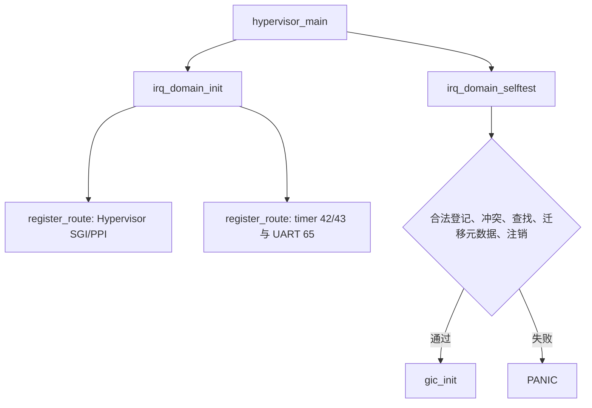
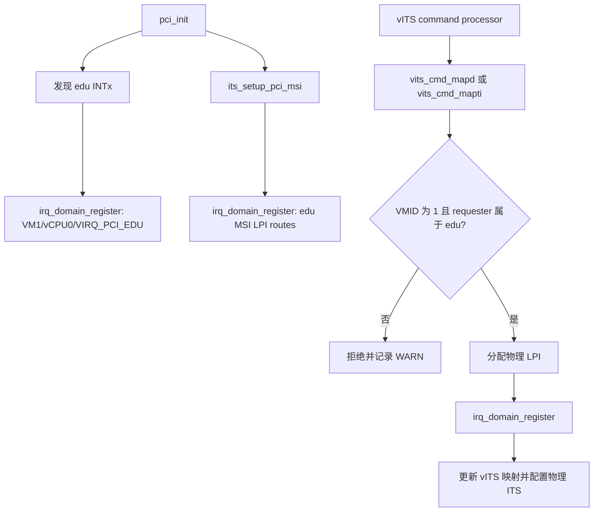
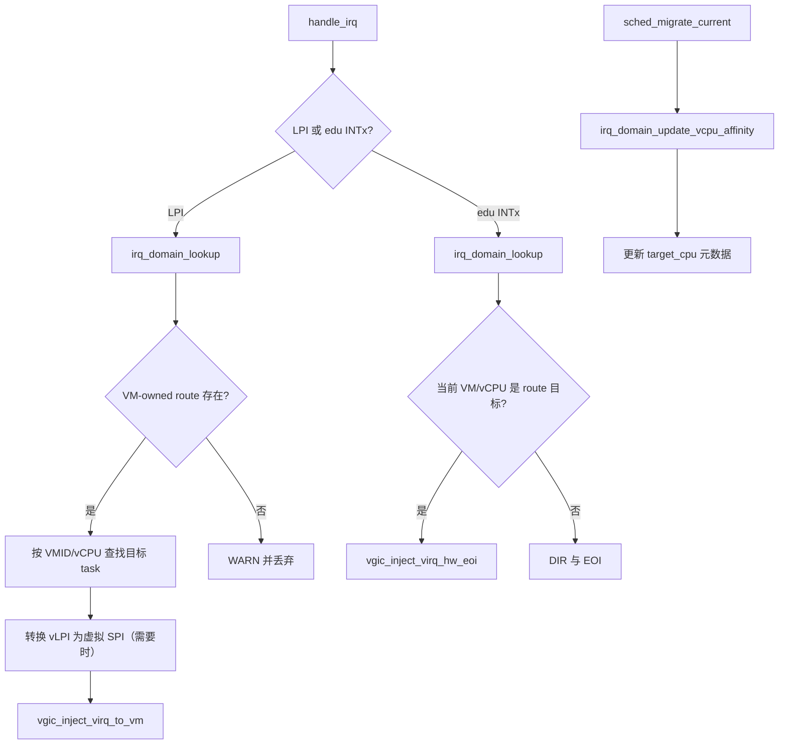

# aVisor Hypervisor Phase 104 详细设计文档：IRQ ownership 与路由域

> 版本：Phase 104
> 平台：QEMU virt（AArch64、EL2、GICv3）
> 主题：物理中断独占 ownership、设备 requester 校验与 VM 路由

## 1. 概述

Phase 104 建立统一的物理 IRQ ownership/routing domain。每条登记包含物理 INTID、VMID、目标 vCPU、虚拟 INTID、目标 CPU 元数据、owner 和启用状态。Hypervisor 保留的中断在启动时预先登记；VM 设备中断必须经登记后才能由物理中断处理路径注入。物理 INTID 是唯一键，不同 owner 或 VM 不能重复登记、抢占该 INTID。

本阶段覆盖当前 QEMU virt PCI edu 直通设备和 VM1/vCPU0，不提供通用 PCI 多设备分配器。vITS MAPD/MAPTI 在接受请求前校验 VM 与 requester ID；非设备所有者请求被拒绝。

## 2. 目标与边界

- 以固定容量 route 表统一管理物理 IRQ ownership 和路由信息。
- 启动时登记 Hypervisor 的 SGI、PPI、物理 timer IRQ 与 UART IRQ，避免 VM 取得保留中断。
- PCI edu INTx、MSI LPI 和 vITS 分配的物理 LPI 均通过 domain 登记。
- 物理 LPI 分发必须查询 domain；无有效 VM route 时丢弃并结束物理中断，不再回退到硬编码 VM1 路由。
- 在 Guest 中验证未授权 requester 被拒绝，合法 requester 仍能完成 vITS LPI 投递。
- 调度迁移仅更新 route 中的 `target_cpu` 软件元数据。本阶段不修改 GICD IROUTER，也不实现 MSI LPI 的物理 affinity 迁移。
- 未将 QEMU maintenance PPI 注册或行为列为已实现能力。

## 3. 数据模型与并发

`struct irq_route` 保存 `pintid`、`vmid`、`vcpu_id`、`vintid`、`target_cpu`、`owner` 和 `enabled`。表容量为 64；VM route 的 owner 为 `IRQ_DOMAIN_OWNER_VM`，Hypervisor 保留 route 使用 `IRQ_DOMAIN_OWNER_HYP`。

注册接口验证 VMID、vCPU 和物理/虚拟 INTID 范围。SPI 范围为 32..1019，LPI 范围为 8192..16383；vLPI 必须保留其原始 INTID，以供后续映射为虚拟 SPI。相同 pINTID 仅允许同 owner、同 VM 的更新；跨 owner 或 VM 冲突返回错误。

route 表由短临界区保护：获取锁前保存 DAIF 并屏蔽 IRQ，使用 `LDAXR`/`STXR` 获取自旋锁，释放时以 `STLR` 释放并恢复原 DAIF。查找返回 route 结构副本，避免调用方持锁访问表项。

## 4. 架构与调用关系

### 4.1 启动隔离



自测在 GIC 初始化前运行，覆盖合法 LPI route、跨 VM 冲突、Hypervisor IRQ 冲突、非法 vCPU、lookup、目标 CPU 元数据更新及注销。

### 4.2 PCI 与 vITS ownership



Requester ID 按 PCI 编码 `(bus << 8) | (device << 3) | function` 计算。当前 edu 测试设备 requester ID 为 16；负向用例使用 17。物理 LPI 登记失败时不继续写 vITS 映射。

### 4.3 物理中断分发与迁移元数据



LPI 注入目标来自 route 的 VMID/vCPU/vINTID。vLPI 8200 在当前 vGIC 路径中转换为 vSPI 72。INTx 仍依赖当前上下文匹配目标 VM/vCPU；本阶段不增加远程物理中断转发机制。

## 5. 代码映射

| 文件 | 变更 |
|---|---|
| `include/boards/virt/irq_domain.h`、`hypervisor/boards/virt/irq_domain.c` | route 数据结构、独占注册/查询/注销、VM 批量注销、迁移元数据更新、启动自测 |
| `hypervisor/boards/virt/main_virt.c` | GIC 初始化前初始化 domain 并运行隔离自测 |
| `hypervisor/boards/virt/pci.c`、`include/boards/virt/pci.h` | edu requester ID 判定；登记 INTx 与 MSI LPI |
| `hypervisor/boards/virt/vits.c` | MAPD/MAPTI requester 与 VM ownership 校验；登记物理 LPI；通过 domain 查询映射 |
| `hypervisor/boards/virt/irq.c` | 按 route 分发 LPI/INTx，移除无 route 的硬编码 LPI fallback |
| `hypervisor/common/sched.c` | vCPU 迁移时更新软件 `target_cpu` 元数据 |
| `guests/el1_test/main.c` | 增加 requester 17 的非法 MAPD/MAPTI 负向用例 |

## 6. 验证

构建命令：

```sh
make -f Makefile.virt -j$(nproc)
```

结果：PASS；kernel 镜像大小 248464 bytes。

QEMU 回归命令：

```sh
timeout 45 make -f Makefile.virt run-log \\
  QEMU_SERIAL_LOG=/tmp/avisor-phase104-final.log
```

QEMU 以退出码 124 被 timeout 终止，符合该持续运行 guest 测试的预期。最终串口日志大小 116796 bytes，关键结果：

```text
IRQ domain: ownership/routing isolation selftest PASSED
[vm1] virtio-net: ALL loopback tests PASSED!
[vm2] virtio-net: ALL loopback tests PASSED!
[vm2] ivshmem: ping-pong test PASSED
[vm1] ivshmem: ping-pong test PASSED
WARN[1]: vITS: MAPD rejected for unowned requester 17
WARN[1]: vITS: MAPTI rejected for unowned requester 17
[vm1] vITS: PASSED! Received vSPI 72 (vLPI 8200)
[vm1] sched: vCPU migration CPU0->CPU1->CPU0 PASSED
[vm2] gicd: LR overflow queue delivered all 4 interrupts PASSED
[vm1] gicd: LR overflow queue delivered all 4 interrupts PASSED
[vm3] PASSED: 双 vCPU Live Migration 成功（VM2 -> VM3）
```

最终日志未发现 `PANIC`、`ASSERT`、`FAILED`、`SOME tests FAILED`、`Unknown IRQ` 或 `no ownership route` 丢弃标记。日志记录和逐项结果见 `docs/phase-logs/phase104.log`。

## 7. 限制

- 所有 route 共用 64 项静态表；edu MSI route 最多登记 16 个向量。
- PCI requester/VM ownership 当前仅覆盖 VM1 上的 edu 设备，不能推导为通用多设备隔离实现。
- vITS 仍维护内部 `lpi_map` 状态；物理 LPI 的 ownership 与 IRQ 分发查询以 IRQ domain 为权威来源。
- 迁移更新 `target_cpu` 软件元数据，不改变设备 IRQ 的 GICD IROUTER，也未实现 MSI LPI affinity 迁移。
- edu INTx 的注入仅在目标 VM/vCPU 当前执行时进行；本阶段未实现远端转发。
- 未登记或验证 maintenance PPI；domain 启动保留项为 SGI、PPI、timer INTID 42/43 和 UART INTID 65。
