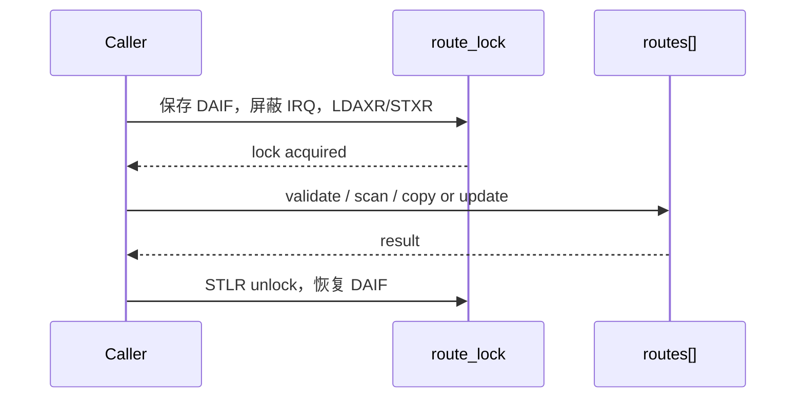
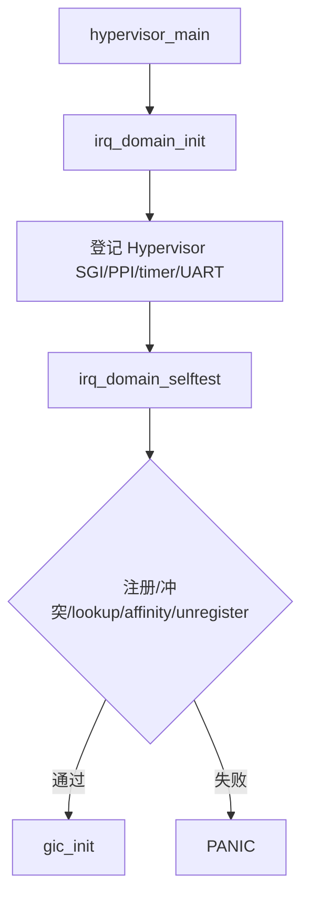
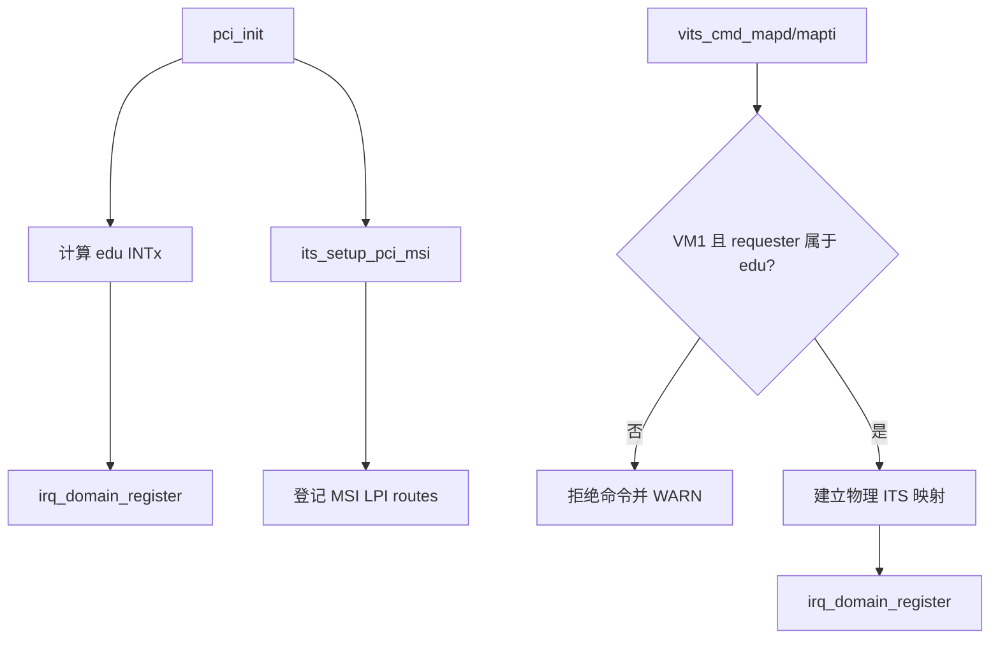
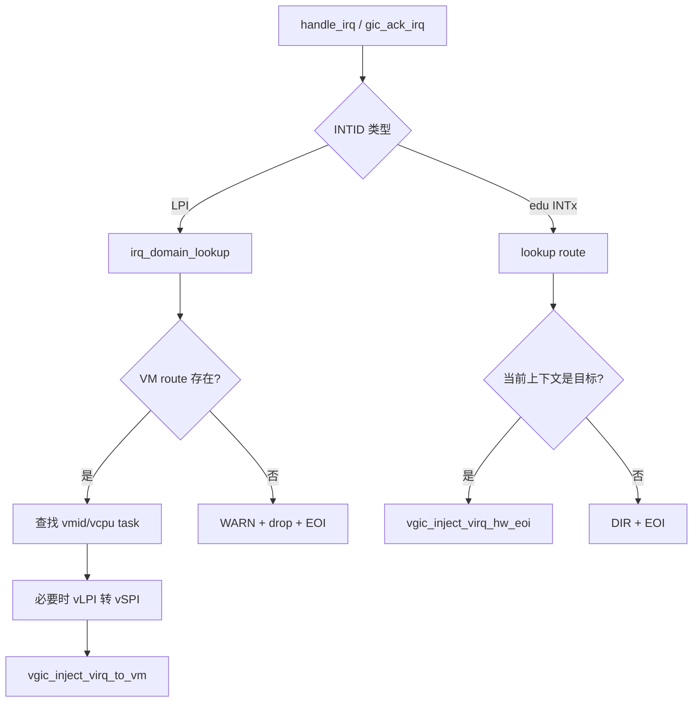
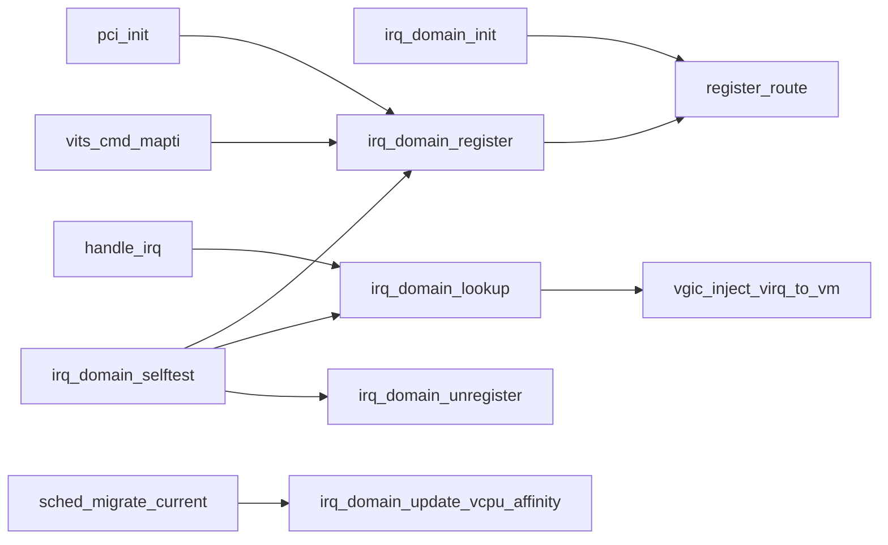

# aVisor Phase 104 详细设计：IRQ Ownership 与路由域

> 平台：QEMU virt / AArch64 EL2 / GICv3 / ITS
> 前置阶段：Phase 103 vGIC LR 溢出队列
> 本阶段边界：建立物理 IRQ 所有权与软件路由权威源，不实现完整物理 affinity 迁移

## 1. 背景与目标

此前 PCI INTx、MSI LPI 和 vITS LPI 的目标 VM 分散在调用点或隐式常量中，无法统一拒绝重复分配和越权 requester。Phase 104 引入固定容量 IRQ domain，以物理 INTID 为唯一键，统一描述 Hypervisor 保留中断和 VM-owned 中断。

目标：

1. 物理 INTID 只能属于一个 owner；跨 owner、跨 VM 重复登记必须失败。
2. LPI/INTx 分发只信任 route，不再使用无 ownership 的硬编码 fallback。
3. vITS MAPD/MAPTI 在创建映射前验证 requester ownership。
4. vCPU 迁移更新 route 的 `target_cpu` 软件元数据。
5. 启动自测覆盖注册、冲突、查询、更新和注销。

## 2. 总体架构

```mermaid
flowchart LR
    Boot[main_virt 启动] --> Domain[IRQ Domain]
    PCI[PCI INTx/MSI 初始化] --> Domain
    VITS[vITS MAPD/MAPTI] --> Owner[Requester ownership]
    Owner --> Domain
    IRQ[物理 IRQ handler] --> Domain
    Domain --> VGIC[vGIC 注入]
    Sched[vCPU migration] --> Domain

    Domain --- Table[(irq_route[64])]
    PCI --> ITS[物理 ITS]
    ITS --> IRQ
```

IRQ domain 是软件 ownership 和投递目标的权威源；物理 GIC/ITS 仍负责中断产生和翻译，vGIC 负责向目标 vCPU 注入。

## 3. 数据结构与不变量

`struct irq_route` 字段如下：

| 字段 | 语义 |
|---|---|
| `pintid` | 物理 SPI/LPI INTID，route 唯一键 |
| `vintid` | Guest 可见虚拟 INTID；vLPI 可保留 8192 以上编号 |
| `vmid` / `vcpu_id` | 目标虚拟机与 vCPU |
| `target_cpu` | 当前目标 pCPU 软件元数据 |
| `owner` | `IRQ_DOMAIN_OWNER_HYP` 或 `IRQ_DOMAIN_OWNER_VM` |
| `enabled` | 表项有效位 |

核心不变量：

- VMID、vCPU、物理/虚拟 INTID 必须在有效范围内。
- SPI 范围为 32–1019，LPI 范围为 8192–16383。
- 同一 `pintid` 仅允许同 owner、同 VM 更新；其他冲突返回失败。
- `irq_domain_unregister()` 只能删除 VM-owned route，不能撤销 Hypervisor 保留项。
- lookup 返回结构副本，不把表内指针暴露到锁外。

## 4. 并发设计

route 表由短临界区自旋锁保护。`domain_lock()` 保存 DAIF、屏蔽 IRQ，并使用 `LDAXR/STXR` 获取锁；`domain_unlock()` 用 `STLR` 释放并恢复 DAIF。锁内只做表扫描和结构复制，不执行 GIC MMIO 或 vGIC 注入。



## 5. 关键流程

### 5.1 启动与隔离自测



### 5.2 PCI/vITS ownership 建立



Requester ID 使用 `(bus << 8) | (device << 3) | function`。当前 ownership policy 只授权 VM1 的 edu function。

### 5.3 物理 IRQ 分发



## 6. 函数调用关系



## 7. 接口与代码映射

| 文件 | 主要职责 |
|---|---|
| `include/boards/virt/irq_domain.h` | route 模型与公共 API |
| `hypervisor/boards/virt/irq_domain.c` | 表管理、并发保护、自测 |
| `hypervisor/boards/virt/main_virt.c` | GIC 初始化前建立 domain |
| `hypervisor/boards/virt/pci.c` | edu INTx/MSI ownership 登记 |
| `hypervisor/boards/virt/vits.c` | requester 校验与 LPI route 建立 |
| `hypervisor/boards/virt/irq.c` | route 驱动的 LPI/INTx 分发 |
| `hypervisor/common/sched.c` | 迁移时更新目标 CPU 元数据 |
| `guests/el1_test/main.c` | 非 owner requester 负向测试 |

## 8. 错误处理与安全属性

- 表满、参数越界和 ownership 冲突均返回 `-1`。
- 未登记 LPI 被明确丢弃并 EOI，不回退到 VM1。
- MAPD/MAPTI requester 校验失败时不分配物理 LPI，不修改 route。
- Hypervisor 保留 INTID 不能通过 VM unregister 接口删除。

## 9. 验证

- `make -f Makefile.virt -j$(nproc)`：PASS，镜像 248464 bytes。
- QEMU：`timeout 45 make -f Makefile.virt run-log QEMU_SERIAL_LOG=/tmp/avisor-phase104-final.log`，由 timeout 结束。
- 观察到 domain selftest PASS；requester 17 的 MAPD/MAPTI 被拒绝；合法 requester 完成 vLPI 8200 → vSPI 72 投递；迁移、LR overflow、virtio-net、ivshmem 和 VM2→VM3 migration 相关标记通过。
- 日志未发现 PANIC、ASSERT、FAILED、Unknown IRQ 或 no-ownership drop。

## 10. 限制

- route 表固定 64 项。
- ownership policy 只覆盖 VM1 edu，不是通用 PCI 分配器。
- 本阶段 `target_cpu` 只是软件元数据；SPI IROUTER 同步由 Phase 105 增加，LPI collection affinity 仍未迁移。
- INTx 仅在目标 VM/vCPU 当前运行时注入，不提供远程 INTx 转发。
