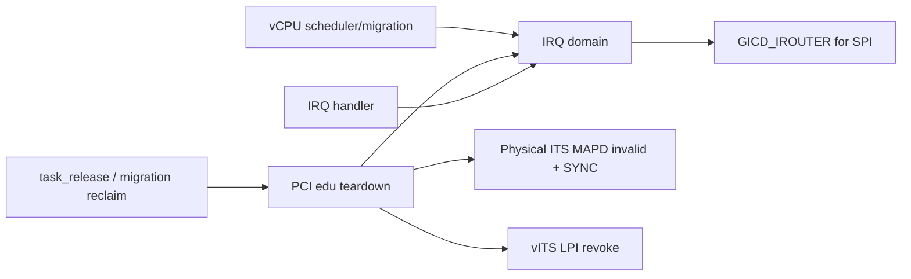
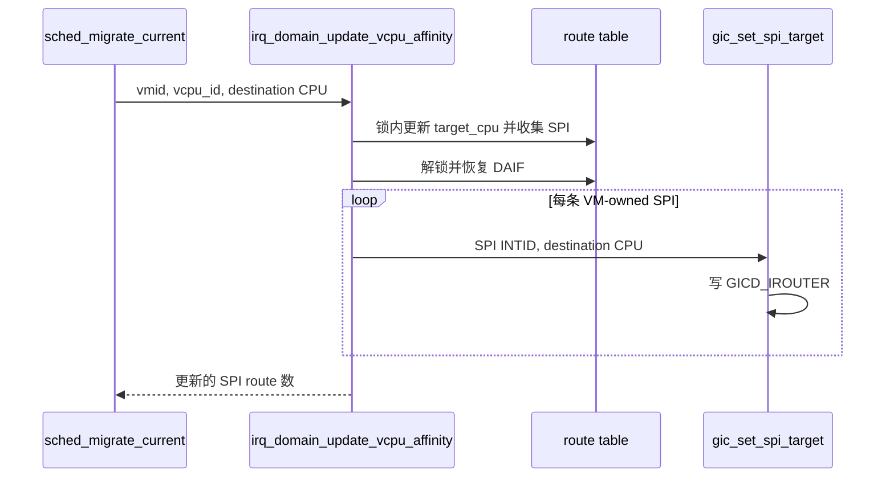
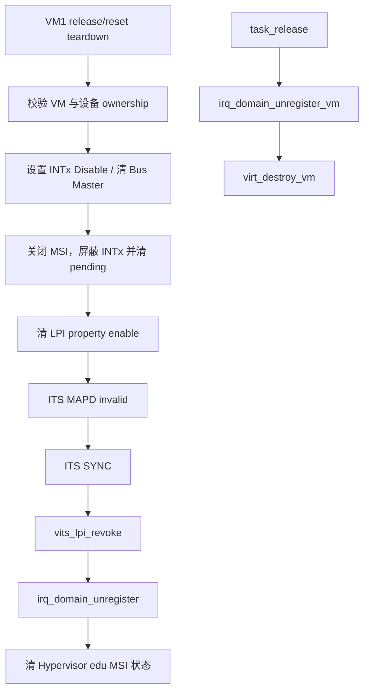
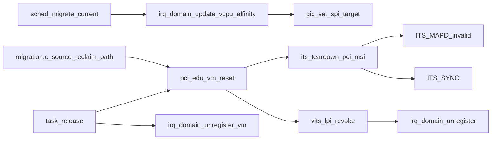

# aVisor Phase 105 详细设计：IRQ 迁移与设备资源释放

> 平台：QEMU virt / AArch64 EL2 / GICv3 / ITS
> 前置阶段：Phase 104 IRQ ownership domain
> 范围：SPI 路由同步、edu IRQ teardown、VM 生命周期集成；不等于通用热拔除

## 1. 设计目标与边界

Phase 104 已将物理 INTID ownership 集中管理，但 route 更新和资源销毁仍需同步硬件状态。本阶段将 VM-owned SPI 的 affinity 元数据更新落实到 GICD_IROUTER，并为 edu MSI/INTx 路径提供 teardown，避免 VM 销毁后旧 LPI route 留存。

本阶段不执行 PCI function reset，不等待通用 DMA quiescence，不将设备重新分配给其他 VM。`pci_edu_vm_reset()` 是历史命名的 teardown API；Phase 106 的 function reset 是另一条路径。

## 2. 架构分层

- IRQ domain 管理 ownership 与目标 vCPU/pCPU 元数据。
- SPI 硬件目标由 GICD_IROUTER 表示；LPI 走 ITS/Redistributor collection 路径。
- teardown 顺序是先关闭设备中断源，再移除物理 ITS/vITS/IRQ 软件映射。

## 3. SPI affinity 更新

`irq_domain_update_vcpu_affinity(vmid, vcpu_id, target_cpu)` 在锁内更新匹配 route，并收集 VM-owned SPI INTID；释放锁后逐个调用 `gic_set_spi_target()`。不在 domain 锁内访问 GIC MMIO。

LPI 不写 GICD_IROUTER；本阶段不改变 ITS collection 或 Redistributor LPI affinity。

## 4. edu teardown 事务

顺序约束：必须先阻止设备产生新 MSI，再等待 ITS 命令同步完成，最后撤销软件 route。该接口只处理当前 QEMU edu 的寄存器和 MSI 配置，不宣称完成设备内部 reset 或 DMA quiescence。

## 5. 生命周期接入

- `task_release()` 在 virt vCPU0 路径中，对 VM1 调 `pci_edu_vm_reset()`，然后注销该 VM 的剩余 IRQ routes，最后销毁虚拟设备状态。
- Live Migration source reclaim 对 VM1 同样释放 edu；其他 VM 不拥有此物理设备。
- 由于回归迁移源为 VM2，本阶段提供的 migration 日志不能作为 VM1 edu teardown 的运行时证明。

## 6. 函数与模块调用图

## 7. 文件职责

| 文件 | 职责 |
|---|---|
| `hypervisor/boards/virt/irq_domain.c` | route affinity 更新及 SPI 列表收集 |
| `hypervisor/boards/virt/gicv3.c` | 更新 SPI 物理目标 |
| `hypervisor/boards/virt/its.c` | 清 LPI enable，提交 MAPD invalid 与 SYNC |
| `hypervisor/boards/virt/vits.c` | 清理 vITS map 并注销物理 route |
| `hypervisor/boards/virt/pci.c` | 禁止 edu 中断源及 teardown 状态 |
| `hypervisor/arch/aarch64/task.c` | VM 任务销毁时调用设备/route 清理 |
| `hypervisor/common/migration.c` | source VM 回收前按 owner 清理 |
| `hypervisor/common/sched.c` | 调用 affinity 更新并处理错误 |

## 8. 失败语义与验证

- 无效 CPU 返回失败；有效迁移但无 SPI route 时仍可更新 LPI route 元数据，返回 0 个 SPI。
- teardown 中物理 ITS 命令通过同步队列完成后才撤销 route。
- `make -f Makefile.virt -j$(nproc)`：PASS，镜像 248648 bytes。
- QEMU `timeout 45 make -f Makefile.virt run-log QEMU_SERIAL_LOG=/tmp/avisor-phase105-final3.log`：按持续运行设计由 timeout 结束。IRQ selftest、vITS MSI、调度迁移、LR overflow 和 VM2→VM3 reclaim 标记通过；无 PANIC/ASSERT/FAILED/Unknown IRQ/no ownership route。
- VM1 edu teardown 未由该 VM2→VM3 migration 路径触发，需与已验证项区分。

## 9. 未实现/未验证

- 设备内部 reset、bus mastering DMA 停止确认与 SMMU 隔离。
- LPI collection/Redistributor affinity 迁移。
- VM1 销毁后 edu 重新分配及重新启动。
- 多设备通用 teardown、热拔除和 PCI resource 释放。
