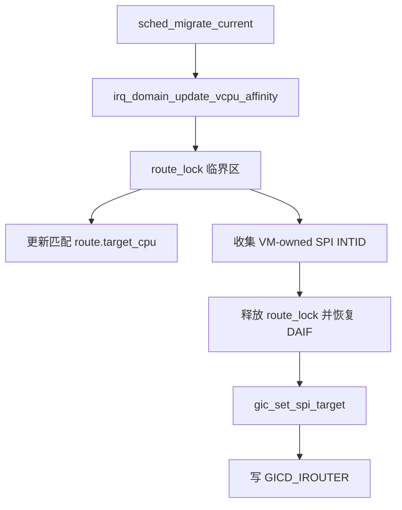
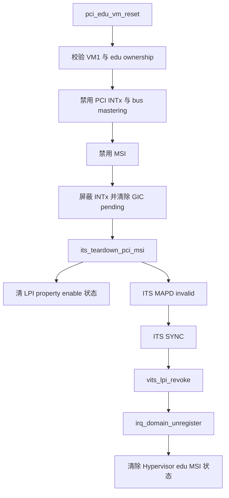
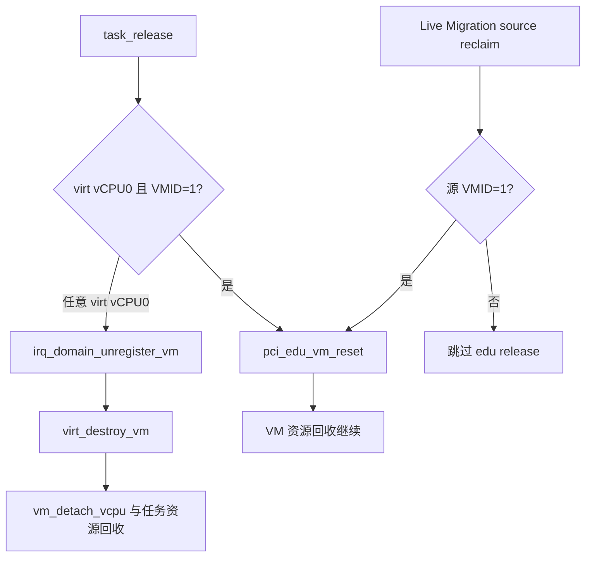

# aVisor Hypervisor Phase 105 详细设计文档：IRQ 迁移与设备释放

> 版本：Phase 105
> 平台：QEMU virt（AArch64、EL2、GICv3、ITS）
> 主题：SPI affinity 迁移同步、edu 设备中断释放、ITS teardown 与 vITS route revoke

## 1. 概述

Phase 105 在 Phase 104 IRQ ownership/routing domain 上补齐部分生命周期操作。vCPU 迁移时，IRQ domain 更新 route 的目标 CPU，并对 VM-owned SPI 更新 GICD_IROUTER。edu 设备 IRQ 释放时禁用 INTx/MSI 与 bus mastering，清理 INTx pending，再撤销物理 LPI route 并向 ITS 发出 MAPD invalid 与 SYNC。vITS route 可按物理 LPI 撤销。VM 销毁与 Live Migration 源 VM 清理路径接入 IRQ 资源释放。设备内部 reset、DMA quiescence 和完整设备回收不在本阶段实现。

本阶段的设备模型范围是当前 QEMU edu 设备及现有 VM1/vCPU0 ownership，不构成通用 PCI FLR、多设备分配器或完整的 PCI 热拔除实现。

## 2. 架构与调用关系

### 2.1 vCPU 迁移时同步 SPI 路由



route 表锁在调用 GIC 配置前释放，避免在 IRQ domain 临界区内执行 MMIO 路由更新。LPI 不走此 SPI IROUTER 路径；当前阶段不改变 ITS collection 或 Redistributor LPI affinity。

### 2.2 edu 设备中断释放



### 2.3 VM 生命周期接入



## 3. 实现要点与限制

- `irq_domain_update_vcpu_affinity()` 更新匹配 route 的 `target_cpu`，并只对 SPI INTID 调用 `gic_set_spi_target()`。返回值是更新的 SPI 路由数；仅含 LPI 的 route 可以更新元数据并返回 0。
- `its_teardown_pci_msi()` 清除对应 LPI property 的 enable 状态，执行屏障后提交 MAPD invalid 和 SYNC。ITS command 接口为同步提交，因此返回后可继续撤销软件 route。
- `vits_lpi_revoke()` 清除 vITS 内部 `lpi_map` 项（如果该 LPI 位于映射范围内），并调用 `irq_domain_unregister()`。非 VM-owned route 不能被该接口移除。
- `pci_edu_vm_reset()` 禁止 bus mastering、INTx 和 MSI，清理 INTx pending 与 MSI routes，并清除 Hypervisor 侧 edu MSI 状态。该函数名称沿用当前代码，但不触发 PCI function reset，也不等待正在进行的 DMA 完成。
- task 销毁与 Live Migration 源回收仅对 VM1 调用 edu IRQ 资源释放；其他 VM 只执行其 IRQ route 和虚拟设备资源清理。
- 该运行中的 Live Migration 回归源 VM 为 VM2，因此没有实际执行 VM1 edu IRQ teardown。设备 IRQ teardown 的端到端运行验证、设备内部 reset、设备复用和 DMA quiescence 均是后续覆盖缺口。
- LPI collection/Redistributor affinity 迁移、PCI INTx 远程投递、通用 PCI FLR 与 VM1 teardown 后重新分配设备均不在本阶段已验证能力内。

## 4. 代码映射

| 文件 | Phase 105 变更 |
|---|---|
| `hypervisor/boards/virt/irq_domain.c` | 更新 route CPU 后对 SPI 调用 `gic_set_spi_target()` |
| `hypervisor/boards/virt/its.c`、`include/boards/virt/its.h` | 增加 PCI MSI teardown：property disable、MAPD invalid、SYNC |
| `hypervisor/boards/virt/vits.c`、`include/boards/virt/vits.h` | 增加单个物理 LPI route revoke |
| `hypervisor/boards/virt/pci.c`、`include/boards/virt/pci.h` | 增加 edu VM release/reset 与中断清理 |
| `hypervisor/arch/aarch64/task.c` | 在 virt vCPU0 任务销毁时清理 VM routes、VM1 edu 和 VM 虚拟设备 |
| `hypervisor/common/migration.c` | Live Migration 源 VM 回收前按 owner 清理 edu |
| `hypervisor/common/sched.c` | 迁移 affinity 更新失败时记录 WARN |

## 5. 验证

构建命令：

```sh
make -f Makefile.virt -j$(nproc)
```

结果：PASS；kernel 镜像大小 248648 bytes。

QEMU 回归命令：

```sh
timeout 45 make -f Makefile.virt run-log QEMU_SERIAL_LOG=/tmp/avisor-phase105-final3.log
```

QEMU 由 timeout 以退出码 124 终止；最终串口日志大小 113506 bytes。观察到：

```text
IRQ domain: ownership/routing isolation selftest PASSED
[vm1] vITS: PASSED! Received vSPI 72 (vLPI 8200)
[vm1] sched: vCPU migration CPU0->CPU1->CPU0 PASSED
[vm2] gicd: LR overflow queue delivered all 4 interrupts PASSED
[vm1] gicd: LR overflow queue delivered all 4 interrupts PASSED
INFO[2]: migration: source VM reclaimed (pages=22 shm=0 ksm=247 done=1)
[vm3] PASSED: 双 vCPU Live Migration 成功（VM2 -> VM3）
```

最终日志未发现 `PANIC`、`ASSERT`、`FAILED`、`Unknown IRQ` 或 `no ownership route`。Live Migration 覆盖的是 VM2→VM3，故不覆盖 VM1 edu teardown。
