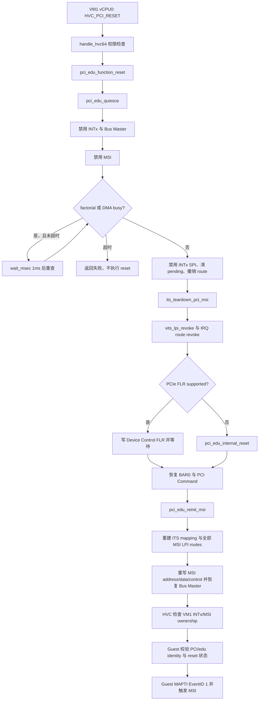
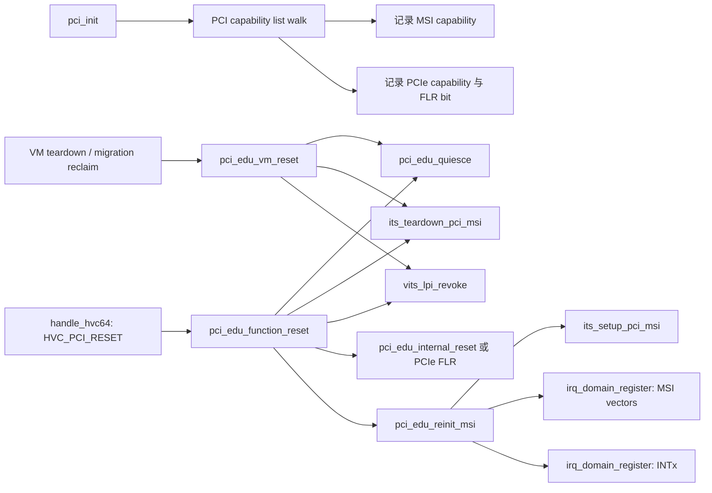

# aVisor Hypervisor Phase 106 详细设计文档：PCIe FLR 与 edu 设备复位

> 版本：Phase 106
> 平台：QEMU virt（AArch64、EL2、GICv3、ITS）
> 主题：PCIe FLR 探测、edu quiescence、设备复位与 MSI/IRQ 恢复

## 1. 概述

Phase 106 为 VM1 透传的 QEMU edu 增加设备功能级复位路径。启动枚举 PCI capability list 时记录 MSI 与 PCI Express capability，并读取 Device Capabilities 的 FLR 支持位。Guest 通过 `HVC_PCI_RESET` 请求复位；Hypervisor 先禁用 INTx、Bus Master 和 MSI，等待 edu factorial/DMA busy 位退出，再撤销 IRQ ownership 与 ITS/vITS LPI 映射。设备支持 FLR 时写 PCIe Device Control FLR 位并等待；否则清理 edu 中断、DMA、liveness 和 factorial 寄存器。最后恢复 BAR、PCI Command、ITS MSI 表项、MSI 配置与 IRQ route。

`pci_edu_vm_reset()` 仍是 Phase 105 的生命周期 teardown 接口，由 VM 销毁及迁移 source reclaim 使用；它不执行设备复位，也不重新分配 IRQ。Guest function reset 使用单独的 `pci_edu_function_reset()`。

## 2. 架构与调用关系

### 2.1 Guest HVC 与 reset/recovery



### 2.2 关键函数调用关系



## 3. 实现要点

- PCI capability 遍历完整走访链表，同时记录 MSI capability 与 PCI Express capability；FLR 支持由 Device Capabilities bit 28 判断，FLR 请求写 Device Control bit 15。
- `pci_edu_quiesce()` 先设置 INTx Disable、清 Bus Master、禁用 MSI，再最多等待 100000 次 1ms，直到 edu factorial STATUS 与 DMA CMD busy 位均清零。
- FLR 前先撤销设备 MSI ITS mapping 与软件 IRQ routes，避免旧物理 LPI 在 reset 后继续投递到 VM。INTx route 同时禁用、清 pending 并注销。
- QEMU edu 未报告 FLR 支持时，fallback 清 IRQ pending、DMA command/source/destination/count、liveness 与 factorial 寄存器。
- MSI recovery 重新调用 `its_setup_pci_msi()`，并重新登记所有已分配向量（包括 vector 0）与 INTx ownership，然后恢复 MSI message address/data/control 与 PCI Command。
- HVC 成功后检查恢复的 INTx route 和 MSI base route 均属于 VM1，且 MSI 状态有效；该检查用于验证 reset 的恢复后置条件，不再使用 teardown 测试的“route 必须缺失”断言。
- Guest 在 reset 后检查 PCI vendor/device、BAR0、edu identification、liveness 读回及 factorial 结果，并对 EventID 1 重新 MAPTI 后验证 MSI 送达。
- VM teardown 的 `pci_edu_vm_reset()` 保留独立 teardown 语义，避免破坏 `task.c` 与 `migration.c` 的既有生命周期调用。

## 4. 代码映射

| 文件 | Phase 106 变更 |
|---|---|
| `hypervisor/boards/virt/pci.c` | PCIe capability/FLR 探测、quiesce、edu fallback reset、MSI/IRQ 恢复 |
| `hypervisor/arch/aarch64/sync_exc.c` | `HVC_PCI_RESET` 权限与 reset 后 ownership 检查 |
| `hypervisor/boards/virt/vits.c` | event 0 复用 PCI MSI vector 0 的 route；reset 后 EventID 1 重新建图 |
| `guests/el1_test/main.c` | reset 后 PCI/edu identity/state 与 MSI 回归断言 |
| `include/common/hvc.h`、`guests/el1_test/guest.h` | HVC reset 编号定义 |
| `include/boards/virt/pci.h` | 声明 VM teardown 与 function reset API |

## 5. 验证

构建命令：

```sh
make -f Makefile.virt -j$(nproc)
```

结果：PASS；Hypervisor 与 Guest 成功编译链接。Guest build 有若干既存 warning，本阶段未处理。

QEMU 回归命令：

```sh
timeout 70 make -f Makefile.virt run-log QEMU_SERIAL_LOG=/tmp/avisor-phase106-final3.log
```

QEMU 由 timeout 以退出码 124 正常终止。关键输出：

```text
INFO[0]: PCI: edu PCIe FLR not supported
[vm1] edu: factorial PASSED
[vm1] vITS: PASSED! Received vSPI 72 (vLPI 8200)
INFO[1]: PCI: edu function reset complete for VM1 (edu internal fallback)
[vm1] vITS: edu reset identity/state PASSED
INFO[1]: vITS: MAPTI done: vINTID=8200 -> pLPI=9001 (vmid=1)
[vm1] vITS: edu function reset + MSI reinit PASSED
[vm1] sched: vCPU migration CPU0->CPU1->CPU0 PASSED
[vm1] gicd: LR overflow queue delivered all 4 interrupts PASSED
[vm3] PASSED: 双 vCPU Live Migration 成功（VM2 -> VM3）
```

扫描 `PANIC`、`ASSERT`、`FAILED`、`Unknown IRQ`、`no ownership` 未发现匹配项。

## 6. 限制

- 当前 QEMU edu capability 未声明可用 PCIe FLR，因此运行时验证覆盖的是 quiesce + edu 内部寄存器 fallback；标准 FLR 分支虽已实现，但尚未在支持 FLR 的设备/模拟器上执行。
- quiescence 依赖 edu busy 位和 100 秒上限；本阶段不提供通用 PCI 设备 reset framework，也未实现 DMA 的 IOMMU/SMMU 隔离。
- Guest 对 liveness 与 factorial 的检查遵循 edu 模型语义：liveness 写零后读回 `0xffffffff`，factorial 输入零后读回 `0! = 1`。
