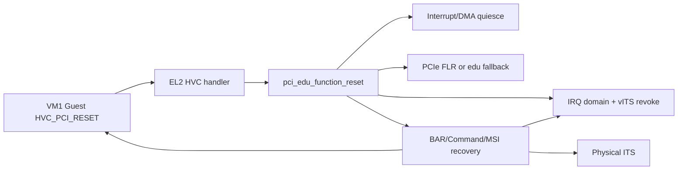
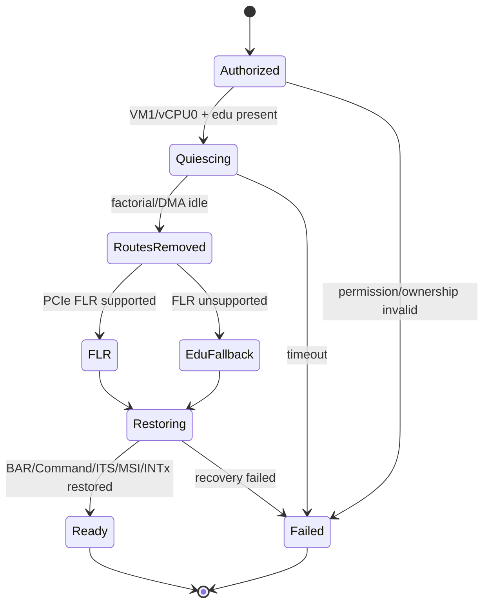
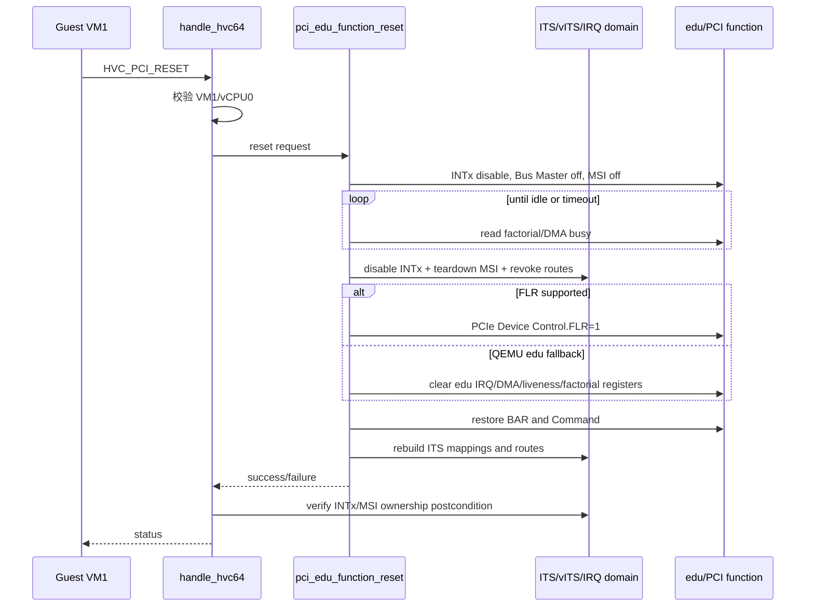
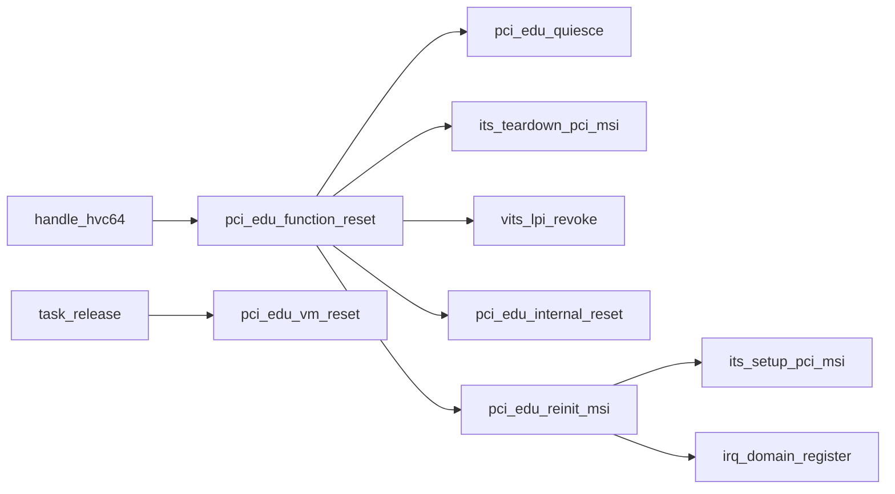

# aVisor Phase 106 详细设计：PCIe FLR 与 edu Function Reset

> 平台：QEMU virt / AArch64 EL2 / GICv3 / ITS
> 前置阶段：Phase 105 IRQ teardown
> 核心：在安全 quiesce 后执行 FLR 或 edu fallback，并重建 MSI/IRQ 状态

## 1. 问题与目标

Phase 105 只能释放设备中断资源，不能让仍在运行的 Guest 请求一次“复位后继续使用”。Phase 106 增加 `HVC_PCI_RESET` 和 `pci_edu_function_reset()`：关闭中断/DMA入口、等待设备空闲、撤销旧 route，执行标准 FLR 或设备模型 fallback，再恢复 BAR、Command、ITS、MSI 和 IRQ ownership。

`pci_edu_vm_reset()` 保持 teardown 语义，用于 VM 销毁；`pci_edu_function_reset()` 是可恢复事务，二者不能混用。

## 2. 架构设计

复位事务分为五个阶段：授权、quiesce、route teardown、设备 reset、资源恢复。任一前置条件失败不得继续对设备执行 reset。

## 3. Capability 探测

PCI capability 链遍历记录：

- MSI capability offset、64-bit address、MMC/MME 等能力；
- PCI Express capability offset；
- Device Capabilities bit 28（FLR supported）；
- Device Control bit 15（Initiate FLR）。

链指针来自 `PCI_CFG_CAP_PTR`，按 capability header 的 next 指针遍历。Phase 107 以后 capability 元数据逐步并入通用 function resource；本阶段运行目标仍是 edu。

## 4. Reset 状态机

### 4.1 Quiesce

`pci_edu_quiesce()`：

1. 设置 INTx Disable；
2. 清 Bus Master；
3. 禁用 MSI；
4. 轮询 factorial STATUS 和 DMA CMD busy；
5. 最多 100000 次、每次等待 1 ms，超时返回失败。

### 4.2 Route teardown

关闭物理 INTx 并清 pending，调用 `its_teardown_pci_msi()` 清 LPI enable、提交 MAPD invalid/SYNC，再由 `vits_lpi_revoke()` 清软件映射和 IRQ route。

### 4.3 设备复位

- 支持 FLR：写 PCIe Device Control FLR bit 并等待设备完成。
- 不支持 FLR：`pci_edu_internal_reset()` 清中断、DMA source/destination/count/cmd、liveness 和 factorial 状态。

### 4.4 恢复

恢复启动期保存的 BAR 与 PCI Command；`pci_edu_reinit_msi()` 重新调用 `its_setup_pci_msi()`，登记 MSI LPI/INTx route，重写 MSI address/data/control，并恢复 bus master。

## 5. 调用时序

## 6. 函数调用图

## 7. 文件映射

| 文件 | 设计职责 |
|---|---|
| `hypervisor/boards/virt/pci.c` | capability 探测、quiesce、reset、恢复事务 |
| `hypervisor/arch/aarch64/sync_exc.c` | HVC 权限及恢复后 ownership 断言 |
| `hypervisor/boards/virt/its.c` | ITS teardown/setup |
| `hypervisor/boards/virt/vits.c` | LPI revoke 与 reset 后重映射 |
| `include/common/hvc.h`、`guests/el1_test/guest.h` | HVC ABI |
| `guests/el1_test/main.c` | reset 后 identity/state/MSI 回归 |

## 8. 正确性与失败处理

- quiesce 超时不进入 reset，避免在设备 busy 时破坏状态。
- reset 前撤销旧 MSI route，恢复时重新分配并登记，避免陈旧 LPI。
- BAR 使用保存的 resource 恢复，不在 HVC 栈内重新扫描总线。
- HVC 成功返回前验证 INTx route 和 MSI base route 仍属于 VM1。

## 9. 验证

- `make -f Makefile.virt -j$(nproc)`：PASS；Guest 仅有既存 warning。
- QEMU：`timeout 70 make -f Makefile.virt run-log QEMU_SERIAL_LOG=/tmp/avisor-phase106-final3.log`。
- edu factorial/MSI、vITS vLPI 8200、reset identity/state、MSI reinit、迁移和 LR overflow 标记通过；无 PANIC/ASSERT/FAILED/Unknown IRQ/no ownership。
- QEMU 报告 `edu PCIe FLR not supported`，因此实际覆盖 quiesce + edu fallback + ITS/MSI recovery；标准 FLR 分支仅经代码审查和构建。

## 10. 限制

- 无支持 FLR 的运行时设备覆盖。
- quiesce 只理解 edu busy 寄存器，不是通用 PCI reset framework。
- 无 SMMU/IOMMU，Bus Master off 不能替代 DMA 隔离。
- 没有定义恢复中途失败后的完整硬件回滚；当前设备模型和调用路径要求恢复步骤成功。
