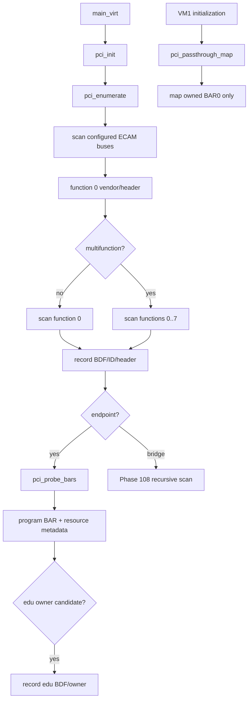
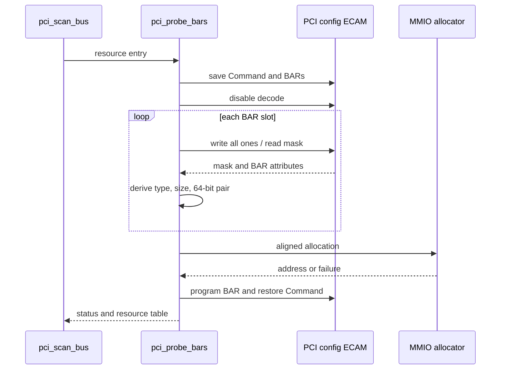
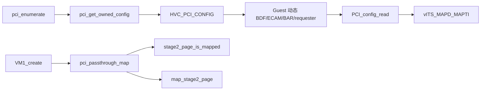
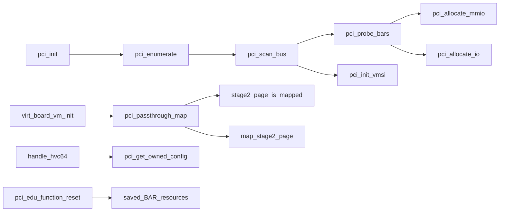

# aVisor Phase 107 详细设计：PCI 枚举与 BAR 资源映射

> 平台：QEMU virt / AArch64 EL2 / GICv3 / ITS
> 前置阶段：Phase 106 edu function reset
> 本阶段引入：ECAM function 扫描、BAR sizing、资源记录与 owner resource 精确映射

## 1. 架构目标

固定 BDF 和 BAR 地址使设备迁移到其他 slot 后 Hypervisor/Guest 信息不一致。Phase 107 在启动期扫描平台 ECAM，建立固定容量 PCI resource table，动态探测并分配 endpoint BAR。当前 ownership policy 仍只把 QEMU edu 分配给 VM1；其他 function 可被枚举和编址，但不因此获得 Guest passthrough 权限。

## 2. 地址模型

| 地址空间 | QEMU virt 范围 | 用途 |
|---|---|---|
| ECAM | `0x3f000000..0x3fffffff`（16 MiB） | bus/device/function 配置空间 |
| PCI MMIO | `0x10000000` 起，受平台 aperture 限制 | MMIO BAR 分配 |
| PCI I/O | Phase 108 才启用分配 | Phase 107 仅识别 |
| Guest IPA | 当前采用 identity map | edu BAR Stage-2 映射 |

ECAM 地址计算：`base + (bus << 20) + (device << 15) + (function << 12) + reg`。

## 3. 启动扫描架构

阶段历史扫描范围为最多 16 buses、32 devices、function 0 的 multifunction 位决定扫描 1/8 functions。bridge 递归策略由 Phase 108 加入。

## 4. BAR 探测与分配

### 4.1 探测算法

1. 保存 PCI Command、原 BAR DWORD 和原 resource metadata。
2. 清 I/O Space 与 Memory Space decode 位。
3. 向 BAR 写全 1，读取 sizing mask，再恢复/写入实际地址。
4. I/O BAR、32-bit MMIO BAR 和 64-bit MMIO BAR 分开解释属性位。
5. 64-bit BAR 读取相邻高 DWORD，作为单一资源并跳过 paired slot。
6. 校验 mask、非零 size、size 为 2 的幂和 aperture 边界。
7. 按 size 对齐分配并编程，恢复原 Command。

Phase 107 allocator按扫描顺序线性增长；降序排序和 pool allocator 是后续阶段能力，不能倒记为本阶段功能。

## 5. Resource table 与所有权

每个 function 记录 BDF、vendor/device、header type、owner VMID、bus hierarchy 元数据和 BAR array。BAR resource 至少包含地址、大小、flags、I/O 类型和 valid 状态。64-bit BAR 作为一个资源记录，保留 high DWORD 用于 reset 恢复。

只有 edu 的 ECAM function page 和 BAR0 映射到 VM1。Phase 107 阶段 ECAM 仍可被 Guest 写入；trap-and-emulate/写权限由 Phase 110 改造。

## 6. Owner passthrough 与 Guest discovery

Guest 不再依赖固定 BDF，通过 HVC selector 0 获取 ECAM function 地址、BAR0、size 和 requester ID。MSI capability 从动态 ECAM 扫描。

## 7. 关键函数调用图

## 8. 错误与事务边界

- BAR 无效或 allocation 失败时恢复已修改的 BAR、Command 和 resource entries；Phase 109 扩展为完整 allocator transaction rollback。
- Stage-2 已有映射时拒绝覆盖并撤销本次已建立页面。
- `map_stage2_page()` 目前不返回分配失败状态，因此页表分配失败不能由此 PCI 调用点可靠回滚。
- 资源表和总线容量固定，超出容量时拒绝继续记录。

## 9. 文件映射

| 文件 | 职责 |
|---|---|
| `hypervisor/boards/virt/pci.c` | ECAM scan、BAR probe、设备表和映射 |
| `include/boards/virt/base.h` | QEMU virt PCI 地址 aperture |
| `include/boards/virt/pci.h` | PCI 查询与 passthrough API |
| `hypervisor/arch/aarch64/sync_exc.c` | Guest resource HVC |
| `guests/el1_test/main.c` | 动态 BAR discovery 和设备测试 |

## 10. 验证与限制

- `make -f Makefile.virt -j$(nproc)`：PASS，Guest 有既存 warning。
- 默认 QEMU 枚举 `00:00.0 1b36:0008`、`00:01.0 1af4:1000`、`00:02.0 1234:11e8`；virtio BAR1 `0x10000000/0x1000`、BAR4 `0x10004000/0x4000`，edu BAR0 `0x10100000/0x100000`。
- Guest PCI/BAR discovery、edu factorial、vITS、reset/MSI reinit 及 migration/LR markers 通过；未发现 PANIC/ASSERT/FAILED/Data Abort/Unknown IRQ/no ownership。
- 本次默认拓扑没有验证非零 bus 与额外 multifunction function；Phase 108 前 I/O BAR 不分配，bridge window 不配置。
- 只有 edu 获得 owner mapping；ECAM 写保护、设备 DMA 隔离及通用 ownership policy 尚未实现。
