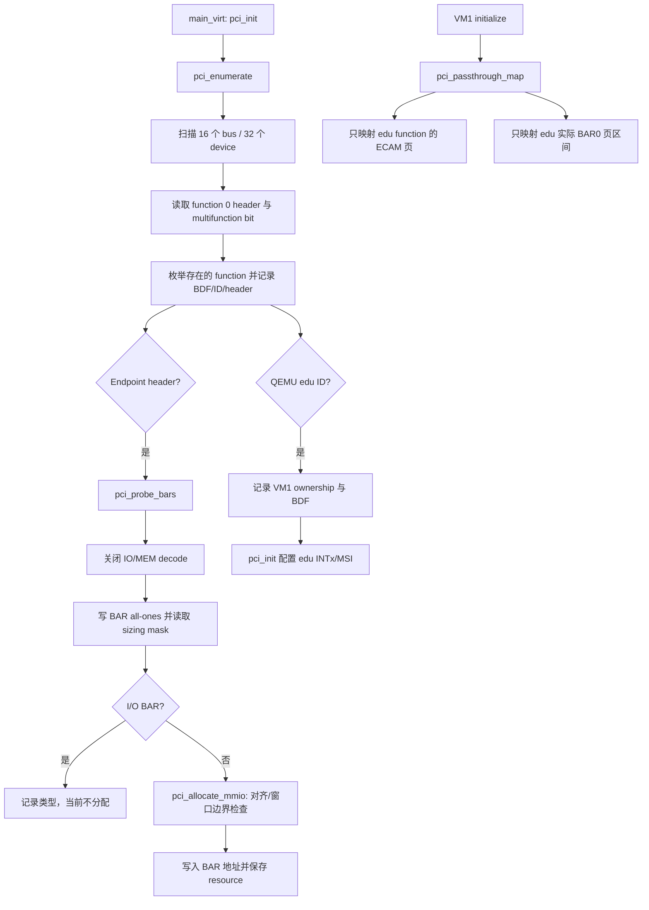
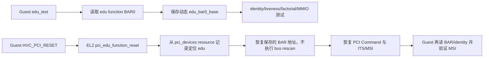

# aVisor Hypervisor Phase 107 详细设计文档：PCI 枚举与 BAR 资源映射

> 版本：Phase 107
> 平台：QEMU virt（AArch64、EL2、GICv3、ITS）
> 主题：PCI ECAM 扫描、BAR sizing/allocation、ownership 映射与 Guest 动态发现

## 1. 概述

Phase 107 将 PCI 初始化从固定 bus 0 edu 地址改为对 QEMU `virt` 16MB ECAM 覆盖范围内最多 16 个 bus、32 个 device、按 multifunction header 探测 function。固定容量设备表记录 BDF、ID、header type、owner VM 和六个 BAR resource。Endpoint 使用 PCI BAR sizing 方式识别资源；MMIO BAR 按 2 的幂大小对齐，在平台 PCI MMIO window 内顺序分配，支持 32-bit 与 64-bit MMIO BAR。I/O BAR 被识别并保留未分配状态。

本阶段仅把归属 VM1 的 edu function 配置空间所在 4KB ECAM 页及其实际 BAR0 区间映射到 Stage-2。Guest 从 edu function BAR0 配置值动态发现设备地址。Phase 106 reset 路径使用启动期保存的 resource 记录恢复 BAR，不在 HVC 栈上重新扫描总线。

## 2. 架构与调用关系

### 2.1 启动期枚举与映射



### 2.2 Guest 使用与 reset 恢复



## 3. 实现要点

- `PCI_MAX_BUSES` 为 16，对应当前 QEMU `virt` ECAM 16MB 范围；扫描每个 bus 的 32 个 device。function 0 的 header type multifunction bit 决定扫描 1 或 8 个 function。
- 固定容量表每项记录 vendor/device、BDF、header type、owner VMID 和六个 BAR 的地址、大小、类型及有效状态。当前仅匹配 QEMU edu 为 VM1 所有。
- Endpoint 在 BAR 探测时暂时关闭 PCI IO/MEM decode。32-bit BAR 根据低 32-bit mask 求大小；64-bit BAR 同时探测高位并占用相邻 BAR slot。仅接纳非零且为 2 的幂大小。
- MMIO allocator 对齐到资源大小，使用 checked 边界条件拒绝溢出和越过 PCI MMIO window 的分配。I/O BAR 识别后记录类型并告警，本阶段不分配 I/O port。
- `pci_passthrough_map()` 只映射 VM1 edu function 的 4KB ECAM 页和保存的 BAR0 大小，不再暴露整个 16MB ECAM 或固定 1MB 地址。
- Guest edu 访问和 vITS 中断测试使用 ECAM 中 BAR0 的动态值。reset 恢复从 resource table 还原 BAR 与高位（若有），不在 vCPU HVC 调用栈上执行全总线枚举。
- `pci_edu_vm_reset()` 生命周期 teardown API 与 Phase 105 保持；Phase 106 function reset 入口继续独立。

## 4. 代码映射

| 文件 | Phase 107 变更 |
|---|---|
| `hypervisor/boards/virt/pci.c` | 设备/resource 表、ECAM 扫描、BAR sizing/allocation、精确 Stage-2 映射、reset BAR 恢复 |
| `include/boards/virt/base.h` | 移除固定 edu BAR 地址常量 |
| `guests/el1_test/main.c` | 动态读取 edu BAR0 并用于设备与 vITS MSI 测试 |

## 5. 验证

构建命令：

```sh
make -f Makefile.virt -j$(nproc)
```

结果：PASS；Hypervisor 与 Guest 编译链接成功。Guest 工程仍有既有 warning。

QEMU 回归命令：

```sh
timeout 70 make -f Makefile.virt run-log QEMU_SERIAL_LOG=/tmp/avisor-phase107-final.log
```

QEMU 由 timeout 以退出码 124 正常终止。观察到：

```text
INFO[0]: PCI: enumerated 00:00.0 id=1b36:0008 header=0
INFO[0]: PCI: enumerated 00:01.0 id=1af4:1000 header=0
INFO[0]: PCI: 00:01.0 BAR1 MMIO 0x10000000/0x1000
INFO[0]: PCI: 00:01.0 BAR4 MMIO 0x10004000/0x4000
INFO[0]: PCI: enumerated 00:02.0 id=1234:11e8 header=0
INFO[0]: PCI: 00:02.0 BAR0 MMIO 0x10100000/0x100000
[vm1] edu: discovered BAR0=0x10100000
[vm1] PCI enumeration/BAR discovery PASSED
[vm1] edu: factorial PASSED
[vm1] vITS: PASSED! Received vSPI 72 (vLPI 8200)
[vm1] vITS: edu function reset + MSI reinit PASSED
[vm1] sched: vCPU migration CPU0->CPU1->CPU0 PASSED
[vm1] gicd: LR overflow queue delivered all 4 interrupts PASSED
[vm3] PASSED: 双 vCPU Live Migration 成功（VM2 -> VM3）
```

扫描 `PANIC`、`ASSERT`、`FAILED`、`Data Abort`、`Unknown IRQ` 和 `no ownership` 未发现匹配项。

## 6. 限制

- 当前运行时拓扑验证了 multifunction-aware 的扫描逻辑路径与多个 bus 的寻址范围，但实际 QEMU 基础拓扑只枚举出 bus 0 的三个 function；尚未用多 bus/multifunction 自定义拓扑验证非零 bus 与额外 function。
- 当前设备表只将 edu 分配给 VM1；其他设备被枚举和分配 BAR，但不映射给 Guest。设备 ownership policy 仍为单设备固定策略。
- I/O BAR 只识别，不分配；PCI bridge 的 bus-number/window programming 与递归扫描在 Phase 108。
- ECAM function 页仍以直通方式映射，Guest 可写该 function 的 BAR/Command；配置写入 trap-and-emulate 与 ownership enforcement 后续处理。
- 当前 allocator 使用普通 PCI MMIO window；独立 prefetchable/high-MMIO window 尚未实现。
