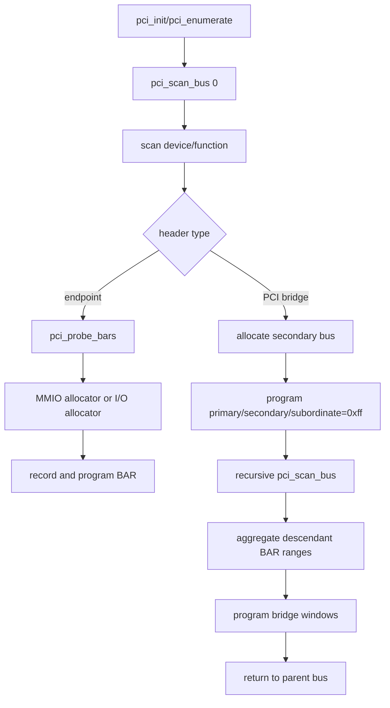
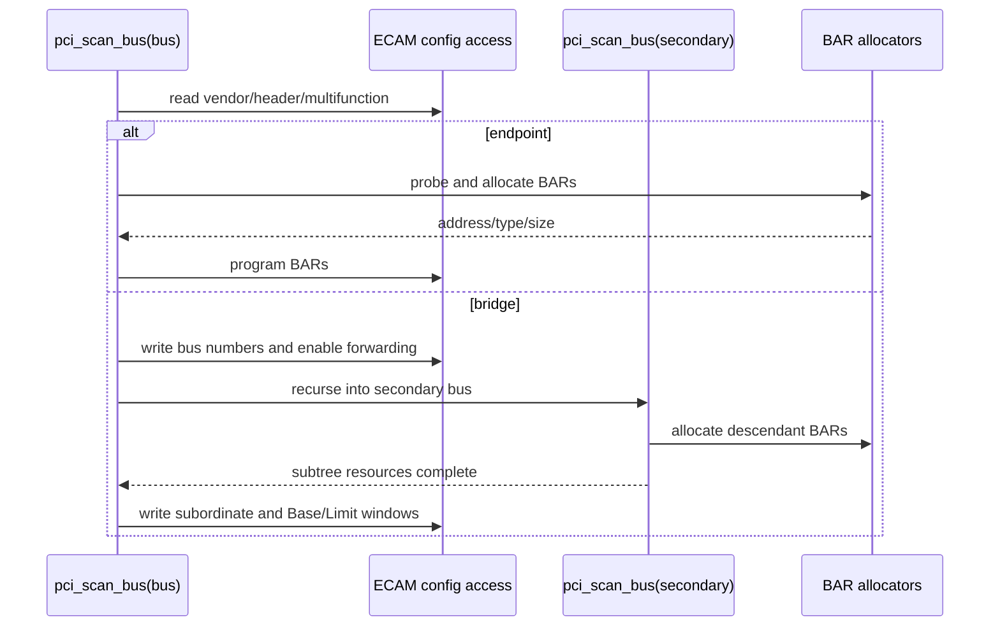
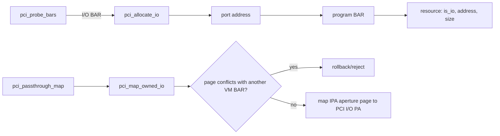
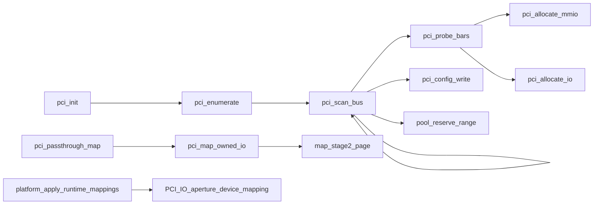

# aVisor Phase 108 详细设计：PCI Bridge 递归枚举与 I/O BAR 分配

> 平台：QEMU virt / AArch64 EL2 / GICv3 / ITS
> 前置阶段：Phase 107 endpoint 枚举与 MMIO BAR 资源表
> 本阶段引入：Type-1 bridge 递归、bus 编号、I/O port pool 与 forwarding window

## 1. 设计目标

Phase 107 只能处理根 bus endpoint。Phase 108 将扫描改为拓扑递归：只有已发现 bridge 的 secondary bus 才会被访问；子树完成后汇总 BAR 范围并配置各级转发窗口。同时加入独立 16-bit I/O port allocator，并把 QEMU virt PCI I/O aperture 映射为设备属性。

当前只枚举并分配下游设备资源；ownership/Guest passthrough policy 仍仅针对 edu，不把 e1000 等桥下设备映射给 Guest。

## 2. PCI 地址和 bus 模型

- BDF 编码 requester：`(bus << 8) | (device << 3) | function`。
- Type-1 bridge Bus Numbers DWORD：Primary[7:0]、Secondary[15:8]、Subordinate[23:16]。
- Type-1 Memory Base/Limit 粒度为 1 MiB。
- I/O BAR 的配置值是 port number；CPU aperture 地址为 `VIRT_PCIE_IO_BASE + port`。
- QEMU virt I/O aperture：`0x3eff0000`，EL2 runtime 页表需按 Device memory 属性映射。

## 3. 递归枚举架构

Bridge 在递归调用前写临时最大 subordinate，确保子树配置访问在扫描期间可达；递归返回后将 subordinate 收紧到实际最高 bus。Phase 113/115 后续加入失败回滚和窗口 reservation，属于后续阶段能力。

## 4. 扫描算法

对 function 0 检查 multifunction bit；非 multifunction 只访问 function 0，多功能设备扫描 0..7。endpoint BAR sizing 保持 size 对齐。I/O BAR size 必须可由 16-bit port aperture 容纳。

## 5. Bridge window 算法

### 5.1 Memory window

对桥后代 MMIO BAR 计算 `min(base)` 与 `max(base + size - 1)`，向下/向上按 1 MiB 边界编码到 Type-1 Memory Base/Limit。无下游 MMIO 时写关闭编码。

### 5.2 I/O window

对子树 I/O port BAR 计算最小 port 与最大末端，按 4 KiB 对齐后写 I/O Base/Limit；Phase 108 仅支持 16-bit I/O window，upper register 在 Phase 113 扩展。

### 5.3 Bridge forwarding

存在下游资源时启用 bridge PCI Command 的 I/O Space 和 Memory Space 位。子树资源以递归生成的 BAR 表为准，不以设备扫描顺序推测范围。

## 6. I/O BAR 分配与 Stage-2 mapping

端口 0 是合法地址，allocator 状态不可用 0 作为失败标志。Stage-2 以 4 KiB 页映射；若页内存在其他 VM 所属 I/O BAR，拒绝共享该页。

## 7. 函数调用图

## 8. 资源状态与错误边界

- Device table 保存 BDF、bridge bus 元数据和每个 BAR 的类型/地址/size。
- bus number 或 BAR allocator 耗尽时停止该设备/递归分支并报告错误；阶段早期实现未具有 Phase 113 的完整事务快照，不能声称所有失败都会原子回滚。
- I/O address 使用端口数值，与 CPU aperture PA 是两个地址表示；resource 记录和访问代码必须一致换算。
- bridge window 覆盖粒度可能大于实际 BAR 范围，后续阶段负责将完整窗口从 pool reservation。

## 9. 文件职责

| 文件 | 职责 |
|---|---|
| `hypervisor/boards/virt/pci.c` | bridge recursion、bus assignment、BAR/窗口编程 |
| `include/boards/virt/base.h` | PCI I/O aperture 常量 |
| `hypervisor/common/platform.c` | EL2 PCI I/O aperture Device mapping |
| `include/boards/virt/pci.h` | PCI resource 和映射 API |

## 10. 验证

- `make -f Makefile.virt -j$(nproc)`：PASS。
- 默认拓扑：virtio-net I/O BAR0 分配 port `0x0`、CPU aperture `0x3eff0000/0x20`，MMIO BAR 与 edu BAR0 正常分配；Guest virtio-net loopback、edu/vITS/reset 记录通过。
- 两级 bridge nested topology：枚举 `00:03.0`、`01:01.0`、bus 2 的 `02:02.0` e1000；BAR0 `0x10200000/0x20000`，BAR1 I/O port `0x40/0x40`；bridge subordinate=2，memory `0x10200000-0x102fffff`、I/O `0x0-0xfff`。
- 日志未发现 PANIC/ASSERT/Data Abort/Unknown IRQ/no ownership。既有 task-slot reuse guest 检查仍失败，未计入 PCI PASS。

## 11. 限制

- 16-bit I/O aperture；upper I/O registers 后续阶段才添加。
- Prefetchable window、桥下设备透传、多级 INTx swizzle 和热插拔未实现。
- 阶段早期 bridge recursion 没有完整 pool/resource/config snapshot rollback。
- 无 SMMU/IOMMU DMA requester 隔离。
