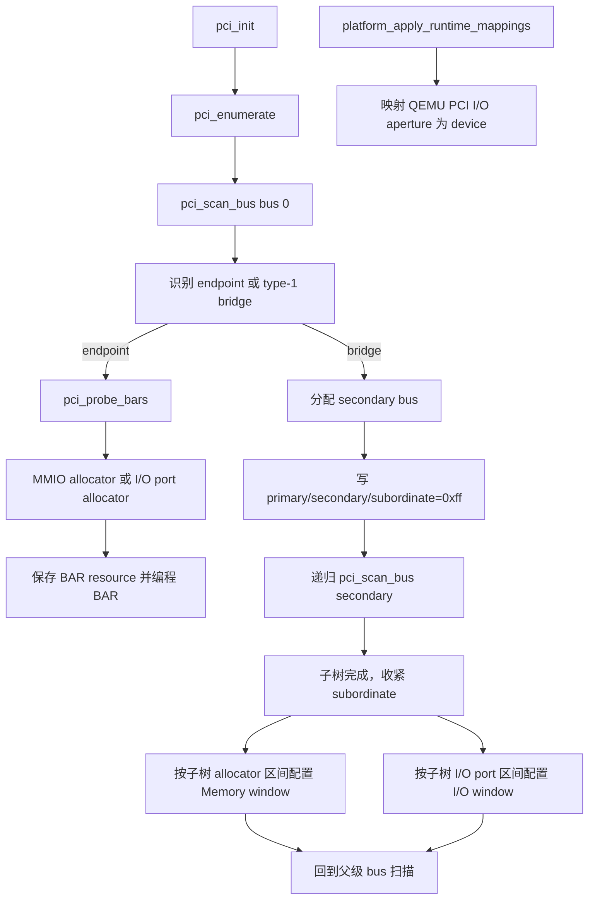
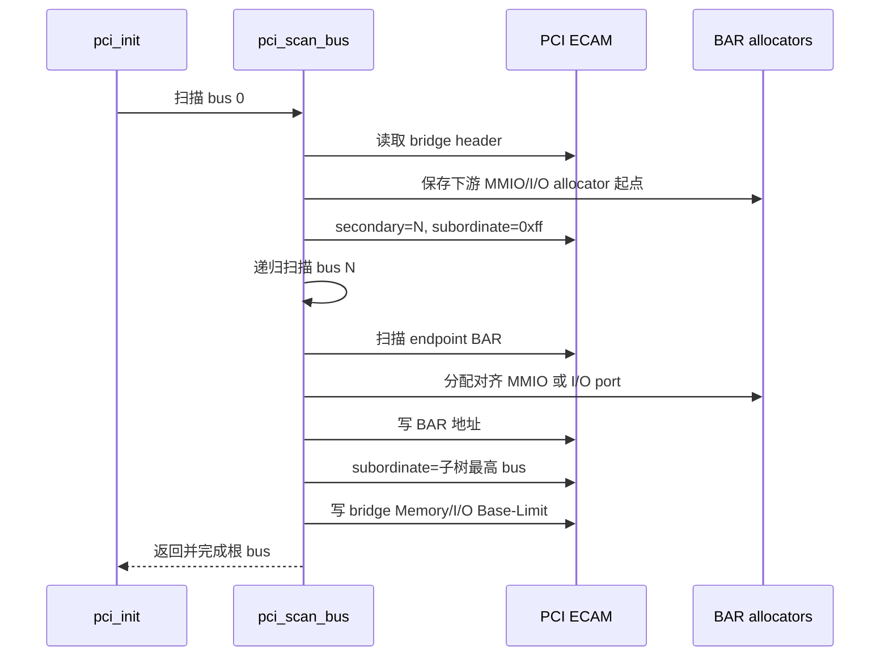

# aVisor Hypervisor Phase 108 详细设计文档：PCI bridge 递归枚举与 I/O BAR 分配

> 阶段：Phase 108
> 平台：QEMU virt（AArch64、EL2、GICv3、ITS）
> 前置阶段：Phase 107 PCI endpoint 枚举与 BAR resource allocator

## 1. 目标与范围

Phase 108 在 Phase 107 的 PCI resource allocator 上增加 PCI-to-PCI bridge 递归扫描、动态 bus number 分配、bridge forwarding window 配置和 16-bit I/O port 分配。扫描从 bus 0 开始，只访问 bridge 声明的下游 secondary bus，不再线性扫未连接 bus。下游资源汇总后配置每级 bridge 的 Memory 与 I/O Base/Limit，并收紧 subordinate bus number。

I/O BAR 使用独立 64KB port allocator，按 BAR 大小对齐。资源表记录 I/O/MMIO 类型和 CPU aperture 地址；QEMU virt I/O aperture `0x3eff0000` 由 EL2 runtime page table 以 device 属性映射。

## 2. 调用与资源流





## 3. 关键数据与算法

- 每个设备 resource 记录 BDF、ID、header type、owner、primary/secondary/subordinate bus，以及六个 BAR 的地址、大小、flags、MMIO/I/O 类型和有效状态。
- `pci_scan_bus(bus)` 在当前 bus 的 32 个 device 上按 function 0 multifunction bit 扫描 function。Type-0 endpoint 调用 BAR sizing；type-1 bridge 分配唯一 secondary bus 后递归扫描。
- 下游递归开始前记录 MMIO 与 I/O allocator 游标。返回后以游标区间为该 bridge 子树资源范围，配置并记录 bus number 与 window。
- Type-1 header 的 Memory Base/Limit 采用 1MB 粒度、32-bit window 编码。子树无 MMIO 资源时写入关闭编码 `0x0000fff0`。
- I/O BAR size 从 sizing mask 求得，分配至 0..0xffff 端口空间并按 size 对齐。BAR 中写入 port number；CPU 访问地址为 `VIRT_PCIE_IO_BASE + port`。超过 64KB 或无效大小的 BAR 不编程。
- Bridge I/O Base/Limit 使用 4KB 粒度和 16-bit I/O window 编码。无下游 I/O 资源时窗口关闭。
- 每个 bridge 的 PCI Command I/O Space 与 Memory Space forwarding 位被打开。
- VM passthrough policy 未变化：仅 edu 归属 VM1，Stage-2 不映射下游 bridge/e1000。

## 4. 代码映射

| 文件 | 变更 |
|---|---|
| `hypervisor/boards/virt/pci.c` | 递归 bridge scan、bus number 分配、bridge window、I/O BAR allocator 和 resource 类型记录 |
| `include/boards/virt/base.h` | 定义 PCI I/O aperture base/size |
| `hypervisor/common/platform.c` | 将 I/O aperture 加入 QEMU virt EL2 runtime device mapping |

## 5. 验证

构建：`make -f Makefile.virt -j$(nproc)`，PASS。

基础拓扑：

```sh
timeout 65 make -f Makefile.virt run-log QEMU_SERIAL_LOG=/tmp/avisor-phase108-basic-final.log
```

结果：QEMU 按预期由 timeout 终止。virtio-net BAR0 分配为 port `0x0`、CPU aperture `0x3eff0000/0x20`；其 MMIO BAR1/BAR4 与 edu BAR0 分配成功。Guest dynamic BAR discovery、factorial、vITS MSI 和 reset + MSI reinit 均通过。

嵌套桥拓扑：

```sh
timeout 65 qemu-system-aarch64 -M virt,virtualization=on,gic-version=3,highmem=off \
  -cpu max -smp 2 -m 1G -device edu \
  -device pci-bridge,id=br1,bus=pcie.0,addr=0x3,chassis_nr=1 \
  -device pci-bridge,id=br2,bus=br1,addr=0x1,chassis_nr=2 \
  -device e1000,bus=br2,addr=0x2 -kernel bin_virt/kernel8.img \
  -display none -monitor none -serial file:/tmp/avisor-phase108-nested-final.log
```

结果：QEMU 按预期由 timeout 终止。扫描发现 `00:03.0`、`01:01.0` 两级 bridge 和 `02:02.0` e1000；e1000 BAR0 分配 128KB MMIO `0x10200000`，BAR1 分配 64-byte I/O port `0x40`，CPU aperture `0x3eff0040`。两个 bridge 的 subordinate bus 均收紧到 2；Memory window 为 `0x10200000-0x102fffff`，I/O window 为 `0x0-0xfff`。edu dynamic BAR、factorial、vITS MSI 和 reset + MSI reinit 均通过。

两份串口日志未发现 `PANIC`、`ASSERT`、`Data Abort`、`Unknown IRQ` 或 `no ownership`。完整 guest 日志另出现既有 Phase 44 task-slot reuse 自测 `FAIL: task 槽位未被实际复用`，与 Phase 107 记录一致；因此本阶段不宣称该项或全量 guest 回归通过。

## 6. 限制

- I/O allocator 仅支持 16-bit I/O port 空间；type-1 bridge 32-bit I/O upper registers 未配置。
- Bridge prefetchable window 未分配；64-bit prefetchable BAR 使用当前普通 MMIO allocator，未建立独立 prefetchable/high window。
- Bridge hotplug、下游设备 ownership/透传和多级 INTx swizzle 未实现。
- 本阶段验证标准 QEMU `pci-bridge` 两级拓扑及 e1000 BAR；其他桥实现、深度/设备表容量边界未专门压力测试。
