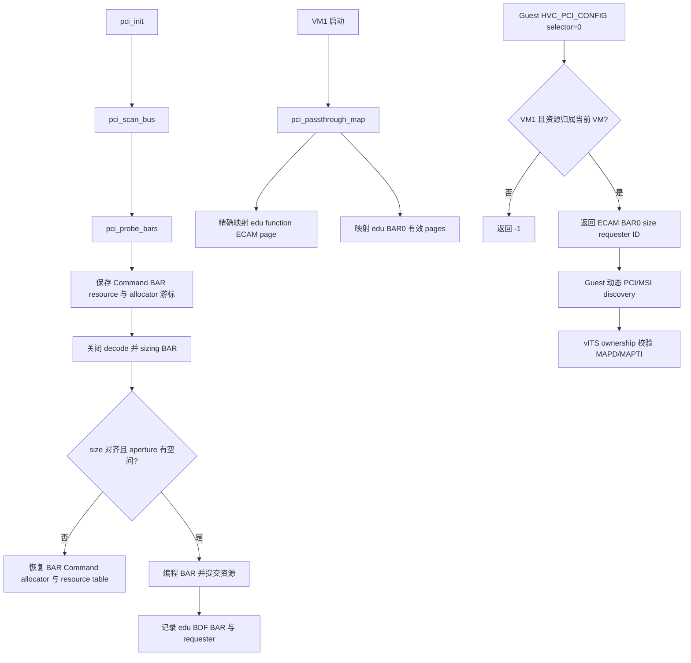
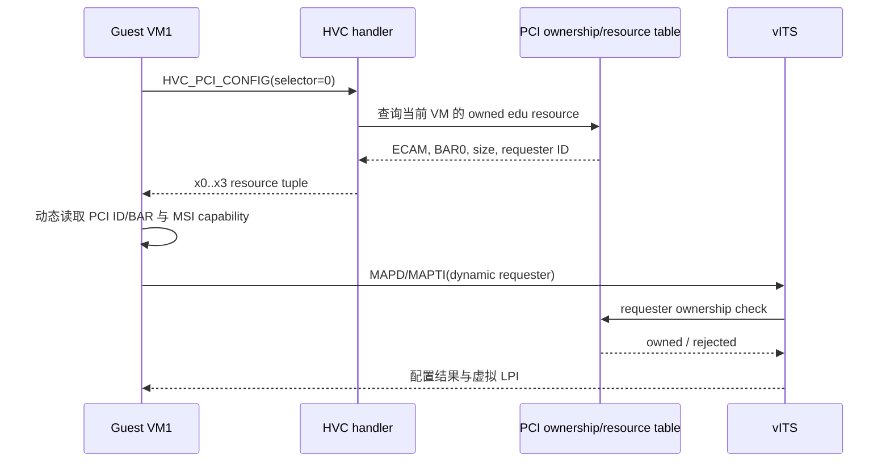

# aVisor Hypervisor Phase 109 详细设计文档：PCI 枚举与 BAR 直通加固

> 阶段：Phase 109
> 平台：QEMU virt（AArch64、EL2、GICv3、ITS）
> 前置阶段：Phase 108 PCI bridge 递归枚举与 I/O BAR 分配

## 1. 目标与范围

本阶段加固 PCI BAR sizing 与资源分配失败路径，确保失败时恢复设备 BAR、PCI Command、MMIO/I/O allocator 游标及 BAR resource 表；校验 BAR size、对齐与 PCI aperture 边界。Stage-2 只映射归属 VM 的 edu ECAM function page 与 BAR0 pages，并在遇到已有 IPA 映射时撤销本次已建立的映射。

新增 `HVC_PCI_CONFIG`，selector 0 仅允许 VM1 查询已归属 edu 的 ECAM、BAR0、BAR size 与 requester ID。Guest 不再依赖固定 BDF，vITS MAPD/MAPTI 和 MSI capability 扫描使用动态 requester/ECAM 地址。

## 2. 调用与资源流





## 3. 关键实现

- `pci_probe_bars()` 对 endpoint 执行 BAR sizing；失败路径恢复原始 BAR（含 64-bit pair）、PCI Command、MMIO/I/O allocator 游标和 BAR resource entries，并将错误返回至扫描者。
- MMIO/I/O allocator 保持按 BAR size 对齐，并验证窗口范围和整数溢出；无效 mask/size 或资源耗尽触发 endpoint transaction rollback。
- `stage2_page_is_mapped()` 只读检查目标 IPA 是否已有 leaf mapping，避免用会创建空页表的 probe 作为冲突检查。`pci_passthrough_map()` 只回滚本次建立的 BAR 页和 ECAM 页，不触碰调用前已有映射。
- `HVC_PCI_CONFIG` selector 0 当前仅支持 VM1 的 edu 资源；非法 selector、无效资源或非 owner 均返回 `-1`。
- Guest HVC helper 返回 x0..x3。Guest 使用 Hypervisor 返回的动态 ECAM/BAR/requester 信息，不再固定 requester 常量或 `00:02.0` ECAM 地址。
- vITS requester policy 继续由 Hypervisor 按枚举出的 edu BDF 校验；移位拓扑中 requester 为 24，邻接未授权 requester 25 被拒绝。

## 4. 代码映射

| 文件 | 变更 |
|---|---|
| `hypervisor/boards/virt/pci.c` | BAR transaction rollback、owner resource query、Stage-2 passthrough mapping conflict/rollback |
| `hypervisor/common/mm.c`、`include/common/mm.h` | 增加只读 Stage-2 leaf mapping 查询 |
| `hypervisor/arch/aarch64/sync_exc.c`、`include/common/hvc.h` | HVC_PCI_CONFIG handler 与 ABI |
| `include/boards/virt/pci.h` | PCI ownership query 与 mapping API |
| `hypervisor/boards/virt/virt_board.c` | 检查 passthrough mapping 结果 |
| `guests/el1_test/guest.h`、`guests/el1_test/main.c` | 多寄存器 HVC helper、动态 PCI/MSI discovery 与 ownership 负测 |

## 5. 验证

构建：`make -f Makefile.virt -j$(nproc)`，通过。`git diff --check` 通过。

默认拓扑日志：`/tmp/avisor-phase109-final-basic.log`。发现 edu `00:02.0`，BAR0 `0x10100000/0x100000`；Guest PCI enumeration/BAR discovery、vITS MSI delivery、edu reset + MSI reinit 均通过。vITS 接受 requester 16 并拒绝未授权 requester 17。

移位与嵌套 bridge 拓扑命令：

```sh
timeout 75 qemu-system-aarch64 -M virt,virtualization=on,gic-version=3,highmem=off \
  -cpu max -smp 2 -m 1G -device edu,bus=pcie.0,addr=0x3 \
  -device pci-bridge,id=br1,bus=pcie.0,addr=0x4,chassis_nr=1 \
  -device pci-bridge,id=br2,bus=br1,addr=0x1,chassis_nr=2 \
  -device e1000,bus=br2,addr=0x2 -kernel bin_virt/kernel8.img \
  -display none -monitor none -serial file:/tmp/avisor-phase109-final-nested.log
```

日志发现 edu `00:03.0`、两级 bridge `00:04.0`/`01:01.0` 和下游 e1000 `02:02.0`。Guest PCI discovery、动态 requester 24、拒绝 requester 25、MSI delivery 和 reset + MSI reinit 均通过。QEMU 按测试设定由 timeout 终止。

完整 Guest 日志仍出现既有 `FAIL: task 槽位未被实际复用`，与 Phase 108 已记录的 Phase 44 task-slot reuse 自测失败一致；本阶段不宣称该项或全量 Guest 回归通过。Stage-2 mapping API `map_stage2_page()` 无失败返回值，因此页表页分配失败不可由本 PCI 调用点恢复；本阶段覆盖已有映射冲突的事务 rollback。

## 6. 限制

- HVC 当前仅暴露 VM1 的 edu selector 0；未实现通用多设备 selector。
- QEMU 移位与 nested bridge 拓扑完成 discovery/MSI/reset 验证；桥后 e1000 由 Hypervisor 枚举和分配 BAR，但未透传给 Guest。
- Stage-2 页表内存分配失败无法通过现有 `map_stage2_page()` ABI 向调用方报告。
- 未新增独立 IOMMU/SMMU DMA translation abstraction；本阶段以设备 ownership、Hypervisor requester 校验与精确 Stage-2 映射为范围。
