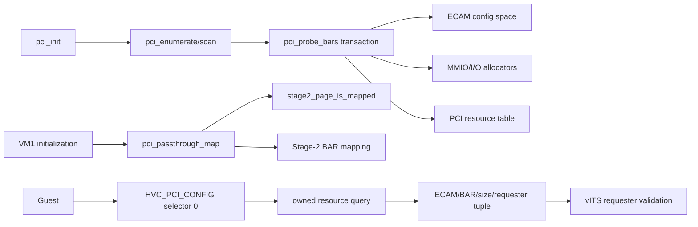
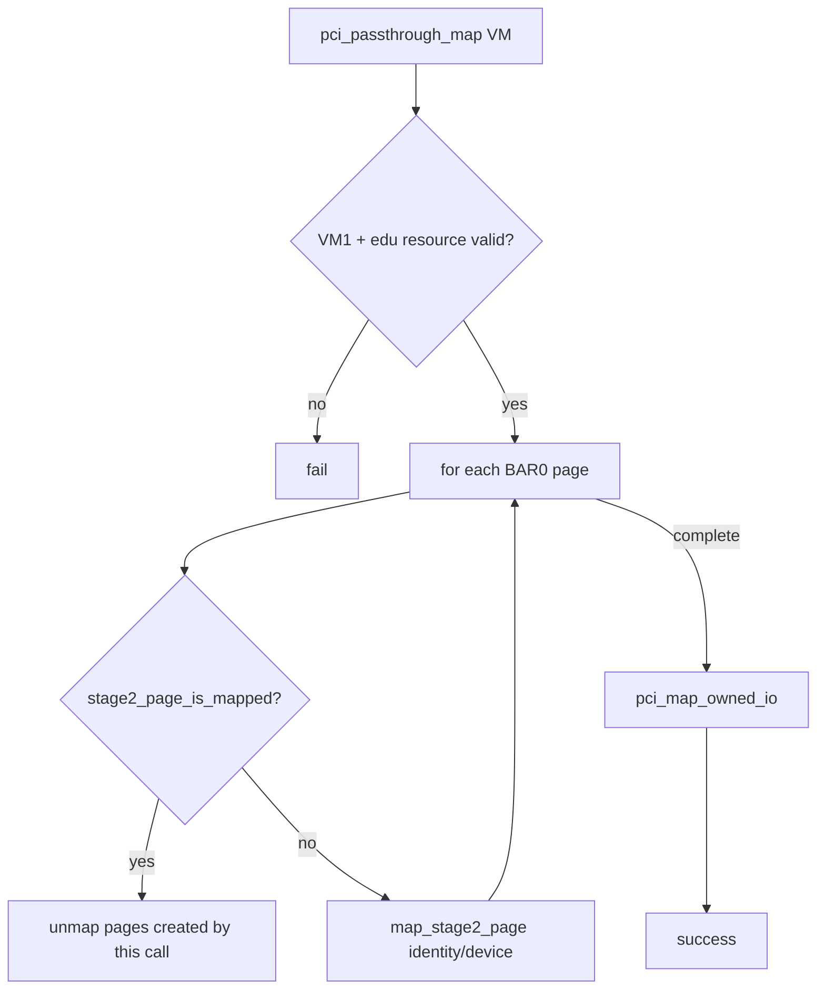
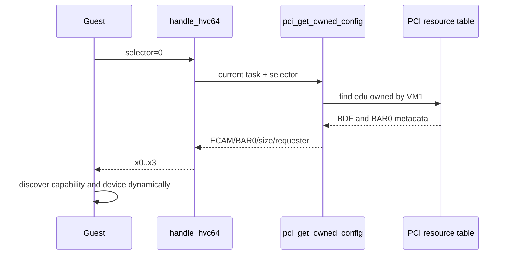
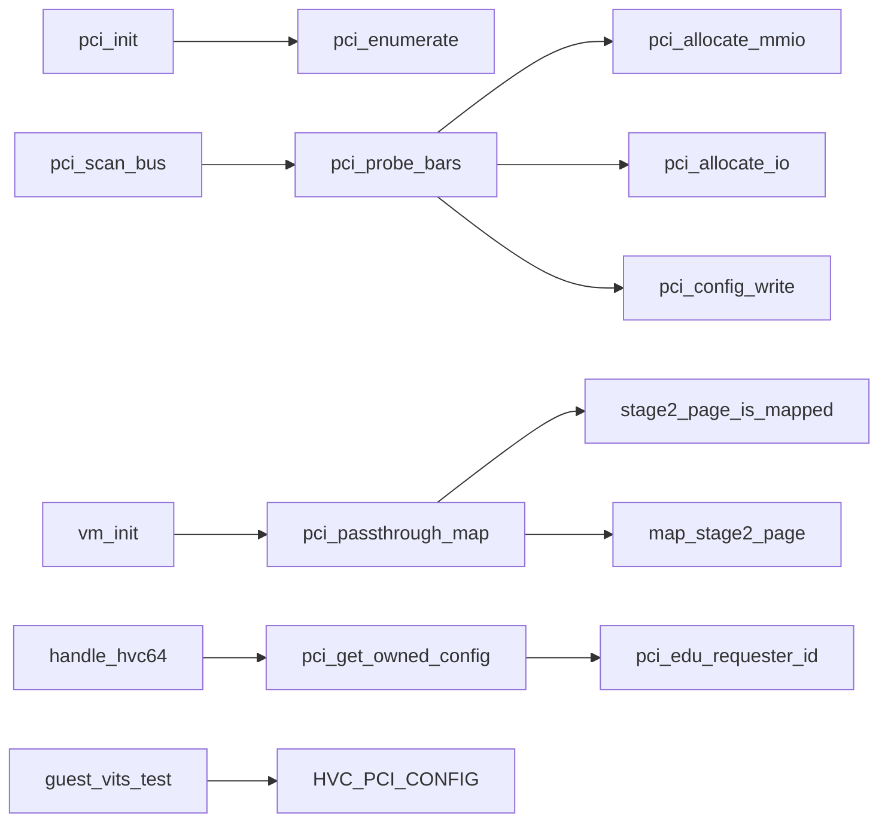

# aVisor Phase 109 详细设计：PCI 资源事务与 Owner BAR 直通加固

> 平台：QEMU virt / AArch64 EL2 / GICv3 / ITS
> 前置阶段：Phase 108 recursive PCI bridge 和 I/O BAR
> 本阶段：BAR transaction rollback、Stage-2 conflict rollback、owner resource HVC

## 1. 背景与目标

Phase 108 建立了递归枚举和资源分配，但 BAR 探测涉及多次配置空间写入；中途失败可能留下部分编程状态。Guest passthrough mapping 也必须避免覆盖已有 Stage-2 映射。Phase 109 把 BAR sizing/assignment 变为可回滚事务，并通过受限 HVC 暴露当前 VM 拥有的 edu 资源。

目标边界仍为单设备策略：只有 VM1 的 edu function 可查询和透传。桥下 e1000 等设备可由 Hypervisor 枚举和分配资源，但不因此获得 Guest ECAM 权限。

## 2. 架构



## 3. BAR assignment transaction

事务快照覆盖：PCI Command、所有 BAR low/high DWORD、目标 resource entries、MMIO/I/O allocator state。所有 BAR sizing 完成后再按大小降序分配，任一资源无效或分配失败即恢复快照。

```mermaid
sequenceDiagram
    participant Scan as pci_scan_bus
    participant Tx as pci_probe_bars
    participant Cfg as ECAM config
    participant Pool as resource pools
    participant Res as pci_device_resource
    Scan->>Tx: probe function
    Tx->>Cfg: snapshot Command/BAR low/high
    Tx->>Pool: snapshot pools
    Tx->>Res: snapshot BAR metadata
    Tx->>Cfg: disable decode; probe all BAR masks
    Tx->>Tx: validate sizes and sort descending
    loop each valid BAR entry
        Tx->>Pool: aligned allocation
        Pool-->>Tx: address or error
        Tx->>Cfg: program BAR pair
        Tx->>Res: commit resource metadata
    end
    alt any failure
        Tx->>Cfg: restore all BARs and Command
        Tx->>Res: restore resource snapshot
        Tx->>Pool: restore pool snapshot
    else success
        Tx->>Cfg: restore Command
    end
```

64-bit BAR 作为配对 entry 排序，保存原 high DWORD；失败回滚时恢复两个 DWORD。allocator 的 pool snapshot 是最终事务状态保障。

## 4. Owner mapping transaction

`pci_passthrough_map()` 检查 VMID、BAR0 对齐、size 和 MMIO aperture；逐页确认 IPA 尚未映射，再进行 identity mapping。发生冲突时只 unmap 本次创建的 BAR pages，不撤销调用前已有映射。ECAM 后续由 Phase 110 trap-and-emulate，不再向 Guest 直映。



当前 `map_stage2_page()` 没有失败返回值，因此只能检测既有映射冲突，不能报告中间页表分配失败。

## 5. HVC resource ABI 与 ownership

`HVC_PCI_CONFIG` selector 0 仅接受 VM1。成功返回寄存器组：x0=ECAM function address、x1=BAR0 address、x2=BAR0 size、x3=requester ID。非法 selector、未找到 edu 或非 owner 返回 -1。



## 6. 函数调用图



## 7. 代码映射

| 文件 | 职责 |
|---|---|
| `hypervisor/boards/virt/pci.c` | BAR 事务、pool rollback、owner query 与映射 |
| `hypervisor/common/mm.c`、`include/common/mm.h` | Stage-2 leaf 查询 |
| `hypervisor/arch/aarch64/sync_exc.c`、`include/common/hvc.h` | HVC handler/编号 |
| `hypervisor/boards/virt/virt_board.c` | VM 初始化映射错误检查 |
| `guests/el1_test/guest.h`、`guests/el1_test/main.c` | HVC ABI 与动态 requester discovery |

## 8. 验证与已知边界

- `make -f Makefile.virt -j$(nproc)` 与 `git diff --check`：PASS。
- 默认拓扑：edu `00:02.0` BAR0 `0x10100000/0x100000`；Guest discovery、vITS requester 16、拒绝 requester 17、MSI/reset recovery 通过。
- nested topology：edu `00:03.0`，两级 bridge 和 e1000 `02:02.0`；动态 requester 24，拒绝邻接 requester 25；QEMU 由 timeout 结束。
- 完整 Guest log 有历史 task-slot reuse FAIL，本阶段不宣称全部 Guest tests 通过。
- Stage-2 map API 无失败状态；仅 VM1 edu 可通过 HVC 查询；无 IOMMU/SMMU DMA 隔离。
