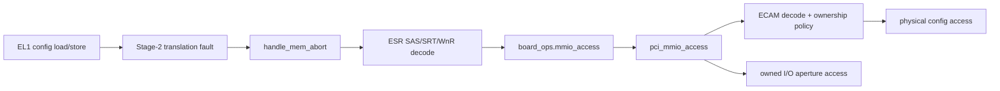
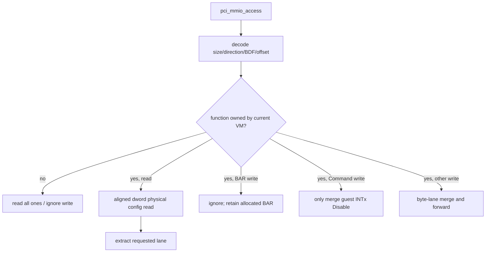
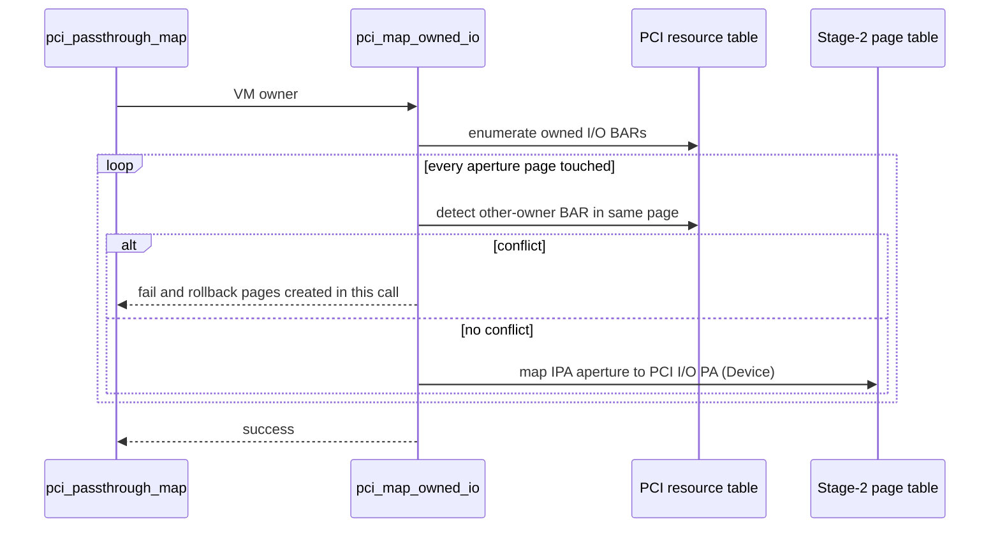
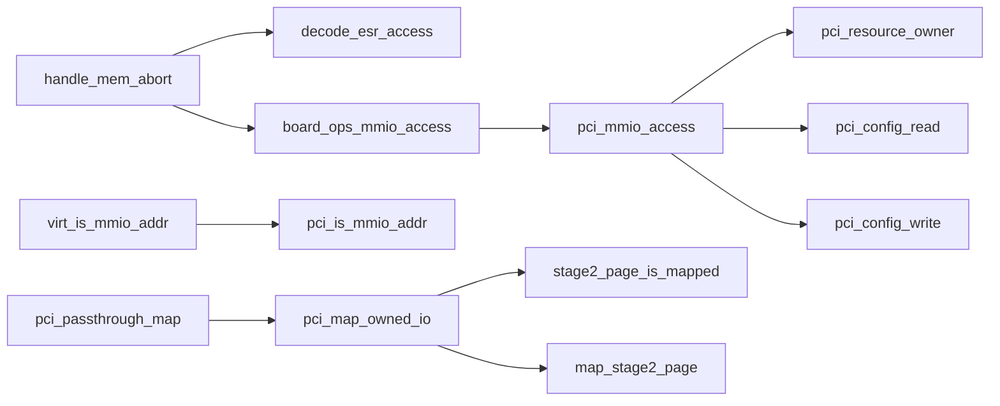

# aVisor Phase 110 详细设计：PCI ECAM Trap-and-Emulate 与 I/O BAR 映射

> 平台：QEMU virt / AArch64 EL2 / Stage-2 / PCI ECAM
> 前置阶段：Phase 109 owner resource query 与映射事务
> 本阶段：Guest ECAM 配置访问模拟；I/O BAR aperture 按 owner page 映射

## 1. 设计目标

直接映射 ECAM 会允许 Guest 修改 BAR、Command 和中断配置，绕过 Hypervisor 的 resource ownership。Phase 110 将 ECAM 纳入 MMIO fault classifier，由 EL2 按访问宽度模拟配置读写。I/O BAR aperture 则只映射 owner VM 所需页，并检查页粒度共享冲突。

## 2. 访问路径架构

## 3. 访问解码和寄存器语义

`handle_mem_abort()` 从 ESR 解出 SAS（本 callback 当前接受 1/2/4-byte）、写方向、目标寄存器和值；按 fault IPA 识别 ECAM 或 I/O aperture 后调用 `board_ops.mmio_access`。未处理的访问可回到原 generic MMIO path。

ECAM 地址解码：

- bus = `(ipa - ECAM_BASE) >> 20`
- device = `((ipa - ECAM_BASE) >> 15) & 0x1f`
- function = `((ipa - ECAM_BASE) >> 12) & 0x7`
- config offset = low 12 bits

未归属 function 的读取返回访问宽度对应 all-ones；写入忽略。BAR 写保护分离 guest-visible config 和物理分配结果。Command 写只授权 INTx Disable，I/O/MEM decode 和 Bus Master 由 Hypervisor 控制。

## 4. Owner I/O aperture mapping

映射粒度为 4 KiB。不同 owner BAR 即使 port 区间不重叠，只要共用一个页也不能同时映射。相同 owner 的 BAR 可复用已映射页。

## 5. 关键函数图

## 6. 接口/文件设计

| 文件 | 职责 |
|---|---|
| `include/common/board.h` | size/direction-aware MMIO callback |
| `hypervisor/common/mm.c` | Stage-2 fault 解码与 callback 分派 |
| `hypervisor/boards/virt/virt_board.c` | PCI aperture fault classification 与 callback 注册 |
| `hypervisor/boards/virt/pci.c` | ECAM emulation、owner policy、I/O mapping |
| `include/boards/virt/pci.h` | PCI classifier 与访问 API |
| `guests/el1_test/main.c` | 16-bit Vendor read、BAR write protection 测试 |

## 7. 正确性与访问约束

- 只允许 byte/halfword/word 访问被 PCI handler 完整模拟；其他访问尺寸走未处理路径。
- 物理 config access 以 aligned dword 为基础，按 byte lane 提取/合并，避免邻近寄存器破坏。
- ECAM function owner 通过 resource table 判定，不能因 BDF 存在就授权。
- PCI I/O aperture 的物理 PA 由平台 EL2 runtime map 提供，Guest IPA 页由 owner mapping 建立。
- callback 返回 handled/unhandled 必须与 abort handler PC advance/retry 语义一致。

## 8. 验证

- `make -f Makefile.virt -j$(nproc)`：PASS；guest 有既存 warnings，common/mm 有既存 deallocate_page 类型 warning。
- 默认拓扑：ECAM emulated，VM1 映射一个 owned device、I/O aperture 0 页；16-bit Vendor read、BAR relocation write protection、edu/vITS/reset 回归通过。
- nested bridge：两级 bridge 和 e1000 枚举，edu requester 24；guest PCI discovery/MSI/reset 通过。
- 当前 topology 没有 VM-owned I/O BAR，故 I/O 正向映射和跨 owner 同页冲突只经代码路径检查，未实测。
- Guest suite 仍含既有 task-slot reuse FAIL，不宣称全量回归通过。

## 9. 限制

- owner function 的非 BAR/Command 配置空间仍可写，包括 MSI capability；Phase 111 开始引入 vMSI。
- MSI-X Table/PBA MMIO 未模拟；无 SMMU/IOMMU DMA 隔离。
- Stage-2 map API 无法向调用者报告页表分配失败。
