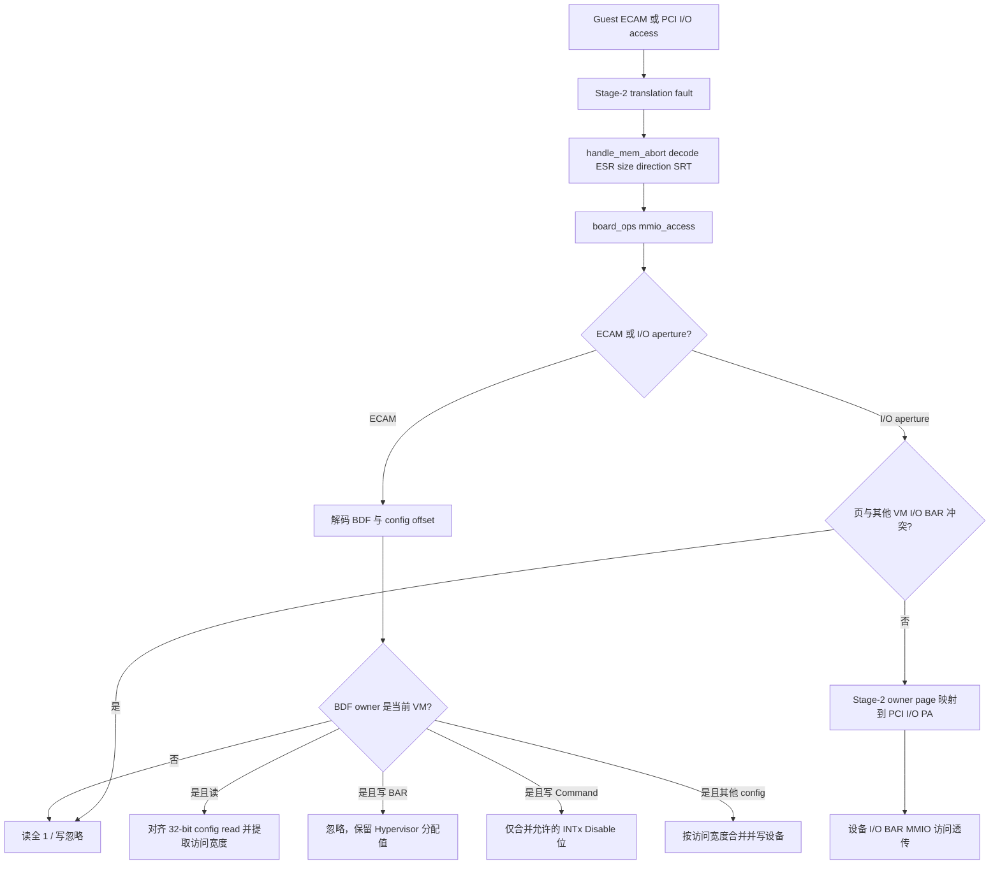
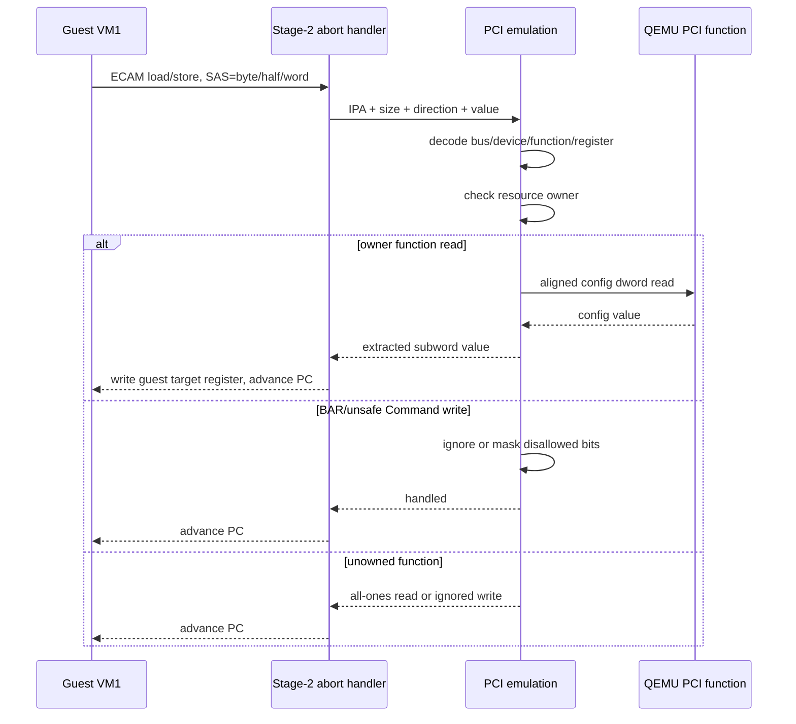

# aVisor Hypervisor Phase 110 详细设计文档：ECAM 模拟与 I/O BAR 直通

> 阶段：Phase 110
> 平台：QEMU virt（AArch64、EL2、GICv3、ITS）
> 前置阶段：Phase 109 PCI enumeration 与 owner resource query

## 1. 目标与范围

Phase 110 将 Guest 的 PCI ECAM 从 Stage-2 设备直通改为 EL2 trap-and-emulate，并把 PCI I/O BAR aperture 纳入 owner VM 的 Stage-2 映射。ECAM 配置访问按 byte/halfword/word 宽度模拟；未归属 function 返回全 1，写入忽略。BAR 写由 Hypervisor 忽略，PCI Command 仅允许 Guest 改变 INTx Disable 位，I/O、Memory 与 Bus Master enable 位由 Hypervisor 保持。

I/O aperture 映射以 4KB 页为单位。若拟映射页与其他 VM 所属 I/O BAR 相交，则拒绝该映射，避免把共享页内其他设备的寄存器暴露给 owner VM。

## 2. 访问与映射流程

## 3. 实现细节

- `board_ops.mmio_access` 为新 size-aware callback，参数包含访问地址、字节宽度、读写方向和 in/out value。`handle_mem_abort()` 对该 callback 优先分派，未处理时保留既有 `mmio_read/mmio_write` 路径。
- ESR.SAS 提供 1/2/4/8 byte size；本 PCI callback 处理 byte、halfword、word，其他尺寸回退到既有通用路径。Guest 配置空间测试使用 16-bit Vendor ID read。
- `pci_is_mmio_addr()` 将 ECAM 与 PCI I/O aperture 识别为 MMIO fault 区域；ECAM 页不再映入 Guest Stage-2。
- ECAM BDF 解码后查 PCI resource table 的 owner。未归属 function 的读返回访问宽度对应的全 1，写忽略。
- owner function 的 BAR 写忽略；Command 写只保留 Guest 对 INTx Disable 的控制，Command 低字节其它位及高字节其它位不由 Guest 改写；其它配置字节写按 lane 合并后转发设备。
- `pci_map_owned_io()` 仅映射当前 VM 所属 I/O BAR 覆盖的 aperture pages。每页检查所有资源表中的其它 VM I/O BAR，冲突即拒绝；同一 owner 的多个 BAR 可共享已映射页。
- PCI passthrough mapping 失败会撤销本次已映射的 edu BAR 页；I/O map helper 冲突时先回滚其本次页映射。

## 4. 代码映射

| 文件 | 变更 |
|---|---|
| `include/common/board.h` | 新增 width/direction-aware `mmio_access` callback |
| `hypervisor/common/mm.c` | 从 ESR 提取 SAS、方向和值，调用 callback 并处理读回寄存器 |
| `hypervisor/boards/virt/pci.c` | ECAM owner trap-and-emulate、BAR/Command 策略、I/O aperture mapping/conflict guard |
| `include/boards/virt/pci.h` | 导出 PCI fault classifier 与访问 callback |
| `hypervisor/boards/virt/virt_board.c` | 将 ECAM/I/O aperture 纳入 fault classifier 并注册 PCI callback |
| `guests/el1_test/main.c` | 增加 16-bit ECAM Vendor read 与 BAR relocation write-protection 检查 |

## 5. 验证

构建：`make -f Makefile.virt -j$(nproc)`，通过。Guest 构建有既有 warning；Hypervisor common/mm 仍有既有 deallocate_page 指针类型 warning。

基础拓扑：`timeout 65 make -f Makefile.virt run-log QEMU_SERIAL_LOG=/tmp/avisor-phase110-basic-final.log`。日志显示 VM1 只映射 1 个 owned device、ECAM emulated、I/O aperture 0 页。Guest PCI discovery、16-bit Vendor read、BAR write protection、edu identification/liveness/factorial、MSI、中断投递、reset + MSI reinit 均通过。

嵌套桥拓扑使用 edu `00:03.0`、两级 PCI bridge 与桥下 e1000，日志为 `/tmp/avisor-phase110-nested-final.log`。递归枚举发现 `00:04.0`、`01:01.0` 两级 bridge 和 `02:02.0` e1000；Guest dynamic PCI discovery、16-bit read、BAR write protection、MSI、reset + MSI reinit 均通过。edu requester ID 为 24。e1000 属于未透传设备，因此它的 I/O BAR 未映射入 VM1；I/O aperture 的 owner page mapping 和 cross-owner conflict 分支尚无可用的 VM-owned I/O BAR 拓扑进行正向 QEMU 测试。

Guest 完整日志仍包含已有 `FAIL: task 槽位未被实际复用`，与前序阶段记录的 task-slot reuse 自测失败一致；本阶段不宣称全量 Guest 回归通过。

## 6. 限制

- ECAM 当前仍允许 owner VM 写 MSI/PCIe capability 等非 BAR/Command 寄存器；vMSI/MSI message address/data write interception 尚未实现，Hypervisor requester ownership 校验仍是中断路由的保护层。
- I/O BAR 页映射目前没有 owner I/O BAR 正向拓扑覆盖；跨 owner 同页拒绝逻辑需要专门设备拓扑验证。
- QEMU `virt` 物理 PCI I/O aperture 仍由平台 runtime mapping 提供；Stage-2 映射按 owner 页粒度做隔离。
- PCI DMA 尚无 SMMU/IOMMU 隔离，不能据此视为安全的通用设备直通方案。
