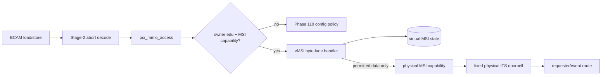
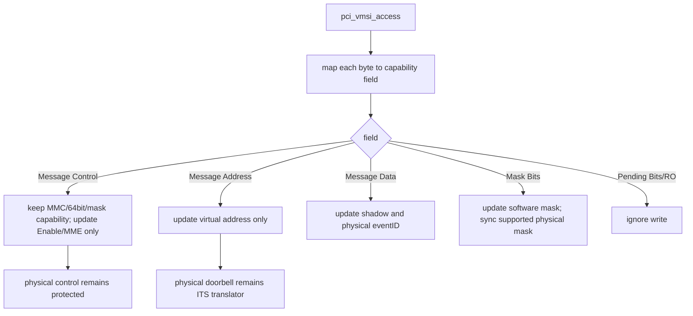
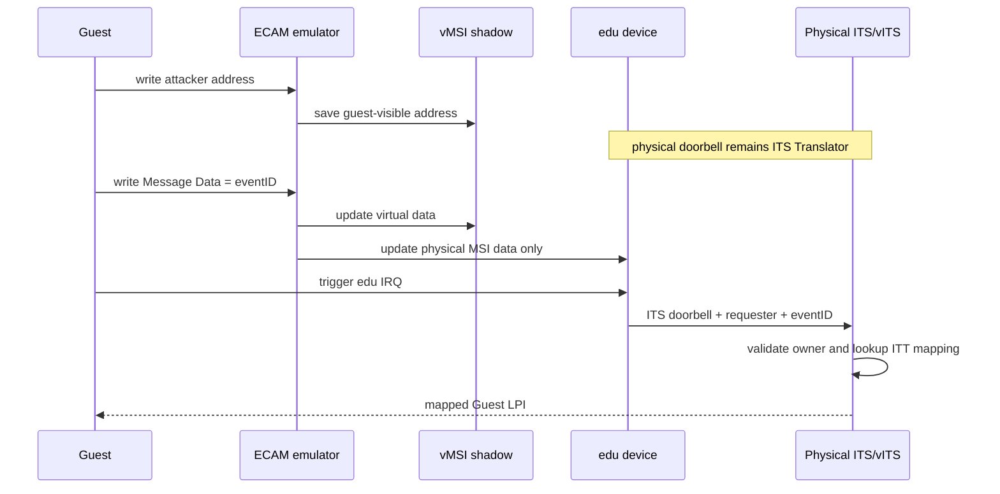
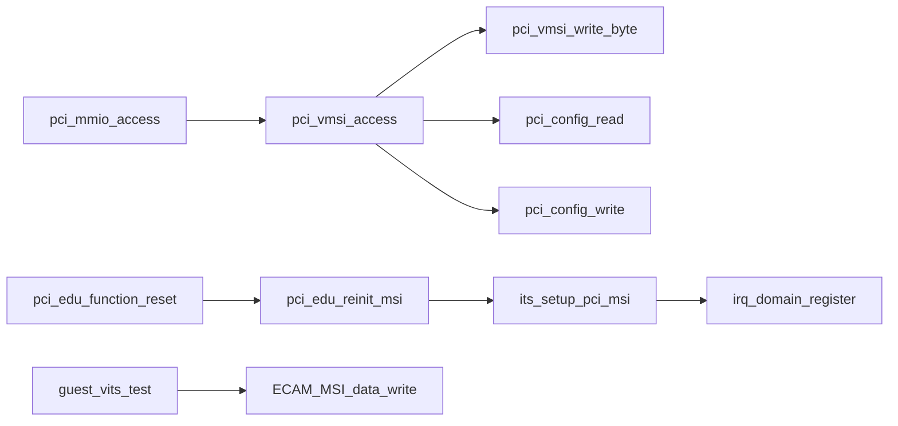

# aVisor Phase 111 详细设计：edu vMSI 与 MSI 配置写拦截

> 平台：QEMU virt / AArch64 EL2 / PCI ECAM emulation / ITS
> 前置阶段：Phase 110 ECAM trap-and-emulate
> 范围：VM1 edu 的 MSI capability 虚拟化；不含 MSI-X Table/PBA 拦截（见限制）

## 1. 安全目标

Guest 需要控制 MSI Message Data/eventID，但不能改变物理 MSI doorbell，使设备向 Hypervisor ITS 之外任意地址写入。Phase 111 在 ECAM emulator 中加入 edu vMSI shadow state：Guest 写虚拟地址只影响 guest-visible 状态；物理地址始终由 Hypervisor 固定为 ITS Translator，eventID 经 owner/requester 校验后路由。

## 2. 数据模型

阶段实现使用 edu 专属 vMSI 状态，包含：

| 状态 | 语义 |
|---|---|
| capability offset/layout | MSI capability 位置、32/64-bit 地址和可选 mask 布局 |
| virtual control | Guest-visible Enable/MME；MMC/能力位只读 |
| virtual address | Guest 对配置空间读写看到的地址状态 |
| virtual data | Guest eventID，更新时同步物理 Message Data |
| mask/pending | 软件 Mask/Pending shadow；Pending 只读 |
| physical address | 固定 ITS Translator PA，不由 Guest 提供 |

MME 不超过 MMC。物理设备 MSI Enable 保持 Hypervisor 控制，物理 MME 固定单向量，Guest 不能要求未分配物理 vector。

## 3. 配置访问架构

## 4. Byte-lane 写入策略

32-bit/64-bit MSI capability的 Message Data、Mask、Pending offset 按 control 的 64-bit bit 计算。每个访问字节单独合并，确保跨 lane 写不会改动保留字段。

## 5. MSI 投递时序

## 6. Reset/reinit

edu reset 先 quiesce 并撤销旧 MSI mapping；重新初始化时重建 ITS route、恢复物理 doorbell/eventID 0 和受控物理 control。Guest-visible Enable 恢复到可用状态，software Mask/Pending 清零。Guest 后续可写入有 vITS event mapping 的 eventID。

## 7. 函数调用关系与文件职责

| 文件 | 职责 |
|---|---|
| `hypervisor/boards/virt/pci.c` | edu vMSI shadow、capability layout、物理 MSI policy、reset reinit |
| `guests/el1_test/main.c` | 虚拟/物理地址保护、eventID 投递和 reset 回归 |

## 8. 验证

- `make -f Makefile.virt -j$(nproc)`：PASS。
- 默认拓扑确认 64-bit MSI；Guest 写入 `0xdead0000` 后物理地址保持 ITS doorbell `0x08090040`；Message Data=1 后收到 vSPI 72/vLPI 8200；reset/reinit 后再次投递通过。
- nested bridge 下 edu requester 24，MSI protection、eventID delivery、reset recovery 通过。
- 日志无 PANIC/ASSERT/Data Abort；已有 task-slot reuse FAIL 不纳入本阶段通过项。

## 9. 限制

- 只覆盖 owner edu，不是通用 per-function capability state。
- MSI-X 仅虚拟化配置空间（Control 读写、物理 Enable 强制关闭）；Table/PBA 所在 BAR 的 MMIO 未拦截。edu 只有 MSI 无 MSI-X，`00:01.0` 有 MSI-X 但无 guest 用例访问其 Table，因此未做实测。
- Mask/Pending 是软件状态；硬件 mask 同步不保证所有设备都遵循虚拟 mask 语义。
- Guest eventID 必须有合法 requester/vITS 映射，否则不会得到有效 Guest LPI。
- 无 SMMU/IOMMU DMA 隔离。
