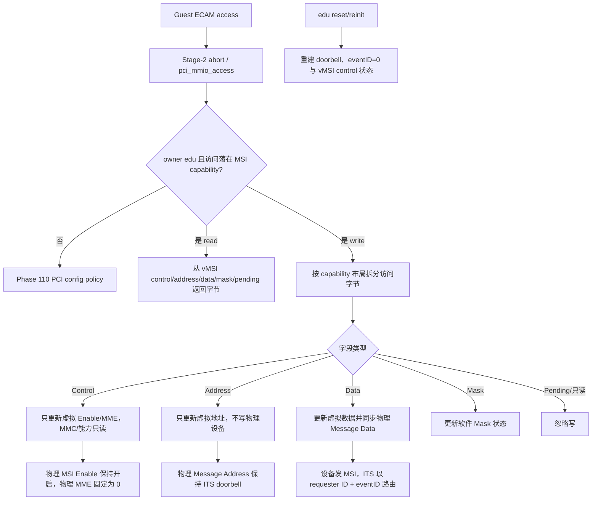
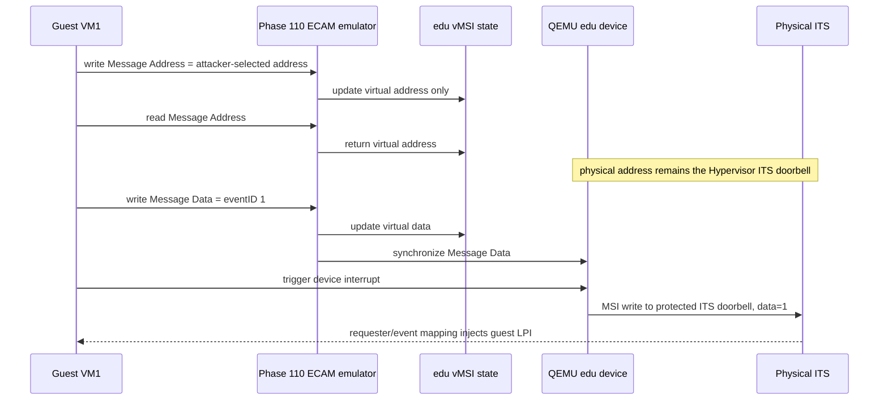

# aVisor Hypervisor Phase 111 详细设计文档：vMSI 与 MSI 写拦截

> 阶段：Phase 111
> 平台：QEMU virt（AArch64、EL2、GICv3、ITS）
> 前置阶段：Phase 110 PCI ECAM trap-and-emulate

## 1. 目标

Phase 111 在 Phase 110 的 ECAM 模拟上为 owner VM1 的 edu PCI function 增加虚拟 MSI 状态。Guest 可以读取和更新虚拟 Message Address、Message Data、MSI Enable、MME 和可选 Mask Bits，但不能通过配置空间把物理 MSI doorbell 改到 ITS 之外。物理 Message Address 始终由 Hypervisor 设置为 ITS Translator 地址；Guest 选择的 Message Data 同步到物理设备，作为 ITS eventID。

目前实现只覆盖 edu 单设备 MSI。MSI-X、其他 PCI function 的 MSI capability 和 PCI DMA/IOMMU 不属于本阶段范围。

## 2. 流程

## 3. MSI capability 状态与布局

- `edu_vmsi_ctrl` 保存 Guest-visible Message Control。MMC、64-bit capability 和 Per-vector Masking capability 来自探测到的硬件能力，不接受 Guest 修改；Guest 仅能写 MSI Enable 与 MME。MME 不得超过 MMC。
- `edu_vmsi_addr` 保存 Guest 的虚拟 Message Address。物理 MSI 地址不由该字段驱动；设备启用 MSI 时 Guest read 返回 Hypervisor ITS doorbell，Guest 对地址的 write 只改虚拟字段。
- `edu_vmsi_data` 保存 Guest-visible Message Data，并在每次更新后同步至设备的 Message Data 字段，使 ITS 能以 Guest 选定 eventID 查找 ITT。
- `edu_vmsi_mask` 保存可选 Per-vector Mask Bits；`edu_vmsi_pending` 保存只读 Pending Bits 软件状态。
- 32-bit/64-bit MSI 按 capability control 的 64-bit 位计算 Message Data、Mask、Pending 偏移和 capability 长度。未实现 Mask capability 时，不暴露其后续字节。
- MSI Control 的物理 Enable 始终保持开启，物理 MME 固定为 0（一个硬件向量）。Guest-visible Enable/MME 是虚拟状态；避免 Guest 关闭物理 MSI 或要求设备发送未经 Hypervisor 分配的多个物理向量。

## 4. Reset

edu quiesce 阶段使 Guest-visible MSI Enable 清零，但物理 MSI 保持启用以维持受控的中断通路。function reset 后重新建立 ITS mapping，恢复 ITS doorbell 与 eventID 0，设置 vMSI Enable 并清空软件 Mask/Pending 状态。Guest 之后仍可通过 MSI data 写入选择已在 vITS 中映射的 eventID。

## 5. 代码映射

| 文件 | 变更 |
|---|---|
| `hypervisor/boards/virt/pci.c` | edu vMSI 状态、32/64-bit capability byte access、物理 MSI address/data/control 策略、reset/reinit 同步 |
| `guests/el1_test/main.c` | 验证虚拟/物理隔离的 Message Address、只读控制能力位、eventID 路由及 reset 后 MSI |

## 6. 验证

构建：`make -f Makefile.virt -j$(nproc)`，通过。

基础拓扑日志：`/tmp/avisor-phase111-basic.log`。验证 MSI capability 为 64-bit、Guest-visible Enable/Mask capability 保留；Guest 写入 `0xdead0000` 后读回仍为物理 ITS doorbell `0x08090040`；Guest 写 Message Data=1 后 vITS 收到 vSPI 72（vLPI 8200）；edu function reset 后 MSI reinit 和再次 eventID 路由通过。

嵌套桥拓扑日志：`/tmp/avisor-phase111-nested.log`。edu requester ID 为 24，两级桥及下挂 e1000 枚举后，同一组 vMSI address protection、eventID delivery 和 reset recovery 测试通过。

全量 Guest 输出仍有已知 `FAIL: task 槽位未被实际复用`，与 vMSI 无关；不宣称全量回归全部通过。未发现 PANIC、ASSERT 或 Data Abort。

## 7. 限制

- vMSI 只虚拟化 owner VM1 的 edu；其他设备 MSI 仍按现有 config policy 处理。
- MSI-X 尚未模拟。
- Mask/Pending 为软件状态，未同步设备物理 mask；Guest mask 向量不保证阻止设备发 MSI。
- MSI Data 是 eventID。Guest 只能成功路由至 vITS 中存在且 requester owner 合法的 event 映射；无映射 event 不会得到有效 Guest LPI。
- PCI DMA 尚无 SMMU/IOMMU 隔离。
