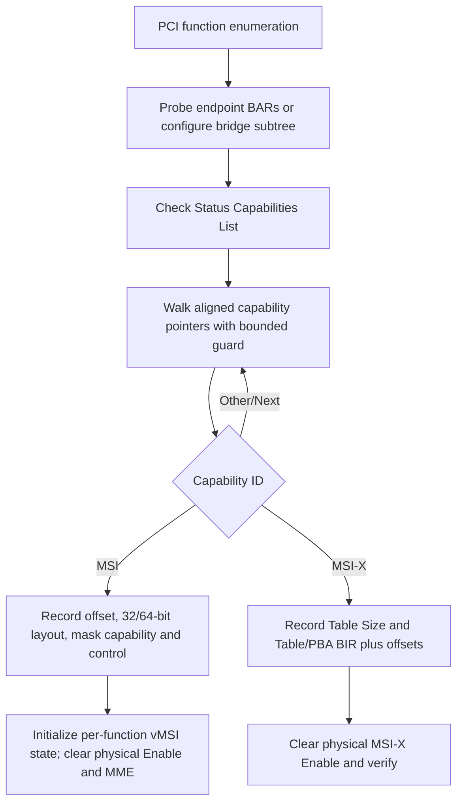
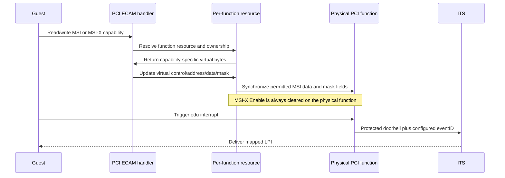

# aVisor Hypervisor Phase 112 详细设计文档：通用 PCI vMSI 与 MSI-X 能力模拟

> 阶段：Phase 112  
> 平台：QEMU virt（AArch64、EL2、GICv3、ITS）  
> 前置阶段：Phase 111 vMSI 与 MSI 写拦截

## 1. 目标与边界

Phase 112 将 MSI capability 元数据及虚拟控制状态从 edu 专属状态迁移到每个枚举到的 PCI function，并扩展 capability 链扫描至 endpoint 和 bridge。对具备 MSI-X 的 function，记录 Table Size、Table/PBA 的 BAR 与偏移，虚拟化 Enable 和 Function Mask，并在物理设备侧强制关闭 MSI-X Enable。

本阶段保留 Phase 111 的 owner edu ITS doorbell 路径。MSI Message Data 与 mask bits 更新会按 capability 布局同步至相应物理设备寄存器；Pending Bits 仅提供软件只读状态。非 owner function 的 ECAM 访问仍受 Phase 110 ownership 策略限制，Guest 不能因通用枚举而获得该 function 的配置空间访问权。

MSI-X Table/PBA 所在 BAR 的 MMIO 尚未进行重映射、保护或仿真；本阶段只模拟 MSI-X capability 配置空间。PCI DMA 仍没有 SMMU/IOMMU 隔离。

## 2. 枚举与状态初始化

`pci_init_vmsi()` 在每个 function 的枚举处理后执行。capability pointer 必须位于标准 capability 区域并按 DWORD 对齐，遍历次数有界。所有虚拟 MSI/MSI-X 控制状态与 PCI function resource 绑定，edu reset/reinit 直接更新 edu 对应 resource，避免专属全局状态与通用状态分叉。

## 3. MSI 配置空间策略

- Control 的 MMC、64-bit 和 Mask capability 位作为能力信息保留。虚拟 Enable/MME 可由配置空间写入更新，MME 限制在 MMC 范围内。
- Message Address 保存在每 function 的虚拟状态。owner edu 的读取仍返回 ITS Translator doorbell；写入不会改写物理 Message Address。
- Message Data 按 32/64-bit capability 布局解码。写入更新虚拟值并同步对应 function 的物理 Message Data 字段。
- 支持 Per-vector Masking 的 capability 才暴露 Mask/Pending 字段。Mask 写入更新虚拟状态并同步物理 Mask register；Pending Bits 只读，Guest 写入被忽略。
- 未实现 Per-vector Masking 的 MSI capability 不把 capability 后续字段误当作 Mask/Pending 状态。

## 4. MSI-X 配置空间策略

- Cap ID、Next、Table Size、Table Offset 和 PBA Offset 从设备 capability 配置空间读取并透传。
- Message Control 中 Enable 和 Function Mask 由每 function 的虚拟 `msix_ctrl` 管理。Table Size 是只读字段。
- Table/PBA BIR 与 DWORD 对齐后的偏移保存在 resource metadata。Guest 写入 Table/PBA DWORD 被忽略。
- 初始化时清除物理 Message Control 的 MSI-X Enable 位，并读回确认关闭。Guest 对虚拟 Enable 的写入不会打开物理 MSI-X。
- 本阶段不对 MSI-X Table/PBA 的 BAR MMIO 提供拦截或仿真，虚拟启用 MSI-X 不能视为表项安全隔离已经完成。

## 5. Guest 与 Hypervisor 数据流

## 6. 验证结果

- `make -f Makefile.virt -j$(nproc)`：PASS。Guest 构建仍报告既有 warning，包括 `guest_secondary_main` 声明顺序、未使用变量和既有格式/类型 warning；本阶段没有新增编译错误。
- 默认 QEMU virt：发现 `00:01.0` virtio-net MSI-X（4 vectors，Table BAR1+0），并确认初始化日志为 `physical=off`；发现 `00:02.0` edu 64-bit MSI capability。edu MSI 虚拟地址保护、eventID=1 的 vITS 中断（vSPI 72/vLPI 8200）及 reset/reinit：PASS。
- Nested bridge 拓扑：发现 edu `00:03.0`、两个 bridge `00:04.0`/`01:01.0` 和 e1000 `02:02.0`。识别 edu/e1000 MSI capability；e1000 声明 Per-vector Masking。Guest edu MSI/vITS 中断：PASS。
- 两种拓扑均未观察到 PANIC、ASSERT 或 Data Abort。QEMU 由 timeout 停止；既有 task-slot reuse 等 Guest suite FAIL 仍可能出现，不据此声称全量测试通过。
- Guest 当前只能访问 owner edu 的 PCI ECAM，故不能直接正向测试 non-owner virtio-net MSI-X 虚拟读写。MSI-X 通过 Hypervisor 枚举和物理 Enable 读回检查覆盖；未验证 MSI-X Table/PBA MMIO 隔离。

## 7. 已知限制

1. MSI-X Table/PBA BAR MMIO 尚未仿真或隔离；Guest ownership 当前限制降低了暴露面，但不能替代未来明确的 BAR 页面隔离。
2. PCI DMA 尚无 SMMU/IOMMU requester 隔离。
3. 只有 edu 被分配给 VM1；其他 function 的通用 vMSI 状态已初始化，但其 ECAM 访问不因此授权。
4. 物理 MSI-X Enable 初始化失败会记录 warning；此时不能将该 function 的 MSI-X 视为安全关闭。
