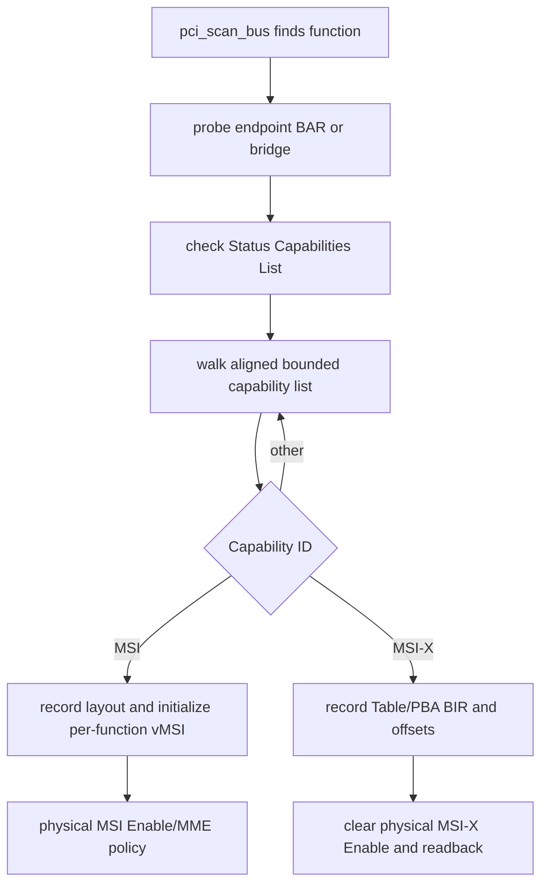
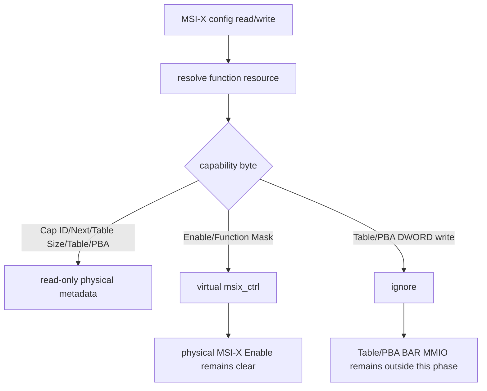
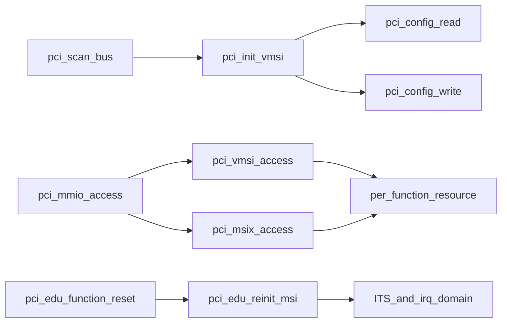

# aVisor Phase 112 详细设计：通用 PCI vMSI 与 MSI-X Capability 模拟

> 平台：QEMU virt / AArch64 EL2 / PCI ECAM emulation / ITS
> 前置阶段：Phase 111 edu vMSI write interception
> 本阶段：capability 状态关联到每个 PCI function，并识别 MSI-X 元数据

## 1. 目标与安全边界

Phase 111 的 vMSI 状态绑定 edu 全局变量，无法扩展到不同 BDF/能力布局。Phase 112 将 MSI/MSI-X capability 元数据与虚拟控制状态关联到每个 PCI function resource，遍历 endpoint 和 bridge function 的 capability list。

这是能力建模和配置空间模拟，不代表所有 function 被授权给 Guest。Phase 110 ownership policy 仍限制 Guest ECAM 至 owned edu。MSI-X Table/PBA 所在 BAR MMIO 没有被本阶段重映射或仿真，不能把虚拟 MSI-X Enable 当作表项隔离完成。

## 2. Function resource 扩展

每个 PCI function 的 resource entry 持有：

- MSI capability offset、Control 能力位、32/64-bit 布局、virtual control/address/data/mask/pending；
- MSI-X capability offset、Table Size、BIR/offset、PBA BIR/offset、virtual Message Control；
- 原 PCI BDF、owner 和 BAR resource array。

capability pointer 必须位于配置空间 capability 区域并 DWORD 对齐，遍历次数有界，防止损坏链表死循环。MSI-X 的物理 Enable 初始化为 off 并读回确认；Guest Enable/Function Mask 保存在虚拟状态。

## 3. 初始化架构

## 4. MSI capability byte policy

- MMC、64-bit capability、mask-capable 位為只讀硬體能力。
- Guest 可更新 virtual Enable/MME，MME 必須受 MMC 限制。
- Message Address 保存在 function virtual state；edu 物理地址仍固定 ITS doorbell。
- Message Data 依 capability 布局同步到對應 function 物理 data field。
- 只有宣告 per-vector masking 才處理 Mask/Pending；Pending 只讀。
- 非 mask-capable MSI 不把後續 config bytes 當作 mask/pending。

## 5. MSI-X capability policy

Table Size 保持只读；BIR 和 offset 保存供後續实现使用，Guest 写入 Table/PBA DWORD 被忽略。物理 MSI-X Enable 强制关闭并 readback。

## 6. 调用图与模块边界

| 文件 | 职责 |
|---|---|
| `hypervisor/boards/virt/pci.c` | per-function MSI/MSI-X metadata 与配置读写模拟 |
| `include/boards/virt/pci.h` | BAR flag 和 PCI API |
| `guests/el1_test/main.c` | owner edu MSI end-to-end 验证 |

## 7. 错误和隔离属性

- capability 链超界、未对齐或过长时停止解析，不继续访问任意 config 地址。
- 物理 MSI-X Enable 无法确认关闭时记录告警；该 function 的 MSI-X 不可视为已被安全隔离。
- non-owner ECAM 仍返回全 1/忽略写。
- PCI DMA 与 MSI-X Table BAR 的数据面隔离不由 capability emulation 提供。

## 8. 验证

- `make -f Makefile.virt -j$(nproc)`：PASS；Guest 构建保留既有 warnings。
- 默认 QEMU 识别 virtio-net MSI-X 4 vectors、Table BAR1+0，physical Enable=off；edu 64-bit MSI、地址保护、eventID 1 delivery 和 reset/reinit 通过。
- nested bridge 识别 edu、bridge 和 e1000 MSI capability；Guest owner edu MSI/vITS 通过。
- 由于 Guest 只能访问 owner edu，non-owner virtio MSI-X virtual read/write 未做正向 Guest 测试；Table/PBA MMIO 隔离未验证。

## 9. 限制

- MSI-X Table/PBA BAR MMIO 尚未 trap/emulate 或隔离。
- 非 owner function 虽有 per-function metadata，Guest 不因此获得配置空间权限。
- 物理 MSI-X Enable 初始化失败只告警，不能宣称关闭保证。
- 无 SMMU/IOMMU requester DMA isolation。
