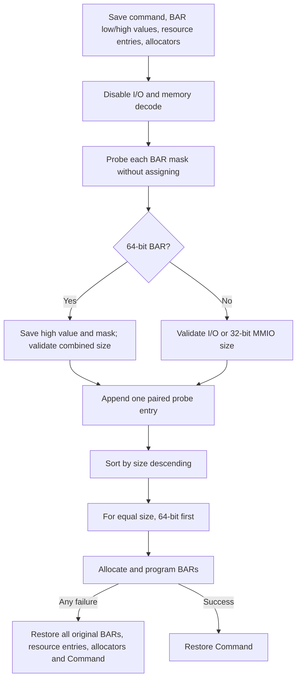

# aVisor Hypervisor Phase 113 详细设计文档：PCI BAR 降序分配与桥窗口回滚

> 阶段：Phase 113  
> 平台：QEMU virt（AArch64、EL2、GICv3、ITS）  
> 前置阶段：Phase 112 通用 PCI vMSI/MSI-X capability 初始化

## 1. 目标

Phase 113 改进 PCI BAR 分配顺序和失败处理：完整探测 function 的 BAR 后按尺寸降序分配，保留 64-bit BAR 的完整配对信息；桥递归扫描失败时恢复分配器、枚举状态及本桥配置；配置 bridge 的 32-bit I/O Base/Limit Upper 字段，以支持超过 64KB 的 I/O aperture。

## 2. BAR 探测与排序

`struct bar_probe_entry` 保存 BAR index、size、原始低/高 DWORD、探测 mask、I/O/MMIO 类型和 64-bit 标记。64-bit BAR 作为一个 entry 排序和分配，遍历时跳过其高 DWORD slot。尺寸不是非零 2 的幂或 64-bit size 超出当前 allocator 可表示范围时，分配事务回滚。

I/O BAR 与 MMIO BAR 共同按资源尺寸排序，但各自仍从独立 allocator 获取空间。相同尺寸时 64-bit BAR 排在 32-bit BAR 前。

## 3. Bridge 配置与回滚

- 递归扫描前保存 bridge bus-number、I/O window、I/O upper、memory window、Command，以及 allocator 游标、bus 游标和资源表计数。
- 子树扫描失败时恢复上述状态与 bridge resource 的 bus 字段，并输出 rollback warning。
- 桥下有 I/O BAR 时，I/O Base/Limit 类型位设置为 32-bit；写入 0x30/0x34 的 I/O Base/Limit Upper DWORD，并读回检查。
- 无 I/O BAR 时关闭 I/O window 并清零 upper DWORD。
- I/O 窗口按 4KB 粒度向下/向上覆盖 allocator 区域；memory window 仍按 1MB 粒度配置。

## 4. 验证

- `make -f Makefile.virt -j$(nproc)`：PASS。
- 默认 QEMU virt：virtio-net BAR4 0x4000 先于 BAR1 0x1000 分配；edu BAR0、liveness、factorial、vITS eventID 1（vSPI 72/vLPI 8200）、function reset 与 MSI reinit 全部 PASS。
- Nested bridge QEMU：递归发现 `00:04.0`、`01:01.0` 两级 bridge 和 `02:02.0` e1000；e1000 BAR0 0x20000 先于 BAR1 I/O 0x40 分配；两个 bridge 均配置 memory/I/O window；I/O upper register readback 未报告 mismatch。Guest edu/vITS/reset 回归 PASS。
- 未观察到 PANIC、ASSERT、BAR allocation failure 或 Stage-2 mapping failure。QEMU 由 timeout 结束。
- 本阶段没有模拟资源耗尽或人为注入递归扫描错误，因此 rollback 路径以代码审查覆盖，未声称运行时故障注入 PASS。

## 5. 已知限制

1. 分配器仍为线性递增 allocator，不维护空闲区间，也不做 best-fit/worst-fit。
2. 64-bit BAR 受当前 MMIO aperture 限制，未分配到独立 64-bit/prefetchable 窗口。
3. PCIe Prefetchable Memory Base/Limit window 仍未实现。
4. DMA 仍无 SMMU/IOMMU requester 隔离。
