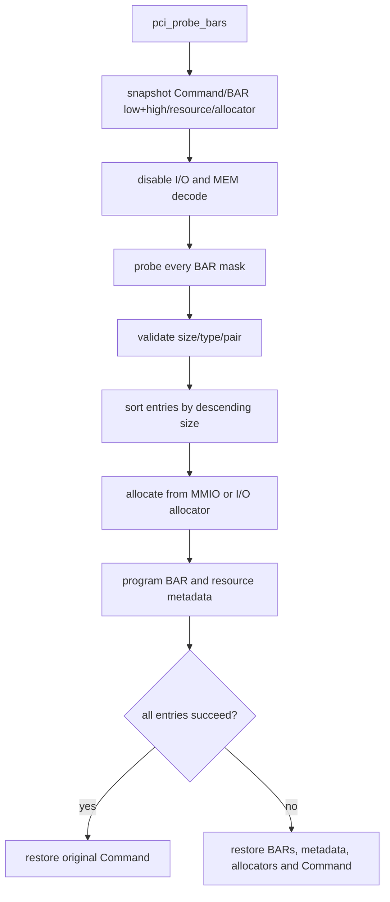
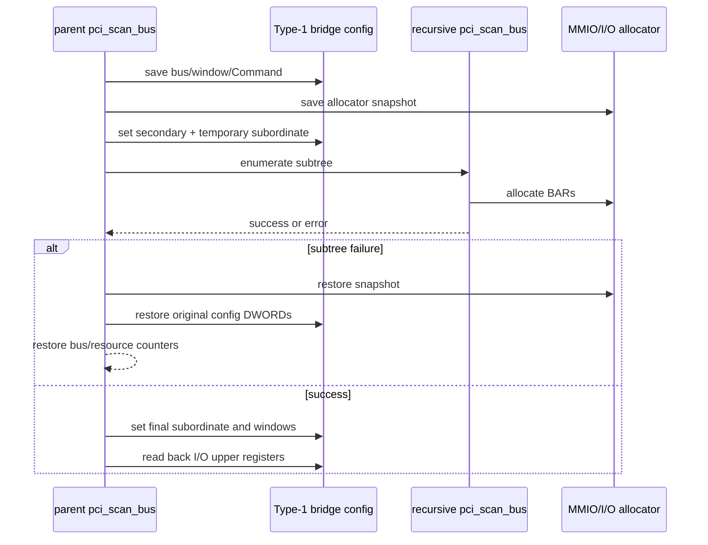
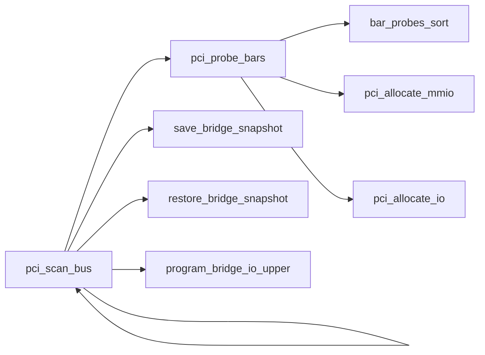

# aVisor Phase 113 详细设计：BAR 降序分配与 Bridge 事务回滚

> 平台：QEMU virt / AArch64 EL2 / PCI-to-PCI bridge
> 前置阶段：Phase 112 per-function vMSI/MSI-X capability metadata
> 本阶段：先完整探测 BAR，再按 size 排序分配；bridge 子树失败恢复配置和枚举状态

## 1. 问题与目标

Phase 108 逐个 BAR 分配会让小 BAR 先占据大 BAR 需要的连续范围。递归 bridge 扫描中，子设备失败也可能留下 bus number、配置窗口和资源分配的半完成状态。Phase 113 将 BAR 配置拆成 probe 与 commit 两段，并建立 bridge scan transaction。

本阶段仍使用线性 allocator；free-range pool、best-fit 和 prefetchable window 在 Phase 114 之后实现。

## 2. BAR probe entry

每个有效资源用 `bar_probe_entry` 暂存：BAR index、size、flags、原始 low/high DWORD、mask low/high、I/O/64-bit 类型。64-bit BAR pair 只产生一个 entry，排序/分配后跳过 high slot。

排序规则：

1. size descending，先放置最大 BAR；
2. 相同 size 时 64-bit BAR 优先；
3. 同类型保持稳定扫描次序。

## 3. Endpoint transaction

尺寸必须非零、为 2 的幂，并可由当前 allocator/aperture 表示。64-bit size 超出当前 32-bit MMIO aperture 处理范围时整个 function assignment 回滚。

## 4. Bridge subtree transaction

递归前 snapshot：bus-number DWORD、Command、I/O Base/Limit 与 upper、Memory window、allocator state、`pci_next_bus`、设备资源计数及相关 resource bus 字段。子树递归或窗口编程失败时恢复 bridge 配置、pool/bus cursors 和 resource count。

Phase 114 以 pool snapshots/free ranges 取代 linear cursor 回滚；本阶段设计的事务边界仍作为后续 pool snapshot rollback 的基线。

## 5. Bridge I/O upper registers

下游存在 I/O BAR 时，将 Type-1 I/O Base/Limit 类型位设为 32-bit encoding，并写 offset `0x30`/`0x34` upper fields；无 I/O resource 时关闭窗口并清零 upper。窗口按 4 KiB 粒度覆盖。Memory window 仍按 1 MiB 粒度。

## 6. 函数调用图

## 7. 代码映射

| 文件 | 职责 |
|---|---|
| `hypervisor/boards/virt/pci.c` | probe entry、排序、BAR rollback、bridge snapshot/window programming |
| `include/boards/virt/pci.h` | PCI resource flags/API |
| `docs/phase-logs/phase113.log` | 当阶段构建/拓扑实测记录 |

## 8. 验证

- `make -f Makefile.virt -j$(nproc)`：PASS。
- 默认 QEMU：virtio BAR4 `0x4000` 先于 BAR1 `0x1000`；edu/vITS/reset/MSI recovery markers 通过。
- nested bridge：两级 bridge 和 bus 2 e1000 被发现；e1000 BAR0 `0x20000` 先于 BAR1 I/O `0x40`；I/O upper readback 无 mismatch，bridge MMIO/I/O windows 有效。
- 无资源耗尽或递归错误注入；rollback 仅由代码路径审阅，不能声称运行时 fault injection pass。

## 9. 后续演进与限制

- Phase 113 allocator 是线性递增；Phase 114 引入独立 free-range pool。
- Phase 113 没有 prefetchable bridge window。
- 64-bit BAR 没有独立高于 4 GiB aperture；本阶段依赖当前低于 4 GiB 的平台范围。
- 无 SMMU/IOMMU DMA isolation。
