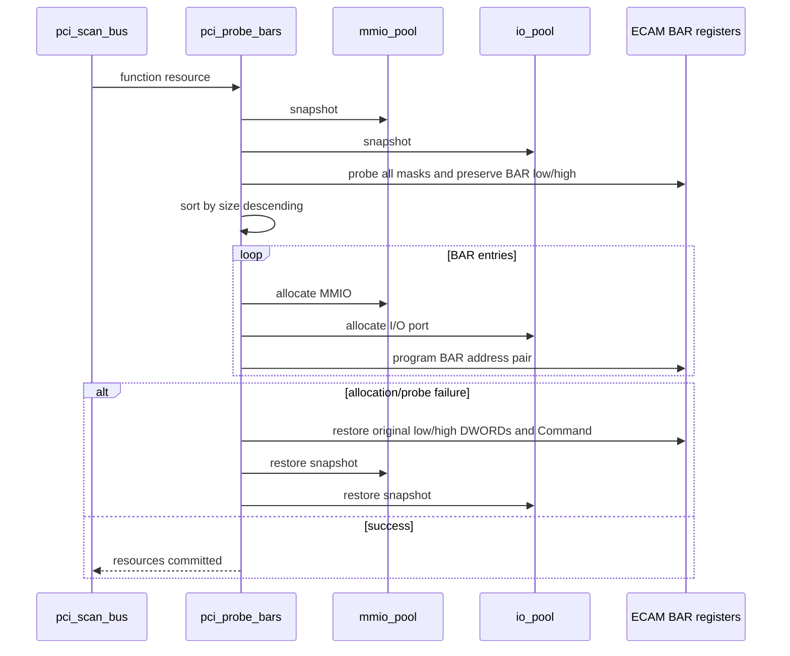
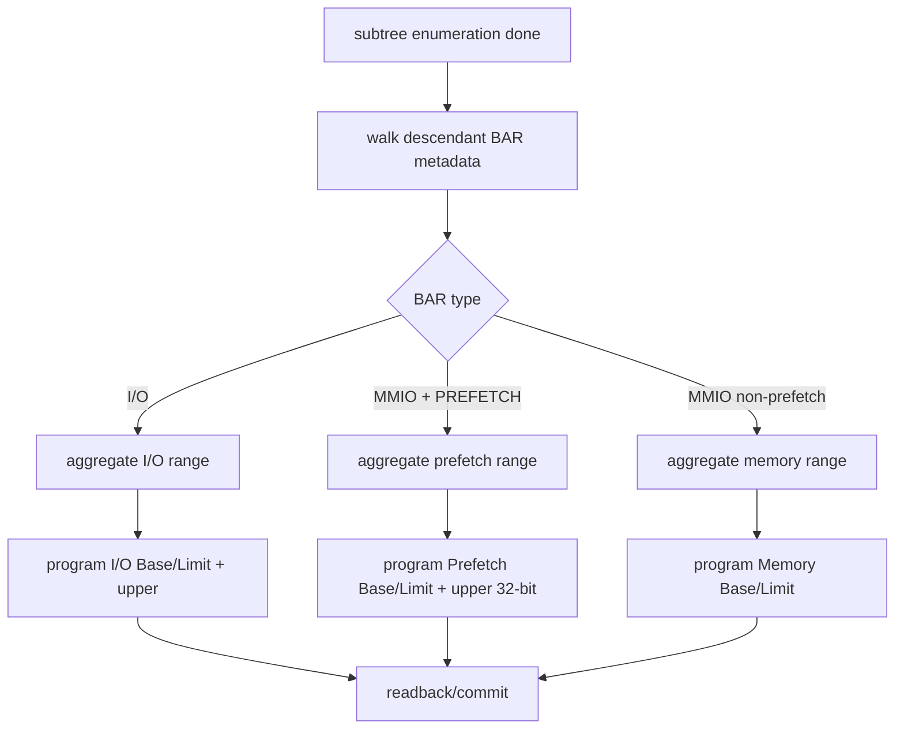
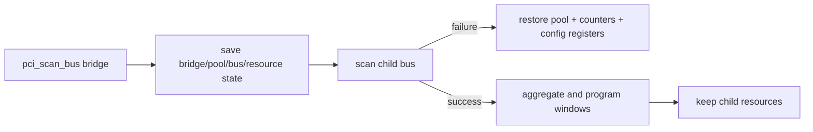

# aVisor Phase 114 详细设计：PCI 空闲区间 Pool 与 Prefetch Bridge Window

> 平台：QEMU virt / AArch64 EL2 / PCIe ECAM
> 前置阶段：Phase 113 BAR descending allocation 与 bridge rollback
> 本阶段：MMIO/I/O free-range pool、best-fit、prefetchable bridge aperture

## 1. 目标

线性游标分配不能表示空洞、释放和窗口保留；bridge 也必须分别转发 non-prefetch MMIO、prefetchable MMIO 和 I/O。Phase 114 用独立 pool 替代游标，并保留 Phase 113 的 BAR probe/sort transaction。

本阶段 pool 固定容量 64 个 free ranges；Phase 115 扩展释放合并和 reservation，Phase 116/117 扩展高端策略与策略框架。

## 2. 数据模型

```c
struct pci_free_range {
    uint64_t base;
    uint64_t size;
};

struct pci_resource_pool {
    struct pci_free_range ranges[PCI_FREE_LIST_MAX];
    unsigned int count;
    uint64_t base;
    uint64_t size;
};
```

MMIO 与 I/O pool 分离，避免不同地址空间 BAR 互相消耗。pool allocator API 以状态码返回成功与否，地址通过输出参数传递，因此 I/O port 0 可作为有效分配。

## 3. Best-fit 算法

对每个 free range：

1. 校验 base/size 范围不溢出；
2. 把请求大小向上按自身大小对齐；
3. 判断请求能否放入；
4. 计算 range size 与 request size 的 waste；
5. 选择 waste 最小区间；
6. 分配后将原 range 删除，插入左/右剩余片段（可为 0、1、2 个）；
7. 若静态表容量不足，分配失败且不修改 pool。

```mermaid
flowchart TD
    A[pool_alloc(size)] --> B[validate pool/request]
    B --> C[scan free ranges]
    C --> D[align candidate and test fit]
    D --> E{candidate valid?}
    E -->|no| C
    E -->|yes| F[compute waste]
    F --> G[remember smallest waste]
    G --> C
    C --> H{best range found?}
    H -->|no| I[return failure]
    H -->|yes| J[split left/right]
    J --> K[insert free fragments]
    K --> L[return address]
```

## 4. BAR transaction 与 pool rollback



64-bit BAR 超出当前 aperture/allocator 可表示范围时事务失败；保存 high DWORD 保证 low/high pair 一致回滚。

## 5. Bridge 子树资源分类

扫描完成后遍历 `child_start..pci_device_count` 的后代资源，按 BAR `is_io` 和 `PCI_BAR_PREFETCH` 分类三类范围：

- I/O BAR：port-relative base/limit；
- non-prefetch MMIO；
- prefetchable MMIO。

分别配置 Type-1 bridge I/O、Memory、Prefetchable Memory Base/Limit；prefetch window type 采用 64-bit encoding，并写 upper base/limit DWORD。窗口关闭时写 disabled encoding。



## 6. 错误回滚

BAR transaction 使用完整 pool snapshot。bridge transaction 保存 bus number、Command、I/O window/upper、Memory window、Prefetch window/upper、pool snapshot、`pci_next_bus` 和 device count。子树失败时恢复快照和桥配置。



## 7. 函数与代码映射

| 函数/模块 | 职责 |
|---|---|
| `pool_init()` | 初始化 MMIO/I/O pool |
| `pool_alloc()` | best-fit 与 range split |
| `pci_allocate_mmio()` / `pci_allocate_io()` | BAR 类型到 pool 的适配 |
| `pci_probe_bars()` | probe/sort/program/rollback |
| `pci_scan_bus()` | bridge recursion、window 分类和配置 |
| `include/boards/virt/pci.h` | `PCI_BAR_PREFETCH` 标志 |

## 8. 验证与边界

- `make -f Makefile.virt -j2`：PASS。
- 默认 QEMU：I/O BAR0 port 0 合法；virtio-net、edu、guest loopback、edu reset/MSI reinit 标记通过。
- nested bridge + e1000：扫描到 bus 2，e1000 MMIO/I/O BAR 分配成功，两级桥窗口无 mismatch/allocation failure/rollback warning。
- 根目录 `make -j2` 不是本阶段目标；该平台构建有既存 `boot.S` `UL` 汇编语法问题，virt 专用 build 成功。
- QEMU 设备未提供 prefetchable BAR，预取窗口 runtime encoding 未被真实设备覆盖；pool exhaustion/bridge failure 未注入。

## 9. 限制与后续阶段

- pool free/coalesce/reserve 与统计属于 Phase 115。
- 64-bit BAR 仍在当前低于 4 GiB aperture 内；high-end allocation 属于 Phase 116。
- 目前没有 MSI-X Table/PBA MMIO隔离或 SMMU/IOMMU DMA isolation。
