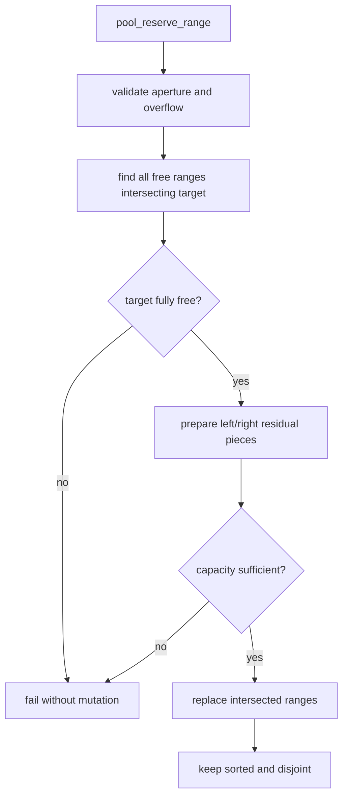
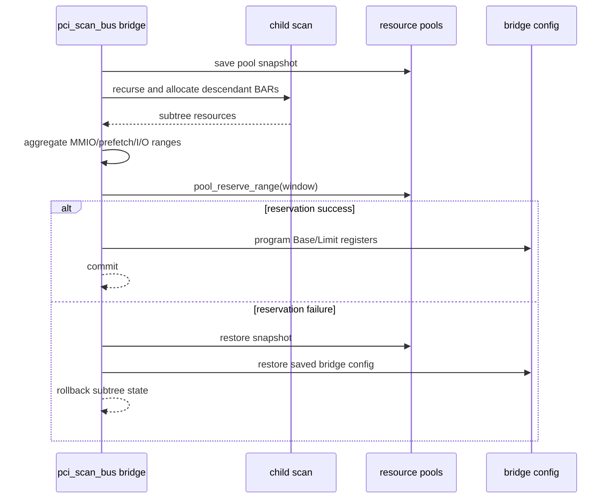
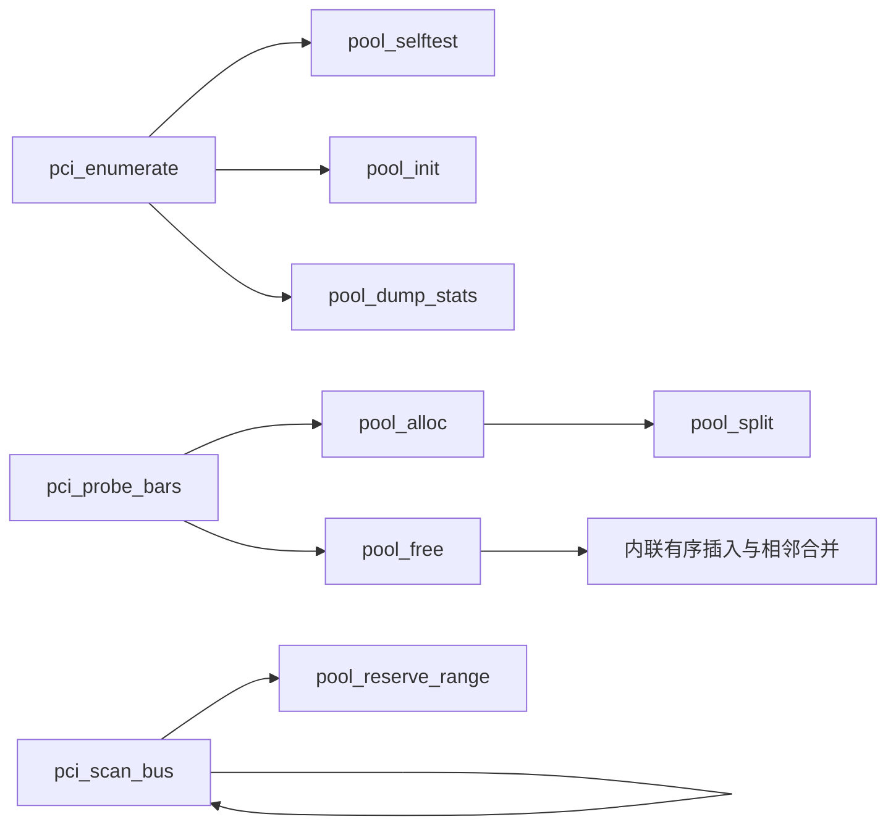

# aVisor Phase 115 详细设计：PCI Resource Pool 加固与窗口 Reservation

> 平台：QEMU virt / PCI MMIO + I/O pools
> 前置阶段：Phase 114 best-fit pools 和 prefetch windows
> 本阶段：有序 free ranges、free/coalesce、reserve 和统计

## 1. 目标

Phase 114 pool 已能分配和拆分 free range，但释放无法合并，bridge window 覆盖范围也未从全局 pool 扣除。Phase 115 引入 pool 边界校验、有序插入、相邻合并、窗口 reservation、启动自测和资源统计。

## 2. Resource pool 模型

pool 表示 `[base, base + size)` 的资源 aperture 和其中有序、互不重叠的 free ranges。已用空间为 pool total 减去 free bytes；bridge window 被 reserve 后即使没有 BAR，也属于不可再分配空间。

不变量：

- 每段 range 非零、落于 pool aperture、加法不溢出。
- ranges 按 base 升序，彼此不重叠；相邻空闲范围应合并。
- alloc/free/reserve 修改失败时不得留下部分更新。
- 靜态容量 `PCI_FREE_LIST_MAX=64` 超限需返回失败。

## 3. API 与算法

### 3.1 `pool_free(base,size)`

校验释放区间在 pool 内且不与现有 free range 重叠；按序插入，再与左/右相邻 range 合并。分配失败 rollback 可以先调用 free 检查释放路径，最终再恢复完整 snapshot，确保 pool 与设备 config 一致。

### 3.2 `pool_reserve_range(base,size)`

从 free pool 移除指定区间。目标可覆盖一个或多个相邻/分段 free range；支持整段删除、左/右裁剪及中间分裂。reserve 从目标窗口中裁剪仍为空闲的片段；窗口内已由后代 BAR 占用的区间保持不变，因此操作可重复且适合覆盖“BAR + 空闲余量”的完整 bridge window。实现先在 pool 副本上完成裁剪，成功后整体提交。

### 3.3 统计

`pool_dump_stats()` 输出 total、used、free、fragment count、largest free range 和 base，帮助观察碎片与桥 reservation 的效果。

## 4. Bridge reserve 流程

橋下 BAR 先分配，再依子樹 resource 算實際窗口；將完整、按 PCI 粒度對齊的窗口从 pool reserve，避免其他 bus 的 BAR 分配落在该 bridge forwarding aperture 内。MMIO 与 prefetch pool 当前共用 MMIO address pool，若窗口重叠需由重复 reserve/transaction 失败处理，而不能重复扣减。

## 5. 启动 selftest

自测使用局部 pool，不触碰真实设备 pool，覆盖：

- aligned allocation 和 prefix/middle/suffix split；
- free 后相邻区间合并；
- reserve 造成单段中间切分；
- reserve 跨多个空闲碎片时保留窗口内已分配空洞；
- invalid/out-of-aperture input 拒绝。

当前启动自测覆盖正常 reserve、split、policy 和 merge；“容量已满后中途失败仍保持原 pool”由本次副本提交实现保证，尚未单独注入该故障。

## 6. 函数调用图

## 7. 代码映射

| 函数/文件 | 职责 |
|---|---|
| `pool_range_valid()` | aperture/overflow validation |
| `pool_split()` | allocation range split |
| `pool_alloc()` | best-fit allocation |
| `pool_free()` | sorted insert + adjacent coalescing |
| `pool_reserve_range()` | bridge window exclusion |
| `pool_selftest()` | 局部 pool algorithm regression |
| `pool_dump_stats()` | 启动资源统计 |
| `pci_scan_bus()` | bridge transaction integrate reserve |

## 8. 验证

- `make -f Makefile.virt -j2`：PASS。
- 默认 QEMU pool selftest PASS；MMIO used `0x105000`、free `0x2eeeb000`、fragments 2；I/O used `0x20`、free `0xffe0`、fragments 1。
- nested bridge/e1000：扫描到 bus 2；两级 bridge 窗口 reserve 成功，最终 MMIO used `0x200000`、I/O used `0x1000`；无 reserve failure/rollback warning/PANIC/ASSERT。
- `git diff --check -- hypervisor/boards/virt/pci.c`：PASS。

## 9. 限制

- 未注入 64-range capacity、pool exhausted、overlap free 或 bridge reservation failure。
- 测试 topology 无 prefetch BAR。
- BAR 已分配后不迁移；如果实际桥窗口范围跨过其他 bus 已分配资源，reservation 会失败并回滚，而不是搬迁 BAR。
- 静态 64-range table；64-bit BAR 尚无独立高于 4 GiB aperture；无 DMA IOMMU。
