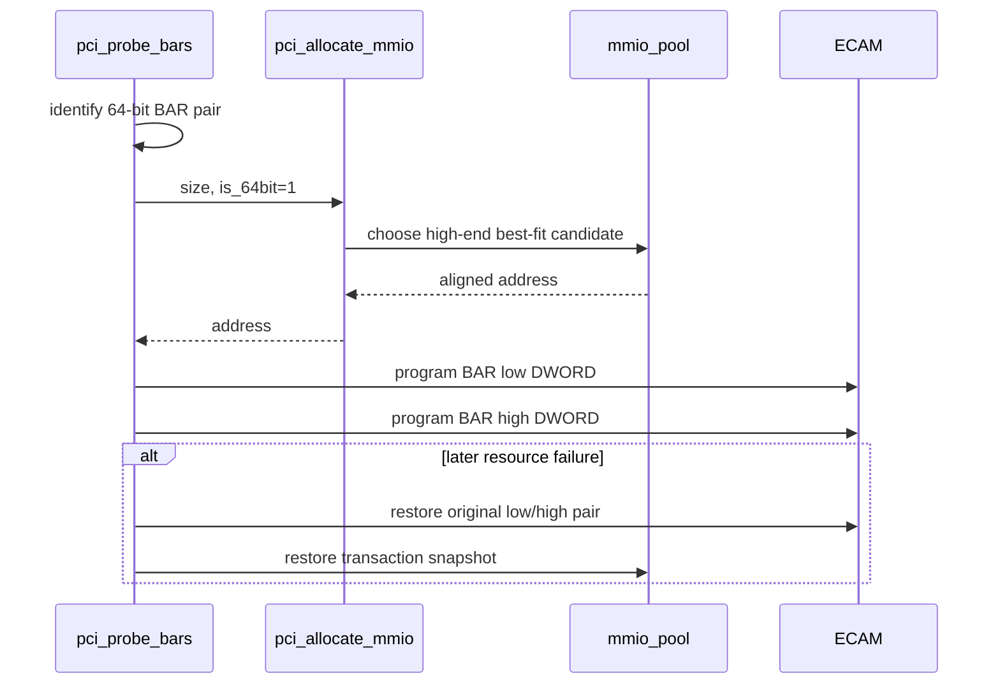
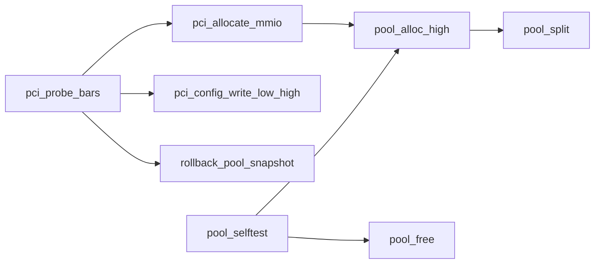

# aVisor Phase 116 详细设计：64-bit BAR 高端分配

> 平台：QEMU virt / PCI MMIO pools / nested PCI bridge
> 前置阶段：Phase 115 range coalescing、reservation 与 pool statistics
> 本阶段：64-bit MMIO BAR 从空闲范围高端分配；32-bit BAR 低端分配

## 1. 目标与地址约束

32-bit MMIO BAR 需要低于 4 GiB 的地址；64-bit BAR 可以表达更大的地址，但当前 QEMU virt aperture 仍在 4 GiB 以下。Phase 116 在既有 pool 中区分分配方向：64-bit BAR 选取高端可用地址，保留低端连续空间给 32-bit BAR。

本阶段验证的是高端 placement 算法，不是 4 GiB 以上地址支持。

## 2. 算法

对于每个 free range `[base,end)` 和幂次对齐 `size`：

- 低端候选：`align_up(base,size)`；
- 高端候选：`align_down(end-size,size)`；
- 候选必须不低于 base、且 `candidate + size <= end`；
- 在满足条件的区间中仍选择最小 waste（best-fit）；
- 以 pool split 逻辑保留 allocation 左右剩余片段。

```mermaid
flowchart TD
    A[pci_allocate_mmio(size,is_64bit)] --> B{is_64bit?}
    B -->|no| C[low-end policy]
    B -->|yes| D[high-end best-fit policy]
    C --> E[pool_alloc]
    D --> E
    E --> F[select free range]
    F --> G[compute aligned candidate]
    G --> H[split range]
    H --> I[program BAR low/high]
```

## 3. 分配方向與 BAR transaction

64-bit BAR high DWORD 和 low DWORD 是同一资源；写入顺序和失败恢复必须覆盖完整 pair。分配方向仅改变候选地址，不改变 size 解析、BAR attributes 或 Phase 113 transaction boundary。



## 4. 关键函数图



## 5. 验证

- `make -f Makefile.virt -j2`：build/link PASS。
- nested bridge QEMU log `/tmp/avisor-phase116-nested.log`：pool selftest PASS；virtio-net 64-bit BAR4=`0x3efec000/0x4000`，32-bit BAR1=`0x10000000/0x1000`，edu BAR0=`0x10100000/0x100000`；bus 2 e1000 BAR0=`0x10020000/0x20000`；桥窗口覆盖下游 BAR。
- 无 PANIC/ASSERT/BAR allocation failure。QEMU 由 timeout 结束，只验证启动和部分 Guest 输出，不声称完整 guest suite 通过。

## 6. 限制

- 当前 aperture 不跨越 4 GiB，不能证明 64-bit 地址高 DWORD 非零时 bridge forwarding 正确。
- 三级 bus 拓扑边界和 64 项 pool 容量未压力测试。
- 本阶段独立 `pool_alloc_high()` 后续由 Phase 117 policy-aware `pool_alloc()` 统一取代。
- 无 DMA IOMMU 隔离。
