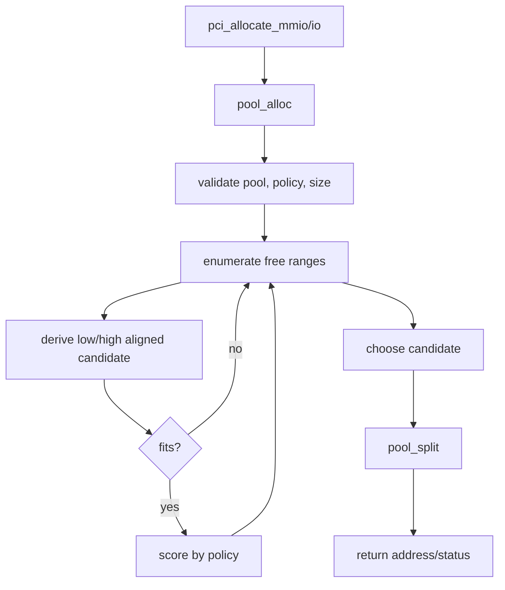
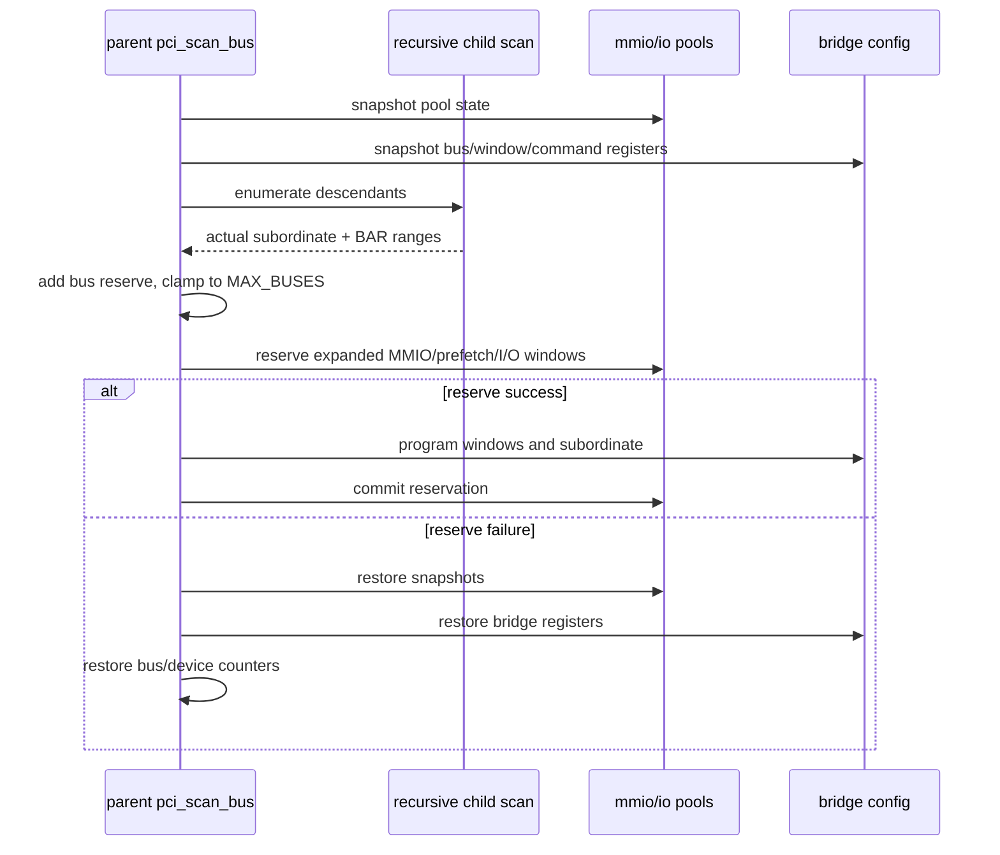
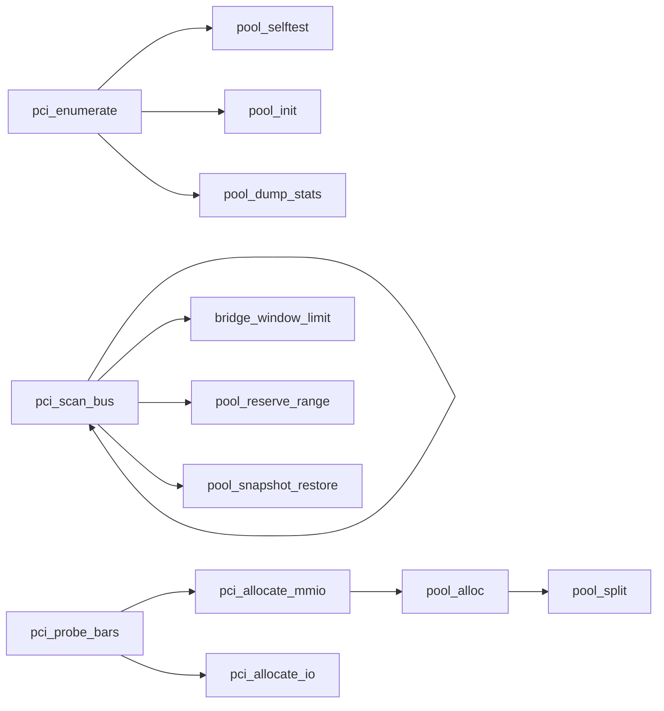

# aVisor Phase 117 详细设计：PCI 分配策略与 Bridge 热插拔资源预留

> 平台：QEMU virt / PCIe bridge / MMIO-I/O resource pools
> 前置阶段：Phase 116 high-end 64-bit BAR allocator
> 本阶段：policy-driven pool allocation、bridge aperture reserve、bus number headroom

## 1. 目标与非目标

Phase 116 通过单独 high allocator 区分 64-bit BAR 分配方向。Phase 117 将策略并入 pool state 和统一 allocator，支持 first-fit、best-fit、worst-fit、high-best；并在桥窗口之外预留静态资源余量，减少未来设备加入时立即耗尽 bus/MMIO/I/O 空间的概率。

这里的“hotplug reserve”是启动期静态预留，不是可运行的 PCI hotplug controller，也不支持动态资源重平衡。

## 2. Pool 数据模型与策略

`struct pci_resource_pool` 由 aperture (`base`,`size`)、有序 free ranges、range count 和 allocation policy 组成。策略是 pool 的 allocation hint，不改变 resource ownership 或 reservation 的语义。

| 策略 | 候选区间 | 放置方向 |
|---|---|---|
| first-fit | 地址升序第一个能容纳的 range | 低端 |
| best-fit | waste 最小 | 低端 |
| worst-fit | waste 最大 | 低端 |
| high-best | waste 最小 | 对齐后的高端 |

默认 MMIO=best-fit、I/O=first-fit。64-bit MMIO BAR 在调用 allocator 时临时使用 high-best，完成后恢复 pool 默认 policy；32-bit BAR 使用 MMIO 默认策略。

## 3. 统一 allocator

`pool_alloc()` 校验 size/pool/policy，遍历有序范围计算 candidate：

- low placement 使用 `align_up(range.base,size)`；
- high placement 使用 `align_down(range_end-size,size)`；
- 只接受完整落入 range 的 candidate；
- first-fit 找到首个可用即结束；其他策略按 waste 选择；
- `pool_split()` 原子分裂区间并维护排序。

## 4. Bridge reserve 算法

### 4.1 Bus number

子树递归扫描得到实际 subordinate bus 後，預留最多 `PCI_BRIDGE_HOTPLUG_BUS_RESERVE=4` 個 bus number，並受 `PCI_MAX_BUSES-1` 限制。將 `pci_next_bus` 推進至 reserve 後首個號碼，避免 sibling bridge 重用已保留 bus。

### 4.2 MMIO / prefetch MMIO

按實際窗口跨度計算 25% reserve，至少 1 MiB，向 1 MiB 對齊。從窗口末端向後擴展，只能使用 MMIO pool 中與窗口末端相鄰的 free range；reserve 完整窗口後再保留 Base 並更新 Limit。I/O 最少預留 1 KiB、按 4 KiB 對齊。

> 注：当前 MMIO pool 同时承载 non-prefetch 和 prefetch BAR，两类 bridge window 的连续空间共用；窗口 overlap 或 reserve 跨已分配 BAR 时应失败并走扫描 rollback，不能宣称可搬迁 BAR。

## 5. Bridge transaction

## 6. 函數調用圖

## 7. 安全與失敗語義

- pool API 以 `status + out address` 表示結果，port 0 為合法分配。
- pool reserve 不應覆蓋已有 allocation；容量不足或跨 allocation 時失敗，调用者恢复完整快照。
- bus reserve clamp 至平台上限；不能越过 PCI resource table/scanned bus arrays 的可表示范围。
- bridge config rollback 必须与 pool、device_count、bus cursor 一致，否则可能出现 config 声称存在但资源已释放的状态。

## 8. 文件与函数映射

| 函数/文件 | 职责 |
|---|---|
| `pool_init()` / `pool_alloc()` / `pool_split()` | policy allocator |
| `pci_allocate_mmio()` | 64-bit BAR 临时 high-best |
| `pool_free()` / `pool_reserve_range()` | 合并释放和窗口排除 |
| `bridge_window_limit()` | 按相邻空闲容量计算可扩展 Limit |
| `pci_scan_bus()` | subtree 汇总、bus/window reserve、rollback |
| `pool_selftest()` | policy/高端分配/合并回归 |
| `pool_dump_stats()` | policy 和 pool 使用量输出 |

## 9. 验证

- `make -f Makefile.virt -j2`：PASS，无编译 warnings。
- 默认 QEMU：pool selftest 通过；virtio 64-bit BAR4=`0x3efec000/0x4000`；日志报告 MMIO best-fit、I/O first-fit。
- nested bridge/e1000：发现 bus 2 e1000；两级 MMIO 窗口扩展至 `0x10000000-0x101fffff`、I/O 至 `0x0-0x1fff`；无 PANIC/ASSERT/allocation failure/reservation failure。
- QEMU 由 timeout 结束，只把启动/PCI 枚举作为覆盖，不宣称完整 guest suite 通过。

## 10. 限制

- bus-number register 未在上述阶段日志中做 runtime readback assertion。
- 没有实际动态热插拔、pool exhaustion、reservation rollback failure 注入。
- 当前 aperture 无法验证 4 GiB 以上 prefetch BAR；无 DMA SMMU/IOMMU 隔离。
