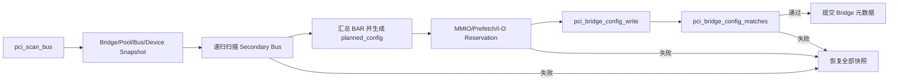
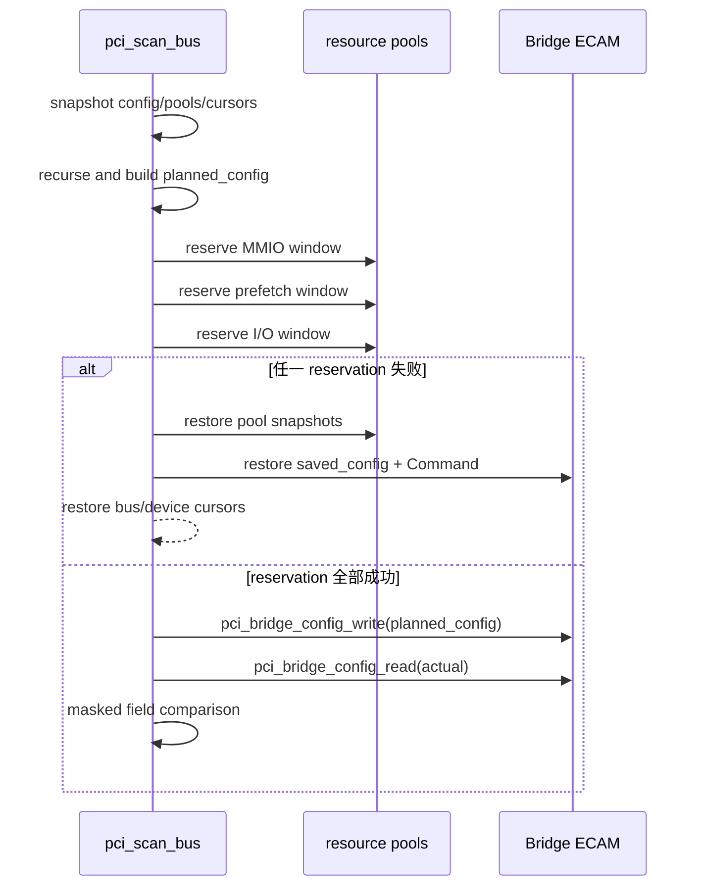
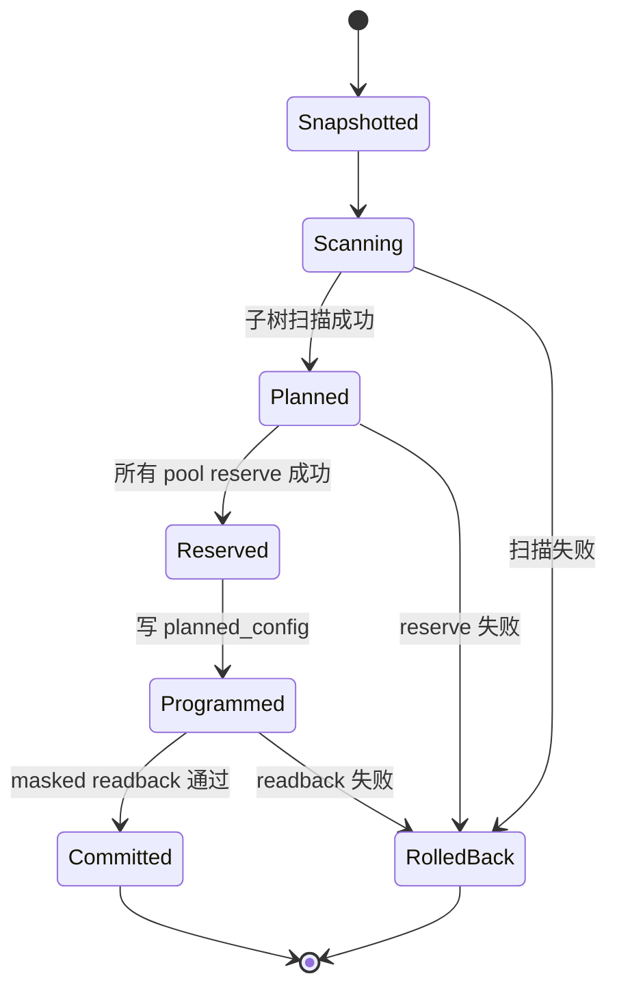
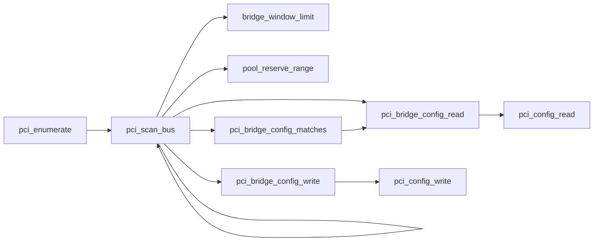

# aVisor Phase 118 详细设计：PCI Bridge 配置事务与读回校验

> 平台：QEMU virt / AArch64 EL2 / PCI-to-PCI bridge
> 前置阶段：Phase 117 allocation policy 与静态 hotplug reserve
> 本阶段：Bridge 配置 snapshot/plan/reserve/commit/readback/rollback 事务

## 1. 目标与边界

Phase 117 已能为 Bridge 子树计算 bus number、MMIO、prefetch MMIO 和 I/O 余量，并从全局资源池中 reservation。但旧流程在资源 reservation 完成前就分散写入多个 Type-1 配置寄存器，可能短暂暴露“配置窗口已生效、软件资源池尚未提交”的中间状态；同时只检查部分 upper register，没有对 bus number 和整组窗口执行统一读回验证。

Phase 118 将 Bridge 配置收敛为一个事务：

1. 保存 Bridge 原配置、Command、资源池、bus cursor 和设备表边界；
2. 递归扫描子树，计算最终 bus/window 配置；
3. 先在软件资源池中完成全部 reservation；
4. 一次性写入规划后的 Bridge 配置；
5. 按 PCI 可写字段掩码读回验证；
6. 任一步失败均恢复所有快照。

本阶段仍是启动期静态枚举，不实现运行时 PCI hotplug、资源重平衡或真实故障注入接口。

## 2. 架构设计



事务涉及两类状态：

- 软件状态：`mmio_pool`、`io_pool`、`pci_next_bus`、`pci_device_count` 和 `pci_device_resource`。
- 硬件配置：Bridge Command、Primary/Secondary/Subordinate Bus、I/O Base/Limit、Memory Base/Limit、Prefetch Base/Limit 及 64-bit upper DWORD。

只有 pool reservation 与配置读回均成功，Bridge 才视为完成提交。

## 3. Bridge 配置模型

新增内部结构 `struct pci_bridge_config`，集中保存 Type-1 Header 中由枚举器管理的寄存器：

```c
struct pci_bridge_config {
    uint32_t bus_numbers;
    uint32_t io_base_limit;
    uint32_t io_upper;
    uint32_t memory_base_limit;
    uint32_t prefetch_base_limit;
    uint32_t prefetch_base_upper;
    uint32_t prefetch_limit_upper;
};
```

该结构有三项用途：

- `saved_config`：扫描前硬件快照，用于任何失败路径恢复。
- `planned_config`：根据子树资源生成的最终配置，不在规划阶段写硬件。
- `actual`：commit 后重新读取的硬件状态，用于校验。

空窗口使用 PCI 约定的 Base 大于 Limit 编码：

- non-prefetch Memory：`0x0000fff0`；
- 64-bit prefetch Memory：`0x0001fff1`；
- I/O：`0x000000f0`。

其中 prefetch 空窗口明确保留 64-bit 类型位，确保 upper DWORD 的写入和读回语义一致。

## 4. 详细事务设计

### 4.1 Snapshot

Bridge 递归前保存：

- `pci_bridge_config_read()` 返回的完整配置快照；
- 原始 Command DWORD；
- MMIO/I/O pool 副本；
- `pci_next_bus` 和 `pci_device_count`；
- 当前 Bridge resource 的层级字段。

扫描子树需要临时写 Primary/Secondary/Subordinate=`0xff`，这是发现下游设备所必需的可见配置。若递归失败，立即调用 `pci_bridge_config_write(saved_config)` 恢复。

### 4.2 Plan

递归成功后，枚举器汇总 `child_start..pci_device_count` 内所有后代 BAR：

- I/O BAR 进入 I/O window；
- 带 `PCI_BAR_PREFETCH` 的 MMIO BAR 进入 prefetch window；
- 其他 MMIO BAR 进入 non-prefetch window。

每类窗口按 Bridge 粒度对齐，并通过 `bridge_window_limit()` 向末端扩展静态余量。计算结果只写入 `planned_config`，不直接访问 ECAM。

### 4.3 Reserve before commit



该顺序保证硬件最终窗口不会领先于 Hypervisor 的软件资源所有权状态。

### 4.4 Commit 与读回

`pci_bridge_config_write()` 以固定顺序写入：

1. Bus Numbers；
2. I/O Base/Limit；
3. I/O Base/Limit Upper；
4. Memory Base/Limit；
5. Prefetch Base/Limit；
6. Prefetch Base Upper；
7. Prefetch Limit Upper。

随后 `pci_bridge_config_matches()` 重新读取全部字段。比较时不能对整个 DWORD 做无条件相等判断，因为 Type-1 Header 中存在状态、保留位和硬件固定类型位。当前比较掩码为：

| 寄存器 | 比较范围 |
|---|---|
| Bus Numbers | bits `[23:0]`，即 Primary/Secondary/Subordinate |
| I/O Base/Limit | `0xf0f0`，即地址高 nibble；类型位由平台固定 |
| I/O Upper | 完整 DWORD |
| Memory Base/Limit | `0xfff0fff0` |
| Prefetch Base/Limit | `0xfff1fff1`，含地址与 64-bit 类型位 |
| Prefetch Upper | 两个 DWORD 完整比较 |

若比较失败，日志同时输出 expected/actual 七元组，随后恢复资源池、cursor、设备表、Bridge 配置和 Command。

## 5. 回滚不变量



回滚完成后必须满足：

- pool free ranges 与进入 Bridge 前一致；
- `pci_next_bus` 不包含失败子树或其 reserve；
- `pci_device_count` 不暴露失败子树；
- Bridge bus/window/Command 与扫描前一致；
- 失败 Bridge 的层级元数据不会作为有效枚举结果继续使用。

## 6. 函数调用 Mermaid



## 7. 文件与函数映射

| 文件/函数 | 职责 |
|---|---|
| `hypervisor/boards/virt/pci.c` | Phase 118 全部实现 |
| `struct pci_bridge_config` | Bridge 配置快照、规划和读回载体 |
| `pci_bridge_config_read()` | 从 ECAM 收集完整受管配置 |
| `pci_bridge_config_write()` | 统一写入受管 Bridge 配置 |
| `pci_bridge_config_matches()` | 按 PCI 字段掩码执行读回验证 |
| `pci_scan_bus()` | 编排 snapshot/scan/plan/reserve/commit/rollback |
| `bridge_window_limit()` | 计算含静态余量的窗口 Limit |
| `pool_reserve_range()` | 在 commit 前排除窗口覆盖的空闲资源 |

## 8. 失败语义与安全性

- 子树扫描失败：恢复扫描前全部状态并返回失败。
- pool reservation 失败：不写最终 Bridge 配置，恢复 pool 和临时 bus 配置。
- 配置 readback 失败：认为硬件提交失败，恢复软件与硬件快照。
- expected/actual 差异使用掩码后仍不相等才视为失败，避免将硬件保留位误报为错误。
- rollback 路径不尝试搬迁 BAR；上层 `pci_enumerate()` 将失败传播给 PCI 初始化。

## 9. 验证结果

### 9.1 构建

- 命令：`make -f Makefile.virt -j2`
- 结果：PASS，生成 `bin_virt/kernel8.img`，无 Phase 118 编译错误。

### 9.2 默认拓扑

- 命令：`timeout 65 make -f Makefile.virt run-log QEMU_SERIAL_LOG=/tmp/avisor-phase118-basic.log`
- pool selftest：PASS。
- edu：`00:02.0`，BAR0=`0x10100000/0x100000`。
- Guest PCI discovery、BAR write protection、edu liveness/factorial/MSI、vITS eventID 和 function reset 均出现 PASS 标记。
- QEMU 按持续运行设计由 timeout 终止，不据此宣称整个 Guest 套件自然完成。

### 9.3 两级嵌套 Bridge

- 拓扑：root bridge → bus 1 bridge → bus 2 e1000。
- e1000：`02:02.0`，MMIO BAR0=`0x10020000/0x20000`，I/O BAR1=`0x40/0x40`。
- 两级 Bridge MMIO window：`0x10000000-0x101fffff`。
- 两级 Bridge I/O window：`0x0-0x1fff`。
- `01:01.0` 与 `00:04.0` 均输出 `config committed and verified`。
- 最终 MMIO used=`0x204000`，I/O used=`0x2000`。
- 无 `config readback failed`、reservation failure、PANIC 或 ASSERT。

## 10. 限制与后续方向

- QEMU 当前拓扑没有 prefetchable BAR，因此非空 prefetch window 的读回路径未运行覆盖。
- 未通过故障注入强制触发 reservation/readback rollback；失败路径由代码事务结构保证。
- 不支持运行时设备热插入、移除、BAR 重分配或 Bridge window 动态扩缩。
- PCI DMA 仍未接入 SMMU/IOMMU 隔离。
