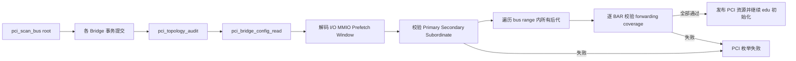
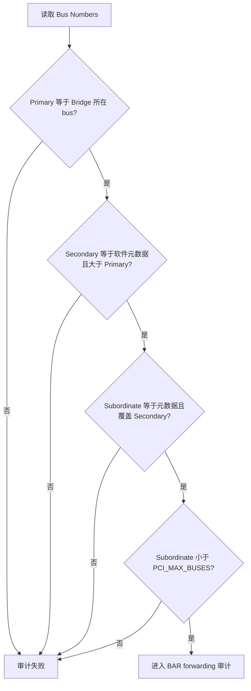
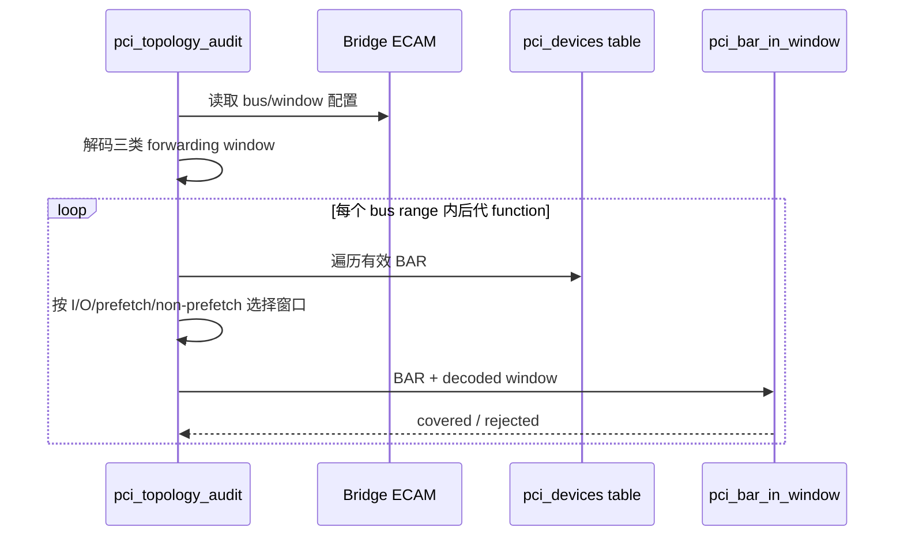
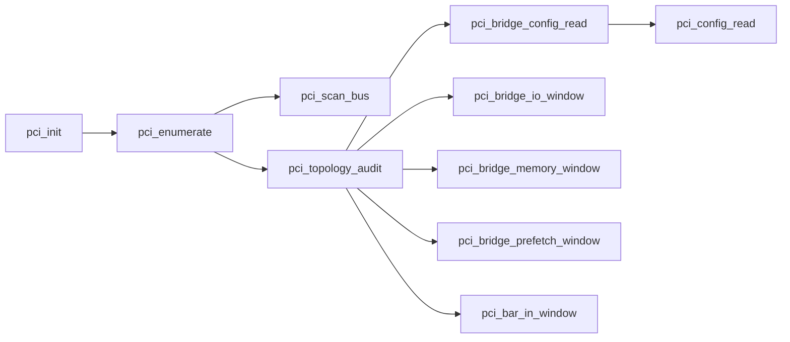

# aVisor Phase 119 详细设计：PCI Bridge 拓扑与转发窗口审计

> 平台：QEMU virt / AArch64 EL2 / PCI-to-PCI bridge
> 前置阶段：Phase 118 Bridge 配置事务与读回校验
> 本阶段：枚举后全拓扑 bus/window/BAR 一致性审计

## 1. 目标与边界

Phase 118 保证单个 Bridge 的规划配置在提交后能够按可写位读回，但“每个寄存器等于计划值”还不能证明整个 PCI 树可正确转发：

- Primary/Secondary/Subordinate bus 可能与软件层级元数据不一致；
- 后代 endpoint 虽已获得 BAR，BAR 可能不在祖先 Bridge forwarding window 内；
- 嵌套 Bridge 的内层窗口正确，不代表外层窗口覆盖整个后代子树；
- 空窗口编码和 32/64-bit upper 字段需要转换为统一的闭区间后才能验证。

Phase 119 在 `pci_scan_bus(0)` 完成后执行只读全局审计。只有所有 Bridge 的 bus topology 和所有后代 BAR forwarding 关系都成立，PCI 枚举结果才允许继续发布给 VM。

本阶段不修改已分配地址，不尝试自动扩大窗口，也不实现动态 hotplug 后的在线审计。

## 2. 架构设计



审计位于资源分配和 Bridge commit 之后、pool 统计及 owner BAR 发布之前。因此审计失败不会向 Guest 暴露已知不一致的 passthrough 资源。

## 3. 审计数据模型

### 3.1 Bridge window

新增内部统一模型：

```c
struct pci_bridge_window {
    uint64_t base;
    uint64_t limit;
    uint8_t enabled;
};
```

窗口使用闭区间 `[base, limit]`。`enabled` 由解码后的 Base/Limit 关系决定：Base 大于 Limit 表示 PCI 规范中的 disabled window。

### 3.2 地址域

- MMIO/prefetch BAR 使用 CPU 物理 MMIO 地址直接比较。
- I/O BAR 在资源表中保存为 `VIRT_PCIE_IO_BASE + port`，审计时减去 aperture base，转换回 Bridge I/O port 域。
- 64-bit prefetch window 由 Base/Limit lower 字段和两个 upper DWORD 拼接。

## 4. Bridge 窗口解码

### 4.1 I/O window

`pci_bridge_io_window()` 解码：

```text
base  = (IO_BASE[7:4] << 8) | (IO_BASE_UPPER << 16)
limit = (IO_LIMIT[7:4] << 8) | (IO_LIMIT_UPPER << 16) | 0xfff
```

I/O Bridge 粒度是 4 KiB，因此 Limit 补齐低 12 位。

### 4.2 Non-prefetch MMIO window

`pci_bridge_memory_window()` 解码：

```text
base  = MEMORY_BASE[15:4] << 16
limit = MEMORY_LIMIT[15:4] << 16 | 0xfffff
```

窗口粒度为 1 MiB。

### 4.3 Prefetch MMIO window

`pci_bridge_prefetch_window()` 拼接 lower 与 upper 字段：

```text
base  = BASE_UPPER << 32 | BASE[15:4] << 16
limit = LIMIT_UPPER << 32 | LIMIT[15:4] << 16 | 0xfffff
```

当前 QEMU 回归没有非空 prefetch BAR，但 disabled 编码和字段拼接仍由审计实现处理。

## 5. Bus topology 审计

对每个 `header_type == PCI_HEADER_BRIDGE` 的资源项，从 ECAM 读取 Bus Numbers 并检查：

1. `primary == bridge->bus`；
2. `secondary == bridge->secondary_bus`；
3. `subordinate == bridge->subordinate_bus`；
4. `secondary > primary`；
5. `subordinate >= secondary`；
6. `subordinate < PCI_MAX_BUSES`。



此检查同时验证 Phase 117 的 bus reserve 已写入硬件，并验证 Phase 118 readback 后的软件层级记录没有漂移。

## 6. 后代 BAR forwarding 审计

Bridge 的所有后代定义为资源表中 `secondary <= child.bus <= subordinate` 的 function。对每个有效 BAR，按类型选择窗口：

| BAR 类型 | 目标窗口 |
|---|---|
| I/O BAR | I/O Base/Limit |
| Prefetchable MMIO BAR | Prefetch Base/Limit |
| Non-prefetch MMIO BAR | Memory Base/Limit |

`pci_bar_in_window()` 检查：

- window 已启用；
- BAR size 非零；
- `base + size` 不溢出；
- BAR 起始地址不低于 window base；
- BAR 末地址不高于 window limit。



嵌套拓扑中，同一 e1000 BAR 会分别由内层 Bridge 和外层 Bridge 检查。因此测试中的两个 BAR 对两个 Bridge 共形成四次 forwarding coverage。

## 7. 失败语义

审计是 fail-closed：

- bus topology 不一致时记录 Bridge BDF 和读回的 Primary/Secondary/Subordinate；
- BAR 不在窗口内时记录 Bridge BDF、child BDF、BAR index、address 和 size；
- 任一错误使 `pci_topology_audit()` 返回失败；
- `pci_enumerate()` 不再发布 owner BAR，也不继续 edu IRQ/MSI 初始化。

本阶段审计是提交后的安全门，不执行第二次回滚。前序 Bridge 事务已完成且配置可能仍在硬件中，但 Hypervisor 不会把该拓扑标记为可用。自动修复或重新规划属于后续资源重平衡能力。

## 8. 函数调用 Mermaid



## 9. 文件与函数映射

| 文件/函数 | 职责 |
|---|---|
| `hypervisor/boards/virt/pci.c` | Phase 119 实现 |
| `struct pci_bridge_window` | 统一表示三类 forwarding aperture |
| `pci_bridge_io_window()` | 解码 16/32-bit I/O Base/Limit |
| `pci_bridge_memory_window()` | 解码 non-prefetch MMIO window |
| `pci_bridge_prefetch_window()` | 解码 64-bit prefetch window |
| `pci_bar_in_window()` | 执行单 BAR 覆盖和溢出检查 |
| `pci_topology_audit()` | 全 Bridge bus topology 与后代 BAR 审计 |
| `pci_enumerate()` | 在发布资源前调用审计安全门 |

## 10. 复杂度与容量

设设备资源数为 `D`，Bridge 数为 `B`，每 function 最多 `6` 个 BAR。当前实现对每个 Bridge 扫描资源表，复杂度为 `O(B × D × 6)`。平台上限是 `PCI_MAX_DEVICES=128`，因此启动期成本有明确上界，不需要额外树结构或动态内存。

审计计数：

- `bridges`：完成审计的 Bridge 数；
- `forwarded-bars`：所有 Bridge 层级上的 BAR coverage 次数，而不是唯一 BAR 数。

## 11. 验证结果

### 11.1 构建

- 命令：`make -f Makefile.virt -j2`
- 结果：PASS，镜像 `bin_virt/kernel8.img` 生成成功，无 Phase 119 编译错误。

### 11.2 默认拓扑

- 命令：`timeout 65 make -f Makefile.virt run-log QEMU_SERIAL_LOG=/tmp/avisor-phase119-basic.log`
- 审计结果：`PCI: topology audit PASSED bridges=0 forwarded-bars=0`。
- Guest PCI enumeration/BAR discovery、edu liveness、factorial、MSI 和 vITS 均出现 PASS 标记。
- QEMU 由外部 timeout 结束，不宣称整个 Guest 测试套件自然退出。

### 11.3 两级嵌套 Bridge

- 拓扑：`00:04.0 bridge -> 01:01.0 bridge -> 02:02.0 e1000`。
- e1000 BAR0：MMIO `0x10020000/0x20000`。
- e1000 BAR1：I/O port `0x40/0x40`。
- 两级 Bridge MMIO window：`0x10000000-0x101fffff`。
- 两级 Bridge I/O window：`0x0-0x1fff`。
- 两级 Bridge 均完成 Phase 118 commit/readback。
- Phase 119 审计：`PCI: topology audit PASSED bridges=2 forwarded-bars=4`。
- 无 `does not forward`、`invalid bus topology`、PANIC 或 ASSERT。

## 12. 限制与后续方向

- 当前回归没有非空 prefetchable BAR，prefetch forwarding 只覆盖解码与 disabled-window 路径。
- 未注入错误 Bus Numbers 或缩窄窗口来运行验证 fail-closed 分支。
- 审计只在启动枚举后执行；不监控运行期硬件或 Guest 配置变化。
- 不执行自动窗口扩展、BAR 搬迁或全局资源重平衡。
- PCI DMA 仍未接入 SMMU/IOMMU 隔离。
