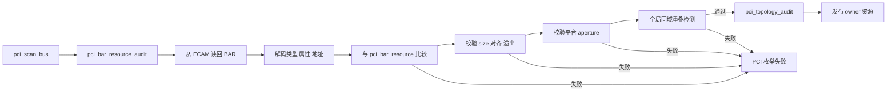
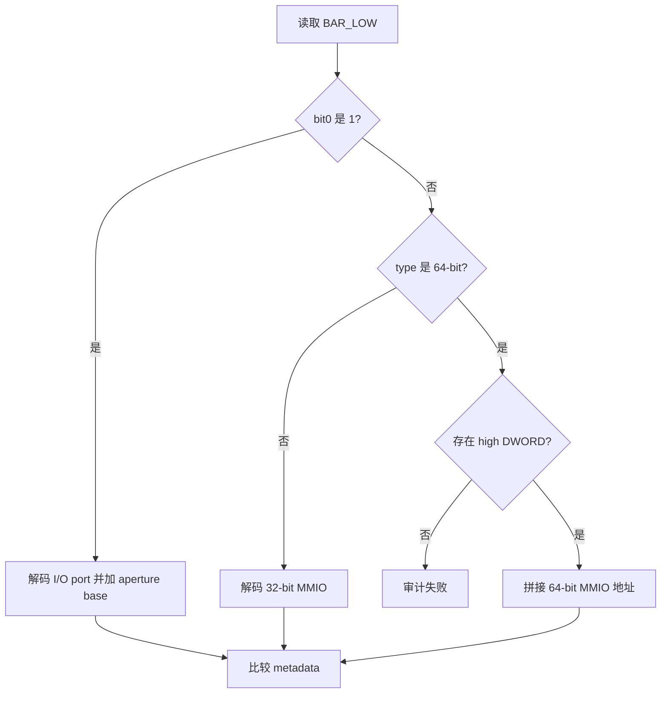
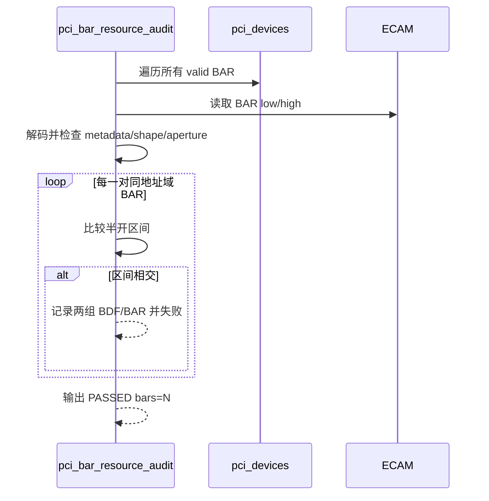
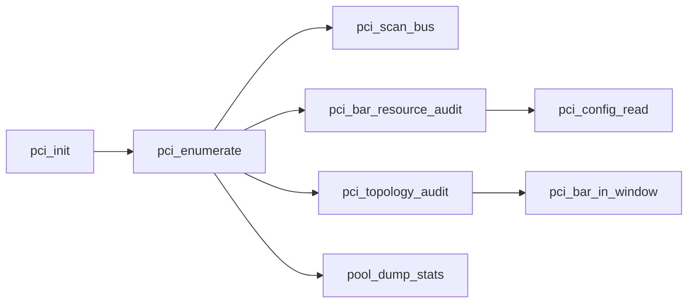

# aVisor Phase 120 详细设计：PCI BAR 资源一致性与重叠审计

> 平台：QEMU virt / AArch64 EL2 / PCI ECAM
> 前置阶段：Phase 119 Bridge 拓扑与转发窗口审计
> 本阶段：BAR ECAM、资源元数据、aperture 和全局地址唯一性审计

## 1. 目标与边界

Phase 119 已证明后代 BAR 位于祖先 Bridge 的转发窗口内，但该结论依赖 `pci_device_resource.bars[]` 的地址、类型和大小可信。如果硬件 BAR 配置与软件元数据发生偏差，Bridge 审计可能检查错误的地址；如果两个 function 的 BAR 重叠，即使它们分别落在合法 aperture 和 Bridge window 内，仍会产生资源别名。

Phase 120 在 Bridge 拓扑审计前加入 BAR 资源安全门：

1. 从 ECAM 重新读取每个有效 BAR；
2. 解码 I/O、32-bit MMIO 和 64-bit MMIO 地址；
3. 校验 BAR 类型、属性位、地址与资源表一致；
4. 校验 size 是非零 2 的幂、地址按 size 对齐且范围不溢出；
5. 校验 BAR 完整落入平台 I/O 或 MMIO aperture；
6. 对同一地址域内所有有效 BAR 做两两重叠检测；
7. 任一检查失败时阻止 PCI 资源向 Guest 发布。

本阶段不重新执行 destructive BAR sizing，不修改 BAR，不自动搬迁冲突资源。

## 2. 架构设计



审计顺序为 BAR 资源审计先于 Bridge 拓扑审计。这样后者使用的每个 BAR 地址和类型都已经由 ECAM 读回证明。

## 3. BAR 读回解码

### 3.1 I/O BAR

I/O BAR 由 bit 0 标识，低两位不属于地址：

```text
port        = BAR_LOW & ~0x3
cpu_address = VIRT_PCIE_IO_BASE + port
flags       = BAR_LOW & 0x3
```

资源表保存 CPU 可访问地址，因此比较前必须将 port 加上 ECAM I/O aperture 的 CPU base。

### 3.2 32-bit MMIO BAR

```text
address = BAR_LOW & ~0xf
flags   = BAR_LOW & 0xf
```

bit `[2:1]` 表示 memory type，bit 3 表示 prefetchable。

### 3.3 64-bit MMIO BAR

当 memory type 为 `0b10` 时，当前 BAR 与下一个 DWORD 构成一对：

```text
address = BAR_HIGH << 32 | (BAR_LOW & ~0xf)
```

审计要求 low BAR 不是 BAR5，否则没有合法 high partner。资源表中的 `is_64bit` 必须与 ECAM 类型一致。



## 4. 元数据一致性检查

对每个 `bar->valid` 项比较：

- ECAM `is_io` 与 `bar->is_io`；
- ECAM memory type 与 `bar->is_64bit`；
- I/O 的低 2 位或 MMIO 的低 4 位与 `bar->flags`；
- 解码后的 CPU 地址与 `bar->address`。

不对无效 BAR 做推断，因为 64-bit BAR 的 high DWORD 在资源表中不是独立有效资源。

失败日志包含 BDF、BAR index、ECAM 解码地址、metadata 地址和 size，便于定位配置空间与资源表漂移。

## 5. Size、对齐和溢出检查

资源表中的 size 来自枚举期 destructive sizing。本阶段不再次写 `0xffffffff`，而是验证 sizing 结果的必要不变量：

```text
size != 0
size & (size - 1) == 0
address & (size - 1) == 0
address <= UINT64_MAX - size
```

最后一项确保后续计算半开区间 `[address, address + size)` 不发生 64-bit wraparound。

## 6. Aperture 边界检查

按 BAR 类型选择平台地址域：

| BAR 类型 | aperture base | aperture size |
|---|---|---|
| I/O | `VIRT_PCIE_IO_BASE` | `VIRT_PCIE_IO_SIZE` |
| MMIO | `VIRT_PCIE_MMIO_BASE` | `VIRT_PCIE_MMIO_SIZE` |

使用减法形式避免 `base + size` 溢出：

```text
address >= aperture_base
bar_size <= aperture_size
address - aperture_base <= aperture_size - bar_size
```

该检查验证整个 BAR，而不只是起始地址。

## 7. 全局重叠检测

### 7.1 地址域隔离

I/O 与 MMIO 使用不同地址语义，不能直接互相判定重叠。只有 `left->is_io == right->is_io` 的 BAR 才进入区间比较。

### 7.2 半开区间判定

两个 BAR 的半开区间分别为 `[a, a_end)` 和 `[b, b_end)`，重叠条件为：

```text
a < b_end && b < a_end
```

相邻 BAR 满足 `a_end == b`，不会误判为冲突。



## 8. 安全门与失败语义

`pci_enumerate()` 的发布顺序为：

1. 初始化资源池；
2. `pci_scan_bus(0)` 完成 BAR 分配和 Bridge 配置；
3. `pci_bar_resource_audit()`；
4. `pci_topology_audit()`；
5. 输出 pool stats；
6. 记录 edu BAR、配置 owner 并继续 MSI/IRQ 初始化。

任一 BAR 审计错误都会返回失败。已写入硬件的 BAR 不自动恢复到枚举前值，但不会作为有效 passthrough 资源发布。自动修复需要全局重分配事务，不属于本阶段。

## 9. 函数调用 Mermaid



## 10. 文件与函数映射

| 文件/函数 | 职责 |
|---|---|
| `hypervisor/boards/virt/pci.c` | Phase 120 全部实现 |
| `pci_bar_resource_audit()` | ECAM/metadata/shape/aperture/overlap 总审计 |
| `pci_config_read()` | 读取 BAR low/high DWORD |
| `pci_enumerate()` | 在拓扑审计和资源发布前调用 BAR 安全门 |
| `struct pci_bar_resource` | 保存 address、size、flags、I/O/64-bit/valid 属性 |

## 11. 复杂度与容量

设有效 BAR 总数为 `R`，资源项数为 `D`：

- ECAM 与元数据审计：`O(D × PCI_MAX_BARS)`；
- 重叠检测：`O(R²)`；
- 最大设备资源数 128，每 function 最多 6 个 BAR，启动期成本有明确上界且无需动态内存。

`PASSED bars=N` 中的 `N` 是唯一有效 BAR 数，不像 Phase 119 的 `forwarded-bars` 那样按 Bridge 层级重复计数。

## 12. 验证结果

### 12.1 构建与静态检查

- `make -f Makefile.virt -j2`：PASS。
- VS Code diagnostics：`pci.c` 无诊断。
- `git diff --check`：PASS。

### 12.2 默认拓扑

- 命令：`timeout 65 make -f Makefile.virt run-log QEMU_SERIAL_LOG=/tmp/avisor-phase120-basic.log`
- BAR 审计：`PCI: BAR resource audit PASSED bars=4`。
- Bridge 审计：`bridges=0 forwarded-bars=0`。
- Guest PCI discovery、edu liveness、factorial、MSI 和 vITS 均出现 PASS。
- QEMU 按持续运行测试设计由 timeout 结束。

### 12.3 两级嵌套 Bridge

- 拓扑：root edu + 两级 Bridge + e1000。
- edu BAR0：MMIO `0x10100000/0x100000`。
- e1000 BAR0：MMIO `0x10020000/0x20000`。
- e1000 BAR1：I/O port `0x40`，CPU `0x3eff0040/0x40`。
- BAR 审计：`PCI: BAR resource audit PASSED bars=6`。
- Bridge 审计：`bridges=2 forwarded-bars=4`。
- 无 `resource mismatch`、`outside aperture`、`BAR overlap`、PANIC 或 ASSERT。

## 13. 限制与后续方向

- 未通过故障注入运行 address mismatch、misalignment、aperture overflow 和 overlap 失败分支。
- 不重新读取 BAR sizing mask，因此 size 一致性依赖枚举期 sizing 和本阶段不变量检查。
- 不覆盖 Expansion ROM BAR。
- 审计仅在启动枚举后执行，不持续监控运行期物理配置空间变化。
- 不执行 BAR 搬迁或资源池重建。
- PCI DMA 仍未接入 SMMU/IOMMU 隔离。
