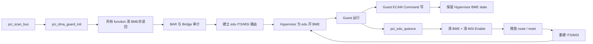
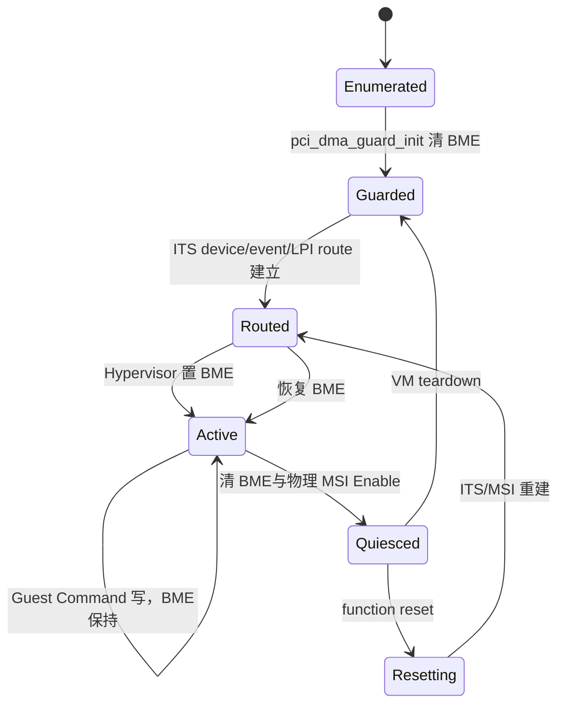
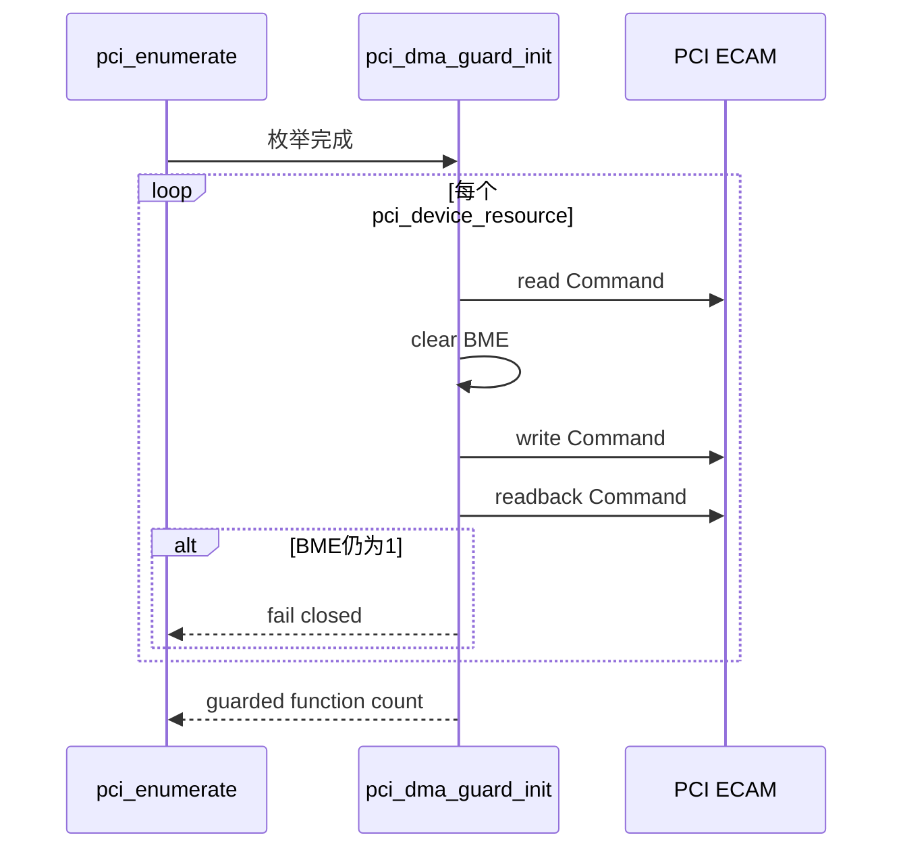
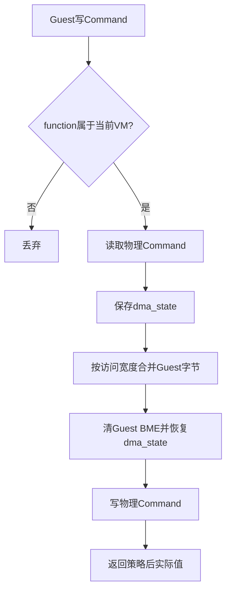
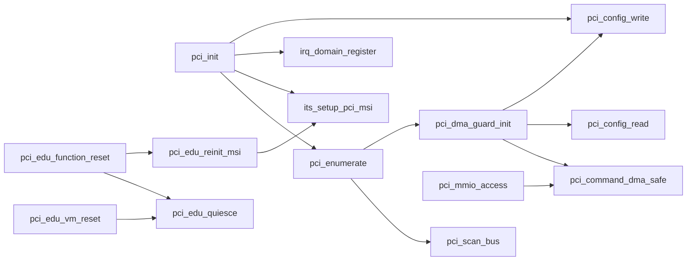

# aVisor Phase 121 详细设计：PCI 总线主控受控生命周期与 DMA 防护

> 平台：QEMU virt / AArch64 EL2 / PCI ECAM / GICv3 ITS
> 前置阶段：Phase 120 BAR 资源一致性与重叠审计
> 本阶段：Bus Master Enable（BME）收敛、Guest Command 写隔离与 edu quiesce 修复

## 1. 目标与安全边界

PCI Command bit 2（Bus Master Enable，BME）允许 function 发起 Memory Write/Read。Stage-2 只约束 CPU 访问，不能限制 PCI requester DMA；当前工程未接入 SMMU/IOMMU，因此任意 Guest 可控 BME 都是越权 DMA 风险。

Phase 120 之前存在三条开启路径：

1. `pci_init()` 在发现 edu 后无条件置位 BME；
2. `pci_edu_reinit_msi()` 和 function reset 恢复时重新置位 BME；
3. Guest 经 ECAM trap 写 PCI Command 低字节，可直接改变物理 BME。

但 QEMU PCI MSI 投递本身要求 function 的 BME 为 1。永久关闭 BME 会导致 edu MSI、vITS 及 reset 后 MSI 回归全部超时。因此 Phase 121 采用受控生命周期，而不是宣称已经具备完整 DMA 隔离：

- 枚举完成后，对所有发现的 function 清除物理 BME并读回验证；
- 只有 Hypervisor 完成 edu ITS/MSI 路由后，才为已授权 edu 开启 BME；
- Guest Command 写保留当前物理 BME，Guest 不能开启或关闭；
- quiesce 先关闭 BME 和物理 MSI Enable，再等待设备 idle；
- reset/reinit 仅在路由重建成功后恢复 edu BME；
- 未授权 Bridge/e1000 等 function 始终保持 BME=0。

本阶段是降低暴露面的 fail-closed guard，不替代 SMMU requester 隔离。edu BME 开启期间仍具备物理 DMA 能力。

## 2. 架构设计



控制面分为：

- **全局默认拒绝**：枚举完成时清除所有 function 的 BME；
- **设备特例授权**：当前只有 VM1 的 edu，在 MSI 路由可用后由 Hypervisor 开启；
- **Guest 隔离**：ECAM Command 模拟允许 I/O、Memory 和 INTx Disable 的既有行为，但 BME 不接受 Guest 输入；
- **生命周期撤销**：VM teardown/function reset 前关闭 BME，阻断新的 PCI master transaction。

## 3. BME 状态机



核心不变量：

1. `Guarded` 前不向 Guest 发布可用 PCI 资源；
2. Guest 写不能产生 `Guarded -> Active` 或 `Active -> Guarded` 转移；
3. 只有 Hypervisor 的 MSI setup/reinit 可进入 `Active`；
4. teardown/reset 必须先进入 `Quiesced`；
5. 路由重建失败时不能恢复 BME。

## 4. 枚举后全局 DMA guard

`pci_dma_guard_init()` 遍历 `pci_devices[0..pci_device_count)`：

1. 读取 PCI Command；
2. 通过 `pci_command_dma_safe()` 清除 `PCI_CMD_BUSMASTER`；
3. 对已分配 owner 的 function 保留 Memory decode；
4. 写回 Command；
5. 重新读取并验证 BME 为 0；
6. 任一 function 无法清除时返回失败，阻止 PCI 初始化继续。



该 guard 位于 BAR/Bridge 审计之前，使后续审计和资源发布均在总线主控关闭状态进行。

## 5. edu 授权与 MSI 顺序

QEMU edu 的 MSI 写入依赖 PCI bus mastering，因此 BME 必须在物理 MSI Enable 前恢复，但不能早于 ITS route：

1. 发现 MSI capability；
2. `its_setup_pci_msi()` 建立 Device、Collection 和 Interrupt 映射；
3. 写 Message Address/Data；
4. 注册 LPI ownership；
5. Hypervisor 读取 Command 并置 BME；
6. 写物理 MSI Enable；
7. 禁用 INTx。

日志 `edu bus mastering enabled by hypervisor after MSI routing` 标记授权点。非 edu function 没有对应授权入口。

## 6. Guest Command 写隔离

Guest 的 ECAM Command 写由 `pci_mmio_access()` trap-and-emulate。Phase 121 在合并字节写之前记录：

```c
uint32_t dma_state = command & PCI_CMD_BUSMASTER;
```

Guest 输入合并完成后：

```c
command = pci_command_dma_safe(command) | dma_state;
```

因此：

- 物理 BME=0 时，Guest 写 1 仍保持 0；
- 物理 BME=1 时，Guest 写 0 仍保持 1，避免破坏 Hypervisor 管理的 MSI 通路；
- I/O Space、Memory Space 和 INTx Disable 仍按现有 owner policy处理；
- 写后 `*value` 返回实际读回值，而非未经策略过滤的 Guest 输入。



## 7. Quiesce 与 reset/reinit

### 7.1 Quiesce

`pci_edu_quiesce()` 顺序：

1. 设置 INTx Disable；
2. 清除 BME；
3. 清除物理 MSI Enable；
4. 同步清除 virtual MSI shadow Enable；
5. 轮询 factorial status 和 DMA command busy，直到 idle 或超时。

Phase 121 修复了旧代码的方向错误：旧实现使用 `msi | PCI_MSI_CTRL_EN`，实际会在 quiesce 时开启物理 MSI；现在改为 `msi & ~PCI_MSI_CTRL_EN`。

### 7.2 Function reset

- quiesce 成功后撤销 SPI/LPI ownership 和 ITS route；
- 执行 PCIe FLR 或 edu internal fallback；
- 在 BME=0 状态下恢复 BAR 与 Memory decode；
- `pci_edu_reinit_msi()` 重建 ITS/LPI；
- 仅当重建成功时恢复 BME、MSI Enable 和 INTx Disable。

### 7.3 VM teardown

`pci_edu_vm_reset()` 调用 quiesce 后释放 IRQ/ITS 资源，但不执行 reinit，因此 BME 保持关闭。

## 8. 函数调用 Mermaid



## 9. 文件与函数映射

| 文件/函数 | 职责 |
|---|---|
| `hypervisor/boards/virt/pci.c` | Phase 121 全部实现 |
| `pci_command_dma_safe()` | 清除 Command BME 的统一策略函数 |
| `pci_dma_guard_init()` | 枚举后清除并读回验证全部 function BME |
| `pci_init()` | ITS/MSI route 建立后授权 edu BME |
| `pci_mmio_access()` | 保留 Hypervisor BME state，拒绝 Guest 改变 |
| `pci_edu_quiesce()` | 清 BME、禁物理 MSI并等待 idle |
| `pci_edu_reinit_msi()` | route 重建后恢复受控 BME |
| `pci_edu_function_reset()` | 在 BME 关闭状态恢复 BAR并进入 reinit |

## 10. 错误处理

- 任一 function 清 BME 后读回仍为 1：`pci_dma_guard_init()` 失败，PCI 初始化停止。
- edu ITS setup 失败：不进入 BME 授权点，保持 INTx fallback 或返回失败。
- LPI ownership 注册失败：不应继续发布可用 MSI 通路。
- quiesce timeout：不撤销后续设备状态，不执行 reset。
- reinit 失败：返回失败，BME 不应作为成功设备状态发布。
- Guest 非 owner ECAM 写继续由现有 owner policy 丢弃。

## 11. 验证过程与发现的问题

### 11.1 永久关闭 BME 的反例

初始实现尝试全程保持 BME=0。实测：

- edu liveness/factorial 通过；
- edu MSI timeout；
- vITS event timeout；
- function reset 后 MSI timeout。

这证明 QEMU PCI MSI 写入依赖 BME。最终设计改为 Hypervisor 受控授权，而不是删除 MSI 功能或错误宣称无需 BME。

### 11.2 构建

- `make -f Makefile.virt -j2`：PASS。
- `pci.c` IDE diagnostics：无错误。
- `git diff --check`：PASS。

### 11.3 默认拓扑

- guard：`bus mastering disabled for 3 functions`；
- BAR 审计：`bars=4`；
- 拓扑审计：`bridges=0 forwarded-bars=0`；
- edu MSI route 后出现受控 BME enable 日志；
- Guest BAR write protection、liveness、factorial、MSI、vITS 均 PASS；
- edu internal fallback reset 完成；
- function reset 后 MSI reinit PASS。

### 11.4 两级嵌套 Bridge

- guard：`bus mastering disabled for 6 functions`；
- 两级 Bridge commit/readback 通过；
- BAR 审计：`bars=6`；
- 拓扑审计：`bridges=2 forwarded-bars=4`；
- edu MSI、vITS 和 function reset 后 MSI 均 PASS；
- 未授权 e1000 和 Bridge 没有 BME enable 路径。

两组 QEMU 均由外部 timeout 结束，不能据此声称整个持续运行 Guest 套件自然退出。

## 12. 限制与后续方向

- BME guard 不是 SMMU/IOMMU。edu Active 状态仍可进行物理 DMA，尚无 requester 粒度地址转换和权限表。
- 当前授权模型硬编码为 VM1 edu，不是通用设备 assignment framework。
- 未拦截 MSI-X Table 数据面产生的 DMA/interrupt side effect。
- 未提供故障注入验证 BME readback failure、ITS setup failure 和 quiesce timeout。
- 后续应接入 SMMUv3 domain，将 BME enable 的必要条件升级为 requester 已绑定 owner VM 的 DMA page table。
