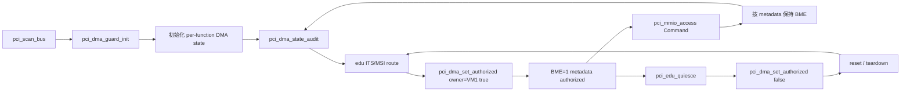
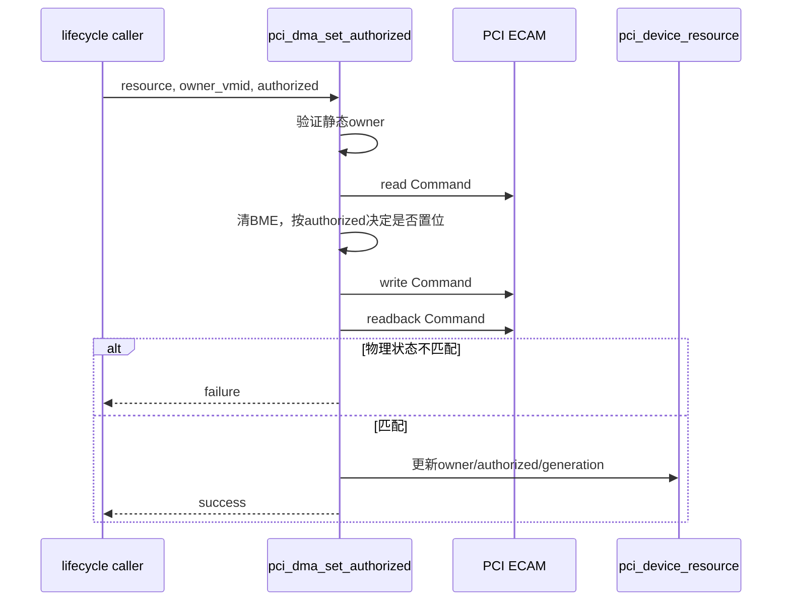
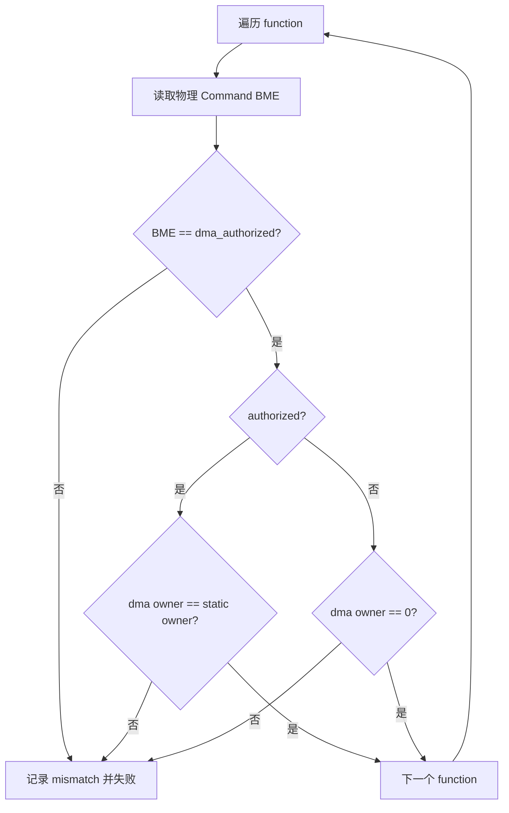
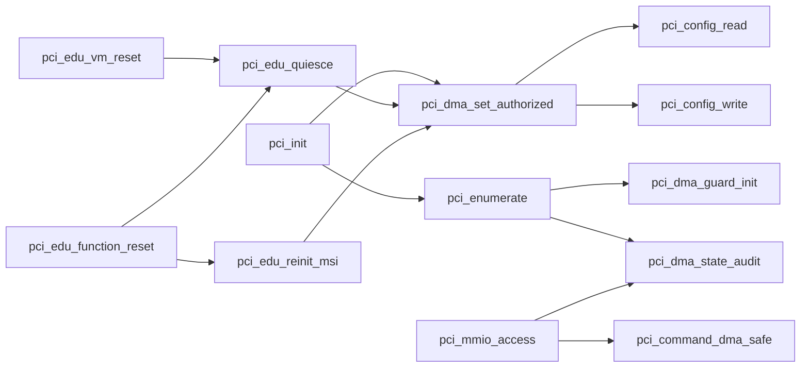

# aVisor Phase 122 详细设计：PCI DMA 授权状态模型与一致性审计

> 平台：QEMU virt / AArch64 EL2 / PCI ECAM / GICv3 ITS
> 前置阶段：Phase 121 PCI 总线主控受控生命周期与 DMA 防护
> 本阶段：per-function DMA authorization、owner/generation 跟踪与物理 BME 一致性审计

## 1. 目标与边界

Phase 121 已将 Bus Master Enable（BME）从 Guest 控制收回 Hypervisor，但授权事实仍隐含在物理 PCI Command bit 2 中：Guest Command 模拟需要先读取硬件 BME 再决定保留值，edu setup/reset 也直接操作 Command。这种设计存在三个问题：

1. 物理寄存器是执行结果，不应同时作为授权策略的唯一来源；
2. 无法表达“哪个 VM 获得 DMA 授权”和授权生命周期版本；
3. 缺少全局审计，无法检测软件授权状态与物理 BME 漂移。

Phase 122 为每个 `pci_device_resource` 增加显式 DMA 状态，所有 edu BME 转移统一通过授权接口，并在枚举后与 Guest Command 写后审计物理状态。

本阶段仍不实现 SMMU/IOMMU page table。`dma_authorized` 表示 Hypervisor 允许该 function 开启 BME，不代表 DMA 地址已被硬件隔离。

## 2. 架构设计



策略状态与执行状态分离：

- 策略状态：`dma_owner_vmid`、`dma_authorized`、`dma_generation`；
- 执行状态：物理 PCI Command BME；
- 一致性安全门：`pci_dma_state_audit()`；
- 唯一状态转移入口：`pci_dma_set_authorized()`。

## 3. 数据模型

`struct pci_device_resource` 新增：

```c
uint8_t dma_owner_vmid;
uint8_t dma_authorized;
uint32_t dma_generation;
```

字段语义：

| 字段 | 含义 |
|---|---|
| `owner_vmid` | function 配置空间/BAR 的静态 owner |
| `dma_owner_vmid` | 当前 DMA 授权 owner；未授权时为 0 |
| `dma_authorized` | Hypervisor 是否允许物理 BME 为 1 |
| `dma_generation` | 每次 guard 初始化、授权或撤销后的单调版本 |

核心不变量：

```text
dma_authorized == 0  => dma_owner_vmid == 0 && physical BME == 0
dma_authorized == 1  => dma_owner_vmid == owner_vmid && physical BME == 1
```

`dma_generation` 用于区分同一 function 在 reset 前后的授权实例。当前是启动期内存计数器，不持久化且不处理 32-bit wraparound。

## 4. 统一授权接口

### 4.1 接口

```c
static int pci_dma_set_authorized(
    struct pci_device_resource *resource,
    unsigned int owner_vmid,
    int authorized);
```

### 4.2 前置条件

- `resource != NULL`；
- function 必须已有非零 `owner_vmid`；
- 调用者提供的 `owner_vmid` 必须等于静态 owner。

任一条件不满足立即失败，未 owner 的 Bridge/e1000 不能通过该接口开启 BME。

### 4.3 转移步骤



只有物理读回成功后才更新软件状态，避免 metadata 提前声明未实际生效的授权。

### 4.4 Generation

- `pci_dma_guard_init()` 将每个 function 初始化为 generation 1；
- edu 首次 MSI route 后授权：generation 2；
- function reset quiesce 撤销：generation 3；
- MSI route 重建后重新授权：generation 4。

日志包含 BDF、owner 和 generation，便于追踪生命周期顺序。

## 5. 全局 DMA 状态审计

`pci_dma_state_audit()` 遍历全部 `pci_devices`，读取每个 function 的物理 Command 并检查：

1. `physical BME == dma_authorized`；
2. 已授权时 `dma_owner_vmid == owner_vmid`；
3. 未授权时 `dma_owner_vmid == 0`。



枚举期在 DMA guard 后立即审计，确保所有 function 都从一致的 revoked 状态开始。Guest Command 写后再次审计，检测 ECAM 模拟是否破坏授权不变量。

## 6. Guest Command 模拟

Phase 121 从物理 Command 保存 `dma_state`。Phase 122 改为从软件策略决定：

```c
uint32_t dma_state = resource->dma_authorized ?
                     PCI_CMD_BUSMASTER : 0;
```

随后合并 Guest 对 I/O、Memory、INTx Disable 的写入，并执行：

```c
command = pci_command_dma_safe(command) | dma_state;
```

效果：

- Guest 不能自行授权 DMA；
- Guest 不能撤销 Hypervisor 当前有效授权并破坏 MSI；
- 即使物理 BME 意外漂移，Guest 写也依据 metadata 收敛到策略值；
- 写后审计确认物理寄存器与全局软件状态一致。

## 7. 生命周期接入

### 7.1 初始化

`pci_dma_guard_init()`：

- 清除所有 function 物理 BME；
- 初始化 `dma_owner_vmid=0`、`dma_authorized=0`；
- 设置 `dma_generation=1`；
- 读回验证 BME。

随后 `pci_dma_state_audit()` 要求 `authorized=0`。

### 7.2 edu MSI setup

完成 ITS setup 和 LPI ownership 注册后：

```c
pci_dma_set_authorized(edu_resource, 1, 1);
```

授权失败时不继续把 edu 宣称为可用 MSI 设备。

### 7.3 quiesce

`pci_edu_quiesce()` 首先调用：

```c
pci_dma_set_authorized(resource, 1, 0);
```

成功撤销后再设置 INTx Disable、清物理 MSI Enable并等待设备 idle。

### 7.4 reinit

`pci_edu_reinit_msi()` 在 ITS/LPI 重建和 Command decode 恢复后调用统一授权接口。授权失败导致 reset/reinit 整体失败。

## 8. 函数调用 Mermaid



## 9. 文件与函数映射

| 文件/函数 | 职责 |
|---|---|
| `hypervisor/boards/virt/pci.c` | Phase 122 全部实现 |
| `struct pci_device_resource` | 保存 per-function DMA owner、授权位和 generation |
| `pci_dma_set_authorized()` | 唯一 BME 授权/撤销入口及物理读回 |
| `pci_dma_guard_init()` | 初始化全部 function 为 revoked generation 1 |
| `pci_dma_state_audit()` | 软件授权与物理 BME 全局审计 |
| `pci_mmio_access()` | 根据 metadata 保持 BME并执行写后审计 |
| `pci_edu_quiesce()` | 生命周期撤销入口 |
| `pci_edu_reinit_msi()` | reset 后重新授权入口 |

## 10. 错误处理

- owner 为 0 或调用 owner 不匹配：拒绝授权/撤销请求。
- Command 写后 BME 读回不等于目标值：接口失败，不更新 metadata。
- audit 发现物理/软件漂移：记录 BDF、physical、authorized、DMA/static owner 和 generation，并失败。
- 初始 audit 失败：阻止 PCI 初始化和资源发布。
- Guest 写后 audit 失败：记录告警；访问已被消费，当前实现未触发 VM shutdown。
- quiesce 撤销失败：停止 reset/teardown 流程。
- reinit 授权失败：function reset 返回失败。

## 11. 验证结果

### 11.1 构建与静态检查

- `make -f Makefile.virt -j2`：PASS。
- `pci.c` IDE diagnostics：无错误。
- `git diff --check`：PASS。

验证期间曾将一次 `git diff --check` 的 cwd 误写为不存在的 `/THING`，命令未执行且未产生文件变更；随后在正确工作目录重新执行并通过。

### 11.2 默认拓扑

- DMA guard：`bus mastering disabled for 3 functions`；
- 初始审计：`functions=3 authorized=0`；
- edu 首次授权：BDF `00:02.0`、VM1、generation 2；
- reset quiesce 撤销：generation 3；
- reinit 再授权：generation 4；
- Guest BAR write protection、edu MSI、vITS、reset 后 MSI reinit 均 PASS；
- 无 DMA state mismatch、PANIC 或 ASSERT。

### 11.3 两级嵌套 Bridge

- DMA guard：`bus mastering disabled for 6 functions`；
- 初始审计：`functions=6 authorized=0`；
- BAR 审计：`bars=6`；
- 拓扑审计：`bridges=2 forwarded-bars=4`；
- edu `00:03.0` 生命周期 generation 依次为 2、3、4；
- Bridge 和 e1000 无 DMA authorization 日志；
- edu MSI、vITS、reset 后 MSI reinit 均 PASS。

一次嵌套测试命令误把 root bus 写成 `pcDEAD`，QEMU 在启动前以 `Bus not found` 拒绝，未执行测试；随后使用正确 `pcie.0` 重跑并通过。

两组有效 QEMU 回归均由外部 timeout 结束，不表示完整 Guest 持续运行套件自然退出。

## 12. 安全分析与限制

Phase 122 改进了授权可审计性，但仍有明确边界：

- `dma_authorized=1` 时没有 SMMU 限制 requester 可访问的物理地址（Phase 195 起授权前要求已绑定 SMMU domain，但仍不编程 SMMU 硬件）；
- 当前只有 VM1 edu 使用通用接口，尚未暴露通用设备分配 API；
- generation 仅在本次启动内有效，没有跨迁移持久化；
- 未加锁，依赖当前 PCI 初始化/reset/ECAM trap 的串行执行模型；
- Guest 写后 audit 失败只告警，尚未自动 revoke 或停止 VM；
- 后续应在 `pci_dma_set_authorized(..., true)` 前要求 requester 已绑定 SMMUv3 domain，并将 domain generation 与 DMA generation 关联。

> 后续状态（t5，方向 A）：授权前要求已绑定 SMMU domain 已实现，见 Phase 195 范围。`smmu_domain` 为纯软件记录，不写 SMMU 寄存器；domain generation 与 DMA generation 的关联未实现。
