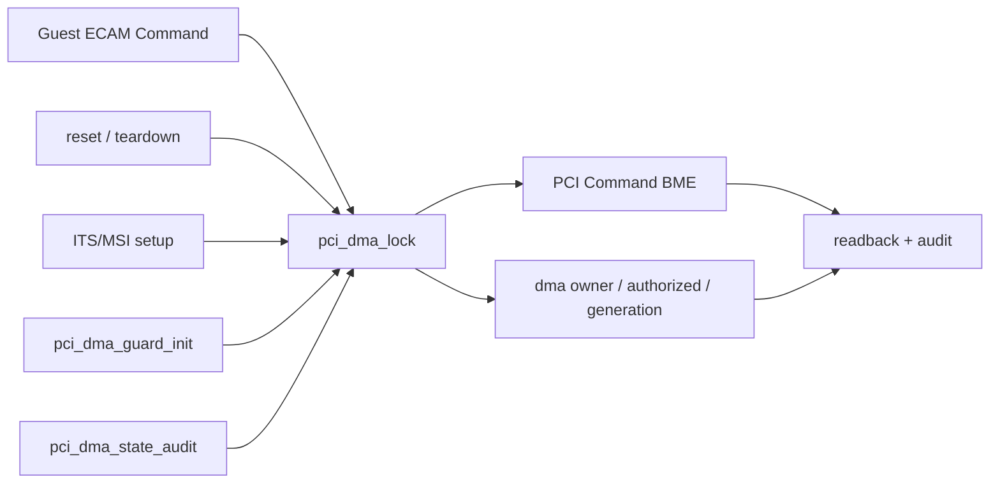
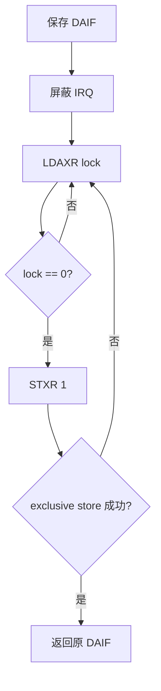
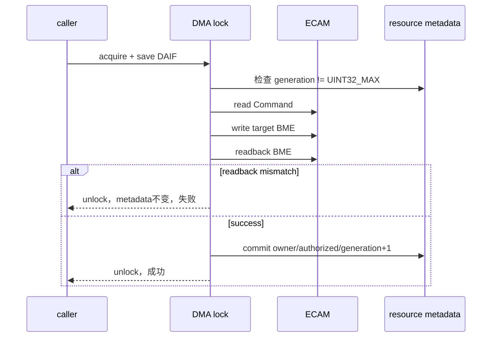
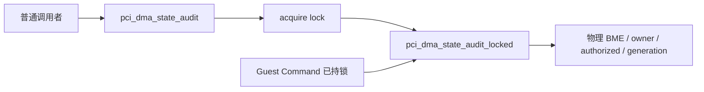
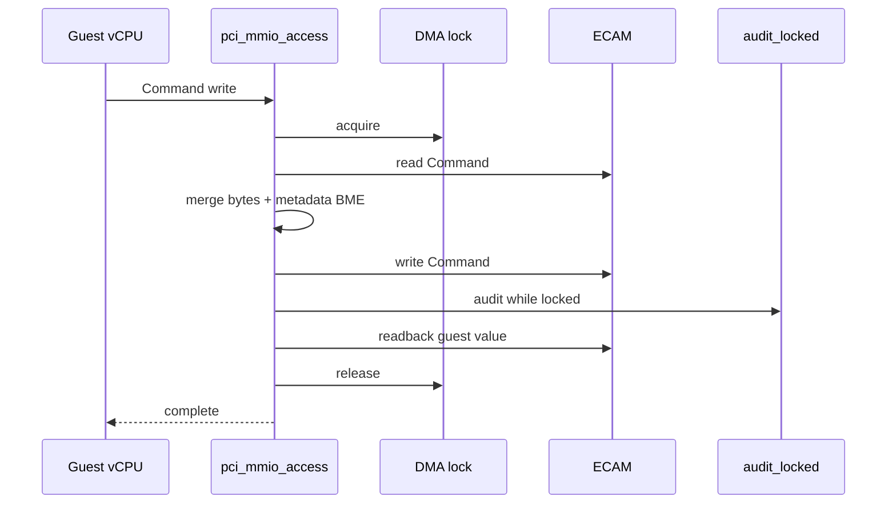
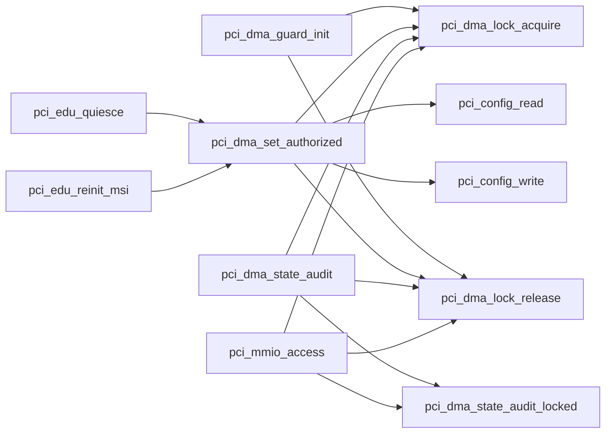

# aVisor Phase 123 详细设计：PCI DMA 授权并发保护与事务化更新

> 平台：QEMU virt / AArch64 EL2 / PCI ECAM / GICv3 ITS
> 前置阶段：Phase 122 PCI DMA 授权状态模型与一致性审计
> 本阶段：保存 DAIF 的 DMA 状态锁、授权事务、Guest Command 原子保持与 generation 溢出保护

## 1. 背景与目标

Phase 122 将 DMA 授权从物理 BME 隐式状态提升为 `dma_owner_vmid`、`dma_authorized` 和 `dma_generation` 显式模型，但其正确性依赖 PCI reset、Guest ECAM trap 和审计串行执行。随着多 vCPU、异步 teardown 和迁移路径接入，该假设不能继续作为安全边界。

未加锁时可能发生：

1. vCPU A 的 Guest Command 写读取 `dma_authorized=1`；
2. CPU B 的 teardown 清除物理 BME并提交 revoked metadata；
3. vCPU A 随后按旧快照把 BME 重新写为 1；
4. 软件状态为 revoked，但物理 function 可继续 bus mastering。

Phase 123 使用一把全局 DMA 状态锁串行化下列操作：

- 枚举后的全 function guard 初始化；
- DMA 授权与撤销；
- 物理 BME/metadata 全局审计；
- Guest Command read-modify-write、BME 保持、读回和写后审计。

同时将授权更新定义为锁内事务，并在 `dma_generation == UINT32_MAX` 时 fail closed，禁止版本回绕。

## 2. 架构设计



锁保护的逻辑对象不是单一字段，而是复合不变量：

```text
{ PCI Command.BME,
  dma_owner_vmid,
  dma_authorized,
  dma_generation }
```

因此不能只对 metadata 使用原子变量，也不能在锁外执行 ECAM 写后再更新 metadata。

## 3. AArch64 锁设计

### 3.1 数据

```c
static volatile unsigned int pci_dma_lock;
```

0 表示 unlocked，1 表示 locked。

### 3.2 获取锁

`pci_dma_lock_acquire()`：

1. `MRS DAIF` 保存调用者中断屏蔽状态；
2. `MSR DAIFSet, #2` 屏蔽 IRQ；
3. `LDAXR` acquire-load 锁值；
4. 非零时继续自旋；
5. 写 1 并使用 `STXR` 尝试独占提交；
6. 成功后返回原始 DAIF。



屏蔽本地 IRQ用于避免持锁代码被同一 CPU 的 IRQ 路径打断后再次获取该锁。多 CPU 互斥由 exclusive monitor 与 acquire/release 内存序保证。

### 3.3 释放锁

`pci_dma_lock_release(flags)` 使用：

```text
STLR WZR, [lock]
MSR DAIF, flags
```

`STLR` 确保临界区内物理 ECAM 操作和 metadata 写入在其他 CPU 观察到 lock=0 前完成；随后恢复调用者原 DAIF，而不是无条件打开 IRQ。

## 4. 授权事务

`pci_dma_set_authorized()` 的锁内事务如下：



事务特性：

- owner 参数校验在加锁前执行，因为静态 `owner_vmid` 在运行期不变；
- generation 检查、ECAM read-modify-write、readback、metadata commit 均在锁内；
- readback 失败时 metadata 保持原值；
- 日志在解锁后输出，减少 IRQ-disabled 临界区长度；
- 日志使用锁内复制出的 generation，不在解锁后重新读取共享状态。

## 5. Generation 溢出保护

Phase 122 直接执行 `dma_generation++`。32-bit 回绕会让新授权实例与早期版本号重合，破坏版本单调性。

Phase 123 在写物理 BME前检查：

```c
if (resource->dma_generation == UINT32_MAX)
    return -1;
```

采用 fail-closed 语义：

- 不改变物理 BME；
- 不改变 owner/authorized；
- 不回绕至 0；
- setup/reinit 将收到失败并停止继续发布授权状态。

当前没有重置 generation 的管理接口。达到上限需要重新启动 Hypervisor，实际生命周期内不可合理耗尽，但保护消除了整数回绕语义缺口。

## 6. Guard 初始化并发保护

`pci_dma_guard_init()` 在循环前获取全局锁，依次：

1. 清每个 function 的物理 BME；
2. 初始化 `dma_owner_vmid=0`；
3. 初始化 `dma_authorized=0`；
4. 初始化 `dma_generation=1`；
5. 读回验证 BME 为 0。

全部 function 完成后释放锁。若任一 readback 失败，先释放锁再返回，避免错误路径永久锁死。

启动阶段原则上尚无 Guest 并发，但将初始化纳入同一锁域可保证代码不变量完整，也为后续运行期重新枚举预留一致语义。

## 7. 审计的锁分层

为避免持锁调用审计时重复获取非递归锁，审计拆为两层：

```c
static int pci_dma_state_audit_locked(void);
static int pci_dma_state_audit(void);
```

- `_locked()`：假定调用者已持锁，只执行全 function 检查；
- 外层函数：获取锁、调用 `_locked()`、释放锁。



该模式明确了锁所有权，避免 `pci_mmio_access()` 在 Command 临界区内调用普通审计函数造成自死锁。

## 8. Guest Command 原子路径

Phase 122 的 Guest Command 路径在读取 metadata、写物理 Command 和调用审计之间可能被撤销路径插入。Phase 123 将完整 read-modify-write 纳入单个临界区：

1. 获取 DMA lock并保存 DAIF；
2. 读取物理 Command；
3. 从 `resource->dma_authorized` 生成目标 BME；
4. 合并 Guest 对 I/O Space、Memory Space、INTx Disable 的字节写；
5. 清除 Guest 输入 BME并恢复授权目标 BME；
6. 写物理 Command；
7. 调用 `pci_dma_state_audit_locked()`；
8. 读取模拟写回值；
9. 释放锁并恢复 DAIF；
10. 审计失败时输出 WARN。



撤销和重授权无法在步骤 2–8 之间插入，因此 Guest 写不能复活已撤销 BME，也不会覆盖新授权。

## 9. 锁顺序与临界区规则

当前 DMA lock 是 PCI DMA 状态的独立顶层锁：

- 临界区内不调用 `irq_domain_register/unregister` 或 ITS command queue；
- `pci_edu_quiesce()` 通过授权 API短暂持锁，返回后才继续 MSI disable 和 idle polling；
- `pci_edu_reinit_msi()` 先完成 ITS/LPI setup，再调用授权 API；
- 锁内不进行设备 busy polling；
- INFO/WARN 正常路径日志尽量放在解锁后。

这避免与 IRQ domain lock 或未来 ITS lock 形成嵌套锁顺序。当前仅 generation exhausted 和 readback error 在错误路径附近记录日志，其中锁均已先释放。

## 10. 函数调用 Mermaid



## 11. 文件与函数映射

| 文件/函数 | 职责 |
|---|---|
| `hypervisor/boards/virt/pci.c` | Phase 123 全部实现 |
| `pci_dma_lock` | 全局 DMA 授权状态锁 |
| `pci_dma_lock_acquire()` | 保存 DAIF、屏蔽 IRQ、LDAXR/STXR acquire |
| `pci_dma_lock_release()` | STLR release 并恢复原 DAIF |
| `pci_dma_set_authorized()` | 锁内 BME read/write/readback 和 metadata commit |
| `pci_dma_guard_init()` | 锁内初始化全部 function 的 revoked 状态 |
| `pci_dma_state_audit_locked()` | 已持锁审计核心 |
| `pci_dma_state_audit()` | 普通调用者审计包装器 |
| `pci_mmio_access()` | 锁内 Guest Command read-modify-write 与审计 |

## 12. 错误处理

- generation 达到 `UINT32_MAX`：解锁，记录 BDF，拒绝状态转移。
- BME readback 与目标不一致：解锁并失败，metadata 不提交。
- guard readback 失败：解锁并阻止 PCI 初始化。
- audit mismatch：返回失败；枚举期阻止发布，Guest 写路径记录 WARN。
- owner 不匹配：加锁前直接拒绝，不触碰物理状态。
- 锁为自旋锁，不允许持锁路径阻塞、调度或等待设备 idle。

## 13. 验证结果

### 13.1 构建与静态检查

- `make -f Makefile.virt -j2`：PASS。
- `pci.c` IDE diagnostics：无诊断。
- `git diff --check`：PASS。

### 13.2 默认拓扑

- DMA guard：`bus mastering disabled for 3 functions`；
- 初始审计：`functions=3 authorized=0`；
- edu 授权：generation 2；
- function reset quiesce 撤销：generation 3；
- MSI reinit 重授权：generation 4；
- Guest PCI BAR write protection、edu MSI、vITS 和 reset 后 MSI reinit 均 PASS；
- 无死锁、generation exhausted、state mismatch、PANIC 或 ASSERT。

### 13.3 两级嵌套 Bridge

- DMA guard：`bus mastering disabled for 6 functions`；
- 初始审计：`functions=6 authorized=0`；
- BAR 审计：`bars=6`；
- 拓扑审计：`bridges=2 forwarded-bars=4`；
- edu `00:03.0` generation 依次为 2、3、4；
- edu MSI、vITS 和 reset 后 MSI reinit 均 PASS；
- 未授权 Bridge/e1000 无授权日志。

两组 QEMU 均由外部 timeout 终止，说明持续运行期间未观察到死锁，但不代表穷举了所有 SMP 竞争交错。

## 14. 限制与后续方向

- 使用单一全局锁，所有 function 的 Command 写和审计串行化；当前设备规模有界，后续可评估 per-function lock。
- 未提供并发故障注入或专门的 SMP stress test，现有回归主要证明功能未退化。
- 锁是不可重入的，调用者必须遵守 `_locked` 分层规则。
- `pci_dma_state_audit_locked()` 会在持锁状态遍历最多 128 个 function 并执行 ECAM MMIO 读取，增加 IRQ latency，但只在低频管理/Guest Command 路径执行。
- 仍无 SMMU/IOMMU，锁只保证授权状态一致，不限制已授权 requester 的 DMA 地址范围。
- 后续应把 SMMU domain bind/unbind 与授权事务合并：domain 安装成功后才能置 BME，撤销时先清 BME、同步设备，再拆除 domain。
