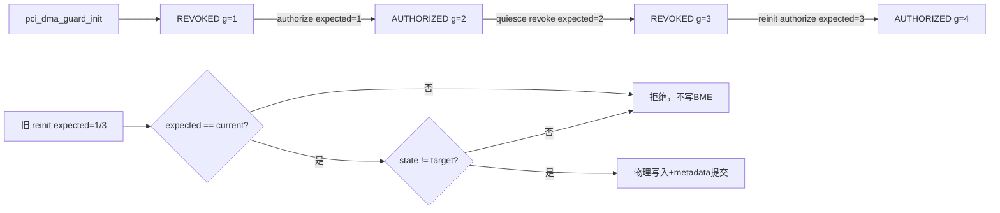
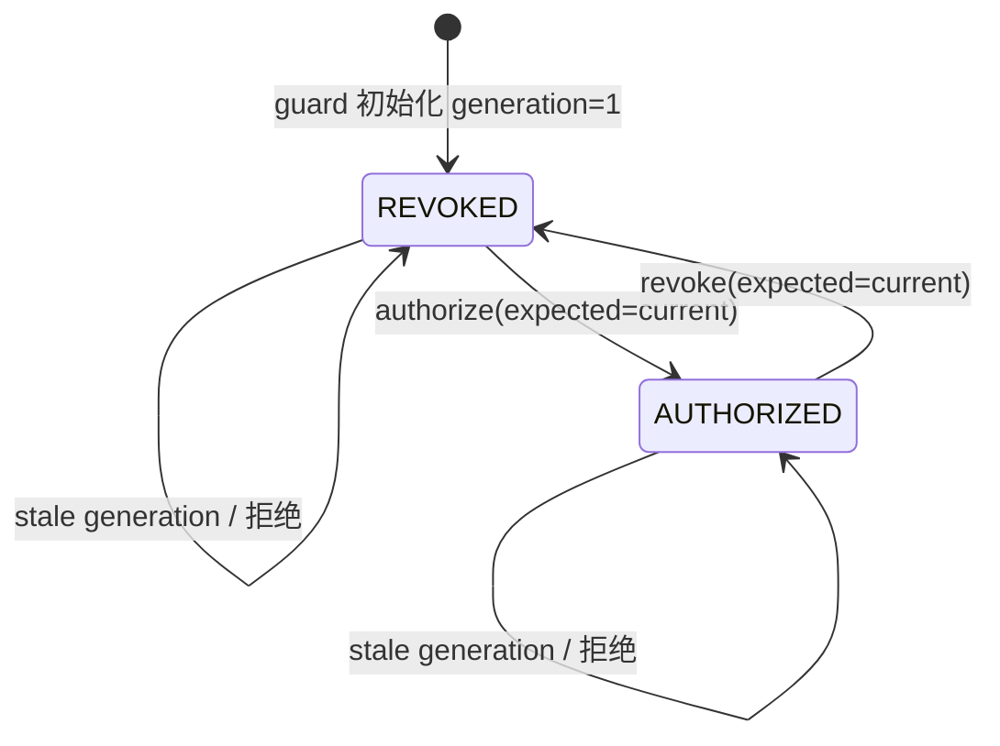
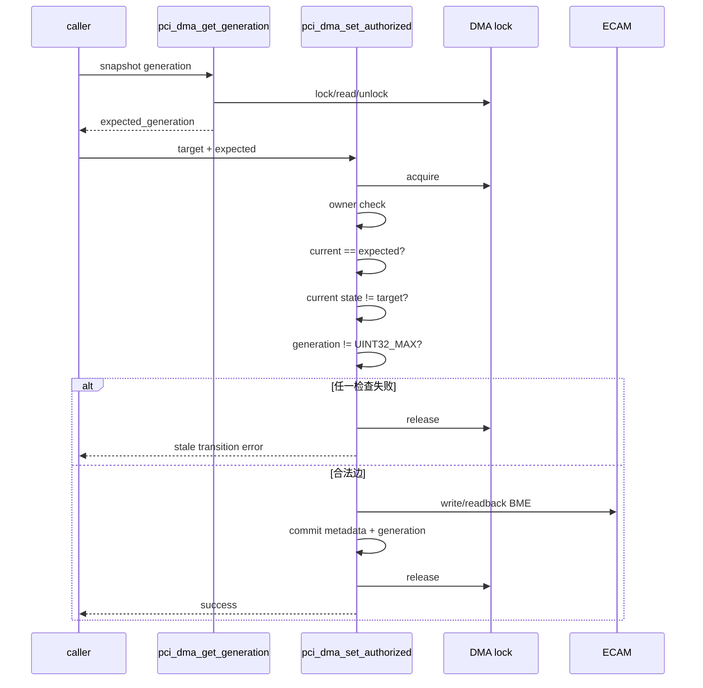
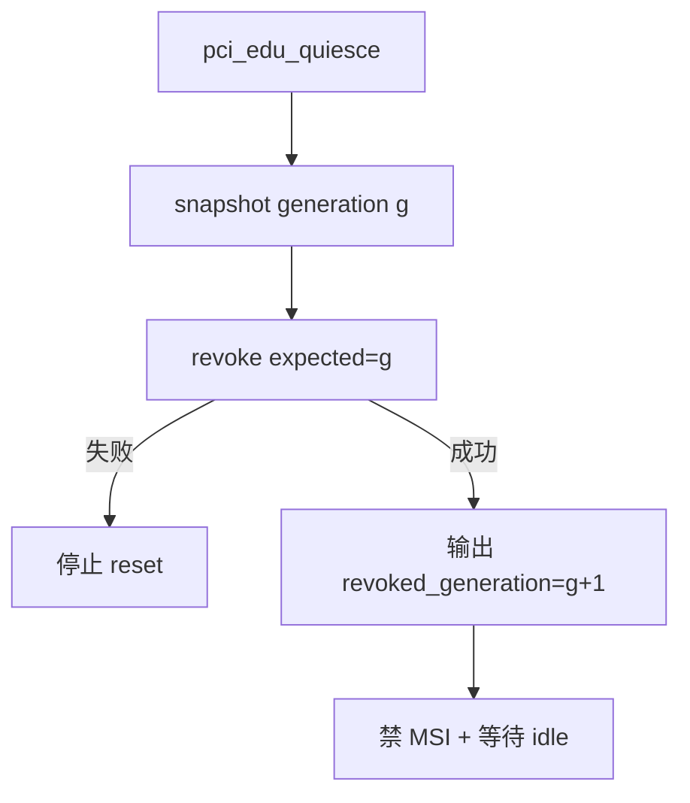
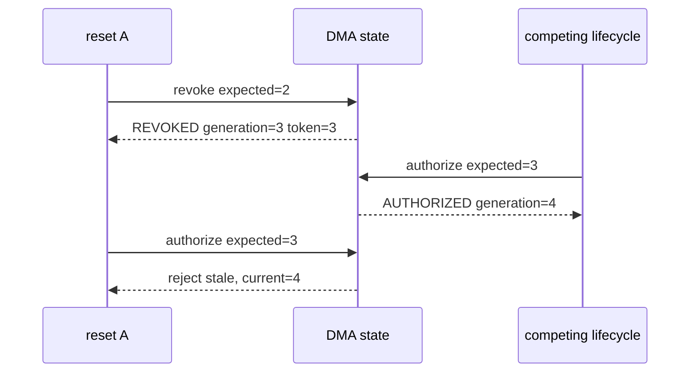
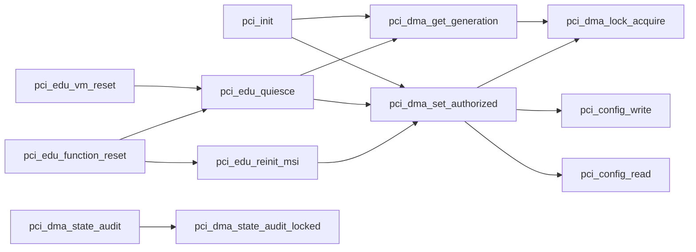

# aVisor Phase 124 详细设计：PCI DMA 授权状态机与 Generation 条件转换

> 平台：QEMU virt / AArch64 EL2 / PCI ECAM / GICv3 ITS
> 前置阶段：Phase 123 PCI DMA 授权并发保护与事务化更新
> 本阶段：严格授权状态机、expected-generation 条件写与 reset token 传递

## 1. 背景与目标

Phase 123 使用 IRQ-safe 自旋锁保证物理 BME 与 DMA metadata 的单次更新原子，但锁只能避免同时执行，不能识别已经过期的顺序操作。

例如 reset A 在 quiesce 后释放锁并执行设备 reset；随后 reset B 完成一次新的撤销/授权周期；最后 reset A 的 reinit 才到达。若 reinit 只检查当前状态并直接授权，旧 reset A 可能覆盖更新的生命周期。

Phase 124 引入 compare-and-transition 语义：

```text
transition(current_generation == expected_generation,
           current_state != target_state)
```

只有 generation 与调用者持有的 token 一致，并且状态边合法时，才允许修改物理 BME和提交 metadata。这样锁负责互斥，generation 负责识别调用时序是否仍然有效。

本阶段目标：

1. 明确 `REVOKED` 与 `AUTHORIZED` 两态状态机；
2. 拒绝重复授权、重复撤销和 generation 不匹配请求；
3. quiesce 输出撤销后的 generation token；
4. function reset reinit 必须使用该 token；
5. 初始 MSI setup也通过锁保护的 generation snapshot发起条件授权；
6. 审计禁止 generation 0。

## 2. 架构设计



Phase 124 不新增第三个持久状态。reset 进行中由 `REVOKED + generation token` 表达；token 仅在调用栈中传递。

## 3. 状态机定义



状态映射：

| 逻辑状态 | `dma_authorized` | `dma_owner_vmid` | 物理 BME |
|---|---:|---:|---:|
| REVOKED | 0 | 0 | 0 |
| AUTHORIZED | 1 | 静态 `owner_vmid` | 1 |

合法边只有：

```text
REVOKED(g)    -> AUTHORIZED(g + 1)
AUTHORIZED(g) -> REVOKED(g + 1)
```

任何自环都视为调用者生命周期错误，而不是幂等成功。

## 4. Generation 条件接口

### 4.1 接口变化

```c
static int pci_dma_set_authorized(
    struct pci_device_resource *resource,
    unsigned int owner_vmid,
    int authorized,
    uint32_t expected_generation);
```

`expected_generation` 是调用者在准备状态转换前取得的版本快照。

### 4.2 锁内检查顺序



条件和状态检查必须在锁内执行。snapshot 与 transition 之间允许其他 CPU先完成转换，但这种竞争会导致 expected 不匹配并安全失败。

### 4.3 拒绝日志

拒绝日志包含：

- BDF；
- expected generation；
- current generation；
- current state；
- target state。

这可区分：

- stale token：`expected != current`；
- 重复转换：`state == target`。

两种情况均不触碰物理 BME。

## 5. Generation Snapshot

`pci_dma_get_generation(resource)` 在 DMA lock 内读取 generation，避免未同步访问：

```c
lock();
generation = resource->dma_generation;
unlock();
```

snapshot 本身不是预约。只有后续 `pci_dma_set_authorized(..., expected)` 的比较成功才获得转换权，语义类似 compare-and-swap。

## 6. 初始 MSI 授权

edu 初始化路径完成 ITS route 和 IRQ ownership 后：

1. 获取 `edu_resource`；
2. `pci_dma_get_generation()` 获取当前 token，正常为 1；
3. 调用条件授权，目标 `AUTHORIZED`；
4. 成功后 generation 变为 2；
5. 再开启物理 MSI Enable。

若期间有其他路径改变状态，授权因 stale generation 失败，不会基于过期 route 上下文开启 BME。

## 7. Quiesce token

接口调整为：

```c
static int pci_edu_quiesce(uint32_t *revoked_generation);
```

流程：

1. 获取当前 generation；
2. 以该 generation 条件撤销；
3. 成功后新版本必为 `generation + 1`；
4. 通过输出参数返回 revoked token；
5. 清 MSI Enable并等待设备 idle。



VM teardown不需要重新授权，传入 `NULL`；function reset需要后续 reinit，传入 token 地址。

## 8. Reset/Reinit Token 传递

`pci_edu_function_reset()` 在栈上保存 `revoked_generation`：

```text
quiesce(&revoked_generation)
  -> teardown ITS/LPI
  -> FLR 或 fallback reset
  -> 恢复 BAR/Command decode（BME保持0）
  -> reinit_msi(revoked_generation)
```

`pci_edu_reinit_msi(expected_generation)` 完成 ITS/LPI 和 MSI message 重建后，使用 token 条件授权。

如果 reset 期间另一个生命周期操作修改 generation，则旧 reinit 被拒绝。它不能开启 BME，也不会把 metadata 推进到新 generation。



## 9. 审计增强

`pci_dma_state_audit_locked()` 除 Phase 122/123 不变量外增加：

```text
dma_generation != 0
```

所有枚举到的 function 经 guard 后必须从 generation 1 开始。generation 0 表示状态尚未初始化或 metadata 被破坏，审计失败并阻止正常发布。

Generation 单调性无法仅靠当前快照审计；由条件转换接口和溢出保护共同保证。

## 10. 错误语义

| 错误 | 行为 |
|---|---|
| owner 不匹配 | 加锁前拒绝 |
| expected generation 不匹配 | 解锁并拒绝，不写 ECAM |
| current state 等于 target | 解锁并拒绝，不增加 generation |
| generation 为 `UINT32_MAX` | fail closed，不允许回绕 |
| BME readback 不匹配 | metadata 不提交 |
| quiesce 条件撤销失败 | reset/teardown 停止 |
| reinit 条件授权失败 | reset 返回失败，不能发布成功状态 |
| generation 0 | audit 失败 |

Phase 124 选择严格状态机而非幂等接口，目的是暴露生命周期重复调用。上层若需要幂等行为，应先显式读取状态并决定是否发起转换，而不是让底层隐藏时序错误。

## 11. 函数调用 Mermaid



## 12. 文件与函数映射

| 文件/函数 | 职责 |
|---|---|
| `hypervisor/boards/virt/pci.c` | Phase 124 全部实现 |
| `pci_dma_get_generation()` | 锁保护的 generation snapshot |
| `pci_dma_set_authorized()` | expected-generation 条件状态转换 |
| `pci_dma_state_audit_locked()` | 增加 generation 非零检查 |
| `pci_edu_quiesce()` | 撤销并返回 revoked token |
| `pci_edu_reinit_msi()` | 使用 reset token 条件重新授权 |
| `pci_edu_function_reset()` | 在 quiesce 与 reinit 间传递 token |
| `pci_edu_vm_reset()` | teardown 使用严格撤销但不请求 token |

## 13. 验证结果

### 13.1 构建与静态检查

首次构建发现局部变量名 `current` 与调度器头文件中的 `current` 宏冲突，编译器报 `expected ')' before '.' token`。将局部变量重命名为 `current_generation` 后：

- `make -f Makefile.virt -j2`：PASS；
- `pci.c` IDE diagnostics：无诊断；
- `git diff --check`：PASS。

### 13.2 默认拓扑

- DMA guard：3 个 function；
- 初始 audit：`authorized=0`；
- edu 初始授权：generation 2；
- function reset撤销：generation 3；
- token 条件重授权：generation 4；
- Guest BAR write protection、edu MSI、vITS、reset 后 MSI reinit 均 PASS；
- 无 stale transition、generation exhausted、state mismatch、PANIC 或 ASSERT。

### 13.3 两级嵌套 Bridge

- DMA guard：6 个 function；
- BAR 审计：`bars=6`；
- 拓扑审计：`bridges=2 forwarded-bars=4`；
- edu `00:03.0` generation 按 2、3、4 演进；
- edu MSI、vITS、reset 后 MSI reinit 均 PASS；
- Bridge/e1000 没有 DMA 状态转换。

两组 QEMU 均由 timeout 终止。正常回归证明合法状态边未受影响；当前没有专用故障注入触发 stale/repeated transition 拒绝日志。

## 14. 限制与后续方向

- token 仅是 32-bit generation，不包含 BDF/owner；当前由 `resource` 指针和 owner 参数共同限定目标。
- 初始 setup使用 snapshot后立即转换，但未把 ITS route 自身纳入同一事务；stale 时 BME安全保持关闭，已建立 route需要调用者清理。
- reinit stale 失败时已重建的 ITS/LPI资源尚未事务回滚。
- VM teardown重复调用现在会严格失败，调用方必须保证一次性生命周期。
- 没有故障注入测试 stale、duplicate 和 generation exhaustion 分支。
- 仍未实现 SMMU。后续应将 `expected_generation` 同 SMMU domain generation绑定，并在授权失败时回滚新建 ITS/SMMU资源。

> 后续状态（t5，方向 A）：Phase 195 在授权前增加了「必须已绑定 SMMU domain」的门控，`smmu_domain` 仅为软件记录。`expected_generation` 与 SMMU domain generation 的绑定仍未实现。
