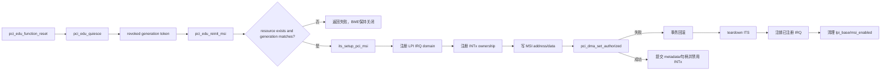
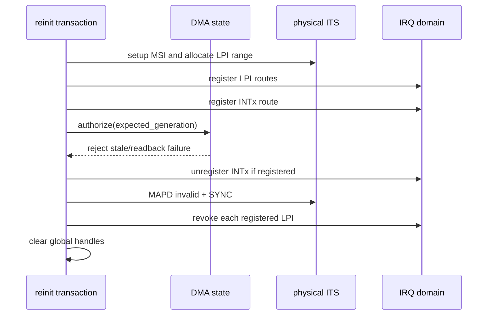
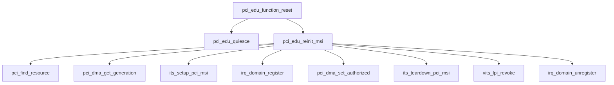

# aVisor Phase 125 详细设计：PCI DMA 授权失败与 MSI 资源事务回滚

> 平台：QEMU virt / AArch64 EL2 / PCI ECAM / GICv3 ITS/vITS
> 前置阶段：Phase 124 PCI DMA 授权状态机与 Generation 条件转换
> 本阶段：reset/reinit 期间的 MSI、IRQ domain 与 DMA 授权失败回滚

## 1. 背景与问题

Phase 124 已经使用 expected-generation 防止陈旧 reset 重新打开 BME，但 `pci_edu_reinit_msi()` 原先先建立 ITS/LPI 和 IRQ ownership，再执行 DMA 条件授权。若授权因 generation 陈旧、状态不匹配或物理 BME readback 失败，函数直接返回，已经建立的中断资源仍可能残留。

这会产生三个问题：

1. 失败的 reinit 仍可能留下 vITS/IRQ domain 路由；
2. `pci_edu_lpi_base` 与真实资源状态可能不一致；
3. 后续 reset 可能重复注册相同 PINTID，或者向已失败的路径注入中断。

Phase 125 将 reinit 收敛为一个资源事务：

```text
预检查 generation
    -> 建立物理 ITS 映射
    -> 注册 LPI/INTx ownership
    -> 写入 MSI message
    -> 条件授权 BME
    -> 提交 MSI metadata 与全局句柄

任一中间步骤失败 -> 撤销 IRQ ownership + teardown ITS + 清理句柄
```

本阶段不改变 Phase 124 的严格状态机，也不把 BME 授权改成幂等操作。

## 2. 架构设计



核心原则：只有授权成功后，才发布 `pci_edu_lpi_base`、`pci_edu_msi_enabled` 和 MSI shadow metadata。失败路径不得把半初始化状态暴露给其他路径。

## 3. 资源与事务状态

### 3.1 临时事务上下文

`pci_edu_reinit_msi()` 使用局部变量记录事务进度：

| 变量 | 含义 |
|---|---|
| `lpi_base` | 本次 ITS setup 返回的 LPI 起点 |
| `registered_vectors` | 已成功注册的 LPI 数量 |
| `intx_registered` | INTx ownership 是否已经注册 |
| `vectors` | 本次实际使用的向量数量，上限 16 |
| `expected_generation` | quiesce 返回的 reset token |

资源只有在所有步骤完成后才写入全局句柄：

```c
pci_edu_lpi_base = lpi_base;
pci_edu_msi_enabled = 1;
```

### 3.2 状态不变量

成功返回：

```text
DMA authorized = 1
physical BME   = 1
MSI route      = valid
LPI ownership  = registered
pci_edu_lpi_base = current lpi_base
pci_edu_msi_enabled = 1
```

失败返回：

```text
DMA authorized = 0
physical BME   = 0
MSI global handle = cleared
new IRQ ownership = removed
new ITS mapping = torn down
```

LPI 分配器当前采用单调递增的 `next_lpi`，因此 teardown 不会回收数值区间；回滚保证的是路由、ownership 和可见句柄的一致性，而不是 LPI ID 复用。

## 4. 详细流程

### 4.1 Generation 预检查

reinit 首先查找 edu resource，并在 DMA lock 保护下读取 generation：

```text
resource == NULL              -> fail
current_generation != expected -> fail
```

这一步在创建 ITS 资源前执行，避免明显的陈旧 reset 消耗新的中断资源。

### 4.2 建立临时 MSI 资源

调用 `its_setup_pci_msi()` 获取新的 LPI 区间；随后逐个注册 LPI route。每成功一个向量，`registered_vectors` 加一。任何注册失败都跳转到统一 rollback。

INTx ownership 也纳入事务。注册成功后设置 `intx_registered`，但不在中间步骤发布成功状态。

### 4.3 条件 DMA 授权

MSI address/data 写入物理配置空间后，调用：

```c
pci_dma_set_authorized(edu_resource, 1, 1,
                       expected_generation)
```

只有该调用成功，才允许：

1. 提交 MSI shadow metadata；
2. 开启物理 MSI；
3. 禁用物理 INTx；
4. 发布新的 LPI base 和 MSI enabled 标志。

陈旧 token 会在锁内被拒绝，BME 不会打开，然后进入 rollback。

### 4.4 回滚顺序



回滚顺序先停止可能产生的 INTx 路由，再 teardown ITS，最后撤销每个已经注册的 LPI ownership。这样不会在物理 ITS 已失效后继续把新事件路由到有效的 guest route。

## 5. 函数调用 Mermaid



## 6. 失败语义

| 失败点 | 处理 | BME结果 |
|---|---|---|
| resource 不存在 | 直接失败 | 保持 0 |
| generation 不匹配 | 直接失败，不创建资源 | 保持 0 |
| ITS setup 失败 | 直接失败 | 保持 0 |
| LPI 注册失败 | 回滚已注册 LPI 与 ITS | 保持 0 |
| INTx 注册失败 | 回滚 LPI 与 ITS | 保持 0 |
| DMA 条件授权失败 | 回滚全部新资源 | 保持 0 |
| 成功授权后 | 提交 MSI 状态 | 置 1 |

Phase 125 不尝试在授权失败后重新授权，也不吞掉失败返回值。调用者必须把 reset 视为失败生命周期，并由上层决定是否终止 VM 或发起新的完整 reset。

## 7. 与 Phase 124 的关系

Phase 124 负责“谁有权改变 DMA 状态”，Phase 125 负责“授权失败时已创建的外围资源如何撤销”：

```text
Phase 124: generation compare-and-transition
Phase 125: resource transaction rollback
```

两者组合后，陈旧 reinit 的效果为：

```text
BME 不开启
MSI/LPI 新资源不残留
全局资源句柄不发布
reset 返回失败
```

## 8. 验证结果

### 8.1 构建与静态检查

- `make -f Makefile.virt -j2`：PASS；
- `git diff --check`：PASS；
- `pci.c` IDE diagnostics：无诊断。

### 8.2 默认 QEMU 正常路径

默认 QEMU virt topology 在 35 秒回归窗口内完成关键 PCI 测试：

- PCI DMA guard：3 个 function，初始 audit `authorized=0`；
- edu 初始授权：generation 2；
- PCI BAR write protection：PASS；
- edu MSI interrupt：PASS；
- vITS requester ownership 与 MSI 路径：PASS；
- function reset 撤销：generation 3；
- reset 后分配新 LPI 8193并重新授权：generation 4；
- `edu function reset + MSI reinit`：PASS；
- 未出现 rollback、DMA state mismatch、PANIC 或 ASSERT。

QEMU 由 timeout 终止，表示长时间运行的 Guest 测试达到回归窗口，并非 Guest suite 自然退出。

### 8.3 失败路径审计

当前工程没有硬件故障注入接口，因此通过控制流和 generation 条件路径静态验证：

- stale generation 在 ITS setup 前被预检查拒绝；
- snapshot 后发生竞争仍由锁内 `pci_dma_set_authorized()` 拒绝；
- LPI/INTx 注册失败进入统一 rollback；
- DMA 授权失败清理已经注册的 ownership 和 ITS mapping；
- 全局 `pci_edu_lpi_base` 与 `pci_edu_msi_enabled` 在 rollback 后为零。

### 8.4 已知限制

- `next_lpi` 仍然单调递增，回滚不复用 LPI 编号；
- `its_setup_pci_msi()` 内部 ITT page 当前没有单独释放接口，MAPD teardown 由 ITS 管理；
- 物理配置空间中已经写入的 MSI address/data 在失败路径不会恢复旧值，但 BME保持关闭且 MSI Enable 不会被提交为成功状态；
- 仍未接入 SMMU/IOMMU；
- 尚无专门的 fault injection 和 SMP 压力测试。

## 9. 文件与接口映射

| 文件/函数 | 职责 |
|---|---|
| `hypervisor/boards/virt/pci.c` | Phase 125 reinit 事务与回滚实现 |
| `pci_edu_reinit_msi()` | 资源建立、条件授权、统一 rollback |
| `pci_dma_set_authorized()` | Phase 124 generation 条件授权 |
| `its_setup_pci_msi()` | 建立物理 ITS MSI 映射 |
| `its_teardown_pci_msi()` | 撤销物理 ITS Device mapping |
| `irq_domain_unregister()` | 撤销 INTx ownership |
| `vits_lpi_revoke()` | 清理 LPI 虚拟路由和 ownership |

## 10. 总结

Phase 125 将 PCI edu reset 的 MSI reinitialization 从“步骤串联”升级为“资源事务”。在 expected-generation 授权失败、IRQ ownership 冲突或中间资源建立失败时，系统会撤销当前事务已经产生的路由并清理全局句柄，同时保持 BME 关闭。这样 Phase 124 的陈旧状态保护不会留下新的中断资源泄漏窗口。
