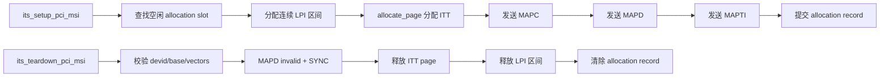
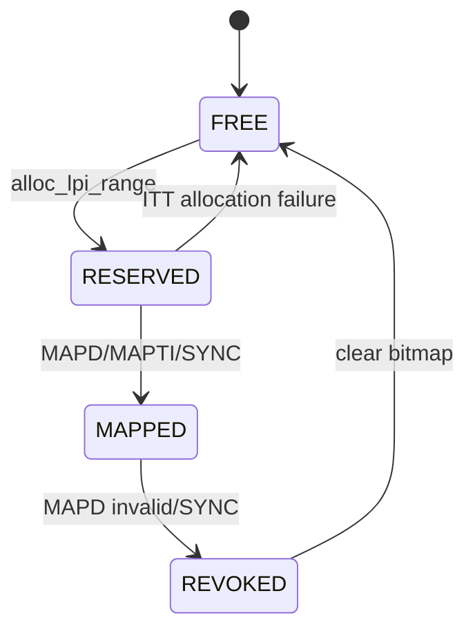
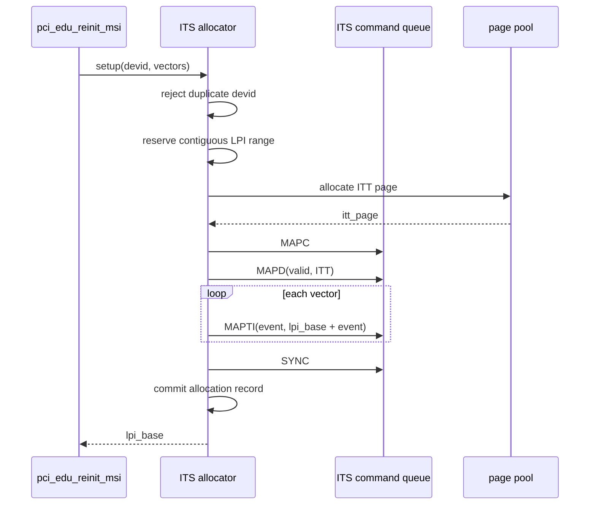
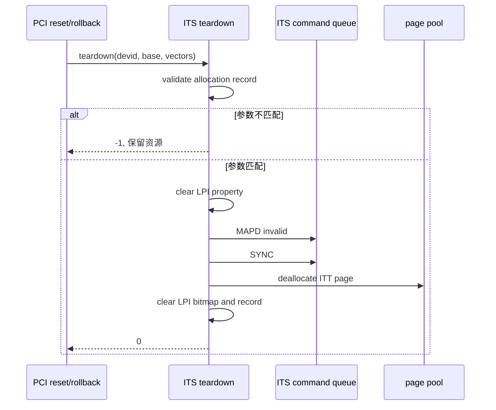
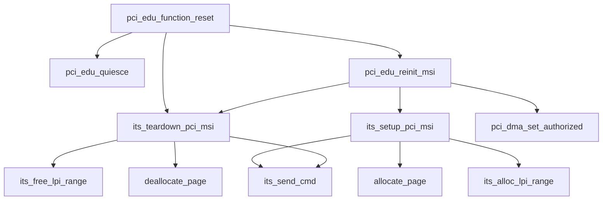

# aVisor Phase 126 详细设计：ITS MSI 资源生命周期回收与 LPI 复用

> 平台：QEMU virt / AArch64 EL2 / GICv3 ITS/vITS / PCI ECAM
> 前置阶段：Phase 125 PCI DMA 授权失败与 MSI 资源事务回滚
> 本阶段：物理 ITS 的 ITT、LPI 区间和分配记录生命周期管理

## 1. 背景与目标

Phase 125 已经能够在 MSI reinit 失败时撤销 ITS mapping，但此前 `its_setup_pci_msi()` 使用单调递增的 `next_lpi`，并且为每次 MAPD 分配 ITT page 后没有保存对应页面。这样 teardown 只能撤销 QEMU ITS 的 Device mapping，不能回收页池页面或复用 LPI 区间。

长期 reset/reinit 会导致：

- ITT page 持续消耗物理页池；
- LPI ID 只能增长，无法复用；
- teardown 参数错误时无法识别目标资源；
- 相同 DeviceID 重复 setup 可能覆盖旧映射。

Phase 126 的目标：

1. 建立有限的 PCI MSI allocation table；
2. 按区间分配和释放 LPI；
3. 保存每个 DeviceID 的 ITT page、LPI base 和 vector 数量；
4. teardown 必须校验 DeviceID、LPI base 和 vector 数量；
5. 成功 teardown 后释放 ITT page、清除 LPI 使用位并使 allocation 无效；
6. 保持 Phase 125 的 rollback 和 Phase 124 的 DMA generation 语义不变。

## 2. 架构设计



资源层次为：

```text
PCI DeviceID
  └── allocation record
        ├── ITT page
        └── contiguous LPI range
              └── LPI IRQ-domain/vITS ownership（由 pci.c 回收）
```

ITS 层只管理物理 ITS 资源；`irq_domain` 和 vITS 映射仍由 PCI reset/rollback 调用方撤销。

## 3. 数据结构

```c
struct its_msi_allocation {
    uint32_t devid;
    unsigned int lpi_base;
    unsigned int num_vectors;
    void *itt_page;
    uint8_t valid;
};
```

字段含义：

| 字段 | 作用 |
|---|---|
| `devid` | PCI requester ID，作为 ITS DeviceID |
| `lpi_base` | 连续 LPI 区间起点 |
| `num_vectors` | 实际建立的 MAPTI 数量 |
| `itt_page` | 物理 ITS 使用的 ITT page，释放时返回页池 |
| `valid` | allocation record 是否正在使用 |

当前实现最多保留 16 条 allocation record，LPI 复用范围为 `8192..8999`。该上限覆盖当前 PCI 直通场景，并避免使用 vITS 管理区间 `9000..`。

## 4. LPI 分配算法

### 4.1 分配

`its_alloc_lpi_range()` 使用 bitmap 扫描连续空闲区间：

```text
for each candidate start:
    检查 start .. start + num_vectors - 1
    若全部空闲：标记 used 并返回 LPI_INTID_BASE + start
```

MSI vector 必须连续，因为 MAPTI 使用 `lpi_base + event_id` 的确定性映射。

### 4.2 释放

`its_free_lpi_range()` 验证范围处于 `8192..8999` 后清除 bitmap。释放发生在物理 MAPD teardown 和 SYNC 之后，避免 ITS 仍可能使用已经重新分配的 LPI。



## 5. Setup 事务

`its_setup_pci_msi()` 的执行顺序：

1. 规范化 vector 数量，限制为 `ITS_ITT_MAX_EVENTS`；
2. 检查 DeviceID 是否已有有效 allocation；
3. 查找空闲 allocation slot；
4. 分配连续 LPI 区间；
5. 分配 ITT page；
6. 发送 MAPC、MAPD、MAPTI 和 SYNC；
7. 提交 allocation record；
8. 返回 LPI base。

在 allocation record 提交之前，所有中间失败点都不会暴露有效记录。ITT page 分配失败会立即释放已预留的 LPI bitmap。



## 6. Teardown 事务

`its_teardown_pci_msi()` 从 allocation table 查找同时满足以下条件的记录：

```text
devid == requested devid
lpi_base == requested lpi_base
num_vectors == recorded num_vectors
```

任一条件不匹配即返回失败，不修改 bitmap，也不释放 ITT page。这避免错误调用释放其他设备的资源。

校验成功后：

1. 清除 LPI property bytes；
2. 执行 DSB；
3. 发送 MAPD invalid；
4. 发送 SYNC；
5. `deallocate_page(itt_page)`；
6. 清除 LPI bitmap；
7. 将 record 标记为 invalid。



## 7. 与 Phase 125 回滚的关系

Phase 125 rollback 现在使用 ITS allocation record 完成真正的资源释放：

```text
irq_domain_unregister(INTx)
its_teardown_pci_msi()
vits_lpi_revoke(each LPI)
clear pci_edu_lpi_base / pci_edu_msi_enabled
```

如果 teardown 参数错误，ITS 层返回失败并打印警告；调用方不会静默认为资源已经释放。正常路径下，reset 前后可以复用同一 LPI 区间，并且 ITT page 会回到 page pool。

## 8. 函数调用 Mermaid



## 9. 错误语义与不变量

| 场景 | 处理 |
|---|---|
| DeviceID 已存在 | setup 失败，不覆盖旧记录 |
| allocation table 已满 | setup 失败 |
| LPI 区间不足 | setup 失败 |
| ITT page 分配失败 | 释放已预留 LPI，setup 失败 |
| teardown 参数不匹配 | 保留所有资源并返回失败 |
| MAPD teardown 完成 | 才释放 ITT 和 LPI bitmap |
| reset rollback teardown 失败 | 调用方输出 warning，继续清理其他 ownership |

关键不变量：

```text
valid record => ITT page 有效 && LPI bitmap 已占用
invalid record => 不允许 teardown 成功
free LPI => 不存在有效 MAPD record 指向该区间
```

## 10. 验证结果

### 10.1 静态与构建验证

- `make -f Makefile.virt -j2`：PASS；
- `git diff --check`：PASS；
- `its.c`、`pci.c`、`its.h` IDE diagnostics：无诊断。

### 10.2 QEMU 回归

默认 topology 在 35 秒回归窗口内完成关键 PCI 测试：

- 初始 `ITS: MSI map devid=16 vec=1 lpi=8192..8192`；
- edu MSI interrupt：PASS；
- vITS requester ownership 和 LPI 注入：PASS；
- function reset 撤销 DMA，generation 变为 3；
- teardown 输出 `ITS: MSI resources released devid=16 lpi=8192..8192`；
- reinit 复用 LPI 8192，而不是分配 8193；
- DMA 重新授权 generation 变为 4；
- `edu function reset + MSI reinit`：PASS；
- 未出现 duplicate allocation、teardown mismatch、PANIC 或 ASSERT。

QEMU 由 timeout 终止，表示长时间运行的 Guest 测试达到回归窗口，并非 Guest suite 自然退出。

### 10.3 已知限制

- allocation table 是固定大小，不支持动态扩容；
- 当前只覆盖单 collection、单 CPU 的 ITS 配置；
- MAPC collection 是共享的，teardown 不撤销 collection 0；
- LPI bitmap 和 allocation table 尚未加独立锁，当前调用路径由单线程生命周期串行保证；
- 仍未实现 SMMU/IOMMU；
- 没有专门的重复 setup、错误 teardown 参数和资源耗尽 fault injection。

## 11. 文件与接口映射

| 文件/函数 | 职责 |
|---|---|
| `hypervisor/boards/virt/its.c` | allocation table、LPI bitmap、ITT page 生命周期 |
| `its_alloc_lpi_range()` | 分配连续 LPI 区间 |
| `its_free_lpi_range()` | 释放 LPI bitmap |
| `its_setup_pci_msi()` | 建立并提交 MSI allocation record |
| `its_teardown_pci_msi()` | 校验并释放 ITS MSI 资源 |
| `include/boards/virt/its.h` | teardown 返回值接口声明 |
| `hypervisor/boards/virt/pci.c` | reset/rollback 调用 ITS 资源回收 |

## 12. 总结

Phase 126 将 ITS MSI 管理从“命令发出即完成”提升为可追踪的资源生命周期管理。每个 DeviceID 都有明确的 ITT page、连续 LPI 区间和 vector 数量记录；teardown 通过记录校验后才执行物理 MAPD invalid、页回收和 LPI 复用。这样 Phase 125 的事务回滚可以真正释放失败 reinit 的资源，长期 reset 不再单调消耗物理页池和 LPI ID。
