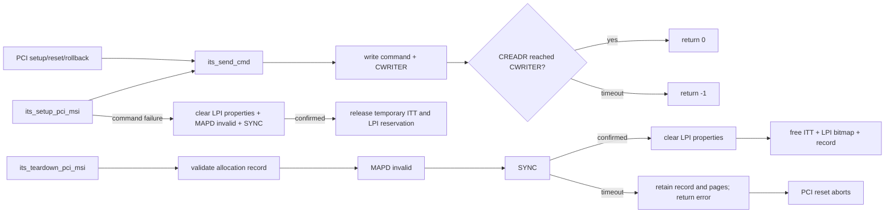
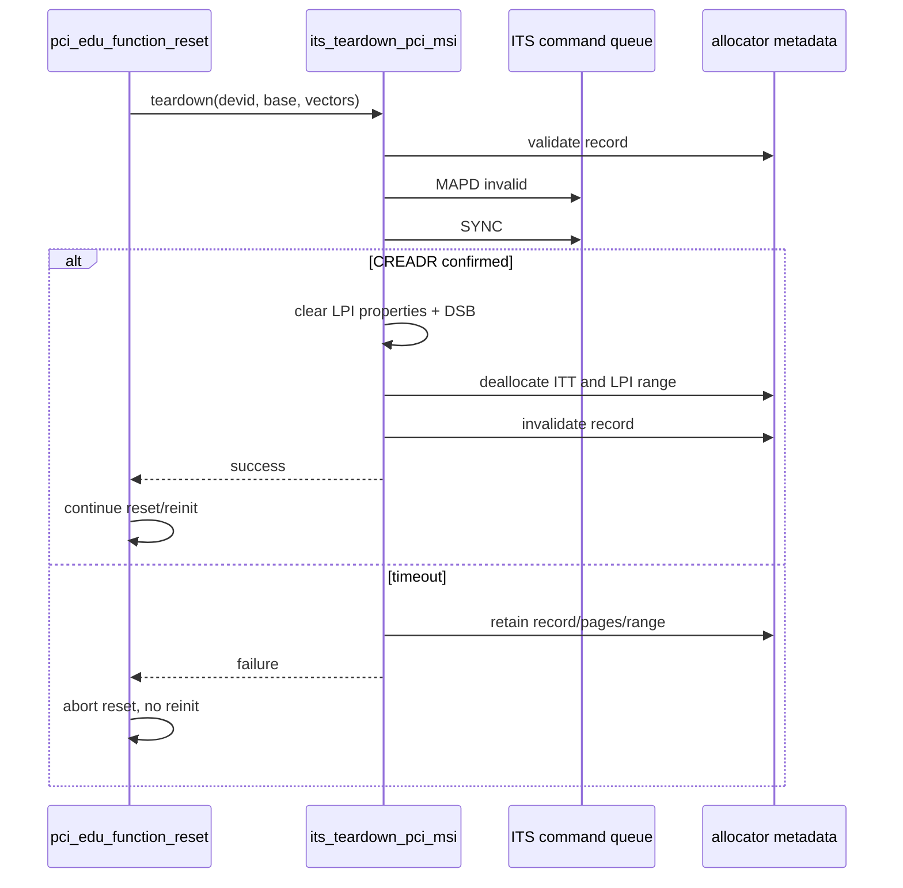
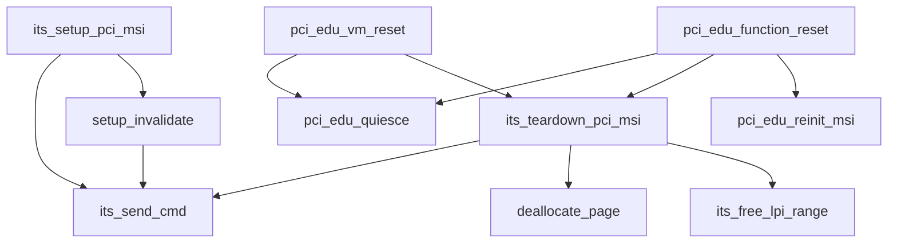

# aVisor Phase 127 详细设计：ITS 命令完成确认与安全 Teardown

> 平台：QEMU virt / AArch64 EL2 / GICv3 ITS / PCI edu passthrough
> 前置阶段：Phase 126 ITS MSI allocation 生命周期和 LPI 复用
> 本阶段：将 ITS 命令超时变成可传播错误，并确保 teardown 仅在 MAPD invalid 已确认后释放资源

## 1. 背景与目标

Phase 126 已经记录每个 PCI DeviceID 对应的 ITT page、LPI 区间和向量数，但仍有两处风险：

1. `its_send_cmd()` 在等待 CREADR 超时时只打印 warning，调用者仍认为命令成功；
2. teardown 先清零 LPI property，再发送 MAPD invalid/SYNC，命令未确认时仍会释放 ITT page 和 LPI bitmap。

如果 ITS 命令队列停滞，MAPD invalid 可能尚未生效，ITS 仍可能读取 ITT 或投递 LPI。释放/复用这些资源会造成物理映射指向已回收页面或新 owner 的 LPI。

Phase 127 的目标：

- `its_send_cmd()` 返回明确成功/失败；
- setup 在关键命令失败时不提交 allocation record，并尽可能撤销部分 MAPD；
- teardown 先确认 MAPD invalid 和 SYNC，成功后才清 LPI 属性、释放 ITT/LPI；
- teardown 失败时保留 allocation record、ITT page 和 LPI bitmap；
- PCI reset 在 teardown 失败时停止后续设备 FLR/internal reset，避免状态不明时继续重建。

## 2. 架构设计



## 3. ITS 命令接口

接口由 `void` 改为 `int`：

```c
static int its_send_cmd(uint64_t d0, uint64_t d1,
                        uint64_t d2, uint64_t d3);
```

返回约定：

| 返回值 | 语义 |
|---|---|
| `0` | 写入命令后，CREADR 在 timeout 内追上 CWRITER |
| `-1` | 命令队列未确认完成；设备/ITS 状态不得推断为已更新 |

每次调用仍然对应单条命令。若 MAPD 命令自身已经写入队列但确认超时，硬件最终是否消费该命令是未知的，因此调用方不能释放其依赖资源。

## 4. Setup 错误处理

setup 流程在分配 temporary LPI range 和 ITT page 后依序发送 MAPC、MAPD valid、MAPTI、SYNC。任一命令失败：

1. 清除本次 LPI property bytes并执行 DSB；
2. 尝试发送 MAPD invalid 和 SYNC；
3. 只有撤销命令都确认成功，才释放 ITT page 和 LPI bitmap；
4. 若撤销命令未确认，保留 ITT page 和 LPI reservation，避免潜在硬件引用悬空资源；
5. 不发布 allocation record，返回 0，阻止 PCI 上层继续建立 guest route 或开启 DMA。

这种故障路径可能留下不可达的保留资源，但不会将仍可能被 ITS 使用的内存交还给页池。后续恢复需要 ITS reset/reinitialization 或系统级回收，不在本阶段实现。

## 5. Teardown 顺序

### 5.1 成功路径

```text
validate allocation
  -> MAPD invalid acknowledged
  -> SYNC acknowledged
  -> clear LPI properties + DSB
  -> deallocate ITT page
  -> free LPI range
  -> invalidate allocation record
```

teardown 不能先清属性或释放页。MAPD invalid + SYNC 是 ITS 不再依赖该 DeviceID ITT 的确认点。

### 5.2 命令超时路径

- 返回 `-1`；
- allocation record 仍有效；
- ITT page 不归还页池；
- LPI bitmap 保持占用；
- PCI reset 返回失败，停止后续 FLR/internal reset 和 MSI reinit。



## 6. PCI 生命周期调用方

`pci_edu_vm_reset()` 和 `pci_edu_function_reset()` 现在检查 ITS teardown 返回值：

- VM reset teardown 失败时返回错误，不清除 `pci_edu_lpi_base`；
- function reset teardown 失败时记录 warning 并返回，不执行 FLR/internal reset，也不进行 MSI reinit；
- vITS LPI route 在 ITS teardown 成功后才撤销。

此顺序保证失败时 guest-facing ownership 仍可被后续诊断识别，且对应物理资源没有被 allocator 复用。

## 7. 函数调用 Mermaid



## 8. 状态不变量

```text
allocation.valid == 1
    => ITT page allocated && LPI range reserved

teardown returns 0
    => MAPD invalid and SYNC were acknowledged
       before ITT/LPI release

teardown returns -1
    => allocation, ITT page and LPI reservation remain intact

PCI reset continues past teardown
    => ITS teardown returned 0
```

ITS command timeout 表示状态未知而非确定失败；资源采取保留策略，避免错误复用。

## 9. 验证结果与限制

### 9.1 构建和静态检查

- `make -f Makefile.virt -j2`：PASS；
- `git diff --check`：PASS；
- `its.c` 与 `pci.c` IDE diagnostics：无诊断。

### 9.2 QEMU 回归

默认 topology 的 35 秒回归窗口内：

- 初始 MSI allocation 成功，DeviceID 16 使用 LPI 8192；
- edu MSI interrupt：PASS；
- vITS LPI 注入：PASS；
- function reset 成功确认 teardown，释放 LPI 8192 并完成 reinit 复用；
- DMA generation 从 2 到 3，再到 4；
- reset 完成后，Guest 输出 `EL2 task stack overflow` PANIC，故整套 QEMU 回归不能判定为完全通过。该 panic 发生在本次重建并重新编译 Guest 测试之后；原因尚未定位，不能据此归因于 Phase 127，也不能忽略。

QEMU 由 timeout 终止，Guest suite 未自然退出。当前 QEMU 未注入 ITS CREADR stall，因此命令超时分支尚未动态验证。

### 9.3 限制

- QEMU 正常回归不能注入 CREADR stall，超时失败路径目前依赖静态控制流审计；
- ITS 命令 timeout 后不能判断命令是否稍后完成，因此资源会被保留，可能造成资源泄漏；
- MAPC collection 生命周期仍为 ITS 全局共享，不在单设备 teardown 时撤销；
- 命令队列并发写入保护尚未引入，本阶段仍依赖现有单核串行设备生命周期调用；
- 未接入 SMMU/IOMMU。

## 10. 文件映射

| 文件 | 变更职责 |
|---|---|
| `hypervisor/boards/virt/its.c` | ITS 命令成功/失败传播、setup 回滚、teardown 安全顺序 |
| `hypervisor/boards/virt/pci.c` | reset 调用方检查 teardown 结果并在失败时停止 |
| `docs/Phase127_ITS命令完成确认与安全Teardown_详细设计文档.md` | 设计、状态机、时序及验证说明 |

## 11. 总结

Phase 127 将 ITS 命令队列完成状态变成真实的控制流条件，并将资源释放放到 MAPD invalid/SYNC 的确认之后。命令超时采取保留资源、阻断 reset 的 fail-closed 策略，避免 ITS 可能仍在读取时 ITT page 或 LPI 被重新分配给其他用途。
