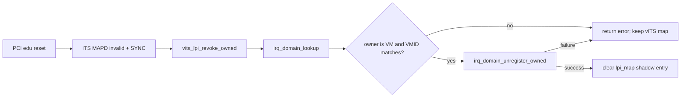
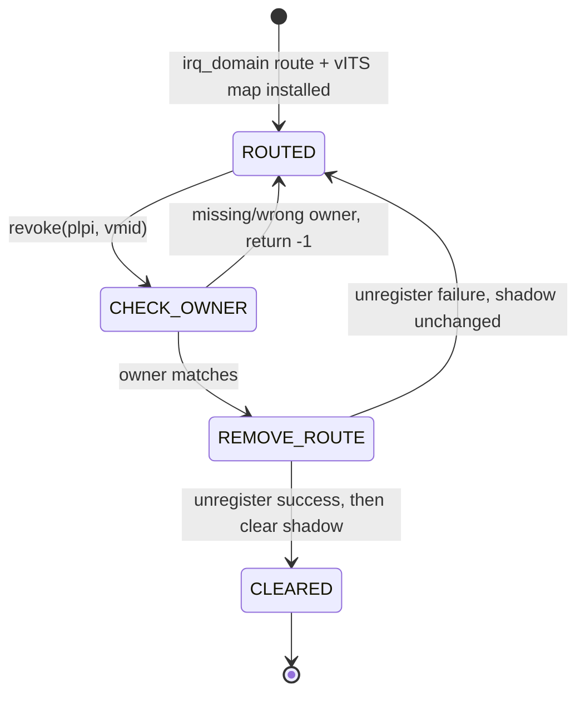
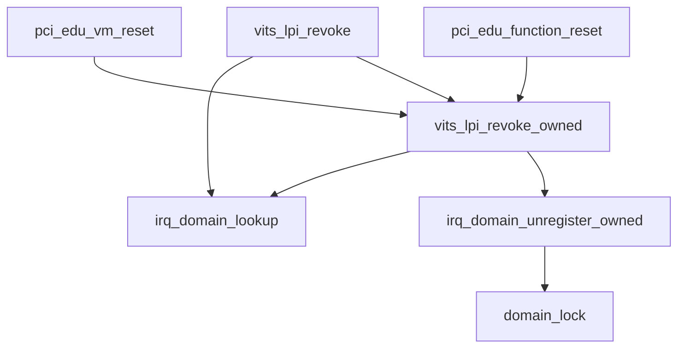

# aVisor Phase 128 详细设计：IRQ Domain 按 VM 所有者注销与 vITS 路由一致性

> 平台：QEMU virt / AArch64 EL2 / GICv3 ITS/vITS
> 前置阶段：Phase 127 ITS 命令完成确认与安全 Teardown
> 本阶段：防止撤销错误 VM 的 pLPI route，并维持 IRQ domain 与 vITS 映射一致

## 1. 背景与目标

Phase 127 已保证物理 ITS 资源只有在 MAPD invalid/SYNC 被确认后才释放。本阶段检查其上层路由 ownership 生命周期，发现：

- `irq_domain_unregister(pintid)` 只按 PINTID 删除 route，不要求调用者提供 VMID；
- `vits_lpi_revoke()` 先清本地 `lpi_map`，之后再注销 irq_domain route；
- 如果 route 不存在或 ownership 与预期 VM 不符，两个状态源可能不一致，且调用者无法区分是否删除了目标 owner 的记录；
- PCI edu reset 已知由 VM1 拥有，但 teardown 调用链没有把这个 owner 作为显式参数传入。

Phase 128 提供 owner-aware 注销路径，并定义“先验证/注销 IRQ domain，再清除 vITS shadow mapping”的提交顺序。旧的通用 unregister 保留给已有管理场景，PCI/vITS 生命周期使用带 VMID 的接口。

## 2. 架构设计



两个状态源的更新顺序：

```text
IRQ domain route remains authoritative
  -> verify route ownership
  -> disable route under irq_domain lock
  -> clear vITS pLPI shadow entry
```

如果 unregister 失败，vITS shadow entry 不会先被清除。

## 3. 按所有者注销接口

### 3.1 IRQ Domain

新增：

```c
int irq_domain_unregister_owned(unsigned int pintid,
                                unsigned long vmid);
```

实现使用既有 `domain_lock()`，仅当以下条件同时成立时注销：

- route enabled；
- `pintid` 匹配；
- owner 为 `IRQ_DOMAIN_OWNER_VM`；
- route VMID 与参数一致。

其他情况返回 `-1`，且不修改任何 route。

原 `irq_domain_unregister()` 保持原行为，供 PCI INTx 等调用路径使用；本阶段不改变其接口语义。

### 3.2 vITS revoke

新增 owner-aware API：

```c
int vits_lpi_revoke_owned(unsigned int plpi, unsigned long vmid);
```

执行步骤：

1. 检查 pLPI 位于 vITS 映射范围；
2. 查询 IRQ domain route；
3. 验证 route 是 VM route 且 VMID 匹配；
4. 调用 `irq_domain_unregister_owned()`；
5. 只有注销成功才清零 `lpi_map[plpi]`。

`vits_lpi_revoke(plpi)` 作为调用便利接口，会查询当前 VM owner 并转调 owner-aware 版本；不存在 VM route 时返回失败。

## 4. PCI reset 接入

PCI edu reset 和 VM teardown 使用显式 owner：

- VM reset：传入 `vm->vmid`；
- function reset：设备所有者固定为 VM1，传入 `1`。

外层流程先由 Phase 127 teardown 物理 ITS mapping，再逐 LPI 撤销 vITS/IRQ-domain ownership。遇到 owner 不匹配时返回失败，不会清除其他 VM 的路由或本地映射。

Phase 128 不调整 ITS 资源释放顺序，也不改变 Phase 127 命令超时处理。

## 5. 状态机



不变量：

```text
vITS shadow cleared => matching VM route was successfully removed
wrong VMID revoke => route and shadow remain unchanged
```

## 6. 函数调用 Mermaid



## 7. 自测

`irq_domain_selftest()` 扩展覆盖：

1. VM1 注册 PINTID 16383；
2. VM2 对同 PINTID 执行 owned unregister，必须失败；
3. 查询确认 VM1 route 保持存在；
4. VM1 owned unregister 成功；
5. 再次查询确认 route 已移除。

该测试不依赖真实 ITS 命令，也不改变既有 IRQ ownership 冲突测试。

## 8. 错误语义

| 场景 | 行为 |
|---|---|
| pLPI 超出 vITS 管理区间 | 返回 `-1`，不改状态 |
| route 不存在 | 返回 `-1`，不改 shadow |
| route owner 不是 VM | 返回 `-1` |
| VMID 不匹配 | 返回 `-1`，保留 route 和 shadow |
| IRQ domain 注销失败 | 返回 `-1`，保留 shadow |
| 注销成功 | 清 shadow 并返回 `0` |

## 9. 验证结果与限制

### 9.1 构建与静态检查

- `make -f Makefile.virt -j2`：PASS；
- `git diff --check`：PASS；
- `irq_domain.c`、`vits.c`、`pci.c` IDE diagnostics：无诊断。

### 9.2 QEMU 回归

默认 topology 在 35 秒窗口内观察到：

- `IRQ domain: ownership/routing isolation selftest PASSED`，包括 VM2 错误 owner 注销拒绝；
- edu MSI interrupt：PASS；
- vITS 注入：PASS，Guest 收到目标 vSPI；
- reset teardown 完成，LPI 8192 释放后被 reinit 复用；
- reset 完成后再次出现 `EL2 task stack overflow` PANIC。

PANIC 发生在 Phase 127 已出现的 reset 后路径，原因尚未定位；因此整套 QEMU regression 不能判为完全通过，也不据此将问题归因于 Phase 128。QEMU 由 timeout 终止，Guest suite 未自然退出。

### 9.3 限制

- `lpi_map` 仍通过 irq_domain 锁间接保护路由，但 shadow table 本身没有独立锁；目前 vITS 命令处理和 reset 生命周期由现有串行调用约束；
- 逐个 revoke 若中途失败会留下剩余 route，调用方能获知失败但没有批量事务回滚；
- VM teardown 的 `irq_domain_unregister_vm()` 仍作为最终兜底，但物理 ITS 资源释放仍要求 PCI reset 成功；
- 没有 SMP 并发 revoke 压力测试。

## 10. 文件映射

| 文件 | 变更职责 |
|---|---|
| `include/boards/virt/irq_domain.h` | 声明 owner-aware IRQ route 注销接口 |
| `hypervisor/boards/virt/irq_domain.c` | 锁内按 PINTID+VMID 注销及错误 owner 自测 |
| `include/boards/virt/vits.h` | 声明 owner-aware vITS LPI revoke |
| `hypervisor/boards/virt/vits.c` | 保证 route 注销成功后才清 shadow map |
| `hypervisor/boards/virt/pci.c` | reset 使用显式 VM owner revoke |

## 11. 总结

Phase 128 将 vITS LPI 路由撤销从“按 PINTID 删除”提升为“按 PINTID 和 VMID 校验后删除”。IRQ domain 与 vITS shadow mapping 采用先注销 route、后清影子的顺序，避免错误 owner 的操作导致路由被误删或两个状态源分裂。
