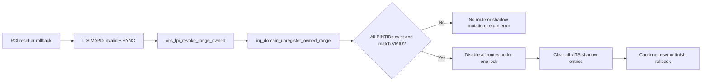
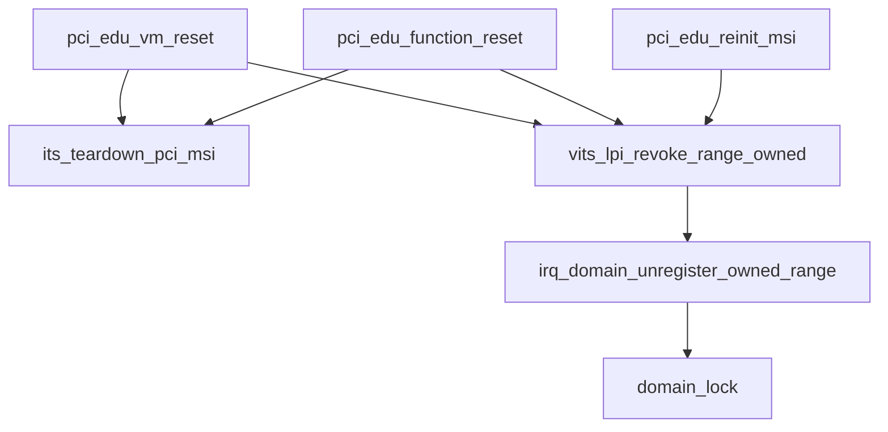

# aVisor Phase 129 详细设计：PCI MSI 批量路由撤销事务与精确资源回收

> 平台：QEMU virt / AArch64 EL2 / GICv3 ITS + vITS
> 前置阶段：Phase 128 IRQ route 按 VM owner 注销
> 本阶段目标：将一个 MSI vector range 的 owner 验证和 IRQ-domain 注销作为原子事务，并让 PCI reset/rollback 检查撤销结果。

## 1. 背景

Phase 128 增加了 `irq_domain_unregister_owned()` 和 `vits_lpi_revoke_owned()`，但 PCI reset 逐 vector revoke 时忽略返回值。ITS MAPD invalid/SYNC 已成功后，如果某一项 ownership 不匹配，reset 仍可能清空全局 LPI base 并继续 FLR；部分 route 可残留，无法由全局状态重建。

本阶段将连续 vector 的校验和注销放在同一 IRQ-domain 锁临界区，再由 vITS 在整批 route 成功注销后统一清除 shadow map。PCI reset 将批量撤销失败视为硬失败，不再继续清理后续状态。

## 2. 架构



## 3. 数据与接口

新增接口：

```c
int irq_domain_unregister_owned_range(unsigned int first_pintid,
                                      unsigned int count,
                                      unsigned long vmid);
int vits_lpi_revoke_range_owned(unsigned int first_plpi,
                                unsigned int count,
                                unsigned long vmid);
```

`count` 表示从 `first_*` 开始的连续向量数。vITS 层检查非零数量与映射范围；IRQ-domain 层逐项验证 route enabled、owner 为 VM、VMID 匹配。

## 4. 批量注销事务

`irq_domain_unregister_owned_range()` 按以下步骤执行：

1. 获取 IRQ-domain IRQ-safe 锁；
2. 对范围内每个 PINTID 查找 enabled route；
3. 任一项缺失或 owner/VMID 不匹配时释放锁并返回 `-1`，不改任何 route；
4. 全部校验通过后，再次遍历范围并将 route 标记为 disabled；
5. 释放锁并返回 `0`。

先完整验证、后统一修改，避免部分注销。锁覆盖两个遍历，保证范围内 route 状态不会在验证与提交之间变化。

## 5. vITS 与 PCI 生命周期

`vits_lpi_revoke_range_owned()` 先验证 pLPI 范围，再调用 IRQ-domain 批量事务。仅当其返回成功时，才清除对应的 `lpi_map` entries。

PCI edu 生命周期接入如下：

- MSI reinit rollback：只对已成功注册的 vector 数执行批量撤销；失败时记录告警；
- VM reset：ITS teardown 成功后，以 VM1 owner 批量撤销 route；失败立即返回，不清零全局 base/enabled；
- function reset：ITS teardown 成功后，以 `vm->vmid` 批量撤销；失败中止 FLR/reinit。

## 6. 状态机

```mermaid
stateDiagram-v2
    [*] --> ROUTES_ACTIVE
    ROUTES_ACTIVE --> VALIDATING: revoke range
    VALIDATING --> ROUTES_ACTIVE: missing or wrong owner; no mutation
    VALIDATING --> ROUTES_REMOVED: all match; atomic route disable
    ROUTES_REMOVED --> SHADOW_CLEARED: clear vITS entries
    SHADOW_CLEARED --> RESET_CONTINUES: success
```



不变量：

```text
任意一个 vector owner 校验失败 => 本批 route 全部保持原状
vITS shadow range 清除 => IRQ-domain range 已整体注销
PCI reset 继续到 FLR => ITS teardown 和 vITS route revoke 均成功
```

## 7. 函数调用图



## 8. 失败语义

| 条件 | 行为 |
|---|---|
| count 为 0 或 pLPI range 越界 | 返回 `-1`，不改状态 |
| route 缺失 | 批量验证失败，不注销任何 route |
| owner 类型错误或 VMID 不匹配 | 批量验证失败，不注销任何 route |
| 批量验证通过 | 锁内注销整个 route range |
| IRQ-domain 批量成功 | vITS 清理整个 shadow range |
| reset revoke 失败 | 中止 reset，不继续 FLR/reinit，不清全局 LPI base |
| rollback revoke 失败 | 告警并保留可诊断错误信息 |

## 9. 验证

- 构建：`make -f Makefile.virt -j2`；
- 格式检查：`git diff --check`；
- QEMU 默认 PCI topology：观察 MSI/vITS 注入、ITS teardown、reset/reinit 和 LPI 复用；
- 对 ownership mismatch 的全批无变更语义由锁内实现保证；当前没有单独注入损坏 vector ownership 的 QEMU fault test。

Phase 127/128 已知的 function reset 后 `EL2 task stack overflow` 属于未定位问题。若仍重现，不能将 QEMU 长时间运行或 timeout 描述为整套 Guest suite 通过。

## 10. 限制

- ITS MAPD invalid/SYNC 与 IRQ-domain range unregister 仍是两个硬件/软件阶段；若 ITS teardown 已成功而后续 ownership 校验失败，物理映射已失效但软件 route 保留以避免误删错误 owner，后续需要显式恢复/清理流程；
- rollback 路径记录批量撤销失败，但不能保证将已完成的 ITS teardown 反向恢复；
- 没有覆盖并发 owner mutation 的 SMP stress test；IRQ-domain 锁已保护验证与注销阶段。

## 11. 文件映射

| 文件 | 职责 |
|---|---|
| `include/boards/virt/irq_domain.h` | IRQ-domain 批量 owner-aware API |
| `hypervisor/boards/virt/irq_domain.c` | 原子验证并注销连续 route range |
| `include/boards/virt/vits.h` | vITS 批量 revoke API |
| `hypervisor/boards/virt/vits.c` | 整批成功后清除 shadow map |
| `hypervisor/boards/virt/pci.c` | reset/rollback 检查批量 revoke 结果 |

## 12. 总结

Phase 129 将多向量 MSI teardown 从逐项、忽略错误的处理改为按 VM owner 校验的批量事务。任何 vector 校验失败都不会造成 IRQ-domain 部分注销；PCI reset 只有在 ITS teardown 和路由撤销都成功后才进入设备 FLR/reinit。
