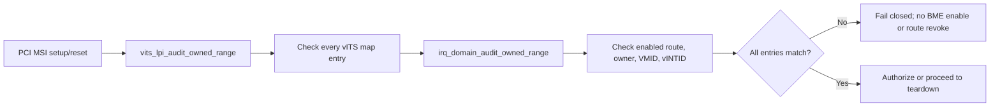
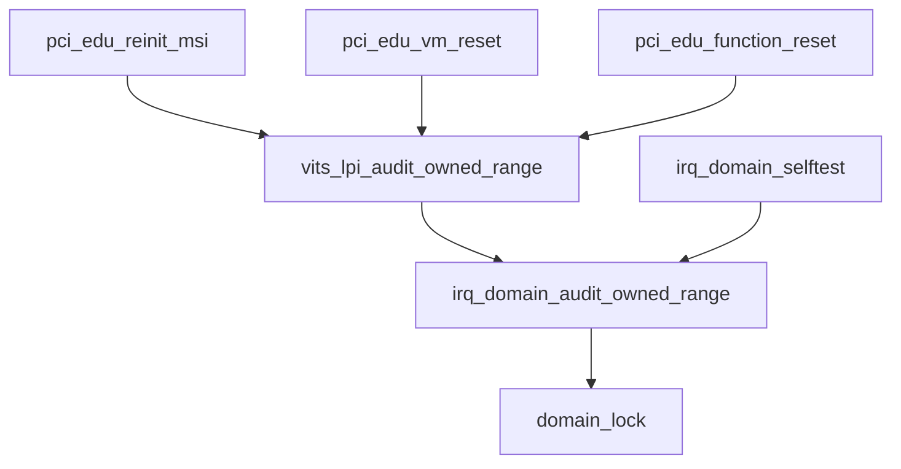

# aVisor Phase 130 详细设计：PCI MSI 中断映射一致性审计

> 平台：QEMU virt / AArch64 EL2 / GICv3 ITS + vITS
> 前置阶段：Phase 129 PCI MSI 批量路由撤销事务
> 本阶段目标：验证 vITS shadow mapping 与 IRQ-domain route 在 VM、PINTID、vINTID 三个维度一致。

## 1. 背景与问题

系统维护两份软件路由状态：

- vITS `lpi_map[pLPI]` 保存 VMID 与 vINTID；
- IRQ domain `routes[]` 保存 PINTID、VMID、vINTID、vcpu 和 owner。

中断派发实际以 IRQ-domain route 为准，而 reset/revoke 需要依据 vITS 设备映射生命周期。若其中一份缺失、owner 不同或 vINTID 偏移异常，原流程可能继续授权 BME 或释放 ITS 资源，却没有明确定位状态不一致。

Phase 130 增加连续范围的一致性审计：要求每个 PINTID 有且仅能查到 enabled VM route，route VMID 和连续 vINTID 与 vITS shadow entry 相符。该审计放在 edu MSI 授权前及 reset teardown 前，避免带着不一致状态进入下一生命周期阶段。

## 2. 架构



## 3. 接口与检查条件

新增接口：

```c
int irq_domain_audit_owned_range(unsigned int first_pintid,
                                 unsigned int count,
                                 unsigned long vmid,
                                 unsigned int first_vintid);
int vits_lpi_audit_owned_range(unsigned int first_plpi,
                                unsigned int count,
                                unsigned long vmid,
                                unsigned int first_vintid);
```

对 `n` 范围内的每项，审计要求：

```text
pintid = first_pintid + n
lpi_map[pintid].vmid = vmid
lpi_map[pintid].vintid = first_vintid + n
IRQ route enabled = true
IRQ route owner = VM
IRQ route vmid = vmid
IRQ route vintid = first_vintid + n
```

IRQ-domain 表在 `domain_lock()` 保护下检查；返回 0 表示整个范围一致，任何缺失/不符都返回 -1，不改变状态。

## 4. 调用时机

### MSI reinit

ITS 建立映射并完成 vITS/IRQ-domain route 注册后，PCI 调用区间审计。只有审计成功才继续 DMA BME 授权。审计失败进入现有 rollback，撤销刚创建的映射。

### VM reset 与 function reset

在 ITS teardown 之前先审计当前 edu LPI range。审计失败时不释放 ITS mapping，也不注销 route；成功后再进行 Phase 127 ITS MAPD invalid/SYNC 与 Phase 129 owner-aware route range revoke。

### Startup selftest

IRQ-domain selftest 对单 route 覆盖：

- 正确 VMID/vINTID：成功；
- 错误 VMID：失败；
- 错误 vINTID：失败。

## 5. 状态机

```mermaid
stateDiagram-v2
    [*] --> MAPPED: vITS shadow + IRQ route installed
    MAPPED --> AUDIT: check range
    AUDIT --> MAPPED: mismatch; no state mutation
    AUDIT --> READY: all fields agree
    READY --> AUTHORIZED: MSI reinit may enable DMA
    READY --> TEARDOWN: reset may disable ITS and revoke routes
```



不变量：

```text
BME authorization after reinit => range audit succeeded
ITS teardown before reset revoke => current shadow/routes range audit succeeded
Audit failure => no audit-side state mutation
```

## 6. 函数调用图



## 7. 错误处理

| 情况 | 结果 |
|---|---|
| count 为零或 LPI 超出 vITS 管理范围 | 立即失败 |
| 任一 shadow VMID/vINTID 不匹配 | 失败，不改 route/shadow |
| 任一 IRQ route 缺失、非 VM owner、VMID/vINTID 不匹配 | 失败，不改 route/shadow |
| MSI reinit 审计失败 | 回滚新建的 ITS/route 资源，拒绝 BME 授权 |
| reset 审计失败 | 中止 reset 前置 teardown，不进入 ITS unmap/FLR |
| 审计通过 | 调用方继续生命周期事务 |

## 8. 验证

- `make -f Makefile.virt -j2`：构建验证；
- `git diff --check`：格式检查；
- IDE diagnostics：检查 `irq_domain.c`、`vits.c`、`pci.c`；
- startup selftest 覆盖正确映射、错误 VMID 和错误 vINTID；
- QEMU 观察 edu MSI/vITS 注入、ITS teardown 和 reset/reinit；
- Phase 127–129 已知的 reset 后 `EL2 task stack overflow` 需独立记录，不能据此宣称整套 Guest suite 自然完成。

## 9. 限制

- vITS shadow entries 目前不是通过独立锁保护；本审计只保证 IRQ-domain route 集合在检查期间稳定，整体 vITS 修改仍依赖现有串行命令/PCI lifecycle 调用约束；
- ITS 硬件 Device/ITT 状态不在本审计函数中读取，依赖 ITS setup/teardown 返回状态；
- 暂无故障注入工具主动篡改单个 shadow entry/route；
- 连续 vINTID 是当前 edu MSI 映射策略，通用非连续事件映射需要另行设计审计参数。

## 10. 文件映射

| 文件 | 职责 |
|---|---|
| `include/boards/virt/irq_domain.h` | 声明 IRQ route range audit |
| `hypervisor/boards/virt/irq_domain.c` | 锁内审计 owner/VMID/vINTID，并扩展 selftest |
| `include/boards/virt/vits.h` | 声明 vITS range audit |
| `hypervisor/boards/virt/vits.c` | 比对 shadow entries 并委托 IRQ-domain audit |
| `hypervisor/boards/virt/pci.c` | 在 MSI 授权及 reset teardown 前执行审计 |

## 11. 总结

Phase 130 为 PCI edu 连续 MSI LPI range 建立明确的一致性检查点。vITS shadow mapping 和 IRQ-domain route 必须在 VMID、PINTID、vINTID 上一致，检查通过后调用方才可授权 DMA 或开始 reset teardown。
