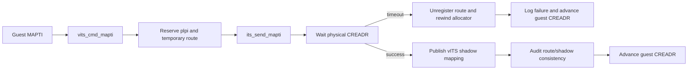
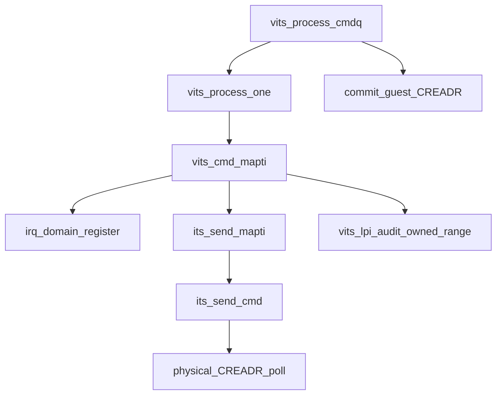

# aVisor Phase 131 详细设计：vITS MAPTI 事务提交与 ITS 命令确认

> 平台：QEMU virt / AArch64 EL2 / GICv3 ITS + vITS
> 前置阶段：Phase 130 PCI MSI 中断映射一致性审计
> 本阶段目标：物理 MAPTI 命令成功后才发布软件映射；失败时回滚临时路由和分配游标，并避免 Guest 因 vITS 无错误状态寄存器而永久阻塞。

## 1. 背景

原 vITS MAPTI 流程先注册 IRQ-domain route、后发送物理 ITS 命令，且物理命令队列逻辑散落在 `vits.c`。若物理命令超时，route 和分配游标仍可能保留；vITS 命令队列处理器也无视 `vits_process_one()` 错误并将 CREADR 直接推进到 CWRITER，使失败 MAPTI 看起来已完成。

Phase 131 将物理 MAPTI 发送统一到 ITS driver，等待 CREADR 确认后，再提交软件 route/shadow mapping。物理命令失败则撤销临时 IRQ route 并恢复 LPI 分配游标；vITS 记录失败并消费该命令，因为当前接口没有可供 Guest 观察的错误状态寄存器。

## 2. 架构



## 3. 事务阶段

### 3.1 Reserve

- 检查 VM 与 PCI requester ownership；
- 分配 `next_alloc_plpi`；
- 注册临时 IRQ-domain route；
- 初始化物理 LPI property byte 并执行 `dsb sy`。

### 3.2 Physical commit

新增 `its_send_mapti(devid, lpi, eventid, collection)`，复用 ITS 层既有 `its_send_cmd()`，由 ITS 层统一维护 command queue writer、wrap 和 timeout。

仅当 `its_send_cmd()` 等到物理 CREADR 追上 CWRITER 时返回成功。

### 3.3 Software publish

物理命令成功后写入 `lpi_map`，再用 Phase 130 的 `vits_lpi_audit_owned_range()` 确认 route 与 shadow mapping 一致。审计失败时撤销 route、清空 shadow 并恢复分配游标。

### 3.4 Rollback / guest command queue

物理命令失败时 owner-aware unregister 临时 route，`next_alloc_plpi--`，不发布 shadow mapping。`vits_process_one()` 传播 MAPTI 失败；命令队列记录失败命令并继续推进 CREADR，避免 Guest 因不存在的 vITS error status 而永久等待。错误通过 hypervisor warning 可见，Guest 侧仍沿用现有同步完成语义。失败不代表 MAPTI 成功，软件映射保持未发布状态。

## 4. edu event 0 特殊路径

edu event 0 使用 Phase 8 已分配且由 ITS MSI allocation table 管理的物理 LPI，不再发送第二条物理 MAPTI。该路径仍注册 guest virtual route，更新 shadow entry，再执行 Phase 130 一致性审计。失败时撤销 guest route 并清理 shadow entry，不影响 ITS allocation owner 的物理映射。

## 5. 状态机

```mermaid
stateDiagram-v2
    [*] --> RESERVED: allocate plpi + register temporary route
    RESERVED --> PHYSICAL_PENDING: submit MAPTI
    PHYSICAL_PENDING --> RESERVED: timeout; unregister route + rewind allocator
    PHYSICAL_PENDING --> SOFTWARE_COMMIT: physical CREADR confirms
    SOFTWARE_COMMIT --> ACTIVE: publish shadow + audit passes
    SOFTWARE_COMMIT --> RESERVED: audit failure; clear shadow and rollback
    ACTIVE --> [*]
```



核心不变量：

```text
vITS shadow is published => physical MAPTI has completed
MAPTI timeout => route is not visible and LPI allocator slot can be reused
Guest CREADR past MAPTI => command was consumed; failure is logged and no mapping is published
```

## 6. 函数调用图



## 7. 错误语义

| 失败点 | 处理 |
|---|---|
| requester/VM 不允许 | MAPTI 返回错误，不分配 route |
| LPI 空间耗尽 | 返回错误、记录 warning，并消费 Guest command |
| IRQ route 冲突 | 释放临时 LPI reservation、记录 warning，并消费 Guest command |
| ITS MAPTI timeout | unregister 临时 route，回退 allocator，不发布 shadow |
| software audit 失败 | unregister route、清 shadow、回退 allocator |
| handler 成功或失败 | CREADR 均推进一个 command；失败有 hypervisor warning，Guest 不会永久阻塞 |

## 8. 验证

- `make -f Makefile.virt -j2`：构建；
- `git diff --check`：格式检查；
- IDE diagnostics：检查 `its.c`、`vits.c` 与 `its.h`；
- QEMU：验证 edu MSI event 0 的既有路径不受影响；
- 通用非零 EventID MAPTI 的物理 ITS 超时故障注入尚未实现，不能声称该故障分支已通过运行时测试。

## 9. 限制

- 物理 MAPTI 命令若硬件已执行但软件等待因异常中断超时，命令状态可能不确定；本阶段按 fail-closed 回滚软件 route，未增加物理 MAPD/clear property 的反向补偿命令；
- 失败的 Guest command 仍被消费并推进 CREADR；由于当前 vITS 没有独立错误寄存器编码，Guest 无法直接获知 MAPTI 失败；
- LPI allocator 使用单调游标并只在最近一次分配失败时回退，不支持并发 MAPTI；该处理沿用现有单 VM/串行命令约束；
- edu event 0 特殊路径不创建 ITS 新 allocation，需依赖 PCI MSI allocation lifecycle 已存在。

## 10. 文件映射

| 文件 | 变更职责 |
|---|---|
| `include/boards/virt/its.h` | 声明物理 MAPTI 接口 |
| `hypervisor/boards/virt/its.c` | 复用带完成等待的 ITS command sender |
| `hypervisor/boards/virt/vits.c` | MAPTI 软件映射事务、错误传播及 CREADR 提交语义 |

## 11. 总结

Phase 131 让 vITS MAPTI 的软件可见状态晚于物理 ITS 命令完成点提交。失败时撤销临时 route、回收最近的 LPI reservation，并消费 Guest command 但不发布映射；错误由 hypervisor warning 记录，避免将未确认的映射写入软件状态。
