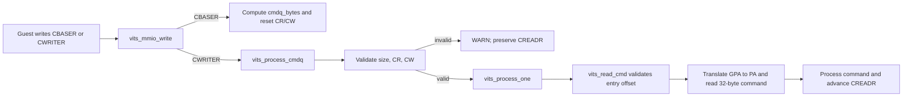
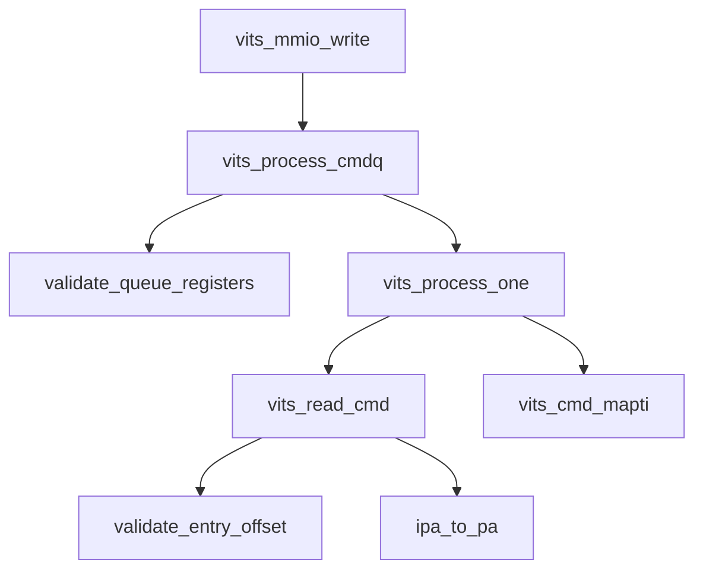

# aVisor Phase 132 详细设计：vITS 命令队列边界校验与非法指针拒绝

> 平台：QEMU virt / AArch64 EL2 / GICv3 ITS + vITS
> 前置阶段：Phase 131 vITS MAPTI 事务提交与 ITS 命令确认
> 本阶段目标：在访问 Guest 命令队列内存前校验队列大小、命令偏移与读写指针，非法状态 fail closed，不读取越界命令，也不伪造 CREADR 前进。

## 1. 背景与问题

vITS 从 Guest 配置的 CBASER 获取命令队列 GPA，并根据 Guest 写入的 CWRITER 读取队列项。ITS 命令固定为 32 字节，队列容量由 CBASER.SIZE 表示。旧实现虽然将 CWRITER 做了字段掩码，却未在读取命令前验证 offset 是否落在队列容量内、是否按命令大小对齐；CBASER.SIZE 也可能给出不能整除命令长度的队列容量。错误或恶意的寄存器输入会导致读取队列外的 Guest 内存或解析无效命令。

Phase 132 将验证放在两个边界：命令读取处验证单条命令位置，队列处理入口验证整个队列配置和 CR/CW 指针。非法状态只告警并拒绝本次处理，CREADR 保持原值。

## 2. 目标与非目标

目标：

- command queue size 必须非零且是 `VITS_CMD_SIZE` 的整数倍；
- CWRITER、CREADR 均须小于队列容量，并按 32 字节对齐；
- 命令读取 offset 必须在队列范围内且按 32 字节对齐；
- CBASER 更新后，将本 vITS 的 CWRITER/CREADR 初始化为 0，避免旧指针套用到新队列；
- 增加 Guest 回归，验证非对齐 CWRITER 不推进 CREADR。

非目标：改变 vITS 错误寄存器模型、重新设计 MAPD/MAPC 语义、或处理多个并发命令生产者。

## 3. 架构与数据流



## 4. 詳細設計

### 4.1 單條命令讀取驗證

`vits_read_cmd()` 在 GPA 計算和 `ipa_to_pa()` 前檢查：

```text
CBASER valid bit is set
0 <= offset < cmdq_bytes
offset % VITS_CMD_SIZE == 0
```

任一條件不成立即返回錯誤。不得計算並解引用命令 slot 的 PA。

### 4.2 隊列配置與指針驗證

`vits_process_cmdq()` 在處理任何命令前檢查：

```text
cmdq_bytes != 0
cmdq_bytes % VITS_CMD_SIZE == 0
CWRITER < cmdq_bytes && CWRITER % VITS_CMD_SIZE == 0
CREADR < cmdq_bytes && CREADR % VITS_CMD_SIZE == 0
```

驗證失敗時輸出包含 CR、CW 和容量的 warning，直接返回，保留原 CREADR。有效隊列照既有逐命令處理與尾端回繞規則運行。

### 4.3 CBASER 更新

Guest 寫完整 CBASER 後，根據 SIZE 欄位計算 `(SIZE + 1) * PAGE_SIZE`，並將該 vITS 狀態的 CWRITER/CREADR 清零。這避免重新配置 queue base/size 後沿用先前隊列的指針。

### 4.4 Guest regression

Guest vITS 初始化並使能後，先寫入非對齊 CWRITER=1，再讀 CREADR。由於隊列處理器必須 fail closed，CREADR 應保持 0；若不為 0，Guest regression 報告失敗。隨後 Guest 正常執行 MAPC/MAPD/MAPTI 流程，驗證拒絕路徑未破壞正常隊列。

## 5. 狀態與錯誤語義

| 條件 | 行為 |
|---|---|
| CBASER 未有效配置 | 單命令讀取失敗並告警 |
| 命令 offset 超出 queue size | 拒絕讀取，回傳錯誤 |
| 命令 offset 非 32-byte aligned | 拒絕讀取，回傳錯誤 |
| queue size 為零或非命令長度倍數 | 拒絕整批處理，CREADR 不變 |
| CWRITER/CREADR 越界或未對齊 | 拒絕整批處理，CREADR 不變 |
| 有效 queue 中單一命令失敗 | 延續 Phase 131 語義：告警並消費命令，最終 CREADR 跟進 CWRITER |

區分「隊列寄存器本身非法」和「有效隊列中的命令處理失敗」：前者不可安全定位任何命令，因此不推進 CREADR；後者由 Phase 131 定義為可定位命令並消費，以免 Guest 永久等待。

## 6. 函數調用圖



## 7. 不變量

```text
A command is read only when its complete 32-byte slot starts inside the configured queue.
Invalid CR/CW or queue size => CREADR is unchanged.
Changing CBASER starts the newly configured virtual queue at CR=CW=0.
Valid queue command failures retain Phase 131 consume-and-warn semantics.
```

## 8. 驗證方案與結果記錄

- `make -f Makefile.virt -j2`：通過，hypervisor 與 Guest regression 均完成構建；Guest 編譯有既存 warnings；
- `git diff --check`：通過；
- IDE diagnostics：`vits.c` 和 `main.c` 無診斷；
- QEMU：日誌觀察到 `reject invalid command queue pointers CR=0x0 CW=0x1 size=4096`，隨後 edu MSI 與 vITS MAPTI 測試通過；Guest 在非法寫後直接讀回 CREADR=0 並恢復 CWRITER=0；
- QEMU 由 35 秒 timeout 終止，不代表完整 Guest suite 自然退出；command entry offset 的獨立直接注入未提供，不能聲稱所有邊界組合已做 runtime 測試。

## 9. 限制

- CWRITER 的寄存器欄位仍依既有實作遮罩為 OFFSET[19:0]；本階段驗證遮罩後的寄存器值，不重構寄存器寬度與保留位語義；
- `ipa_to_pa()` 的映射有效性仍由既有 stage-2 翻譯函數負責；
- vITS 沒有 Guest 可讀錯誤狀態寄存器。非法 CWRITER 被拒絕時 CREADR 保持不變，Guest driver 可能持續等待，hypervisor warning 是當前診斷方式；本階段的 guest regression 只在非法寫後直接檢查 CREADR，不使用會等待命令完成的 `vits_send_cmd()` 封裝。

## 10. 文件映射

| 文件 | 職責 |
|---|---|
| `hypervisor/boards/virt/vits.c` | 命令 offset、隊列大小與指針驗證；CBASER 更新時重置 CR/CW |
| `guests/el1_test/main.c` | 非對齊 CWRITER 拒絕回歸 |
| 本文件 | Phase 132 架構、校驗條件、錯誤語義與驗證記錄 |

## 11. 總結

Phase 132 把 vITS 命令隊列的範圍與對齊條件變成讀取 Guest memory 前的明確前置條件。非法 queue register state 不會被當作有效命令處理，CREADR 也不會虛假前進；合法命令及 Phase 131 MAPTI 失敗消費策略保持不變。
