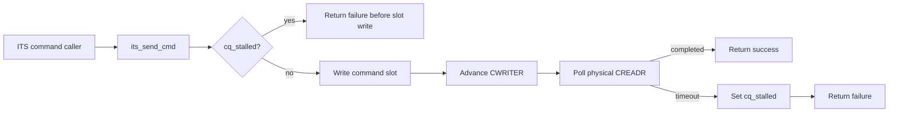
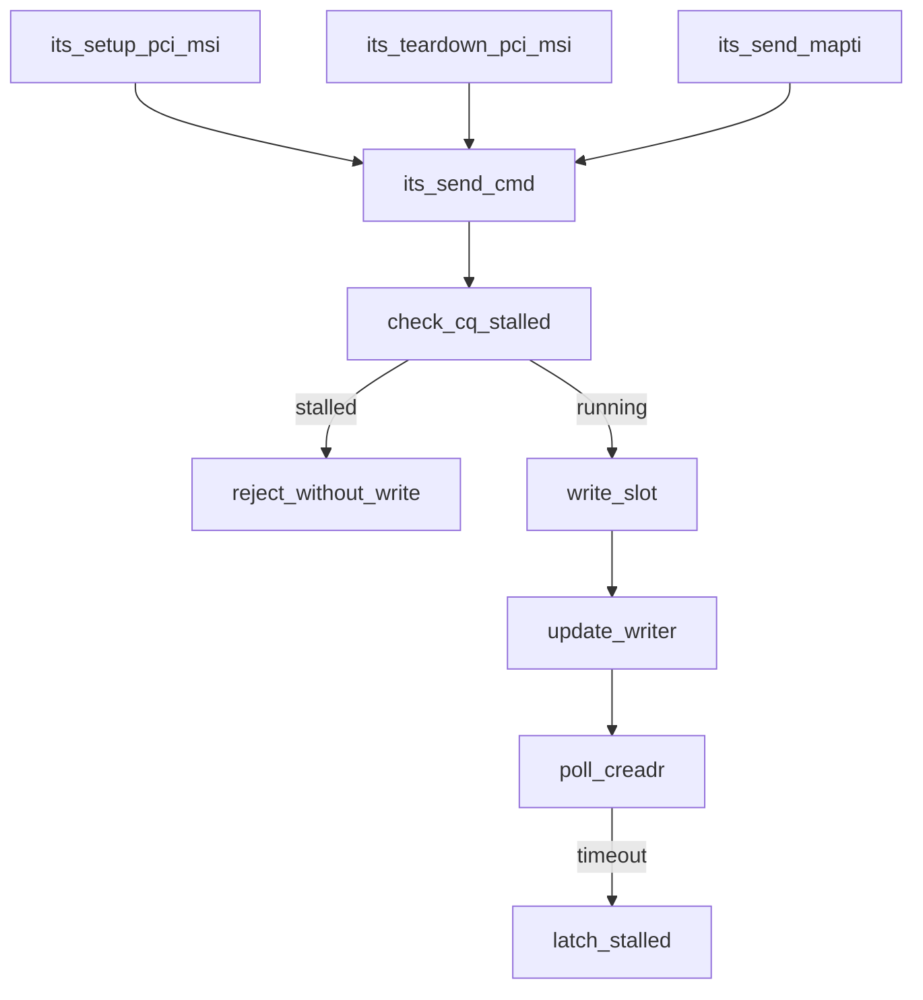

# aVisor Phase 133 详细设计：物理 ITS 命令队列超时锁存与后续命令拒绝

> 平台：QEMU virt / AArch64 EL2 / GICv3 ITS
> 前置阶段：Phase 132 vITS 命令队列边界校验与非法指针拒绝
> 本阶段目标：物理 ITS 命令完成超时后锁存 queue stalled 状态，并在写入任何后续 command slot 前拒绝发送，避免在消费状态未知时覆盖未确认命令。

## 1. 背景

物理 ITS driver 以 `cq_byte_off` 追踪下一条命令的 slot。`its_send_cmd()` 写入 32-byte 命令、推进 CWRITER，再轮询 CREADR。此前如果轮询超时，接口返回失败但 writer 偏移已经前进；调用者可能随后发送 MAPD invalid、SYNC 或新的 MAPTI。硬件是否消费了超时命令未知，继续推进可能重用并覆盖仍未消费的 slot，也会让软件根据新 writer 偏移误判队列状态。

Phase 133 采取 fail-stop 语义：一次 timeout 即将物理队列标为 stalled。此后命令一律在访问 slot 前失败。当前实现没有安全的重同步机制，因此不尝试猜测 CREADR 或复用 queue。

## 2. 架构



`its_setup_pci_msi()`、`its_teardown_pci_msi()` 與 `its_send_mapti()` 均共用 `its_send_cmd()`，因此同一 fail-stop gate 覆蓋所有物理 ITS command producer。

## 3. 狀態模型

| 狀態 | `cq_byte_off` | `cq_stalled` | 發送行為 |
|---|---:|---:|---|
| Initialized | 0 | 0 | 可提交命令 |
| Running | 下一個 software writer offset | 0 | 寫 slot、推進 writer、輪詢 reader |
| Stalled | 保留 timeout 時 writer offset | 1 | 不寫 slot、不改 writer，直接返回錯誤 |

狀態轉移：

```mermaid
stateDiagram-v2
    [*] --> Initialized: its_init allocates command queue
    Initialized --> Running: command submitted
    Running --> Running: CREADR catches CWRITER
    Running --> Stalled: timeout; latch cq_stalled
    Stalled --> Stalled: reject every later command
```



只在 `its_init()` 配置新命令隊列時清除 stalled 狀態。runtime 不提供 reset API，避免在 ITS 硬體消費位置不確定時冒險重啟。

## 4. 詳細設計

### 4.1 發送前 gate

`its_send_cmd()` 的第一個動作檢查 `cq_stalled`。若已鎖存，輸出 warning 並返回 `-1`，不解參考 `cmdq_pa`、不寫 slot、不改 `cq_byte_off`、不寫 GITS_CWRITER。

### 4.2 timeout latch

正常發送仍沿用既有流程：寫 4 個 u64、`dsb sy`、更新軟體 offset、寫 GITS_CWRITER、輪詢 GITS_CREADR。達到 timeout 時先設 `cq_stalled = 1`，再記錄 CWRITER/CREADR 和後續 command rejection 語義，最後返回 `-1`。

### 4.3 初始化

在分配 ITS command queue 前，`its_init()` 將 `cq_byte_off` 設為 0 並清除 `cq_stalled`。初始化完成後若 ITS 未能啟用，既有初始化失敗流程不會把隊列交給正常 command callers。

### 4.4 caller 語義

所有呼叫者已處理 `its_send_cmd()` 的負值返回：MSI 建立/回收流程會走既有失敗路徑，vITS MAPTI 會撤銷臨時 software route 並回退最近的 pLPI reservation。timeout 後這些補償 command 也會被 gate 拒絕；caller 因而保留資源並返回失敗，而不宣稱物理狀態已完成清理。

## 5. 函數調用圖



## 6. 核心不變量

```text
cq_stalled == 1 => every later command is rejected before command-slot memory access
A timeout never silently authorizes another CWRITER advance
The timeout command's completion state remains unknown; software does not claim recovery
Only ITS initialization clears the software stalled latch
```

## 7. 錯誤處理與取捨

- 正常完成：CREADR 追上本次 CWRITER，返回成功，後續命令可繼續。
- timeout：鎖存 stalled 並返回失敗；不回退 writer，因為硬體可能已部分或完整消費該命令。
- stalled 後新命令：在 slot write 前拒絕，避免覆寫可能仍被 ITS 使用的 queue entry。
- setup/teardown rollback command 被 gate 拒絕時：保留 allocation/ITT 等軟體資源，不做未確認釋放；診斷告警指出 queue 已 stalled。

此選擇犧牲 ITS timeout 後的可用性，以換取不在硬體 reader 位置未知時破壞共享命令隊列。重同步需要讀取並驗證硬體 CREADR、處理命令是否已生效及恢復 command slot 生命周期，留待後續獨立設計。

## 8. 验证

- `make -f Makefile.virt -j2`：通过，ITS/vITS caller 与接口链接成功；
- `git diff --check`：通过；
- IDE diagnostics：`its.c` 无诊断；
- QEMU 正常路径：日志确认 ITS initialized/enabled、edu MSI interrupt passed、两个非零 EventID vITS MAPTI 完成且 vITS 收中断测试通过；
- QEMU 按 35 秒 timeout 结束；物理 ITS command timeout 与其后再次调用 sender 的故障注入尚未提供，不能将 stalled 分支描述为 runtime 已验证。

## 9. 限制

- stalled 是全域 ITS queue 狀態，因該物理 ITS command queue 本身為全域共享資源；一個 timeout 會阻止所有 PCI MSI/vITS 相關 ITS command。
- 無 runtime recovery/reset API；重新初始化只適用於完整 ITS 初始化生命週期，不允許運行中清除 latch。
- timeout 命令可能已被 ITS 執行。軟體 fail-stop 並不能回滾已生效的硬體映射，只能避免進一步覆寫隊列並保留未確認資源。

## 10. 文件映射

| 文件 | 職責 |
|---|---|
| `hypervisor/boards/virt/its.c` | stalled latch、超時鎖存、後續發送前拒絕、初始化 reset |
| 本文件 | Phase 133 狀態模型、命令流程、失敗語義與驗證邊界 |

## 11. 總結

Phase 133 將物理 ITS command timeout 從一次性返回錯誤提升為 queue lifecycle 狀態。硬體消費位置未知時，driver 停止對隊列作任何後續寫入，避免將不確定 command state 擴大為 slot 覆寫或虛假的資源回收成功。
