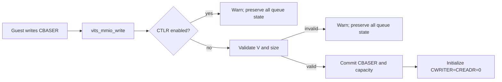
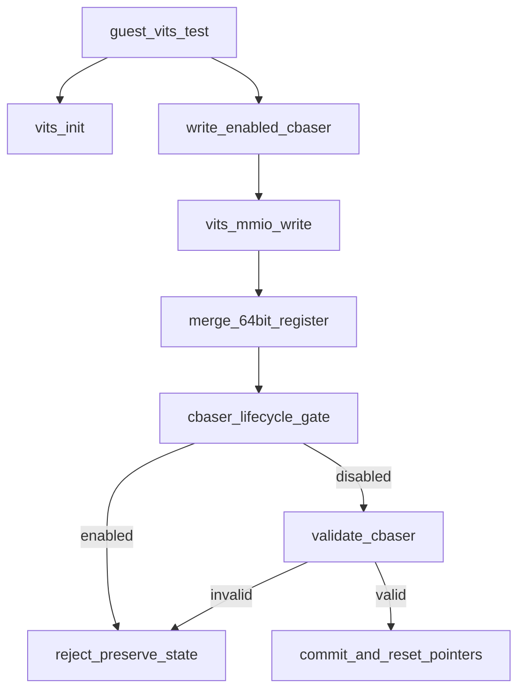

# aVisor Phase 134 详细设计：vITS CBASER 生命周期与配置校验

> 平台：QEMU virt / AArch64 EL2 / GICv3 vITS
> 前置阶段：Phase 133 物理 ITS 命令队列超时锁存与后续命令拒绝
> 本阶段目标：按 ITS 队列生命周期约束 CBASER 配置，拒绝启用期间重配和无效配置，避免错误写入清零正在使用的 CWRITER/CREADR。

## 1. 背景与问题

Guest 通过 CBASER 配置 command queue 基址、valid 位与 SIZE。现有 vITS 在每次 CBASER 写入时立即保存寄存器、重算 queue size 并把 CWRITER/CREADR 归零，即使 CTLR 已启用。这会让队列消费者状态与 Guest 提交位置失配；同时 V=0 或不满足槽大小约束的配置仍可能影响处理器状态。

Phase 134 将 CBASER 更新作为受控状态转换：只有 CTLR disabled 时接受；新值必须 valid，queue 容量必须满足命令大小约束。拒绝时旧寄存器值及所有指针保持不变。

## 2. 目标与非目标

目标：

- CTLR enabled 时拒绝 CBASER 写入；
- CBASER.V 必须为 1；
- `cmdq_bytes=(SIZE+1)*PAGE_SIZE` 必须至少容纳一条 32-byte 命令，且为命令大小整数倍；
- 只有完整接受新 CBASER 后才更新状态并将 CWRITER/CREADR 初始化为 0；
- Guest 回归验证启用后写入 CBASER 不改变其已配置值。

非目标：实现队列暂停/热迁移、跨页命令读取、多 guest 错误寄存器，或重新定义 CBASER 保留位。

## 3. 架构



## 4. 詳細設計

### 4.1 狀態轉移

- **Unconfigured/Disabled**：可提交有效 CBASER。
- **Configured/Disabled**：仍可用另一個有效 CBASER 替換，成功後隊列指針清零。
- **Enabled**：CBASER 為唯讀狀態；任何寫入被忽略，不改 CBASER、容量或指針。

```mermaid
stateDiagram-v2
    [*] --> Disabled
    Disabled --> Configured: valid CBASER
    Configured --> Configured: replace valid CBASER; reset CR/CW
    Disabled --> Disabled: reject invalid CBASER
    Configured --> Configured: reject invalid CBASER; preserve state
    Configured --> Enabled: CTLR.EN=1
    Enabled --> Enabled: reject CBASER write
```



### 4.2 驗證與原子提交

CBASER 分兩次 32-bit MMIO 寫入時，沿用 per-VM low-word cache，只有高 word 到達後才進入完整值驗證。驗證順序如下：

1. 若 `vits->ctlr & 1`，立即拒絕；
2. 要求 bit 63 (`V`) 為 1；
3. 计算 `(SIZE[7:0] + 1) * PAGE_SIZE`；
4. 要求容量至少 32 bytes 并可被 `VITS_CMD_SIZE` 整除；
5. 全部通过后才提交 `cbaser`、`cmdq_bytes`，并初始化 `cwriter=creadr=0`。

不合法分支不先寫任何狀態，確保 commit atomicity。

### 4.3 Guest 回歸

`vits_init()` 配置 CBASER 並使能後，測試對 CBASER 低/高 word 寫 0，再讀高 word。合法原值含 V=1，故讀回高 word 必須仍為 `0x80000000`。若新值被接受，測試立即失敗。隨後執行 Phase 132 的非對齊 CWRITER 測試及既有 MAPC/MAPD/MAPTI/MSI 中斷流程，確認拒絕操作未破壞 queue。

## 5. 函數調用圖



## 6. 不变量与错误语义

```text
CBASER write while CTLR.EN=1 => no vITS queue state changes
Invalid CBASER => old CBASER/cmdq_bytes/CWRITER/CREADR remain unchanged
Accepted CBASER => commit base/capacity, then initialize CR=CW=0
Only a valid CBASER write while disabled can reset queue pointers
```

| 条件 | 处理 |
|---|---|
| CTLR enabled | warning 并忽略 CBASER 写入 |
| V=0 | warning 并忽略，不改变旧状态 |
| queue size 不满足命令槽约束 | warning 并忽略 |
| 配置有效且 CTLR disabled | 原子提交并将 CR/CW 初始化为 0 |

## 7. 验证

- `make -f Makefile.virt -j2`：通过，hypervisor 与 Guest regression 均完成构建；Guest 文件存在多项既存 compiler warnings；
- `git diff --check`：通过；
- IDE diagnostics：修改的 `vits.c` 与 `main.c` 无诊断；
- QEMU 日志出现 `enabled CBASER write rejected`，随后非法 CWRITER 被拒绝、edu MSI interrupt passed、两个 vITS MAPTI 完成及 vITS 收中断测试通过；
- QEMU 由 35 秒 timeout 终止，不代表完整 Guest suite 自然退出；V=0 和极端 SIZE 配置未做独立 runtime 注入。

## 8. 限制

- 当前 Guest 读回断言使用原配置的高 32 位 V 位验证启用期写保护；低位 PA 的完整保留由相同的拒绝分支保证，但本测试不逐位比较完整 64-bit CBASER。
- 当 CTLR 重新 disable 后允许配置有效 CBASER，现有实现没有额外要求队列必须为空；若未来支持运行时 disable/reconfigure，需单独定义 outstanding command 清理协议。
- vITS 当前固定以 Guest IPA 为 command queue base；`ipa_to_pa()` 仍负责每条命令的 stage-2 翻译与映射错误处理。

## 9. 文件映射

| 文件 | 职责 |
|---|---|
| `hypervisor/boards/virt/vits.c` | CBASER 生命周期门控、配置校验、原子提交 |
| `guests/el1_test/main.c` | 启用期间 CBASER 写保护回归及后续 vITS 正常流程 |
| 本文件 | Phase 134 架构、状态转移、验证条件和限制 |

## 10. 总结

Phase 134 让 vITS CBASER 成为有生命周期约束的寄存器，而不是任意可写状态。拒绝启用期间重配及无效配置可避免 command queue 的基址/容量与 reader/writer 状态意外失配；有效配置仅在 disabled 状态下原子生效。
