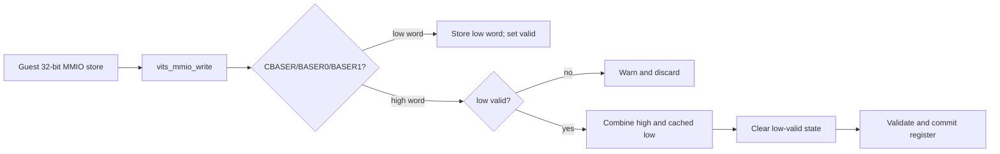
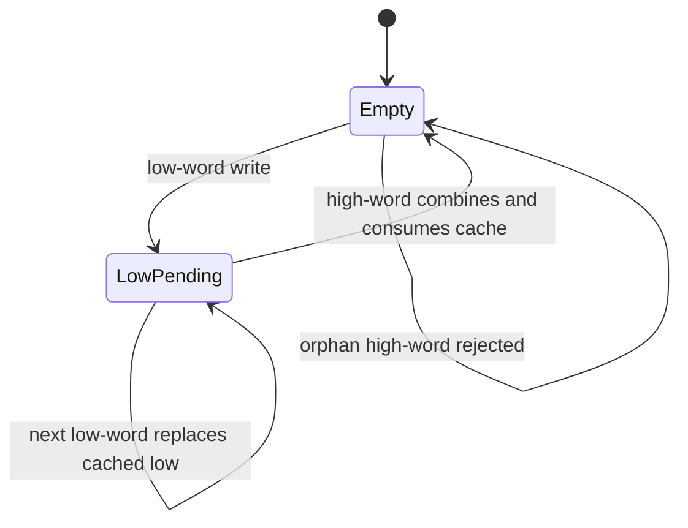
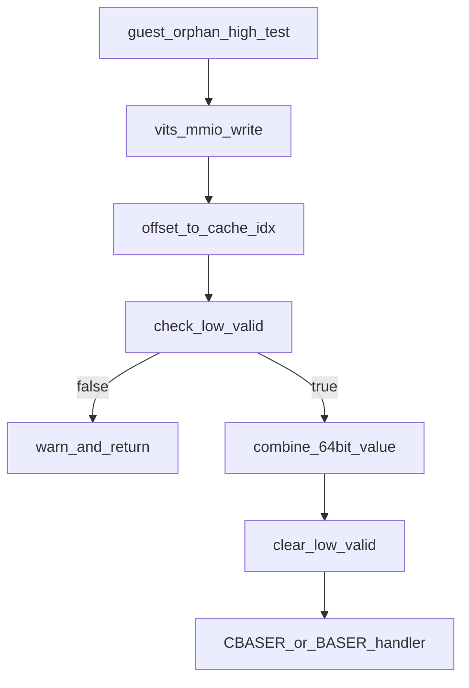

# aVisor Phase 135 详细设计：vITS 分次 64 位寄存器写入配对状态

> 平台：QEMU virt / AArch64 EL2 / GICv3 vITS
> 前置阶段：Phase 134 vITS CBASER 生命周期与配置校验
> 本阶段目标：仅在同一寄存器收到有效低字后，接受其后续高字并组合 64 位寄存器写；孤立高字必须拒绝，避免复用历史缓存值。

## 1. 背景与问题

Guest 可通过两个 32-bit MMIO store 写入 CBASER 和 BASER0/BASER1。vITS 当前将低字保存到 per-VM cache，高字到达时再组合完整 64-bit 值。但状态中只有 cache value，没有“该 cache 是否属于当前一对写操作”的标记。初始化后的高字写或前一对写中断后到来的高字可能与遗留低字组合，意外改变寄存器状态。

Phase 135 为每个可分次写的寄存器增加低字有效状态。低字写入建立待配对状态；高字只有在该状态有效时才能提交完整值，提交后清除状态。高字孤立到达时告警并丢弃，不触碰寄存器。

## 2. 范围

本阶段使用现有寄存器索引表，仅覆盖 `CBASER`、`BASER0`、`BASER1`，保持其余寄存器和 64-bit read 行为不变。跨 VM 的写入互不影响，因为配对缓存和有效位都存于 per-VM `vits_state`。

不在本阶段实现 MMIO store timeout、跨多个 trap 的事务超时、或允许高字先写的寄存器语义。

## 3. 架构



## 4. 狀態與處理流程

每个 register index 有三类状态：

- **Empty**：`write_lo_valid[index] == 0`，没有可配对低字；
- **Low pending**：保存了最近一次低字且 valid 为 1；
- **Consumed**：高字已与低字组合，提交寄存器后 valid 回到 0。



### 4.1 低字写

识别出受支持的 64-bit register 且 offset 指向低 word 时，写入 `write_lo_cache[index]`、置 `write_lo_valid[index] = 1`，当前 MMIO 写只更新缓存，不提交设备寄存器。

### 4.2 高字写

若 `write_lo_valid[index] == 0`，输出包含 offset 的 warning 并立即返回；不合并、不进入 CBASER/BASER 寄存器 handler。若 valid 为 1，则组合 `(high << 32) | cached_low`，清除该 index 的 valid 标记，然后进入寄存器 handler。

连续多次低字写按最后一次值生效；其后一个高字仅消费该寄存器最新低字。不同 register index 的状态独立。

### 4.3 与 Phase 134 CBASER 门控的关系

高字配对完成后才会进入 CBASER handler。若 CTLR enabled，Phase 134 的 handler 拒绝完整写入。低字缓存已经在高字配对时消费，不能留到未来一次无关高字写中重放。孤立高字不会进入 CBASER 校验或重置队列指针。

## 5. 函数调用图



## 6. Guest 回归设计

vITS 初始化后 BASER0 已通过低字/高字配对提交有效值。Guest 随后单独向 BASER0 高字写 0，不写新的低字，再读取 BASER0 高字。读取结果必须仍包含原有 V 位 `0x80000000`；否则报告孤立高字改写寄存器失败。成功后继续 Phase 134 的启用期间 CBASER 写保护、Phase 132 command queue pointer 校验及 MSI/vITS 正常中断测试。

该回归验证可观察寄存器的结果；hypervisor 的孤立高字 warning 用于诊断拒绝路径。

## 7. 错误语义与不变量

| 输入情况 | 行为 |
|---|---|
| 低字写 | 缓存低 32 位并标记待配对 |
| 有效低字后高字 | 组合完整值、消费有效位，再执行寄存器 handler |
| 无有效低字的高字 | warning 后忽略，不改变寄存器 |
| 同一寄存器重复低字 | 最新低字取代先前待配对值 |
| 不同 VM 分别写寄存器 | 使用各自 `vits_state`，互不串扰 |
| CBASER 配对写但 CTLR enabled | 低字配对已消费，完整写由 Phase 134 拒绝 |

```text
A high word is never committed without a pending low word for the same register.
One low-word cache can be consumed at most once.
Register indexes are isolated within each VM state.
Orphan high writes cannot reach the register-specific side-effect handlers.
```

## 8. 验证

- `make -f Makefile.virt -j2`：通过；Guest 构建仍有多项既存 compiler warnings；
- `git diff --check`：通过；
- IDE diagnostics：`vits.h`、`vits.c` 与 Guest 文件无诊断；
- QEMU Guest 断言确认孤立 BASER0 高字写后原寄存器高字保持，随后 edu MSI、两个 vITS MAPTI 及 vITS 收中断测试通过；
- serial 日志未观察到 hypervisor 的孤立高字 warning，因此只报告寄存器可观察状态保持，不能声称 warning 分支已由运行日志确认；QEMU 由 35 秒 timeout 结束；
- 当前策略要求低字先于高字。对高字先写、低字后写的寄存器事务不作缓冲或自动配对。

## 9. 限制

- 配对状态没有超时。若 Guest 写低字后永远不写高字，后续同一寄存器低字会覆盖缓存；不会改变已提交寄存器。
- 如果规范/未来驱动使用高字先写，需要显式扩展事务模型；当前行为为 fail closed。
- vITS MMIO trap 接口按实际 syndrome 地址传入 offset，并用低 3 bit 区分高/低 32-bit word；本阶段延续既有解码规则。

## 10. 文件映射

| 文件 | 职责 |
|---|---|
| `include/boards/virt/vits.h` | per-register low-word valid state |
| `hypervisor/boards/virt/vits.c` | low/high write pairing, one-shot consume, orphan high rejection |
| `guests/el1_test/main.c` | orphan BASER high-word regression |
| 本文件 | Phase 135 状态模型、数据流、失败语义和验证范围 |

## 11. 总结

Phase 135 为 split 64-bit MMIO write 增加明确的配对生命周期。孤立高字不能再将未知或历史低字带入寄存器提交路径；有效写对只消费一次缓存，且状态按寄存器、按 VM 隔离。
