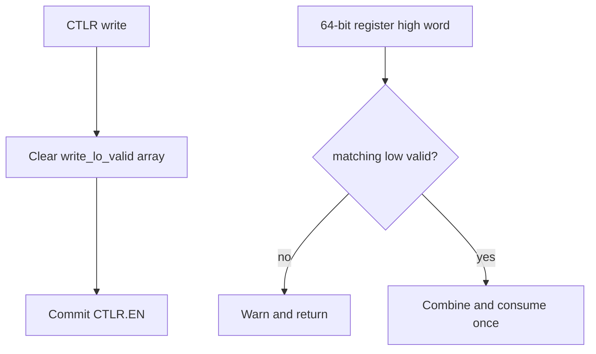
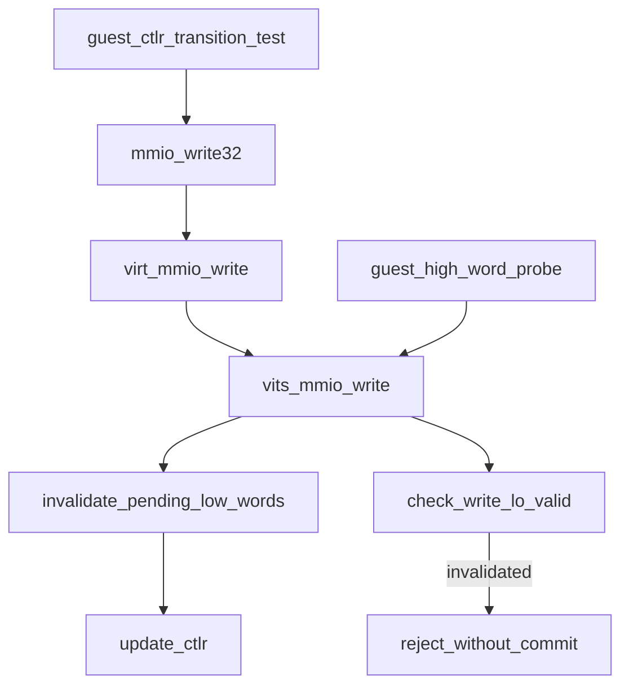

# aVisor Phase 136 详细设计：vITS 寄存器写缓存跨 CTLR 生命周期失效

> 平台：QEMU virt / AArch64 EL2 / GICv3 vITS
> 前置阶段：Phase 135 vITS 分次 64 位寄存器写入配对状态
> 本阶段目标：CTLR 每次被写入時，清除所有未完成的低字配对状态，禁止低字缓存跨越 vITS enable/disable 状态转换。

## 1. 背景

Phase 135 为 CBASER/BASER0/BASER1 添加逐寄存器 `write_lo_valid[]`，高字只有在对应低字有效时才可配对。但待配对状态目前只在收到相同寄存器的高字时消费。若 Guest 写低字后改变 CTLR，再写高字，低字仍可越过设备生命周期边界并参与新一轮寄存器提交。

此阶段将 CTLR 写操作定义为 split-write transaction boundary：无论新值是 enabled 还是 disabled，在更新 CTLR 前清除所有待配对低字 valid 标记。缓存值本身可保留，但 valid 为 0 时不可用于组合。

## 2. 目标与非目标

目标：

- 任意 CTLR 写入都清除 per-register pending-low valid flags；
- 后续孤立高字遵循 Phase 135 行为，告警并丢弃；
- 清理发生在 CTLR 状态提交前，确保 enable/disable 边界无 pending 配对；
- Guest 回归验证在 disable/enable 转换前的低字不能影响转换后的寄存器高字写入。

非目标：清理低字缓存数据本身、改变 CTLR enable 语义、或实现完整寄存器访问超时机制。

## 3. 架构与时序

```mermaid
sequenceDiagram
    participant G as Guest
    participant V as vits_mmio_write
    participant S as vits_state
    G->>V: write BASER0 low word
    V->>S: cache low; valid[0]=1
    G->>V: write CTLR (disable or enable)
    V->>S: clear all write_lo_valid[]
    V->>S: update ctlr
    G->>V: write BASER0 high word
    V->>S: check valid[0]
    V-->>G: reject orphan high; no register commit
```

## 4. 詳細設計

### 4.1 CTLR 写处理顺序

`vits_mmio_write()` 收到 `VITS_CTLR` 时按以下顺序执行：

1. 遍历 `vits->write_lo_valid[]` 并全部置 0；
2. 将 CTLR.EN 更新为输入 bit 0；
3. 记录 CTLR 状态。

该顺序将 pending split-write 与新的 vITS lifecycle state 隔离。低字缓存内容不清零，因为 valid 位已完全决定其可否消费；保留内容不会影响后续寄存器状态。

### 4.2 与 64-bit 配对逻辑交互

- 低字写：更新对应 cache 并设置 valid；
- CTLR 写：失效所有 pending valid；
- 高字写：如果 valid 为 0，Phase 135 gate 返回，不进入 CBASER/BASER handler；
- 有效配对仍只消费一次，CBASER lifecycle 和其他寄存器 handler 保持原逻辑。



## 5. Guest 回归

vITS 已配置 BASER0 并 enable 后：

1. 写入一个不同的 BASER0 低字，建立 pending-low；
2. 写 CTLR=0，再写 CTLR=1，跨越 disable/enable 边界；
3. 只写 BASER0 高字 0；
4. 比较 BASER0 高低 word 与初始化基址，二者必须保持不变；
5. 继续执行孤立高字、非法 CWRITER、MAPTI、edu MSI 和 vITS 中断用例。

若 pending-low 被错误保留，高字写会组合成其他 BASER0 值，读取断言失败。低字预置值刻意与原 BASER0 不同，以确保错误配对可观察。

## 6. 函数调用图



## 7. 错误语义与不变量

| 操作 | 配对状态 | 结果 |
|---|---|---|
| 受支持寄存器低字写 | 对应 index valid=1 | 缓存新低字 |
| 任意 CTLR 写 | 所有 index valid=0 | 低字不再可配对 |
| CTLR 写后的孤立高字 | 对应 index valid=0 | warning、返回、不提交寄存器 |
| 正常低字后直接高字 | valid=1 后消费 | 组合完整值并提交一次 |

```text
After any CTLR write, all write_lo_valid[] entries are zero.
Cached low-word data without a valid bit cannot affect committed registers.
An orphan high word after lifecycle transition cannot reach register side effects.
```

## 8. 验证

- `make -f Makefile.virt -j2`：通过；Guest 构建存在多项既存 compiler warnings；
- `git diff --check`：通过；
- IDE diagnostics：`vits.c` 与 Guest 文件无诊断；
- QEMU 日志两次出现 `reject high-word write without low word`，Guest 输出 `CTLR transition cleared pending register write`；随后 edu MSI interrupt passed、两个 MAPTI 完成且 vITS 收中断测试通过；
- QEMU 由 35 秒 timeout 结束，只记录日志中已观察到的测试，不将其描述为完整 suite 自然退出。

## 9. 限制

- 任何 CTLR 写入都会失效 pending low-word transaction，即使写入值与原 CTLR 相同；这是保守的事务边界策略。
- 只清理 valid flags，不清理低字数据，避免无必要写操作；无效数据不会被合并。
- 不支持高字先写后低字的配对次序。

## 10. 文件映射

| 文件 | 职责 |
|---|---|
| `hypervisor/boards/virt/vits.c` | CTLR transition 前清除所有低字 pending 标记 |
| `guests/el1_test/main.c` | CTLR 状态切换后验证旧低字无法提交 |
| 本文件 | Phase 136 设计、时序、断言与边界 |

## 11. 总结

Phase 136 把 vITS CTLR 写定义为所有 split 64-bit register write 的生命周期隔离点。待配对低字不能跨越 enable/disable 转换，从而防止旧事务状态影响新的虚拟设备配置阶段。
