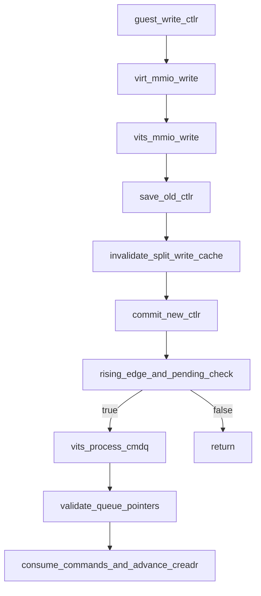

# aVisor Phase 137 详细设计：vITS 启用时排空待处理命令队列

> 平台：QEMU virt / AArch64 EL2 / GICv3 vITS
> 前置阶段：Phase 136 vITS 寄存器写缓存跨 CTLR 生命周期失效
> 本阶段目标：在 CTLR.EN 从 0 上升到 1 时，处理此前已提交但尚未消费的 CREADR..CWRITER 命令，使启用状态与队列进度一致。

## 1. 背景与问题

vITS 当前只在 enabled 状态下响应 CWRITER 写入。Guest disabled 时写入 CWRITER 会记录新 writer，但不处理命令；之后 CTLR 从 0 写为 1 只更新 enable bit，不会检查 pending queue。Guest 因此可能看到设备已 enabled，但 CREADR 仍未追上之前提交的 CWRITER，命令处理被延迟到下一次 writer 写入，甚至长期停滞。

Phase 137 在 CTLR 上升沿增加 pending queue drain。处理前仍使用 Phase 132 的 queue size、CR/CW alignment 和 range validation；若没有 pending work，则不调用处理器。重复写 CTLR=1 不会重放已消费命令。

## 2. 目标与非目标

目标：

- CTLR 上升沿提交 enable 状态后，若 CREADR != CWRITER，则调用既有 `vits_process_cmdq()`；
- disabled 时 CWRITER 更新只记录提交位置，不处理；
- enable 前 CREADR 保持不变，enable 后有效命令被消费并推进 CREADR；
- 重复写 CTLR=1 不重复执行已消费命令；
- 沿用现有 queue pointer validation 和 command failure consume-and-warn 语义。

非目标：调整 CBASER 生命周期、实现异步命令处理、增加 Guest error status，或在 CTLR disable 时回滚已处理命令。

## 3. 架构与时序

```mermaid
sequenceDiagram
    participant G as Guest
    participant M as vITS MMIO handler
    participant Q as vits_process_cmdq
    G->>M: CTLR=0
    M->>M: invalidate pending split writes; set disabled
    G->>M: write valid SYNC slot and CWRITER
    M->>M: record CWRITER; do not process while disabled
    G->>M: CTLR=1
    M->>M: detect disabled-to-enabled transition
    M->>Q: process if CREADR != CWRITER
    Q-->>M: consume command; update CREADR
    M-->>G: CREADR reflects completed queue range
```

## 4. 詳細設計

### 4.1 CTLR transition

`VITS_CTLR` handler 先保存舊 CTLR.EN，再按 Phase 136 清除所有 64-bit register pending-low valid flags，接著提交新 CTLR.EN。僅當舊值為 0、新值為 1 且 `creadr != cwriter` 時呼叫 `vits_process_cmdq()`。

此時 CTLR 已為 enabled，且命令處理函數重用同一套隊列容量、CR/CW 邊界驗證和 wrap-around 消費邏輯。invalid queue state 會被告警並保持 CREADR 原值。

### 4.2 Disabled CWRITER

CWRITER handler 保持既有行為：無論 CTLR 狀態都記錄 masked offset；僅 enabled 時立即呼叫 processor。disabled 狀態由此形成 pending range，待 enable edge 消費。

### 4.3 重複使能寫

當 old EN=1 且新 EN=1，transition predicate 為 false，因此不因 CTLR 重複寫入而觸發 drain。若先前命令已成功消費，`creadr == cwriter`；若前次 queue validation 失敗，重複寫 1 不自動反覆掃描，Guest 可修正寄存器狀態後提交新的 CWRITER。

## 5. 状态机

```mermaid
stateDiagram-v2
    [*] --> Disabled
    Disabled --> Disabled: CWRITER update; record pending writer only
    Disabled --> Enabled: CTLR.EN rising edge; drain pending queue
    Enabled --> Enabled: CWRITER update; process immediately
    Enabled --> Enabled: CTLR.EN remains 1; no transition drain
    Enabled --> Disabled: CTLR.EN cleared; preserve current queue pointers
```



## 6. 函数调用图



## 7. Guest 回归设计

在 vITS 初始化后，测试执行：

1. 写 CTLR=0；
2. 将命令队列首槽写成合法 SYNC 命令并执行 `dsb sy`；
3. 写 CWRITER=0x20，断言 CREADR 仍为 0；
4. 写 CTLR=1，断言 CREADR 变为 0x20；
5. 输出 `pending queue consumed on CTLR enable`；
6. 非法 CWRITER 写入后断言 CREADR 仍为 `0x20`，并将 CWRITER 恢复到该已消费位置；
7. 继续执行寄存器缓存、CBASER、MAPTI 与中断回归。

以 SYNC 作为队列项可以检验真实的命令读取和消费，又不会申请资源或改变设备映射。

## 8. 错误处理与不变量

| 状态/事件 | 行为 |
|---|---|
| disabled 写 CWRITER | 记录 writer，不读 Guest command memory，不推进 CREADR |
| disabled -> enabled 且 CR != CW | 调用 queue processor 并执行既有输入验证 |
| enabled -> enabled | 不触发 transition drain |
| enable 时 queue pointer 非法 | 告警，processor 保留 CREADR |
| 有效队列中的单命令失败 | 依 Phase 131 语义告警并消费该项 |
| 已消费 queue 后再次写 CTLR=1 | CR==CW，不重放命令 |

```text
Disabled state never consumes Guest command slots.
A rising enable edge drains the currently submitted queue range once.
Queue processing still validates CR/CW before any command read.
Repeated EN=1 writes do not replay completed commands.
```

## 9. 验证

- `make -f Makefile.virt -j2`：构建 hypervisor 与 Guest regression；
- `git diff --check`：检查格式；
- IDE diagnostics：检查 vITS 和 Guest 修改；
- QEMU：日志确认 disabled 阶段 CREADR 不动、CTLR enable 后 CREADR 追上；非法 CWRITER 不改变当前 CREADR；edu MSI、两个 MAPTI 和 vITS 收中断测试通过；
- QEMU 后段另报告 `edu function reset FAILED`，出现在上述 vITS 用例之后；本阶段不据此宣称完整 suite 全绿；
- QEMU 由 35 秒受控 timeout 结束，只报告实际观察到的日志，不将其描述为 suite 自然结束。

## 10. 限制

- 该实现为同步处理，CTLR MMIO 写可能承担整个 pending queue 的处理时间。
- vITS 没有 Guest 可读 command error status；非法 pending queue 会保留 CREADR 并依赖 hypervisor warning 诊断。
- CWRITER 仅记录 OFFSET 字段，producer 与 queue full detection 语义沿用既有简化模型，不扩展为完整 ITS 环形队列协议。

## 11. 文件映射

| 文件 | 职责 |
|---|---|
| `hypervisor/boards/virt/vits.c` | CTLR 上升沿检测与 pending queue drain |
| `guests/el1_test/main.c` | disabled submit / enabled drain 的 SYNC 回归 |
| 本文件 | Phase 137 架构、调用流程、状态模型、测试和限制 |

## 12. 总结

Phase 137 使 CTLR.EN 成为命令队列运行状态的实际边界：disabled 期间只记录 Guest 已提交的位置，enabled 上升沿及时消费 pending range，避免 enabled 状态下队列仍滞留旧命令。
