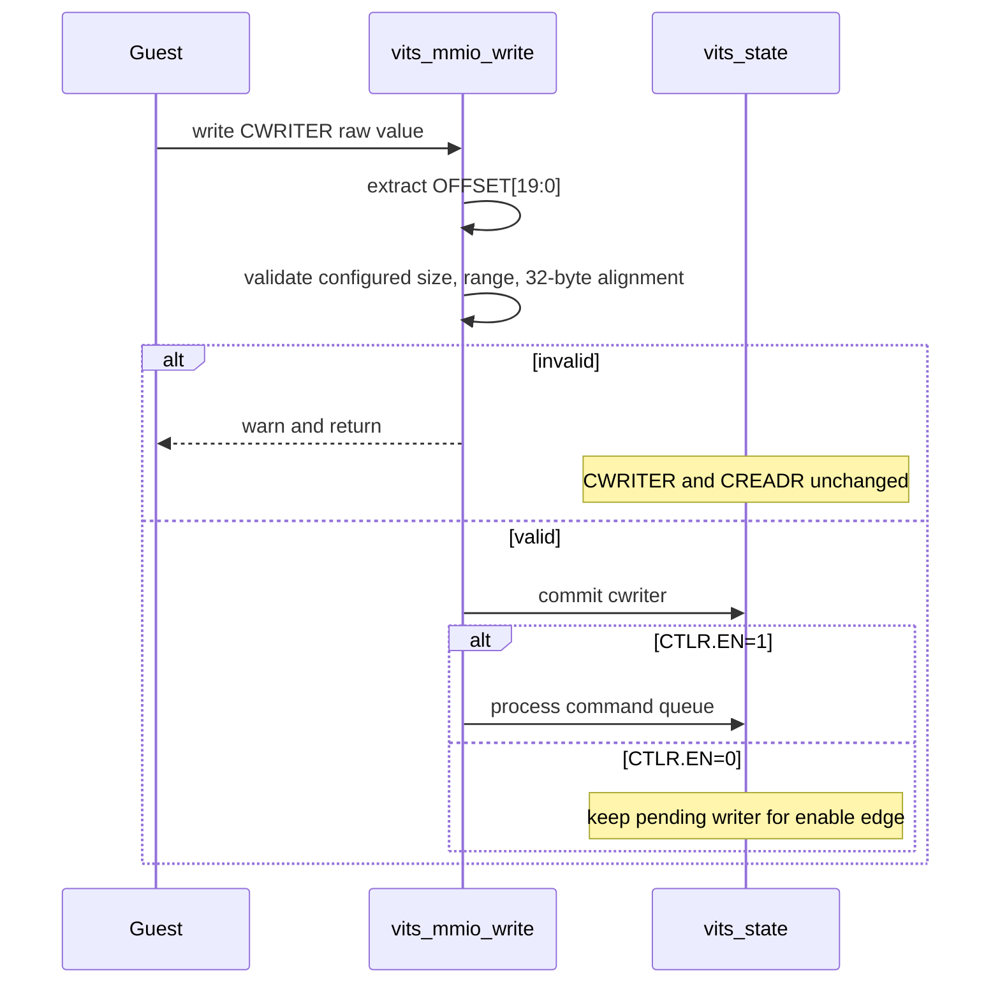
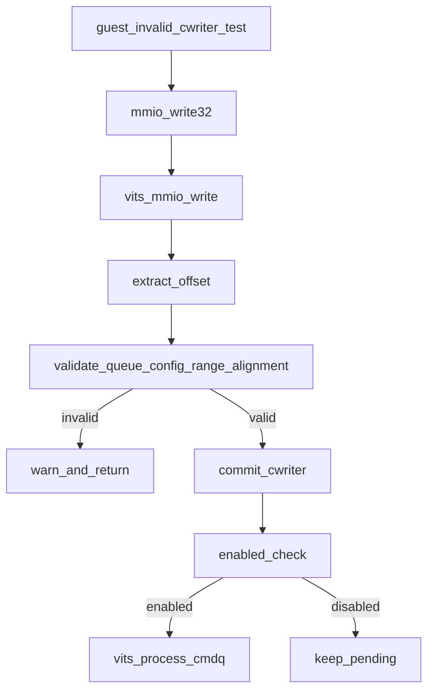

# aVisor Phase 138 详细设计：拒绝非法 CWRITER 并保持队列状态

> 平台：QEMU virt / AArch64 EL2 / GICv3 vITS
> 前置阶段：Phase 137 CTLR enable 上升沿排空 pending command queue
> 本阶段目标：在提交 Guest 的 CWRITER 前校验队列范围和命令对齐；拒绝非法值且不改变任何队列状态。

## 1. 背景与问题

当前 vITS CWRITER handler 先将 Guest 值按寄存器字段 mask 后写入 `vits->cwriter`，再调用 `vits_process_cmdq()`。processor 虽会验证 CWRITER 的范围和 32 字节对齐并拒绝处理，但内部 writer 已经被非法值覆盖，读回 CWRITER 会暴露无效状态。Guest 必须再写入旧值才能恢复，disabled 状态也可能暂存非法 writer，待 CTLR enable 后才发现错误。

Phase 138 将校验移至状态提交边界：候选 offset 必须小于已配置 queue size 且按 `VITS_CMD_SIZE` 对齐。无 queue、越界或未对齐都在更新 `vits->cwriter` 之前拒绝。有效值保持原先行为，disabled 时只提交位置，enabled 时同步处理。

## 2. 目标与非目标

目标：

- mask CWRITER OFFSET 字段后检查 queue 已配置、候选值在队列范围内且 32-byte 对齐；
- 校验失败时保持 CWRITER、CREADR 不变；
- 规则对 enabled 和 disabled 状态一致；
- 有效 writer 仍可在 disabled 阶段记录，并由 Phase 137 enable edge 排空；
- Guest 回归同时读取 CR/CW，证明非法写没有改变 queue state。

非目标：更改 CWRITER 位域模型、环形队列 full/empty 判定、命令解析错误策略或命令处理事务语义。

## 3. 架构与数据流



## 4. 詳細設計

### 4.1 候選值與校驗

handler 先計算 `new_cwriter = val & 0x000FFFFFULL`，只使用 ITS CWRITER OFFSET 字段参与队列位置语义。随后检查：

1. `cmdq_bytes != 0`，表示 CBASER 已建立有效 queue size；
2. `new_cwriter < cmdq_bytes`，防止 writer 指向 queue 尾部之外；
3. `new_cwriter % VITS_CMD_SIZE == 0`，确保位置落在 32-byte command slot 边界。

任一条件失败时输出包含候选 offset 和 queue size 的 warning，然后退出 case。由于此时尚未写入 `vits->cwriter`，guest-visible 状态不会被污染。

### 4.2 有效值提交

全部校验通过后才更新 `vits->cwriter`。若 CTLR.EN 为 1，调用现有 `vits_process_cmdq()`；其内部仍保留对 CR/CW 的防御式验证，避免其他状态来源或未来调用方绕过边界条件。若 disabled，则保留有效 writer，Phase 137 的 CTLR rising-edge drain 负责后续消费。

### 4.3 零值语义

当 CBASER 已配置时 offset 0 在范围内且对齐，因此允许作为合法 writer（包括环绕后的队列位置）。CBASER 未配置时，即使写 0 也拒绝并保持初始状态，避免未初始化 queue 被当作已建立队列。

## 5. 状态不变量

| 输入情况 | CWRITER | CREADR | 后续处理 |
|---|---|---|---|
| 未配置 queue 的任意写入 | 不变 | 不变 | 拒绝 |
| offset 未对齐 | 不变 | 不变 | 拒绝 |
| offset >= queue size | 不变 | 不变 | 拒绝 |
| 合法 offset，disabled | 更新为候选值 | 不变 | enable edge 时处理 |
| 合法 offset，enabled | 更新为候选值 | 处理后按现有规则推进 | 同步消费 |

```text
A rejected CWRITER write never mutates software queue pointers.
A committed CWRITER always identifies an aligned slot within configured size.
The processor retains its own CR/CW validation as defense in depth.
```

## 6. Guest 回归

在 Phase 137 enable-edge SYNC 测试完成后，CR 和 CW 均为 `0x20`。Guest 写入非法 CWRITER=1（非 32-byte 对齐），随后同时读回：

- CREADR 必须仍为 `0x20`；
- CWRITER 必须仍为 `0x20`。

旧实现会先把 CW 写成 1，随后 processor 报错，因此新断言可直接捕获状态污染。测试随后继续执行 MAPC/MAPD/MAPTI 和 MSI/vITS 中断路径，无需 Guest 写回恢复值。

## 7. 函数调用图



## 8. 错误处理与兼容行为

- 非法 CWRITER warning 不再由 queue processor 输出 `reject invalid command queue pointers`，而在 MMIO 提交点说明候选值和队列大小；
- 防御式 processor validation 仍保留，职责是验证完整 CR/CW 状态；
- CWRITER 的 OFFSET mask、同步处理方式、enable edge drain 和失败命令消费策略均不变；
- 非法写对 Guest 可读寄存器表现为 write ignored，CR/CW 保持原值。

## 9. 验证

- `make -B -f Makefile.virt -j2`：强制重建 hypervisor 和 Guest；
- `git diff --check`：检查格式；
- IDE diagnostics：检查 hypervisor 和 Guest 修改；
- QEMU：日志出现 `reject invalid CWRITER=0x1 size=4096`，Guest 未触发 queue-state failure 并继续完成两个 MAPTI、edu MSI 和 vITS interrupt path；
- QEMU 后段报告 `edu function reset FAILED`，发生在上述 vITS interrupt 用例之后；QEMU 按 35 秒受控 timeout 结束，不据此宣称整个 suite 全绿；
- Guest 源文件含跨阶段/既有修改，本阶段提交时仅选择可独立限定的 hypervisor 实现和设计文档；Guest 回归留在工作区不进入本阶段 commit。

## 10. 限制

- 现有模型将 CWRITER OFFSET 简化为 queue byte offset，未实现完整 ITS producer/consumer wrap bit 和 full queue 判定。
- 高位保留字段沿用当前 mask 忽略策略，本阶段只验证实际用于索引 command queue 的 OFFSET。
- 该变更本身不保证 Guest 给定的 GPA 可映射；命令取数时仍由 `vits_read_cmd()` 完成 GPA 翻译与失败处理。

## 11. 文件映射

| 文件 | 职责 |
|---|---|
| `hypervisor/boards/virt/vits.c` | CWRITER commit 前检查配置、范围和对齐 |
| `guests/el1_test/main.c` | 对非法写后 CR/CW 状态增加回归断言（因文件含其他阶段改动不纳入本次 commit） |
| 本文件 | Phase 138 架构、行为、错误语义和验证记录 |

## 12. 总结

Phase 138 将 CWRITER 输入校验前移至状态提交边界。非法 Guest 写入被原子拒绝，不再污染虚拟设备内部和读回状态；合法 CWRITER 的立即处理与 enable-edge pending drain 路径保持不变。
