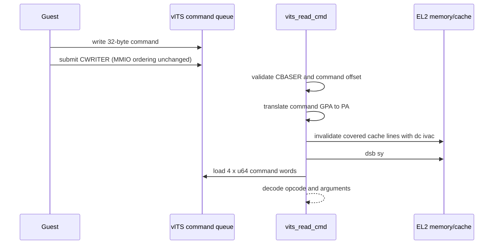
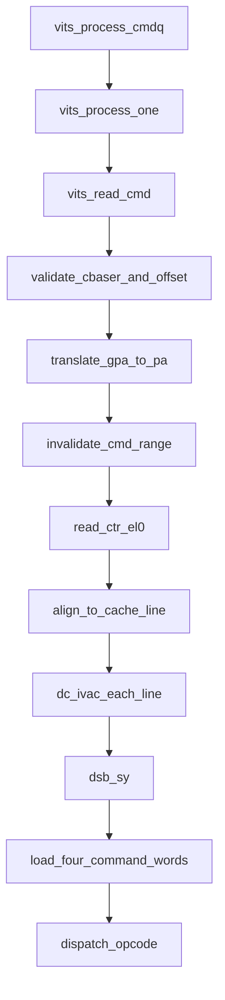

# aVisor Phase 139 详细设计：vITS 命令读取缓存一致性

> 平台：QEMU virt / AArch64 EL2 / GICv3 vITS
> 前置阶段：Phase 138 非法 CWRITER 输入拒绝与队列状态保持
> 本阶段目标：vITS 从 Guest command queue 读取命令前，按数据缓存行执行 invalidate-to-PoC，并在读取前完成屏障，避免消费 hypervisor cache 中陈旧的命令内容。

## 1. 背景

vITS command queue 位于 Guest GPA，hypervisor 通过 stage-2 translation 得到 PA 后直接读取 4 个 64-bit command words。Guest command queue 通常以 non-cacheable 属性映射，Guest 写入可到达 PoC；EL2 仍可能在先前访问同一物理 cache line 时留下陈旧缓存副本。若直接 dereference，命令解析可能看到旧 opcode 或旧参数。

virtio 的 Guest memory 读取路径已采用按 `CTR_EL0.DminLine` 计算 cache line size、逐行执行 `dc ivac`、最后 `dsb sy` 的策略。Phase 139 在 vITS 命令读取路径建立专用、局部 helper，避免依赖 virtio 私有 static 函数，并确保 invalidate 覆盖完整 32-byte command。

## 2. 目标与非目标

目标：

- 在读取 command words 前对对应物理 VA range 执行 invalidate-to-PoC；
- 按 `CTR_EL0.DminLine` 计算真实 cache line size 并对齐起始地址；
- 对 range 覆盖的每条 cache line 执行 `dc ivac`；
- 在普通内存读取前执行 `dsb sy`；
- 保留现有 GPA 翻译失败、queue offset 校验和命令处理语义。

非目标：更改 Guest/EL2 stage-2 memory attributes、清理写路径、实现 cacheable Guest DMA coherency protocol，或修改 command queue producer ordering。

## 3. 处理架构

## 4. 詳細設計

### 4.1 Cache line helper

`vits_invalidate_cmd_range(start, len)` 私有于 `vits.c`：

1. 读取 `CTR_EL0`；
2. 通过 `DminLine` 字段计算 line size：`4UL << ((ctr >> 16) & 0xf)`；
3. 将 start 向下对齐到 line boundary；
4. 从 aligned start 逐 line 执行 `dc ivac`，覆盖 `[start, start + len)`；
5. 执行 `dsb sy`，保证维护操作完成后再 load command words。

invalidate 操作使用 PA 的 identity-mapped EL2 VA，与 `ipa_to_pa()` 返回值使用方式一致。命令 slot 32 字节对齐且长度为 32 字节；line size 大于 slot 时，helper 会安全地失效覆盖 slot 的整条 cache line。

### 4.2 为何使用 IVAC

Guest 页面由 Stage-2 映射为 non-cacheable，Guest 写可直接到达 PoC；EL2 cache 可能含旧数据。`dc ivac` 丢弃旧副本并让后续读取从内存层级重新获取。

不能使用 `dc civac`：clean-invalidate 会先 clean，可能把 EL2 持有的陈旧数据写回 PoC，覆盖 Guest 刚写入的命令。当前设计基于 Guest queue 写已到达 PoC 的属性假设；不将此 helper 泛化到 Guest cacheable DMA buffer。

### 4.3 命令读取次序

`vits_read_cmd()` 保持顺序：

1. 校验 CBASER valid、offset range/alignment；
2. 翻译 command GPA 到 PA，映射失败则返回；
3. invalidate 32-byte command range 并完成 DSB；
4. 读取四个 words 并交给既有 opcode dispatch。

因此非法 offset 或未映射 GPA 不触发 cache maintenance；cache maintenance 完成前不发生 command load。

## 5. 函数调用图

## 6. 不变量与错误语义

| 条件 | 处理 |
|---|---|
| CBASER 无效或 offset 非法 | warning 并返回，不访问命令槽 |
| GPA 无 stage-2 映射 | warning 并返回，不执行 cache invalidate/load |
| range 有效且翻译成功 | 完成覆盖 cache lines 的 IVAC 与 DSB 后读取 |
| 命令解析/执行失败 | 保持现有 command failure 与 CREADR advancement 语义 |
| hypervisor 写 Guest memory | 不由本 helper 处理，写路径继续使用其各自 cache-clean 逻辑 |

## 7. 验证

- `make -B -f Makefile.virt -j2`：强制构建 hypervisor 和 Guest；
- IDE diagnostics：检查 `vits.c`；
- `git diff --check`：验证格式；
- QEMU：确认 CTLR pending queue drain、非法 CWRITER 拒绝、两个 MAPTI、edu MSI 与 vITS 收中断路径正常；
- QEMU 后段出现 `edu function reset FAILED`，发生在 vITS 收中断测试之后；运行由 35 秒受控 timeout 结束，不据此宣称完整 suite 全绿；
- 常规 QEMU 回归只能证明正常队列路径无回归，不构成硬件 stale-cache 故障注入证明。

## 8. 限制与风险

- 设计依赖 Guest command queue 的 Stage-2 memory type 和写入可见性满足 non-cacheable/PoC 假设；若将来支持 cacheable Guest command queue，需要明确 Guest clean-to-PoC 与 ITS command submission ordering。
- cache invalidate 可能作用于包含 command slot 的整条 cache line；这是 cache maintenance 的粒度要求。
- 本阶段只保证 vITS CPU 读取 Guest 命令前的 EL2 cache stale-copy 风险，不覆盖物理 ITS DMA 表或其他设备队列。
- 没有 stale-cache fault injection harness，因此只做代码路径与正常 QEMU 回归验证。

## 9. 文件映射

| 文件 | 职责 |
|---|---|
| `hypervisor/boards/virt/vits.c` | vITS 私有 cache-line invalidate helper，以及命令读取前维护 |
| 本文件 | Phase 139 架构、cache 语义、调用图与验证边界 |

## 10. 总结

Phase 139 在 vITS Guest command memory 的 CPU load 前建立明确的 cache coherency boundary：失效正确物理范围、等待维护完成、再读取命令。此实现复用仓库既有 IVAC/DSB 策略，但保持 helper 局部化，避免跨模块依赖 virtio 私有实现。
