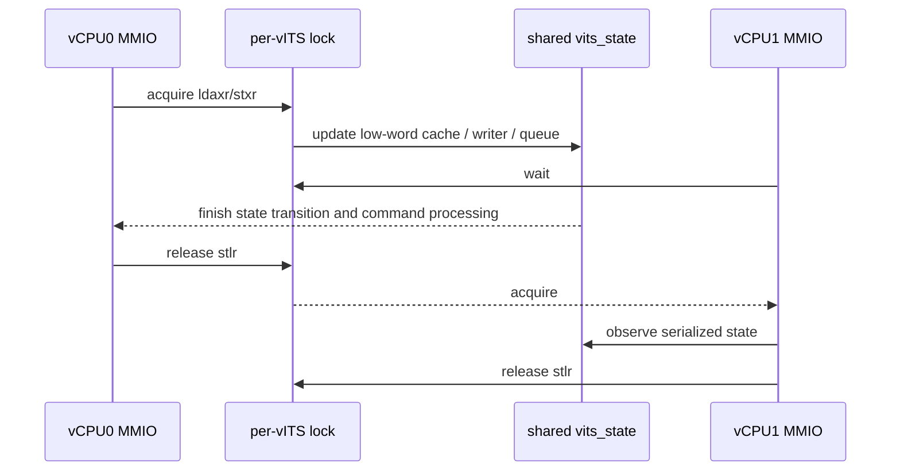
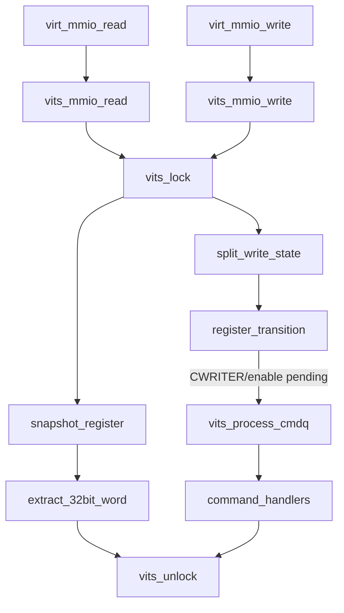

# aVisor Phase 140 详细设计：vITS 多 vCPU 寄存器访问串行化

> 平台：QEMU virt / AArch64 EL2 / GICv3 vITS
> 前置阶段：Phase 139 vITS command queue 读取前 cache invalidate
> 本阶段目标：为 per-VM `vits_state` 增加 acquire/release 自旋锁，串行化所有 vITS MMIO read/write 与其同步副作用。

## 1. 背景

同一 VM 的多个 vCPU 通过 `virt_attach_secondary()` 共享 master 的 `board_data`，因此共享同一个 `vits_state`。vITS handler 原先没有锁，而 virtio MMIO 已有设备级自旋锁。并行 vCPU 可能交错执行 64-bit register low/high word pairing、CTLR 生命周期切换、CBASER 重置、CWRITER 更新与命令队列消费，导致 pending-low state 被覆盖、同一 CREADR..CWRITER 范围重复消费，或寄存器读到非一致状态。

## 2. 目标与非目标

目标：

- `vits_state` 增加 per-instance lock，初始化依赖现有 `memzero()`；
- MMIO read 在读取和拆分返回 32-bit word 前持锁；
- MMIO write 从访问 split-write cache 前持锁，覆盖完整寄存器 transition 和同步 command queue processing；
- 所有 early return 路径均释放锁；
- 使用 AArch64 `ldaxr/stxr` acquire 和 `stlr` release，与现有 virtio device lock 模式一致。

非目标：锁定全局 LPI map/allocator、改变 command queue 语义、改造 irq-domain/PCI 锁、提供公平性保证或为所有 vITS 命令加入并行处理。

## 3. 架构与锁范围



## 4. 詳細設計

### 4.1 锁实现

`vits_lock()` 使用独占 load/store loop：

- `ldaxr` 读取 lock 并提供 acquire ordering；
- lock 非零时继续等待；
- `stxr` 尝试置 1，失败则重试；
- `vits_unlock()` 使用 `stlr wzr` release lock。

锁字段位于 per-VM `vits_state`，由 `vits_init_vm()` 整体清零初始化。主、次 vCPU 共享该状态，因此共享同一把锁。

### 4.2 MMIO 写临界区

`vits_mmio_write()` 在读取或修改 `write_lo_cache[]` / `write_lo_valid[]` 前获取锁。临界区包含：

- low-word cache 设置与 valid 标记；
- orphan high-word 检查及配对消费；
- CTLR transition 与 pending queue drain；
- CBASER 和 CWRITER 状态更新；
- enabled 状态下同步调用 `vits_process_cmdq()`；
- BASER 和其他寄存器状态更新。

low-word-only 和 orphan-high-word 路径在返回前显式 unlock；常规 switch 通过单一尾部 unlock 释放。命令处理可能等待物理 ITS MAPTI completion，因此会延长锁持有时间，但这是保证单一 reader/writer 状态机不被并发重入所需的同步范围。

### 4.3 MMIO 读临界区

`vits_mmio_read()` 在读取寄存器 snapshot 前获取同一把锁。32-bit high/low word extraction 在持锁期间完成；unknown offset 改为设置返回值 0 后走统一 unlock path，避免错误路径泄漏锁。

## 5. 调用图



## 6. 不变量与错误语义

| 访问路径 | 锁行为 | 保证 |
|---|---|---|
| 任意有效 MMIO read | snapshot 前 acquire，return 前 release | 返回值对应一个串行化观察点 |
| low-word write | 更新 cache/valid 后 release | 配对状态原子提交 |
| orphan high write | warning 后 release | 失败路径不泄漏锁 |
| 完整寄存器 write | 整个 transition 持锁 | 不与其他 vCPU MMIO 交错 |
| CWRITER/enable drain | command processing 完成后 release | 同一队列 reader 不会并发重入 |
| unknown read offset | 返回 0 前 release | 异常寄存器访问不造成永久阻塞 |

```text
Only one vCPU at a time mutates or snapshots a given vITS instance.
Low/high register pairing cannot be interleaved across vCPUs.
Command queue processing is serialized with CWRITER and CTLR transitions.
Every return from MMIO read/write releases the vITS lock.
```

## 7. 锁顺序与边界

vITS lock 内可调用 `vits_process_cmdq()`，其中 MAPTI 会进入既有 irq-domain 和物理 ITS command sender。当前路径未发现这些调用回调进入同一 vITS MMIO handler，因此没有同锁递归。锁只保护 per-VM vITS state；LPI 全局映射、PCI ownership 和 irq-domain 仍由各自既有同步策略负责。

## 8. 验证

- `make -B -f Makefile.virt -j2`：通过；Guest 编译存在既有 warnings；
- IDE diagnostics：`vits.c` 与 `vits.h` 无诊断；
- `git diff --check`：通过；
- QEMU：CTLR pending queue drain、非法 CWRITER、两个 MAPTI、edu MSI 与 vITS 收中断路径通过；后段出现 `edu function reset FAILED`，QEMU 按 35 秒 timeout 结束，不据此宣称整套 suite 全绿；
- 当前回归未提供并发争用注入，因此常规 QEMU 只确认加锁未破坏串行正常路径，不视为 SMP race stress test。

## 9. 限制

- 自旋锁不提供公平性；临界区若执行较慢的同步物理 ITS command wait，其他 vCPU 的 vITS MMIO 将等待。
- 持锁范围覆盖所有同步 command processing，刻意优先保证 queue pointer 和 side effects 一致性；未来若改异步处理，应重新定义队列状态提交协议。
- 不同 vITS 实例之间不共享该锁；全局 LPI allocator/map 的并发安全不属于本阶段范围。

## 10. 文件映射

| 文件 | 职责 |
|---|---|
| `include/boards/virt/vits.h` | per-vITS lock 字段 |
| `hypervisor/boards/virt/vits.c` | acquire/release helper 与 read/write 临界区 |
| 本文件 | Phase 140 架构、调用图、锁范围及验证记录 |

## 11. 总结

Phase 140 将 vITS 从无同步的共享 per-VM MMIO 状态改为单实例串行状态机。read snapshot、split-register pairing、queue pointer transitions 及同步命令消费由同一把 acquire/release 自旋锁保护，避免同一 VM 多 vCPU 同时访问时状态交叉更新。
