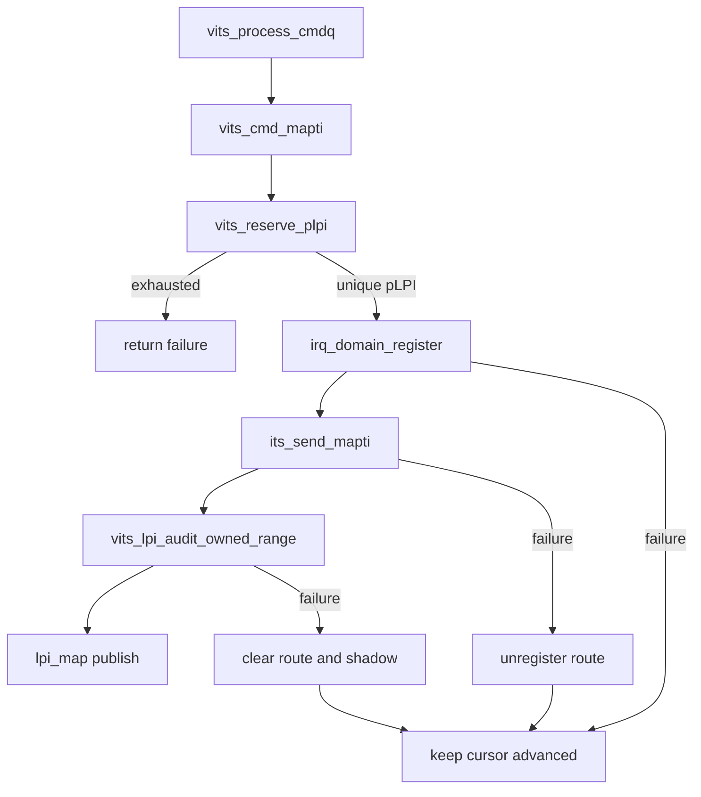

# aVisor Phase 141 详细设计：vITS 物理 LPI 分配器原子 reservation

> 平台：QEMU virt / AArch64 EL2 / GICv3 ITS + vITS
> 前置阶段：Phase 140 per-vITS MMIO 状态串行化
> 本阶段目标：以原子单调 reservation 保护跨 vITS 实例共享的物理 LPI allocator，避免多个 VM/ITS command context 获得相同 pLPI。

## 1. 背景

Phase 140 的锁属于每个 `vits_state`，可串行化同一 VM 的 MMIO 和 MAPTI，但全局 `next_alloc_plpi` 仍由所有 vITS 实例共享。多个不同 VM 的 MAPTI 可并发执行，原先的 `next_alloc_plpi++` 不是跨实例原子操作；并发读取相同 cursor 可能选出同一个 pLPI，造成 irq-domain owner 冲突、shadow mapping 覆盖或错误 rollback。

本阶段将递增操作改为 AArch64 `ldaxr/stxr` 原子 reservation。reservation 成功即唯一占用一个单调 cursor slot。MAPTI 后续任一步失败时仍回滚软件 route/shadow mapping，但不回退全局 cursor，避免并发事务已经推进 cursor 时将其回退并导致重复分配。

## 2. 目标与非目标

目标：

- 对全局 `next_alloc_plpi` 实现原子 reservation；
- reservation 检查上界并在耗尽时返回失败；
- 每次成功 reservation 返回互不重复的 pLPI；
- 移除 MAPTI 失败路径对共享 cursor 的非原子 decrement；
- 不在整个物理 ITS completion wait 期间持有全局 allocator lock。

非目标：实现可回收 free-list、改变固定 edu event 0 LPI、改造 irq-domain 或 physical ITS command queue。

## 3. 架构与 reservation 时序

```mermaid
sequenceDiagram
    participant A as MAPTI context A
    participant B as MAPTI context B
    participant C as global next_alloc_plpi
    A->>C: ldaxr read 9000
    B->>C: ldaxr read 9000
    A->>C: stxr 9001 succeeds; reserve 9000
    B->>C: stxr fails; retry
    B->>C: ldaxr read 9001
    B->>C: stxr 9002 succeeds; reserve 9001
    A->>A: route registration + physical MAPTI
    B->>B: route registration + physical MAPTI
```

## 4. 详细设计

### 4.1 原子 helper

`vits_reserve_plpi(unsigned int *plpi)`：

1. `ldaxr` 读取当前全局 cursor；
2. 若达到 `LPI_MAP_BASE + LPI_MAP_MAX`，执行 `clrex` 并返回 exhaustion；
3. 计算 `next = current + 1`；
4. `stxr` 尝试写入 next；
5. store-exclusive 失败则重试；成功则向 caller 返回旧 current。

同一共享地址上的 exclusive sequence 保证并发 reservation 原子性。`ldaxr` 提供 acquire ordering；成功的 store-exclusive 是唯一 cursor 提交点。

### 4.2 单调失败语义

旧实现会在 route registration、physical MAPTI 或 mapping audit 失败时执行 `next_alloc_plpi--`。这仅在全局完全串行时成立：如果 context A reserve 9000，context B reserve 9001，随后 A decrement，全局 cursor 会从 9002 回到 9001，下一次分配可能重复获得 B 正在使用的 9001。

新实现中 reservation 不回退：

- route registration 失败：返回失败，reservation 形成 hole；
- physical MAPTI 失败：注销 software route，reservation 形成 hole；
- audit 失败：清除 route/shadow，reservation 形成 hole；
- 成功：发布 `lpi_map`，reservation 成为 active mapping。

这是 fail-safe 策略：宁可有限消耗 pLPI，也不重复分配可能已被并发事务或硬件引用的编号。

## 5. 调用图



## 6. 并发不变量

| 不变量 | 保证方式 |
|---|---|
| 两个成功 reservation 不返回同一 pLPI | `ldaxr/stxr` 唯一成功提交 |
| cursor 不超过 allocator 上界 | exclusive store 前检查 current |
| exhaustion 不遗留 exclusive monitor | `clrex` |
| 后置失败不影响其他 transaction 的 cursor | 禁止 decrement |
| 已失败 route 不宣称 active | 既有 unregister/clear rollback 保留 |
| 不长时间阻塞 allocator | 只在 cursor 更新时重试，不覆盖 ITS completion wait |

## 7. 锁顺序与 Phase 140 关系

调用者通常已持有 per-vITS lock；reservation 不获取另一把长期锁，只执行短 exclusive loop。成功后再进入 irq-domain 自身锁和 physical ITS sender。由此避免形成“全局 allocator lock 持有期间等待物理 ITS”的长临界区，也避免 allocator 与 per-vITS lock 的双向锁顺序。

不同 vITS 实例可并行推进 MAPTI，但其 pLPI reservation 唯一。固定 event 0 复用 PCI MSI LPI 的路径不经过 allocator，保持原语义。

## 8. 验证计划与结果记录

- `make -B -f Makefile.virt -j2`：通过；Guest build 输出既有 warnings；
- IDE diagnostics：`vits.c` 无诊断；
- `git diff --check`：通过；
- QEMU：event 1/2 分别获得 pLPI 9000/9001，edu MSI 和 vITS 收中断通过；后段出现 `edu function reset FAILED`，运行按 35 秒 timeout 结束；
- 当前 Guest 回归没有同时从两个独立 vITS 实例发起 MAPTI 的 contention harness，因此 QEMU 正常路径不能替代并发 reservation 压力测试。

## 9. 限制与后续方向

- allocator 为单调 cursor，失败 reservation 和已撤销 mapping 不会回收；容量耗尽后新 MAPTI 失败。
- 本阶段解决 pLPI 编号唯一性，不将 `lpi_map` 变为完整的并发事务表；中断注入主要以已加锁的 irq-domain route 为 authoritative ownership source。
- 若未来需要动态回收，应引入有状态 free-list/bitmap，并在确认物理 ITS 不再引用该 LPI 后原子释放，不能恢复简单 decrement。

## 10. 文件映射

| 文件 | 职责 |
|---|---|
| `hypervisor/boards/virt/vits.c` | 原子 reservation helper、MAPTI allocation 与单调 rollback 语义 |
| 本文件 | 架构、并发时序、不变量、失败语义及验证边界 |

## 11. 总结

Phase 141 将跨 vITS 共享的物理 LPI 分配从非原子递增升级为原子单调 reservation。并发 MAPTI 不再可能从 allocator 获得同一 pLPI，且失败事务不会回退并覆盖其他 context 已提交的 cursor；以少量可能的 reservation hole 换取明确的全局唯一性和 fail-safe rollback。
