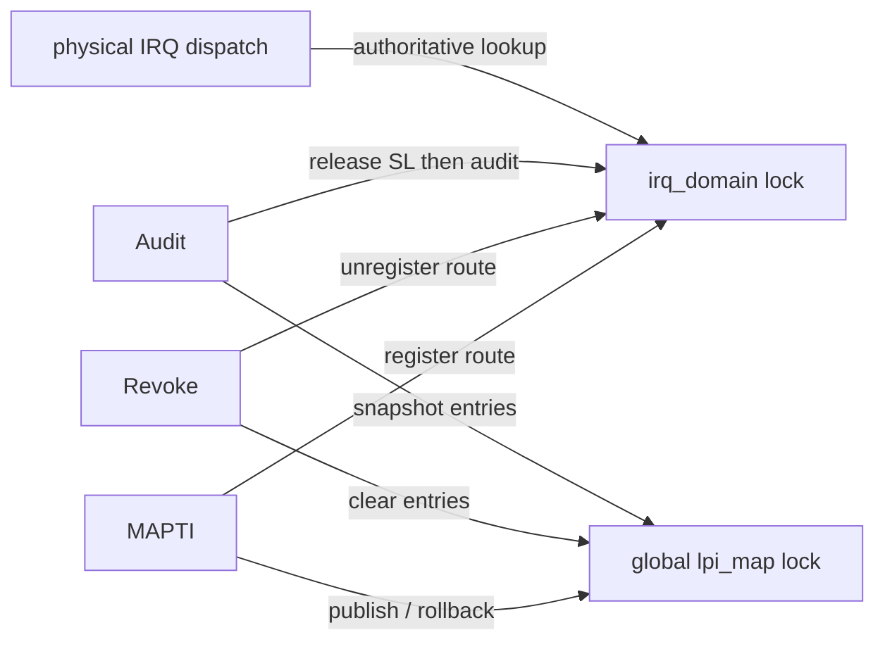
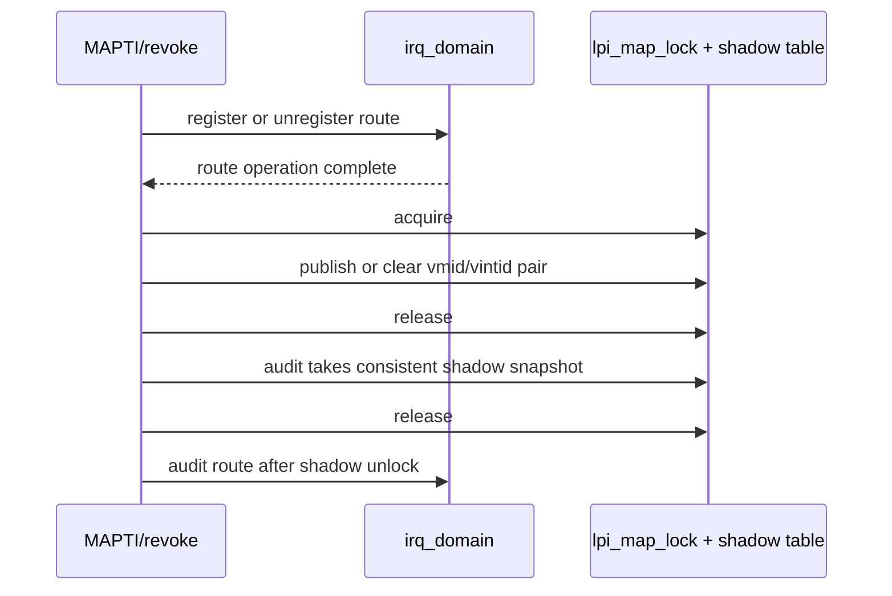

# aVisor Phase 142 详细设计：vITS 全局 LPI 影子映射同步

> 平台：QEMU virt / AArch64 EL2 / GICv3 ITS + vITS
> 前置阶段：Phase 141 全局 pLPI 原子 reservation
> 本阶段目标：以独立短临界区保护全局 `lpi_map` shadow table 的发布、撤销和审计读取。

## 1. 背景

`lpi_map[]` 是所有 vITS 实例共享的审计 shadow map。Phase 140 的 per-vITS lock 不能保护跨实例共享表；Phase 141 只保证 allocator 返回不同 pLPI，也不保护 mapping 内容本身。MAPTI 对 `vmid/vintid` 的两次写、撤销清除和 owned-range audit 读取可能来自不同 vCPU 或不同 VM context。缺少同步时，audit 可能读取到更新一半的条目，或与撤销并发读取不一致。

物理中断分发以 `irq_domain` route 为 authoritative source；本阶段不改变其语义，也不把 `lpi_map` 作为注入路径的唯一依据。

## 2. 目标与非目标

目标：

- 为全局 `lpi_map[]` 增加独立 acquire/release lock；
- 所有条目写入、清除、读取均通过同一锁；
- audit 检查 shadow snapshot 时持锁，退出 shadow lock 后再查询 irq-domain；
- 先完成 irq-domain register/unregister，再操作 shadow lock，避免持有 shadow lock 调用 irq-domain；
- global init 显式初始化 shadow lock。

非目标：修改 allocator 生命周期、扩大到物理 ITS reset/collection、改变 `irq_domain` route authoritative 行为、引入新的锁嵌套或动态回收。

## 3. 架构

锁规则：shadow lock 和 irq-domain lock 从不嵌套。MAPTI/revoke 先调用 irq-domain，再进入 shadow lock；audit 先获取并释放 shadow lock，再调用 irq-domain。这样不存在反向锁序。

## 4. 详细设计

### 4.1 锁实现

`lpi_map_acquire()` 采用 `ldaxr/stxr` 自旋循环获取全局 `lpi_map_lock`；`lpi_map_release()` 用 `stlr wzr` 发布释放。锁初始化在 `vits_global_init()`，早于 vITS 命令处理。临界区只做固定数量的普通内存读写，不包含物理 ITS completion wait、irq-domain API 或日志等待。

### 4.2 MAPTI 发布与回滚

MAPTI 路径先注册 irq-domain route；物理 MAPTI 完成后获取 shadow lock，一次临界区内写入 `vmid` 和 `vintid`，随后释放锁。之后调用 audit：其 shadow 检查使用独立临界区，锁释放后再检查 irq-domain。

如果物理命令或前置 route 注册失败，则 shadow 未发布。如果 post-publish audit 失败，则先 unregister route，再获取 shadow lock 清除条目。固定 edu event 0 映射也使用同一 shadow lock 保护发布和 audit rollback。

### 4.3 撤销与范围撤销

`vits_lpi_revoke_owned()` 先通过 `irq_domain_unregister_owned()` 撤销 authoritative route；成功后才加 shadow lock 并清零两个字段。range revoke 由 `irq_domain_unregister_owned_range()` 先原子验证和撤销整段 route，成功后在一个 shadow 临界区内清零整段表项。失败时不改变 shadow。

### 4.4 审计读取

`vits_lpi_audit_owned_range()` 在参数边界检查之后获取 shadow lock，检查每个 entry 的 vmid/vintid，记录 `shadow_valid` 后统一释放锁。若 shadow 不匹配则返回失败；匹配时在锁外调用 `irq_domain_audit_owned_range()`。因此 shadow snapshot 不会被撕裂，且不会形成 shadow -> irq-domain 的嵌套锁序。

## 5. 调用图

## 6. 并发不变量

| 不变量 | 保证方式 |
|---|---|
| 不读取半更新的 vmid/vintid pair | 同一 shadow lock 包围整对字段 |
| revoke range 不会暴露部分清除的本地 shadow range | 整段 clear 在一个临界区内 |
| audit 不与 shadow update data race | audit snapshot 和所有写入共用同一锁 |
| 不发生 shadow/irq-domain 锁反序 | 两类锁调用不嵌套 |
| 注入路由语义不变 | irq-domain 仍是 authoritative lookup |
| 临界区无慢速物理 ITS 操作 | 仅保护 shadow RAM 读写 |

## 7. 错误处理

- irq-domain register/unregister 失败：不修改 shadow；
- shadow audit 不匹配：返回失败，调用方按既有逻辑撤销 route 并清 shadow；
- range revoke 失败：shadow 不变；
- `lpi_map_acquire()` 为自旋锁，无中途返回路径；持锁区保持有限且不调用外部子系统。

## 8. 验证

- `make -B -f Makefile.virt -j2`：通过；Guest 编译包含既有 warnings；
- IDE diagnostics：`vits.c` 无诊断；
- `git diff --check`：通过；
- QEMU：MAPTI event 1/2 分别得到 pLPI 9000/9001，edu MSI 和 vITS 收中断通过；后段出现 `edu function reset FAILED`，并按 35 秒 timeout 结束；
- 不存在专门的 revoke-vs-audit 并发压力测试，本阶段验证不能视为该竞态的 stress coverage。

## 9. 限制

- shadow lock 仅保护 `lpi_map[]`，不保护 irq-domain 内部状态；后者继续使用其自身锁。
- 分离的 shadow 与 route 操作之间仍存在短暂的逻辑窗口，但 route 是权威状态，所有事务失败路径仍执行现有 rollback；本阶段目标是避免 shadow data race，不提供跨两个子系统的多对象原子事务。
- allocator reservation 不回收，撤销映射不会让 pLPI 重新进入 allocator。

## 10. 文件映射

| 文件 | 职责 |
|---|---|
| `hypervisor/boards/virt/vits.c` | shadow lock、publish/clear/audit 同步及锁序 |
| 本文件 | 架构、锁顺序、调用图、不变量和验证边界 |

## 11. 总结

Phase 142 为共享全局 LPI shadow table 建立独立短临界区，覆盖 mapping 发布、回滚、单项/范围撤销和审计读取。锁与 irq-domain 操作保持不嵌套，物理 IRQ 路由仍由 irq-domain 决定，从而以最小同步范围消除 shadow table 并发读写的数据竞争。
